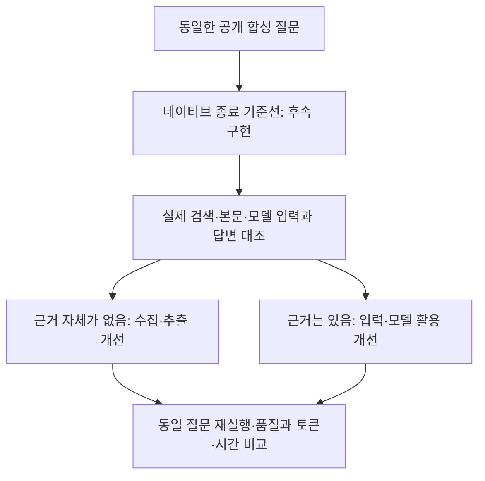

# 055: finish 도입을 폐기하고 정보 부족과 활용 실패를 나눠 개선한다

2026-10-19 · 기준4f680ca. 종료 도구를 추가하지 않기로 결정했다. 이번 작업은 결정과 후속 실험 설계이며 런타임 변경·새 모델 실행은 없다.

## 문제와 결정

사용자는 finish 도입을 폐기하고 다음 개선 방향을 물었다. 이유는 불필요한 토큰 소모, 모델이 추가 계약을 따르지 않을 가능성, 의도한 설계와 실제 동작의 불일치다. finish 도구는 아직 구현하지 않았으므로 삭제할 도구는 없다.

실제로 관찰한 것은053의 final 태그 방식에서 진행 설명 재요청5회가 발생한 것이다. finish 방식의 추가 토큰이나 실패율을 직접 측정한 것은 아니다. 이 위험을 더 실험하기보다 도입 후보에서 제외한다는 결정이다. 054의 네이티브·태그·최종 도구 3방식 비교 제안 중 최종 도구 비교도 취소한다.

현재 실행은 여전히 explicit final 태그를 사용한다. finish 도입 취소와 기존 태그 제거를 같은 완료 항목으로 표현하지 않는다. 다음 구현의 첫 단계는 추가 종료 계약을 제거한 네이티브 기준선 구성이다. legacy 옵션에는 기존 근거 검토·인용 보정 재요청도 있으므로 옵션 이름만 바꾸면 순수 네이티브 비교가 된다고 가정하지 않는다.

## 다음에 풀 문제

좋은 답변은 필요한 근거를 확보하고, 그 근거가 가리키는 대상·조건을 지키며, 남은 불확실성을 명확히 전달해야 한다. 툴콜 횟수나 종료 형식만으로 이를 판단하지 않는다.

| 관찰할 실패 | 확인할 실제 자료 | 후속 개선 후보 |
| --- | --- | --- |
| 검색 결과에 필요한 정보가 없음 | 실제 질의·검색 요약·본문 발췌 | 검색어·후보 선택·본문 접근·추출 개선 |
| 필요한 정보가 있는데 답변이 누락·왜곡됨 | 모델 입력 예정/실제 전달 내용과 답변 대조 | 근거 표현·도구 설명·프롬프트 단순화 실험 |
| 조사 가능한데 종료함 | 확보한 근거·남은 조건·도구 요청 순서 | 행동 지침과 모델 설정을 한 변수씩 비교 |
| 조회 자체가 불가능함 | 도구 오류·예약 조건·확인 불가 범위 | 실패와 정보 부족을 정확히 전달하는지 평가 |

실패 구분은 연구자가 기록을 읽어 판단한다. 하네스가 자연어의 충분함을 자동 판정하는 기능을 새로 넣는 제안이 아니다.

## 우선순위

1. 네이티브 종료 기준선을 먼저 만든다. 추가 툴콜이 없으면 일반 답변으로 종료하고 시간·도구·모델 호출 상한은 유지한다. 이것은 다음 구현 제안이며 이번에 배포하지 않았다.
2. 공개 합성 질문 소수를 고정하고 실제 도구 입력·반환·모델 전달·답변을 연결해 검토한다. 사적 여행 기록은 공개하지 않는다.
3. 근거가 없으면 도구를 개선하고, 근거가 있는데 활용하지 못하면 입력 구성과 모델 동작을 개선한다. 한 번에 한 요소만 바꾼다.
4. 현재 think=false·temperature0과 다른 설정의 비교는 그 다음이다. 설정 차이를 원인으로 확정하거나 모델을 교체하지 않는다.

현재 SYSTEM에는 다각도 검색·세부값 본문 확인·추정 금지·병렬 조회·오류 대응·인용 지침이 이미 있다. 유사한 지시를 더 붙이는 것보다 기존 지침과 반환 자료가 실제로 어떻게 사용되는지 확인한다. 상세 본문을 읽었다는 상태와 필요한 가격·시간을 확보했다는 상태를 구분한다.

## 실제 설정과 다음 실험 흐름

src/travel_agent/agent.py의 chat 함수에서 기준4f680ca에 확인한 요청 일부:

```python
body = {"model": model, "messages": messages, "tools": TOOLS if tools is None else tools, "stream": False, "think": False,
        "options": generation_options()}
```

현재 사고 모드가 꺼져 있음을 보여주는 코드다. 이 값을 바꾸면 개선된다고 입증한 것은 아니다.



평가 항목은 조건 충족·근거 대상 일치·근거 없는 수치·성급한 종료·중복 호출·모델 호출 및 입출력 토큰·시간이다. 비용 절감이나 품질 향상은 재실행으로 측정한 뒤 기록한다.

## 이번 결과와 한계

finish 도입과 비교 실험은 취소했다. 현재 explicit 태그 제거·도구 개선·모델 설정 변경은 미구현이다. 새 모델 질문·답변·에이전트 툴콜은 없으며 기존 소스와053·054 기록을 읽고 다음 개선 순서를 정했다. 프로그램 stdout을 새 품질 검증처럼 제시하지 않는다.

## 후속 질문: 출력 제한과 시스템 프롬프트의 역할

사용자는 명시적 종료 이전의 부실한 답변이 출력 한도 때문인지, 시스템 프롬프트를 개선해야 하는지 물었다. 기존047·051 기록과 현재 동일한 보완 분기를 다시 읽었다. 새 원본 추론이나 웹검색 도구 실행은 하지 않았다.

| 기존 사례 | 실제 관찰 | 해석 범위 |
| --- | --- | --- |
| 047 검색 예고만 하고 종료 | 출력478토큰·stop·툴콜0·도구 제공·final_turn=false | 상한1024에서 강제 잘린 증거는 없음 |
| 051 검색2회 뒤 답변만 보완 | 마지막 출력565토큰·stop·본문0·final_turn=false | 마지막 응답은 출력 한도나 도구 없는 강제 정리 때문에 종료한 것이 아님 |

출력 한도의 직접 강제 중단과 한도 변경의 전체 행동 효과는 다르다. 1024와 더 큰 값의 동일 입력 비교를 하지 않았으므로 ‘출력 제한과 아예 무관하다’고 확정하지 않는다. [Ollama 문서](https://docs.ollama.com/modelfile#valid-parameters-and-values)에서 num_predict는 최대 생성 토큰 수다. 값이 상한이라는 사실만으로 모델이 반드시 그 길이를 채우거나 더 큰 값에서 조사를 계속한다고 보장하지 않는다.

### 프롬프트에서 확인한 실제 선택지

src/travel_agent/agent.py의 run_agent, 기준b11b3ad에서 legacy 근거 보완 메시지는 다음 문장을 포함한다.

> 필요하면 앞선 출처 ID로 web_read를 호출하거나 추가 검색하세요.
>
> 확인할 수 없는 값은 추정해서 쓰지 말고 미확인으로 남기세요.
>
> 도구 사용 자체가 목적은 아니며 확인된 내용만으로도 답할 수 있습니다.

이후 인용 보완은 ‘답변을 한 번 수정하세요’, ‘새 사실을 추가하지 마세요’라고 요청한다. 미확인 표시 자체는 필요하지만 실행 가능한 추가 확인과 구분하지 않으면 미확인 목록을 붙인 답변을 완료로 선택할 여지가 있다. 실제051에서 검토 요청 뒤 새 도구 없이 답변을 고쳤다. 이 지침이 원인이라는 단독 대조 검증은 없으며 모델의 지시 준수·자료 부족 등 다른 요인도 남는다. 인용 보완은 추가 조사를 금지한 코드가 아니라 답변 수정에 초점을 둔 메시지다.

### 다음 프롬프트 후보 — 미적용

<callout icon="🧪">
	추천·조사를 요청받으면 사용자가 요구한 결과를 확보하는 데 필요한 도구 행동을 선택한다. 필요한 확인을 현재 도구로 수행할 수 있으면, ‘검색하겠다’는 예고나 사용자에게 대신 확인하라는 안내로 끝내지 말고 실제 도구를 호출한다.
	날짜·인원 등 사용자만 정할 수 있는 필수 조건이 없으면 필요한 질문을 한다. 접근 실패·반복 조회·현재 도구의 한계로 확인할 수 없으면 확보한 근거와 미확인 이유를 설명한다. 모든 항목을 확인할 때까지 무조건 반복하지 않는다.
</callout>

이는 추가 종료 태그·finish 계약이 아닌 행동 우선순위의 후보 문구다. 기존 중복 지침을 정리하면서 대체하고 도구 설명과도 맞추는 것을 제안한다. 실행하지 않은 검색을 했다고 서술하지 않는 규칙은 유지한다. 모든 요청에 검색을 강제하거나 검색어·사이트·여행 경로를 고정하지 않는다.

네이티브 종료 기준선을 먼저 만든 후 프롬프트만 바꾼 비교를 우선하고 출력 상한 비교는 별도로 한다. 필요 시 이미 저장된 동일 입력에 상한1024와2048을 적용해 호출·출력·종료 이유를 비교하되, 원격 검색 결과가 바뀌는 전체 실행과 구분한다. 이번에는 어느 후보도 실행·배포하지 않았고 품질 향상을 주장하지 않는다.
