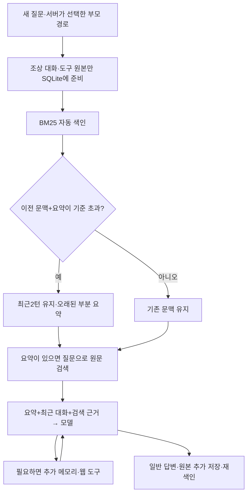

# 057: 웹 대화의 원본을 저장하고 요약 뒤에는 RAG로 다시 찾는다

2026-10-19 · 기준ab1f496 이후 이번 구현.

## 문제 정의: 대화를 이어 가지만 원문 메모리는 비어 있었다

웹은 이전 메시지를 계속 모델에 전달했지만 요청별 메모리 DB는 비어 있었다. 길어진 대화를 요약하는 경로도 없어, 메모리 RAG를 만든 이유인 ‘요약에서 빠진 과거 근거 복원’이 실제 웹 흐름에는 연결되지 않았다.

이번에는 대화·도구 원본 저장 → 자동 BM25 색인 → 오래된 문맥 요약 → 질문에 맞는 원문 검색 → 답변 입력의 흐름을 연결했다. 새 대화와 다른 분기의 원본은 섞지 않고, 요약이 실패하면 이전 문맥을 유지하는 것을 완료 기준으로 삼았다.

## 실제 사용 흐름 시험

실제 qwen3.5:4b-q4_K_M에 합성 여행 대화4턴을 보냈다. 첫 입력에는 ‘강릉을 제외한 이유는 숙소 입구의 계단87개’라는 조건과, 압축 경로를 실행하기 위한 반복 문장을 넣었다. 이어 다른 후보·날짜·예산이 미정이라는 두 질문을 보냈다. 검색 도구는 비활성화했다. 이 실험 프로세스만 압축 기준4000바이트를 사용했고 서비스 기본값은32000바이트다.

마지막 질문:

<callout icon="💬">
	처음 강릉을 제외한 구체적인 이유와 계단 수를 과거 원문 근거 ID와 함께 알려줘. 웹검색하지 마.
</callout>

**실제 답변**

강릉을 제외하신 구체적인 이유는 숙소 입구 계단이 87 개였기 때문입니다. 이는 [m-dbc7c573ab7c5267e129] 기록에 명시되어 있습니다.

마지막 실행에서 이전 문맥+요약은7512→1077 UTF-8바이트로 줄었다. 이 값은 시스템·새 질문·검색 결과를 포함한 전체 모델 요청 크기가 아니다. 실제 마지막 모델 입력은9668바이트·2633토큰이었다.

이전 원본6이벤트·16청크에서3개를 검색했고 답변의87개와 인용ID가 검색된 원문에 일치했다. 마지막 답변 모델1회와 요약 모델1회가 실행됐다. 모델이 요청한 툴콜은0회이며 자동 원문 검색을 툴콜로 세지 않았다.

**판정 범위:** 실제 요약에도87개가 남아 있었다. 따라서 이4턴 결과만으로 ‘요약에서 빠진 정보를 RAG가 복원했다’고 주장하지 않는다. 흐름의 연결과 원문 인용을 확인한 결과다.

<details>
<summary>처음3턴의 실제 입력과 답변</summary>

**질문**

이것은 공개 합성 기억 시험이야. 강릉을 제외한 이유는 숙소 입구의 계단 87개 때문이야. 일정은 미정이며 이동 수단도 아직 정하지 않았다. 일정은 미정이며 이동 수단도 아직 정하지 않았다. 일정은 미정이며 이동 수단도 아직 정하지 않았다. 일정은 미정이며 이동 수단도 아직 정하지 않았다. 일정은 미정이며 이동 수단도 아직 정하지 않았다. 일정은 미정이며 이동 수단도 아직 정하지 않았다. 일정은 미정이며 이동 수단도 아직 정하지 않았다. 일정은 미정이며 이동 수단도 아직 정하지 않았다. 일정은 미정이며 이동 수단도 아직 정하지 않았다. 일정은 미정이며 이동 수단도 아직 정하지 않았다. 일정은 미정이며 이동 수단도 아직 정하지 않았다. 일정은 미정이며 이동 수단도 아직 정하지 않았다. 일정은 미정이며 이동 수단도 아직 정하지 않았다. 일정은 미정이며 이동 수단도 아직 정하지 않았다. 일정은 미정이며 이동 수단도 아직 정하지 않았다. 일정은 미정이며 이동 수단도 아직 정하지 않았다. 일정은 미정이며 이동 수단도 아직 정하지 않았다. 일정은 미정이며 이동 수단도 아직 정하지 않았다. 일정은 미정이며 이동 수단도 아직 정하지 않았다. 일정은 미정이며 이동 수단도 아직 정하지 않았다. 일정은 미정이며 이동 수단도 아직 정하지 않았다. 일정은 미정이며 이동 수단도 아직 정하지 않았다. 일정은 미정이며 이동 수단도 아직 정하지 않았다. 일정은 미정이며 이동 수단도 아직 정하지 않았다. 일정은 미정이며 이동 수단도 아직 정하지 않았다. 일정은 미정이며 이동 수단도 아직 정하지 않았다. 일정은 미정이며 이동 수단도 아직 정하지 않았다. 일정은 미정이며 이동 수단도 아직 정하지 않았다. 일정은 미정이며 이동 수단도 아직 정하지 않았다. 일정은 미정이며 이동 수단도 아직 정하지 않았다. 일정은 미정이며 이동 수단도 아직 정하지 않았다. 일정은 미정이며 이동 수단도 아직 정하지 않았다. 일정은 미정이며 이동 수단도 아직 정하지 않았다. 일정은 미정이며 이동 수단도 아직 정하지 않았다. 일정은 미정이며 이동 수단도 아직 정하지 않았다. 일정은 미정이며 이동 수단도 아직 정하지 않았다. 일정은 미정이며 이동 수단도 아직 정하지 않았다. 일정은 미정이며 이동 수단도 아직 정하지 않았다. 일정은 미정이며 이동 수단도 아직 정하지 않았다. 일정은 미정이며 이동 수단도 아직 정하지 않았다. 일정은 미정이며 이동 수단도 아직 정하지 않았다. 일정은 미정이며 이동 수단도 아직 정하지 않았다. 일정은 미정이며 이동 수단도 아직 정하지 않았다. 일정은 미정이며 이동 수단도 아직 정하지 않았다. 일정은 미정이며 이동 수단도 아직 정하지 않았다. 일정은 미정이며 이동 수단도 아직 정하지 않았다. 일정은 미정이며 이동 수단도 아직 정하지 않았다. 일정은 미정이며 이동 수단도 아직 정하지 않았다. 일정은 미정이며 이동 수단도 아직 정하지 않았다. 일정은 미정이며 이동 수단도 아직 정하지 않았다. 일정은 미정이며 이동 수단도 아직 정하지 않았다. 일정은 미정이며 이동 수단도 아직 정하지 않았다. 일정은 미정이며 이동 수단도 아직 정하지 않았다. 일정은 미정이며 이동 수단도 아직 정하지 않았다. 일정은 미정이며 이동 수단도 아직 정하지 않았다. 일정은 미정이며 이동 수단도 아직 정하지 않았다. 일정은 미정이며 이동 수단도 아직 정하지 않았다. 일정은 미정이며 이동 수단도 아직 정하지 않았다. 일정은 미정이며 이동 수단도 아직 정하지 않았다. 일정은 미정이며 이동 수단도 아직 정하지 않았다. 일정은 미정이며 이동 수단도 아직 정하지 않았다. 일정은 미정이며 이동 수단도 아직 정하지 않았다. 일정은 미정이며 이동 수단도 아직 정하지 않았다. 일정은 미정이며 이동 수단도 아직 정하지 않았다. 일정은 미정이며 이동 수단도 아직 정하지 않았다. 일정은 미정이며 이동 수단도 아직 정하지 않았다. 일정은 미정이며 이동 수단도 아직 정하지 않았다. 일정은 미정이며 이동 수단도 아직 정하지 않았다. 일정은 미정이며 이동 수단도 아직 정하지 않았다. 일정은 미정이며 이동 수단도 아직 정하지 않았다. 일정은 미정이며 이동 수단도 아직 정하지 않았다. 일정은 미정이며 이동 수단도 아직 정하지 않았다. 일정은 미정이며 이동 수단도 아직 정하지 않았다. 일정은 미정이며 이동 수단도 아직 정하지 않았다. 일정은 미정이며 이동 수단도 아직 정하지 않았다. 일정은 미정이며 이동 수단도 아직 정하지 않았다. 일정은 미정이며 이동 수단도 아직 정하지 않았다. 일정은 미정이며 이동 수단도 아직 정하지 않았다. 일정은 미정이며 이동 수단도 아직 정하지 않았다. 일정은 미정이며 이동 수단도 아직 정하지 않았다. 일정은 미정이며 이동 수단도 아직 정하지 않았다. 일정은 미정이며 이동 수단도 아직 정하지 않았다. 일정은 미정이며 이동 수단도 아직 정하지 않았다. 일정은 미정이며 이동 수단도 아직 정하지 않았다. 일정은 미정이며 이동 수단도 아직 정하지 않았다. 일정은 미정이며 이동 수단도 아직 정하지 않았다. 일정은 미정이며 이동 수단도 아직 정하지 않았다. 일정은 미정이며 이동 수단도 아직 정하지 않았다. 일정은 미정이며 이동 수단도 아직 정하지 않았다. 일정은 미정이며 이동 수단도 아직 정하지 않았다. 일정은 미정이며 이동 수단도 아직 정하지 않았다. 일정은 미정이며 이동 수단도 아직 정하지 않았다. 일정은 미정이며 이동 수단도 아직 정하지 않았다. 일정은 미정이며 이동 수단도 아직 정하지 않았다. 일정은 미정이며 이동 수단도 아직 정하지 않았다. 일정은 미정이며 이동 수단도 아직 정하지 않았다. 일정은 미정이며 이동 수단도 아직 정하지 않았다. 일정은 미정이며 이동 수단도 아직 정하지 않았다. 일정은 미정이며 이동 수단도 아직 정하지 않았다. 일정은 미정이며 이동 수단도 아직 정하지 않았다.  이번에는 기억했어라는 한 문장만 답해.

**실제 답변**

기억했습니다.

**질문**

다른 후보는 아직 정하지 않았어. 오늘은 계획을 확정하지 말고 알겠다고만 답해.

**실제 답변**

알겠습니다.

**질문**

지금은 여행 날짜와 예산도 미정이야. 한 문장으로 확인만 해줘.

**실제 답변**

여행 날짜와 예산이 아직 미정이라 구체적인 계획을 세우기 어렵습니다.

</details>

## 정보가 빠진 요약을 별도로 비교했다

위 실험의 최근2턴을 동일하게 유지하고, 요약을 인위적으로 ‘여행 후보 검토 중. 세부 제외 이유와 수치는 요약에서 누락되었다.’로 바꿨다. 이것은 자연적으로 발생한 요약 손실을 재현했다고 주장하는 실험이 아니라, 손실 조건을 직접 만든 대조다.

두 경우 모두 추가 도구를 끄고 실제 모델을1회씩 호출했다. 시스템·최근 대화·현재 질문·생성 설정은 같고 원문 검색 결과의 포함 여부만 달랐다. 검색 결과는 앞선 실제 BM25 조회에서 얻은 동일한3개를 사용했다.

<callout icon="💬">
	처음 강릉을 제외한 구체적인 이유와 계단 수를 과거 원문 근거 ID와 함께 알려줘. 웹검색하지 마.
</callout>

**요약만 전달한 실제 답변**

요청하신 '강릉'에 대한 구체적인 제외 이유와 계단 수는 현재 요약이나 기억 검색 결과에서 확인되지 않았습니다. 따라서 이 정보는 알 수 없습니다.

<callout icon="💬">
	처음 강릉을 제외한 구체적인 이유와 계단 수를 과거 원문 근거 ID와 함께 알려줘. 웹검색하지 마.
</callout>

**요약+원문 검색 결과를 전달한 실제 답변**

강릉을 제외하신 구체적 이유는 숙소 입구 계단이 87개였으며, 이는 이동 수단과 일정이 아직 미정이라는 점과도 연결됩니다. [m-dbc7c573ab7c5267e129]

숫자87과 계단이라는 이유는 원문 검색을 제공한 경우에 답변에 나타났다. 하지만 ‘이동 수단과 일정이 미정이라는 점과 연결된다’는 추가 관계 해석은 원문에서 뒷받침되지 않는다. **세부 정보 복원은 확인했고, 답변 전체의 근거 준수는 통과로 보지 않는다.**

| 조건 | 실제 입력 토큰 | 실제 출력 토큰 | 종료 |
| --- | --- | --- | --- |
| 손실 요약만 | 1097 | 35 | stop |
| 손실 요약+검색 | 2231 | 58 | stop |

검색을 넣으면 입력 토큰이 늘어난다. 이번 실험은 토큰 절감이나 일반 기억 정확도 향상을 입증한 것이 아니다.

## 구현 과정과 선택 이유

### 원본과 현재 문맥을 분리했다

각 실행은 서버가 정한 부모 경로의 원본만 자신의SQLite에 넣는다. 루트 세션ID는 서버가 지정한다. 같은 부모에서 갈라진 형제 분기와 새 대화는 포함하지 않는다. 원본은 덮어쓰지 않으며 사용자 정정은 새 이벤트로 남는다. 재시작 뒤에는 비공개context.json에서 요약과 최근 메시지를 복원한다.

저장하는 것은 사용자 입력, 관찰 가능한 모델 답변, 도구 결과·오류와 실제 인자·호출ID다. 모델 내부thinking·인증 헤더·쿠키를 새로 가져오지 않는다. 원본trace와SQLite, 요약 호출 입력/출력은 로컬 비공개에 보존하며 노션·Git에 자동 업로드하지 않는다.

### 먼저 모델 다운로드 없는 BM25 경로를 연결했다

웹 이미지에는 임베딩·torch·Kiwi가 없다. 이미 쓰는 한국어 단어/bigram 토크나이저를 공유하고, 원문300자 창/40자 겹침을 BM25Okapi로 검색한다. 문자 위치·이벤트ID·역할·시점을 보존한다. 창은 원문의 일부이며 문장 경계 보존이나 의미적 동의어 검색을 보장하지 않는다.

기존 호스트CLI의Kiwi/E5·RRF·리랭킹은 유지했다. 웹 BM25 인덱스에는 임베딩이 없음을 설정과0차원 벡터 행으로 명시하며, 이 인덱스로dense/hybrid를 요청하면 오류로 구분한다. 웹에서 하이브리드를 구현했다고 표현하지 않는다.

src/travel_agent/web_app.py의RunManager._execute에서 부모 경로를 준비하는 실제 코드:

```python
for ancestor in ancestors:
    store.add('local-web',session,turn_events(self.directory,ancestor))
before_index = build_bm25_index(store,'local-web',session)
```

전역 대화 DB를 검색하는 대신 조상 이벤트만 가진 스냅샷을 만든다. 현재는 매 실행 조상 경로를 읽고 인덱스를 다시 만드는 방식이라 긴 대화의I/O·중복 저장 비용이 남는다.

### 요약과 검색을 각각 처리했다

기본 문맥+요약32000바이트 초과 시 최근 사용자 턴2개를 남기고 오래된 부분을 요약한다. 도구 호출과 결과가 최근 턴 안에 있으면 함께 보존한다. 요약 호출은tools=[]·최대30초다. 빈 출력·length·8000바이트 초과·크기 감소 없음·오류는 실패로 보고 기존 문맥을 유지한다. 최근 턴만 커도 무조건 잘라 버리지 않으며 기존 입력 한도가 남는다.

요약이 있으면 현재 질문으로 과거 원문을 먼저 검색해 최대3개·6000바이트를 넣는다. 이것은2-Step이다. 모델이 추가memory_search·memory_show를 선택하는Agentic 경로도 함께 연다.

src/travel_agent/agent.py의run_agent에서 자동 검색 결과를 넣는 실제 코드:

```python
recall_text = ('\n관련 과거 원문 검색 결과(과거 기록이며 현재 사실 검증이 아님):\n' + canonical(recalled_memory)
               if recalled_memory.get('hits') else '')
```

검색된ID와 부모 대화에서 확보했던 메모리ID를 인용 검사 대상으로 보존한다. 인용ID의 존재는 사실 검증이 아니다.



## 실제 자동 검색 기록

<details>
<summary>마지막 질문의 원문 검색·모델 입력 준비 — 모델 툴콜과 구분</summary>

2026-10-18T19:26:54.173355+00:00 · memory_recalled · 자동2-Step 검색. 모델 요청 툴콜이 아니므로 호출ID를 새로 만들지 않았다.

검색어: 처음 강릉을 제외한 구체적인 이유와 계단 수를 과거 원문 근거 ID와 함께 알려줘. 웹검색하지 마.

실행 범위: 이전6이벤트·16청크, bm25, top_k3, 출력6000바이트 한도. 반환3개, omitted_hits0. 실제 웹 요청과memory_show 호출은0회다.

**m-dbc7c573ab7c5267e129** · 원문 역할 user · 2026-10-18T19:26:44.733467+00:00

[user | 2026-10-18T19:26:44.733467+00:00]
이것은 공개 합성 기억 시험이야. 강릉을 제외한 이유는 숙소 입구의 계단 87개 때문이야. 일정은 미정이며 이동 수단도 아직 정하지 않았다. 일정은 미정이며 이동 수단도 아직 정하지 않았다. 일정은 미정이며 이동 수단도 아직 정하지 않았다. 일정은 미정이며 이동 수단도 아직 정하지 않았다. 일정은 미정이며 이동 수단도 아직 정하지 않았다. 일정은 미정이며 이동 수단도 아직 정하지 않았다. 일정은 미정이며 이동 수단도 아직 정하지 않았다. 일정은 미정이며 이동 수단도 아직 정하지 않았다. 일정은 미정이며 이동 수단도 아직 정하지 않았

**m-61be80ef671d4a84caa6** · 원문 역할 assistant · 2026-10-18T19:26:52.209618+00:00

[assistant | 2026-10-18T19:26:52.209618+00:00]
여행 날짜와 예산이 아직 미정이라 구체적인 계획을 세우기 어렵습니다.

**m-4f4d312aee62071f4bb6** · 원문 역할 user · 2026-10-18T19:26:44.733467+00:00

[user | 2026-10-18T19:26:44.733467+00:00]
단도 아직 정하지 않았다. 일정은 미정이며 이동 수단도 아직 정하지 않았다. 일정은 미정이며 이동 수단도 아직 정하지 않았다. 일정은 미정이며 이동 수단도 아직 정하지 않았다. 일정은 미정이며 이동 수단도 아직 정하지 않았다. 일정은 미정이며 이동 수단도 아직 정하지 않았다. 일정은 미정이며 이동 수단도 아직 정하지 않았다. 일정은 미정이며 이동 수단도 아직 정하지 않았다. 일정은 미정이며 이동 수단도 아직 정하지 않았다. 일정은 미정이며 이동 수단도 아직 정하지 않았다. 일정은 미정이며 이동 수단도 아직 정하지 않았다. 일정은 미

이 결과를현재 요약·최근 대화와 함께 다음 모델의 사용자 메시지에 포함했다. context_prepared·memory_recalled는 실행 화면에 표시하고, 원래 모델 툴콜과 자동 검색을 분리했다.

</details>

## 검증·배포·남은 한계

- unittest191개 통과. 분기·새 대화 격리, 재시작, 원문 인자/결과와역할 보존, 요약 실패 시 문맥 유지, 오래된 색인 거부, 원문 창 위치, 의도적으로 빠뜨린 요약에서의 검색 주입, 부모 메모리 인용ID 유지 등을 검증했다.
- 실제 모델 호출은4턴의답변4회+요약1회+손실 조건 비교2회+배포 후API 인사1회로 총8회다. 이번 모델 실험의 도구 호출은0회이며 외부 검색도0회다. 자동 BM25 검색은 모델 호출이 아니다.
- 웹은 같은50729에 배포했다. 서비스는 기본32000바이트·최근2턴이며, 시험의4000바이트 설정은 검증 프로세스에만 적용했다. JavaScript 구문 검사와 정적 자산/API 응답을 확인했다. 브라우저 자동화는 도구 초기화 경로 오류로 실행되지 않아 실제 화면의 시각 검증은 못 했다.
- 요약에는 추가 지연·토큰이 발생한다. 화면의 모델 호출·토큰 합계는 에이전트 루프 기준이고 요약 호출 수·입출력·시간은 별도다. 이번7512→1077은 검색·시스템·현재 질문을 포함한 전체 요청 감소율이 아니다.
- 실제 요약도 ‘assistant 추측은 구분하지 않고’ 같은 부정확한 설명을 썼다. 요약을 검증된 사실로 취급하지 않고 원본·최신 정정과 비교해야 한다.
- BM25의 관련성은 사실성·최신성 판정이 아니다. 검색은 불필요한 과거 조각도 반환했고, 원문을 준 답변에도 추가 관계 해석이 남았다. 여러 질문·정정·오래된 도구 자료에 대한 일반 품질 평가는 후속이다.
- 로컬 사용자 네임스페이스·부모 경로 분리이며 로그인·다중 사용자 인증·배포 보안 체계를 완성한 것은 아니다. 후보 비교 화면과 여행 조건 구조화도 이번에는 구현하지 않았다.

<details>
<summary>최종 배포 후 API 확인</summary>

질문: 안녕! 한 문장으로 인사해줘.

실제 답변: 안녕하세요!

저장된 원본2이벤트·2청크. 요약0회. 새 대화라 이전 원본0건이다.

</details>
