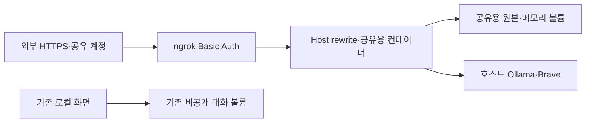

# 058: 기존 대화를 분리하고 ngrok 외부 접속을 열다

2026-10-19 · 기준ca391e7 이후 이번 변경.

## 요청과 문제

사용자가 여행 에이전트를 ngrok 외부 주소로 공유하도록 요청했다. 기존 로컬 화면에는 대화 목록·원본 도구 기록이 있어 이 서버를 그대로 외부에 연결하면 과거 대화도 공유된다. 또 Host·Origin이localhost로 제한돼 있어 터널만 열어서는 브라우저의 POST가 거부된다.

좋은 완료 기준은 기존 기록을 공개하지 않고, 인증 후 외부 화면에서 실제 질문·답변이 가능하며, 모르는 Origin은 계속 거부하는 것이다.

## 구현과 공개 범위

설치된ngrok3.22.1과 기존 인증 설정을 사용했다. 별도travel-agent-share 컨테이너와travel-agent-share-runs 볼륨으로 공유 공간을 만들고, 기존 로컬 컨테이너·볼륨은 연결하지 않았다. Ollama와 기존Brave 키 파일은 재사용하되Ollama API·Docker API 자체를 외부에 노출하지 않았다.

ngrok의HTTPS·Basic Auth·Host rewrite를 사용하고 요청 본문 inspection은 껐다. 계정 토큰·공유 비밀번호·실제 접속 주소는 Git 제외 로컬 파일에만 보존하고 이 문서에 적지 않는다. 한 개의 공유 계정이므로 비밀번호를 가진 접속자끼리는 이 공유 공간의 대화 목록을 같이 본다. 개별 사용자 인증·기록 분리를 구현했다고 표현하지 않는다.

원격 브라우저의 Origin만 정확히 허용하도록 공유용 인스턴스에 WEB_PUBLIC_ORIGIN_FILE을 설정했다. Host는 계속 로컬 주소만 받으며 ngrok이rewrite한다. 기존 로컬 인스턴스의 접근 정책은 바꾸지 않았다. 설정 파일을 읽을 수 없으면 거부한다.

src/travel_agent/web_app.py의handler_for._allowed에 추가한 실제 코드:

```python
origin_file = os.environ.get('WEB_PUBLIC_ORIGIN_FILE')
if origin_file:
    public_origin = Path(origin_file).read_text(encoding='utf-8').strip()
    public = urlsplit(public_origin)
    if public.scheme == 'https' and public.netloc and not public.path and not public.query and not public.fragment and not public.username:
        allowed.add(public_origin)
return origin is None or origin in allowed
```

앞선 로컬Host 검사를 통과한 뒤에만 이 코드에 도달한다. 모든 외부Origin을 허용하거나CORS를 전면 개방하지 않았다. [ngrok 공식 설정 설명](https://github.com/ngrok/ngrok-docs/blob/main/gateway/agent/config/v2.mdx)의basic_auth·host_header·inspect를 참고하고 설치된CLI 도움말과 실제 외부 요청으로 확인했다.



## 실제 외부 질문과 답변

<callout icon="💬">
	안녕! 한 문장으로 인사해줘.
</callout>

실제 답변:

안녕하세요!

외부HTTPS 주소에서 인증 후POST했고, 폴링으로 completed를 받았다. 모델1회·입력973토큰·출력5토큰·에이전트6.32초. 도구 호출·웹검색은0회이므로 툴콜 로그는 없다. 이 실험은 외부 왕복 확인이며 여행 추천 품질 검증은 아니다.

<details>
<summary>외부 요청·격리 검증 결과</summary>

| 확인 | 실제 결과 |
| --- | --- |
| 인증 없는 외부GET | 401 |
| 인증 후 화면GET | 200 |
| 인증 후health·Ollama 연결 | 200·connected |
| 공유 공간 초기 대화 수 | 0 |
| 기존 로컬 대화 수 | 17 유지 |
| 외부에서 기존 로컬 실행ID 조회 | 404 |
| 다른Origin의POST | 403 |
| 올바른 외부Origin의질문POST | 202 |
| 답변 폴링 | completed·안녕하세요! |

인증 헤더·비밀번호는 기록에서 제외했다. 모델 툴콜을 실행한 것처럼 HTTP 확인을 섞어 기록하지 않는다.

</details>

## 검증과 운영 범위

Python 테스트192개 통과. 허용한HTTPS Origin만 통과하고, 유사 도메인·HTTP·다른Host·설정 파일 부재는 거부함을 추가 검증했다. 기존 로컬 서버는 그대로 유지했다.

터널은 백그라운드·숨김으로 실행했다. PC·Ollama·Docker·ngrok이 실행되는 동안 사용할 임시 공유 주소다. 무료 서비스의 고정 주소·사용량·장기 가용성을 보장하지 않는다. 기존 앱의 대기열 제한을 유지하지만 공개 서비스용 계정·과금·사용자별 제한은 아직 없다.

중지는 scripts/stop_share.ps1로 한다. 이 스크립트는 기록한PID의ngrok과 공유 컨테이너만 중지하며 로컬 화면과 두 볼륨의 기록은 삭제하지 않는다.
