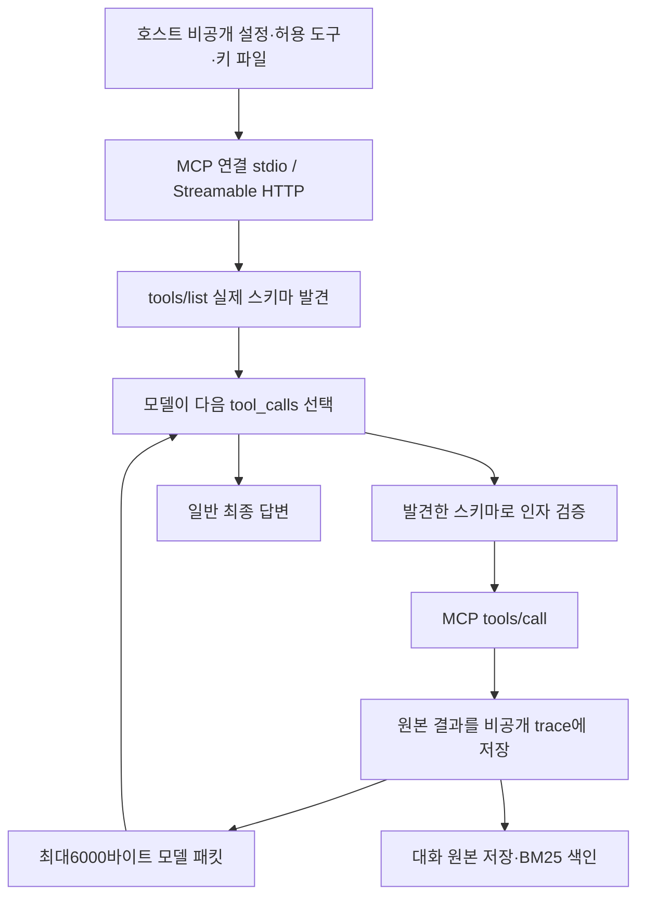

# 059: MCP 연결 기반과 국문 관광정보 후보 검증

2026-10-19 · 기준 fc7c55f 이후 이번 변경.

## 문제 정의: 검색 외에 어떤 근거를 가져올 것인가

여행 준비에 쓸 국가기관·숙박 정보를 MCP로 연결한다. 목표는 API를 고정 함수로 다시 만드는 것이 아니라 서버가 제공하는 도구와 스키마를 발견하고 모델이 선택한 호출을 실제 MCP로 실행하는 것이다. 사용자는 TourAPI 키가 아직 없다고 답했다.

좋은 결과의 기준은 도구 발견→인자 검증→실제 호출→모델 답변→추적·원본 메모리 저장이 이어지는 것이다. 이것과 실제 관광 데이터 확보·여행 답변 품질은 따로 평가한다.

먼저 메모리 상태를 바로잡았다. 호스트 CLI는 SQLite에 E5 벡터를 저장하고 BM25·정확 벡터 검색·RRF·선택적 리랭킹을 한다. 별도 벡터DB 제품을 설치한 상태가 아니다. 현재 웹 화면은057의 BM25 원본 메모리이며 dense 검색은 아직 연결하지 않았다.

## 연구 과정: README 대신 소스와 실제 연결 확인

- [Python SDK 공식 클라이언트](https://py.sdk.modelcontextprotocol.io/client/)와 [전송 계층](https://py.sdk.modelcontextprotocol.io/client/transports/)을 확인하고 실제 설치된2.3.0의 Client·stdio_client·streamable_http_client를 사용했다. 구버전 예제를 그대로 복사하지 않았다.
- [Atrani-Labs/visitkorea-tour-mcp](https://github.com/Atrani-Labs/visitkorea-tour-mcp) 소스 기준2fb19a4b99d2ad9b8d96a74f5c62abfe3e798fe5: services.js의 ko→KorService2, index.js의 도구 등록과 TOUR_API_KEY 필수 처리를 확인했다. 커뮤니티 래퍼이며 기관 공식 운영 MCP는 아니다. 검색·숙박 목록·공통/소개 상세 조회를 첫 후보로 골랐다. 숙박 목록은 실시간 객실 가격·예약 가능 여부가 아니다.
- 위 저장소의 GitHub 이슈/PR 조회는0건이었다. 문제가 없다는 증거로 해석하지 않았다. 현재 Windows의 Node23.1.0에서는 종료코드3221225477로 중단됐고, 번들 Node24.19.0에서는 연결됐다. 전역 Node 변경이나 서버 수리는 하지 않았다.
- [harimkang/mcp-korea-tourism-api](https://github.com/harimkang/mcp-korea-tourism-api) 소스 기준c4d4585cb8e5c3085e3e7631467f7c6d096aa5c1: 언어 매핑에 국문ko가 없어 첫 국문 연결 대상으로 선택하지 않았다. 이슈/PR에서 직렬화 수정과ASGI 변경·되돌림 이력을 확인했다. 이 후보는 설치·실행하지 않았다.
- [Booking.com 공식 MCP](https://developers.booking.com/mcp-server/docs/implementation-guide)는 Streamable HTTP를 제공하지만 Affiliate ID·Demand API 키와 계정별 도구 확인이 필요하다. 현재 접속·재고·예약은 검증하지 않았다.

## 첫 실제 연결: 관광 API 호출 전에도 확인할 수 있는 범위

커뮤니티 국문 후보를 clone하고 잠금 파일대로 의존성을 설치했다. 식별용 가짜 키로 프로세스를 시작하고 실제 MCP initialize·tools/list를 수행했다. 21개 도구를 발견하고 시험용으로 list_tour_services 한 개만 허용했다. 반환된26개 서비스 목록은 서버 소스의 정적 안내다. 외부 TourAPI 조회는0회이며 관광지·숙소 데이터를 확보한 결과가 아니다.

<details>
<summary>관광정보 후보의 실제 메타데이터 호출</summary>
	- 전송: stdio, Node24.19.0. 서버 tourism 연결 성공, 발견21개·노출1개.
	- 호출: mcp_tourism_list_tour_services → 원격 list_tour_services, 인자 {}.
	- 반환 시각: 2026-10-19 05:36:09 KST. 반환 근거 mcp:e014b4f6758ad8d5.
	- 반환: count=26, languages.ko=KorService2, 국문 관광정보 서비스 등 정적 서비스 안내.
	- 모델 호출 없이 클라이언트에서 수행했다. 모델 툴콜ID는 없으며 만들지 않는다. 실제 키·인증 헤더는 기록하지 않는다.
</details>

## 쿼리 → 실제 답변: 로컬 모델이 MCP를 사용하는가

실제 여행 정보와 혼동하지 않도록 합성 서버를 따로 띄웠다. Ollama qwen3.5:4b-q4_K_M, 컨텍스트65536·출력4096·temperature0·think=false로 실행했다. 웹검색은 비활성화했고 이 실행에서 허용한 도구는 lookup_place 하나다.

<callout icon="💬">
	연결된 합성 MCP의 lookup_place 도구로 '샘플A'를 조회하고, 반환된 가상 접근 조건과 MCP 근거 ID만 알려줘. 실제 여행 정보가 아니라 연결 시험이야.
</callout>

실제 답변:

조회된 가상 접근 조건은 다음과 같습니다.

*   **MCP 근거 ID:** `mcp:4564a1846e04f0fa`
*   **가상 접근 조건:** 가상 계단 7 개

모델2회·도구1회, 루프8.054초, 입력2813·출력84토큰이었다. 도구 반환의 가상 접근 조건과 답변이 연결됐다. 그러나 모델이 ID를 대괄호 인용 대신 백틱으로 썼다. completed였어도 citation_status=missing, cited_ids는 비어 있어 인용 품질은 통과하지 않았다. 이 응답을 '좋은 여행 답변'으로 평가하지 않는다.

<details>
<summary>실제 모델 툴콜 → 실행 → 다음 모델 입력</summary>
	1. 2026-10-19 05:36:51.120 KST: 모델 요청 mcp_fixture_lookup_place, 호출ID call_4sne9izp, 인자 {"name":"샘플A"}. 원격 도구 이름은 lookup_place.
	2. 05:36:51.129 KST: MCP 실행 성공, 도구 실행0.008755초. 오류 없음.
	```json
	{"access":"가상 계단 7개","name":"샘플A","source":"test-fixture","synthetic":true}
	```
	3. 모델 전달: mcp_compact_json,327바이트. 원본 결과734바이트는 비공개 trace에 보존했다.
	```json
	{"content_kind":"mcp_result","id":"mcp:4564a1846e04f0fa","is_error":false,"observed_at":"2026-10-18T20:36:51.129922+00:00","remote_tool":"lookup_place","server":"fixture","text":"{\"access\":\"가상 계단 7개\",\"name\":\"샘플A\",\"source\":\"test-fixture\",\"synthetic\":true}","truncated":false,"verified_current":false}
	```
	4. 다음 모델이 위 실제 답변을 생성했다. user·tool·assistant 원본3개를 저장하고 BM25 청크5개를 생성했다. 숨은 사고는 저장하지 않는다.
</details>

## 구현: MCP는 외부 서버와 통신하고, 에이전트는 발견한 도구를 선택한다



아래 코드는 fc7c55f 이후 이번 변경의 실제 소스 발췌다. src/travel_agent/mcp_client.py의 MCPRegistry.__enter__에서 스키마를 가져온다. 실제로 발견하지 못한 도구를 설정 이름만 보고 만들지 않는다.

```python
page = self.portal.call(self._list,client,cursor)
found.extend(page.tools)
cursor = page.next_cursor
```

같은 파일의 MCPRegistry._call은 실제 MCP 호출이며 시간 제한을 둔다. 스트림·프로세스 수명은 AnyIO blocking portal과 ExitStack으로 에이전트 실행 동안 유지한다.

```python
async def _call(self,client,name,args,timeout):
    import anyio
    with anyio.fail_after(timeout):
        return await client.call_tool(name,args,read_timeout_seconds=timeout)
```

src/travel_agent/agent.py의 run_agent는 MCP를 기존 도구 실행·메모리·trace 흐름에 연결한다. 원본 결과와 모델에게 준 패킷을 구분한다.

```python
is_mcp = mcp_registry and name in mcp_registry.routes
content = mcp_model_result(result) if is_mcp else format_web_result(result, web_tool_format) if name in WEB_TOOLS else canonical(result)
```

별도 JSON Schema 검증과 도구 네임스페이스를 적용했다. 읽기 도구를 명시적으로 허용하며 서버3개·노출24도구·모델 전달6000바이트·원본1MiB 상한을 둔다. 원본 전체를 답변 입력에 반복하지 않는다. 기존 도구 총8회·병렬 최대3개 제한을 공유한다. 서버 도구 오류와 전송 실패도 trace·웹 화면에 남긴다.

## 검증 결과와 남은 비용

unittest202개가 통과했다. 실제 stdio·HTTP 전송, 발견되지 않은 도구, 인자 스키마, 시간 초과, 서버 오류, 반환 키 마스킹, 패킷 크기, 병렬 호출 순서, trace·원본 메모리 연결을 확인했다. 스크립트 모델을 사용한 회귀 테스트와 위 실제 Ollama 실험을 구분한다. pip check와 프런트 JS 문법 검사도 통과했다.

로컬 Docker 웹 이미지를 다시 빌드해50729에 반영했다. 건강 확인에서 Ollama·모델·Brave 연결 상태를 확인했고 컨테이너의 SDK2.3.0과 활성 MCP 설정0개를 확인했다. 외부 공유 인스턴스는 기존 상태로 유지했다. 화면 구조의 시각 검증은 이번에 수행하지 않았다.

호스트에는 국문 후보의 실행 경로와5개 읽기 도구를 적은 비활성 설정을 준비했다. 실제 키가 없으므로 관광·예약 MCP는 활성화하지 않았다. Docker에는 호스트의 Windows Node 경로를 그대로 쓸 수 없다. 키 발급 뒤 HTTP 사이드카 또는 컨테이너 런타임을 준비해 실제 조회를 검증해야 한다.

연결과 도구 발견은 루프 시작 전이라 기존180초·모델12회 예산 밖의 시간이 추가된다. 매 요청 연결과 SDK 의존성 비용도 있다. 연결 풀·전체 요청 기한 통합·비텍스트 결과·OAuth·예약 실행은 후속이다. 최신성·정확성·여행 추천 품질 개선은 아직 측정하지 않았다.

## 다음: 실제 국문 데이터로 좁혀 검증

[한국관광공사 국문 관광정보 서비스](https://www.data.go.kr/data/15101578/openapi.do) 활용신청 후 키를 로컬 data/private/tour-api-key 파일에 보관한다. 채팅에 키를 보내지 않는다. 승인된 국문 서비스의 지역코드→키워드 검색→상세조회로 주소·운영 안내 등의 실제 필드를 확인하고 웹검색과 비교한다. 숙박 검색 목록을 객실 재고·예약 성공으로 표현하지 않는다.
