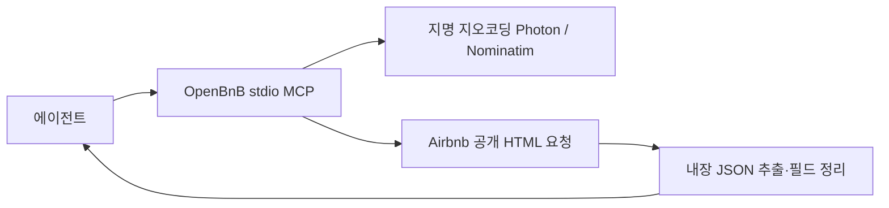

# 061: 숙박·투어 검색 MCP 후보 조사

2026-10-19 · 기준 c4df75c 이후 조사. 실행 코드 변경 없음.

## 문제 정의와 판단 기준

TourAPI를 도입하지 않기로 한 뒤, 숙박·투어 검색을 제공하는 기존 MCP가 있는지 조사했다. 가입·API 키·유료 크레딧 의존, 직접 HTTP와 브라우저 방식, 실제 소스 공개 여부, 실패 이슈를 나눠 확인했다. 이번 범위는 발견·소스 조사이며 검색 성공을 검증한 실험이 아니다.

## 후보와 현재 결론

- [OpenBnB](https://github.com/openbnb-org/mcp-server-airbnb): 로컬 stdio, Airbnb 검색과 숙소 상세2도구. index.ts에서 node-fetch로 공개 HTML을 받고 Cheerio로 페이지의 JSON을 추출하는 경로를 확인했다. 공식 API 키나 브라우저 실행을 요구하지 않는 코드다. 지명은 Photon→Nominatim 외부 지오코딩을 사용하므로 외부 서비스 제한까지 없어지는 것은 아니다. 현재 조건에서 첫 검증 후보로 판단한다.
- [WinWin.travel](https://github.com/WinWin-travel/MCP-server): 호스팅 호텔 검색·필터·예약 MCP라고 안내한다. CONNECT_QUICK.md에서 토큰 신청 폼과 Bearer 인증을 확인했다. 저장소는 연결 안내·n8n 데모 중심이며 서버 검색 구현 자체가 공개된 로컬 검색기는 아니다. 무료·재고 규모는 운영자 주장으로 실제 할당량·한국 숙소 커버리지는 미검증이다. URL에 sse가 있지만 지원 전송은 접속 전 확정하지 않는다.
- [GetYourGuide MCP](https://github.com/chrischall/getyourguide-mcp): 투어 검색·상세·옵션·가능 날짜·후기 조회. client.ts에서 GYG_API_KEY 필수 처리와 X-ACCESS-TOKEN 전달을 확인했다. 키 없이 도구 목록을 발견할 수 있어도 실제 검색은 별개다.
- [Viator MCP](https://github.com/chrischall/viator-mcp): 체험·투어·관광지 검색과 가능 일정 조회. client.ts에서 VIATOR_API_KEY 필수 처리와 exp-api-key 전달을 확인했다. 파트너 가입이 필요해 무가입 후보는 아니다.
- [HasData Airbnb MCP](https://github.com/HasData/airbnb-mcp): Airbnb 검색·상세를 호스팅 제공한다고 안내한다. HasData 키·크레딧이 필요하므로 API 키 없는 로컬 실행 후보와 구분한다. README의 무료 호출 수 설명이 서로 달라 구체적 할당량을 확정하지 않았다. 이 후보는 clone·실행하지 않았다.
- [StayingAPI](https://github.com/stayingapi/hotel-vacation-rental-mcp): 여러 숙박 사이트 통합 검색을 안내하지만 OAuth 계정·크레딧 의존이다. API 키를 직접 붙이지 않는다는 안내를 가입·사용량 제한이 없다는 뜻으로 해석하지 않는다. 소스 실행·실제 검색은 미검증이다.

## 소스·변경 이력에서 확인한 것

4개 저장소를 비공개 조사 폴더에 shallow clone하고 코드를 읽었다. 패키지 설치·서버 실행·에이전트 연결은 하지 않았다.

- OpenBnB: d5a8f18f5978b0a33dea4b3ec130c389bad845cc, 마지막 커밋2026-08-05(저장소 시각). package.json0.3.0.
- WinWin: f5853c24e672a0db4aee56a09b1124cab1132c38,2026-08-25.
- GetYourGuide: f3ea31f52e20dcd17a20dc3cf7b222dd35d98e5e,2026-10-18. CHANGELOG2.1.8에서 반환 view 리팩터링,2.1.7에서 호출 전 날짜 검증 수정을 확인했다.
- Viator: dadb6b41b7973bf849283bf0a0c9be693aa8f7d2,2026-10-17. CHANGELOG2.1.10과2.1.9에서 view 리팩터링·배포 패키지 실행 수정 등을 확인했다. 변경이 최근이라는 사실을 검색 정확도 증거로 쓰지 않는다.

OpenBnB의 [검색0개 이슈40](https://github.com/openbnb-org/mcp-server-airbnb/issues/40)은 열려 있으며 같은 이슈에 로컬 서버는 된다는 사용자 댓글도 있다. 모든 로컬 검색 실패로 일반화할 수 없다. [상세 편의시설 누락41](https://github.com/openbnb-org/mcp-server-airbnb/issues/41)은 닫혔고 [PR42](https://github.com/openbnb-org/mcp-server-airbnb/pull/42)에 복구 변경이 있다. 현재 clone에도 findPdpPresentation·extractAmenities 등이 있어 수정 코드의 존재는 확인했으나 실제 숙소 결과로 검증하지 않았다. [npm과 소스 차이45](https://github.com/openbnb-org/mcp-server-airbnb/issues/45)는 과거 버전 차이 보고다. 현재 배포본도 뒤처졌다고 단정하지 않는다.

OpenBnB index.ts의 실제 검색 본문 처리 발췌:

```typescript
const response = await fetchWithUserAgent(searchUrl.toString());
const html = await response.text();
const $ = cheerio.load(html);
```

HTML을 읽는 것과 숙소 정보를 추출하는 것은 별개다. 후속 코드가 #data-deferred-state-0 및 niobeClientData 내부 경로에 의존하므로 사이트 변경이 결과에 영향을 줄 수 있다. robots 검사도 있어 기본 설정에서 요청을 중단할 수 있다. 이러한 코드 구조 때문에 도구 발견만으로 사용 가능하다고 평가하지 않는다.



이 다이어그램은 읽은 소스의 경로다. 이번에 성공 실행한 네트워크 흐름을 뜻하지 않는다.

## 다음 검증과 미검증 범위

가입 없는 조건에서는 OpenBnB의 고정 커밋을 먼저 검증하는 것이 합리적이다. 국내 지역·날짜·인원을 주고 검색 결과가 실제 지역에 해당하는지, 숙소 URL·가격 단위·요금 조건·상세 필드가 보존되는지 확인해야 한다. 실패하면 HTTP 응답·파서 오류·지역 오인식을 분리한다. 이번에는 후보를 조사했으며 설치·검색·모델 호출·기존 MCP 설정 변경은 하지 않았다. 다음 후보 검증이 성공하기 전까지 활성 MCP는0개다.

<details>
<summary>실제 조사 검색과 도구 사용 범위</summary>
	웹 검색어: github MCP server airbnb search hotels no api key / github MCP server tours activities GetYourGuide Viator Klook search / MCP tours activities no API key Klook Tripadvisor github / site.github.com openbnb-org mcp-server-airbnb issues search not working / site.github.com WinWin-travel MCP-server token free.
	주요 반환 후보: OpenBnB·HasData·StayingAPI·GetYourGuide·Viator·WinWin. 이후 GitHub 원문·이슈40/41/45·PR42를 열어 확인했다.
	로컬 조사:4개 git clone, 각 HEAD·시각 확인, rg로 fetch·인증 환경변수·전송·도구 정의를 찾고 관련 함수와 CHANGELOG를 읽었다. clone4개 모두 종료코드0.
	이 기록은 개발 조사 도구 사용이다. 여행 에이전트의 툴콜·모델 호출은0회이며 모델 호출ID나 가상 여행 답변을 만들지 않는다.
</details>
