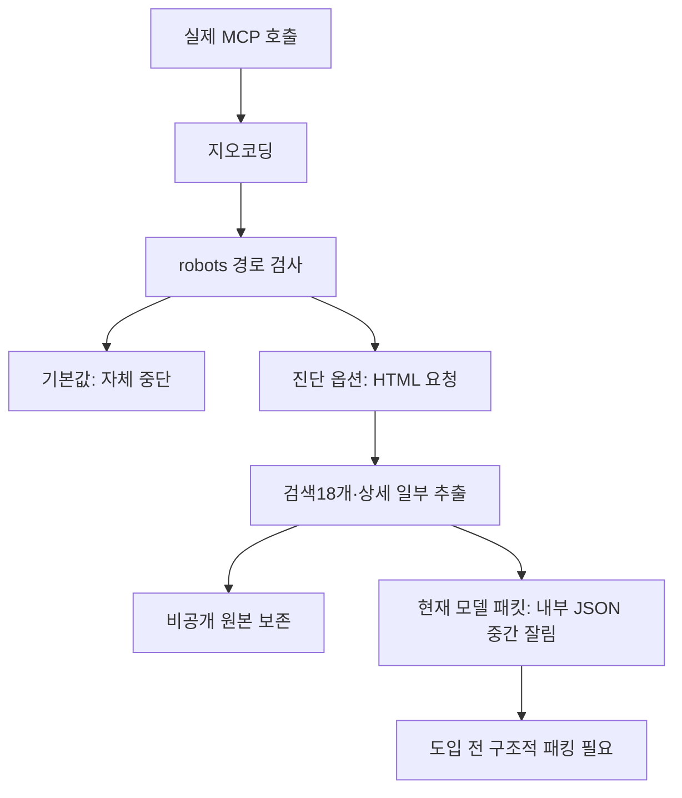

# 062: OpenBnB 실제 국내 숙소 검색·상세·전달부 검증

2026-10-19 · 기준 c350ef9. 에이전트 활성화 전 독립 실험.

## 문제 정의와 통과 기준

061의 OpenBnB 후보를 실제로 실행해 도입 여부를 판단한다. 관광 API 가입 없이 국내 숙소 검색·날짜/인원 전달·가격/링크·상세정보가 반환되는지 확인한다. MCP 연결 성공, 숙소 후보 확보, 가격·위치의 완전한 검증을 구분한다.

먼저 결론: **숙소 후보 검색용으로는 조건부 도입 가치가 있다. 현재 상태 그대로 에이전트에 활성화하는 것은 보류한다.** 기본 설정의 자체 robots 검사, 한국어 지오코딩 오인식, 상세 누락, 우리 모델 패킷의 중간 잘림을 처리해야 한다.

## 실제 설치와 실행 조건

OpenBnB 소스 d5a8f18f5978b0a33dea4b3ec130c389bad845cc·package0.3.0을 비공개 clone에서 실행했다. npm ci --ignore-scripts --no-audit --no-fund로83개 패키지를 설치하고, 번들 Node24.19.0으로 원본 npm run build를 수행했다. 설치·빌드 종료코드0. build의 sync-version.js가 manifest.json 버전을 갱신했으며 검색 소스는 수정하지 않았다. 브라우저·로그인·API 키를 사용하지 않았다.

원본 Python SDK Client로 stdio initialize·tools/list·tools/call을 수행한 시험과 우리 MCPRegistry를 통한 시험을 따로 했다. 발견한 도구는 airbnb_search·airbnb_listing_details 두 개다. LLM 호출은 없고 서비스 설정에도 연결하지 않았다.

## 첫 결과: 기본 설정은 검색 요청 전에 중단

2026-11-14 체크인·11-15 체크아웃·성인2명으로 Gapyeong, South Korea / Seoul, South Korea / 가평, 대한민국을 각각 요청했다. 세 건 모두 isError=true였다.

<callout icon="💬">
	airbnb_search에 location="Gapyeong, South Korea", checkin="2026-11-14", checkout="2026-11-15", adults=2를 보냈다. robots 관련 인자는 기본값이다.
</callout>

실제 반환 error:

```text
This path is disallowed by Airbnb's robots.txt to this User-agent. You may or may not want to run the server with '--ignore-robots-txt' args
```

이는 Airbnb HTTP429·접근 차단 응답을 받은 실험이 아니다. OpenBnB가 robots.txt를 받은 뒤 검색 경로를 검사하고, 검색 HTML을 요청하기 전에 스스로 중단한 결과다.

index.ts handleAirbnbSearch의 실제 코드:

```typescript
if (!ignoreRobotsText && !isPathAllowed(path)) {
```

## 같은 조건의 진단: 실제 숙소 데이터는 오는가

원본 테스트(test-extension.js·test-amenities.js)도 robots 검사 제외 옵션을 사용한다. 기본 설정 실패와 구분해 호출별 ignoreRobotsText=true를 추가했다. 원본 코드나 전역 기본값을 바꾸지 않았다.

<callout icon="💬">
	같은 가평·2026-11-14~15·성인2명 조건에 ignoreRobotsText=true만 추가해 airbnb_search를 다시 호출했다.
</callout>

실제 반환 첫 숙소에서 필요한 필드만 읽기 쉽게 발췌:

- 숙소명: Great memories in the caravan #Fireplace #Barbecue #Netflix #Special
- URL: https://www.airbnb.com/rooms/787424147943562635
- 좌표:37.83465,127.48237
- 가격 표기: ₩179,000 total
- 가격 설명: 1 night x ₩179,000: ₩179,000
- 후기 표기: 4.92 out of 5 average rating,  192 reviews
- 객실 표기: 1 bedroom, 3 beds, 1 bath

이는 실행 당시 페이지의 표시 가격이다. 결제 단계의 확정 총액·현재 재고를 보장하지 않으며 이 문서 작성 뒤 가격도 변할 수 있다.

진단 조건에서 영어 가평·영어 서울·한국어 가평 모두 검색18개씩 반환했다. 검색 호출 시간은 각각2.922초·1.969초·1.735초였다. 상세조회 시간과 서버 시작 시간은 이 수치에 포함하지 않았다. 서로 다른 세 지역 표기에서 후보 확보가 된 것이며 장기 안정성을 평가한 것은 아니다.

영어 서울의 첫 반환은 [Seoul Trip] A Lucky Day #1-Minute Walk from the Bus Stop #Gardidan #Goodidan #Gocheok Dome, ₩78,560 total, originally ₩104,927이었다. 실제 반환 데이터이며 합성 숙소가 아니다.

## 상세조회: 편의시설은 있고 설명·정책은 비어 있다

각 검색의 첫 숙소를 실제 ID로 airbnb_listing_details에 전달했다.3개 모두 isError=false였지만 LOCATION_DEFAULT·POLICIES_DEFAULT·HIGHLIGHTS_DEFAULT·DESCRIPTION_DEFAULT는 ID만 있고 내용은 없었다. AMENITIES_DEFAULT에는 편의시설이 있었다.

가평 첫 숙소의 실제 편의시설 발췌:

```json
{
  "Parking and facilities": "Free parking on premises, Shared outdoor pool",
  "Outdoor": "Fire pit, Outdoor dining area, BBQ grill, Sun loungers",
  "Not included": "Exterior security cameras on property, Washer, Dryer"
}
```

Not included를 제공 시설로 바꾸면 안 된다. 수영장 표기만으로11월 운영 여부나 독채 수영장이라고 확정할 수도 없다. 정상 반환을 '전체 상세정보 조회 완료'로 해석하지 않는다. 이 시험만으로 원문에 없던 정보인지 파서가 놓친 것인지까지 확정하지 않았다.

## 조건·페이지·지역 검증

우리 MCPRegistry에서도 같은 원본 서버를 별도 설정으로 열어 두 도구를 발견했다. 영어 가평 검색18개, maxPrice=200000·propertyType=entire_home 추가 검색18개, 반환된 pageCursors[1]을 쓴 다음 페이지18개를 받았다. 앞선 예비 실행에서도 동일한 검색·필터2회를 수행했으며 최종 비교는 저장된 후속 실행을 따른다.

필터 검색 URL에는 price_max=200000·l2_property_type_ids[]=1·날짜·성인2명이 들어갔다. 최종 첫 페이지18개의 현재 total 표시가 모두20만원 이내였고 다음 페이지도18개가 반환됐다. 첫 페이지와 다음 페이지 숙소 ID 중복은0개다. 숙소 유형 필터의 실제 숙소별 충족 여부·예약 재고·세금 조건을 독립적으로 확인한 것은 아니다.

한국어와 영어 지역명은 같은 범위를 만들지 않았다. 원본 stderr에서 영어 Gapyeong은 Photon이 가평군 county를 골랐고, 한국어 가평은 가평 선힐아파트를 골랐다. 두 호출의 좌표 경계와 순위도 달랐다. 따라서 한국어도 검색18개라는 이유로 지역 해석이 정확하다고 판정하지 않았다. 영어 가평 범위에도25% 여백이 붙어 행정구역 내부만 반환하는 것이 아니다.

## 우리 전달부에서 발견한 별도 문제

최종 영어 가평 원본 텍스트23915바이트가 model_result를 거치면3379바이트, 필터 원본22913바이트는3335바이트가 됐고 둘 다 truncated=true였다. 외부 JSON 패킷 자체는 유효하지만 그 안의 text 문자열은 내부 JSON 중간에서 끝났다. 전체18개를 모델이 보는 구조가 아니다. 우리 범용 MCP 어댑터의 문자열 앞부분 자르기 문제로, OpenBnB 검색 실패와 구분한다.

src/travel_agent/mcp_client.py model_result의 현재 실제 코드:

```python
text = bounded_prefix(result.get('text',''),max(0,(max_bytes-overhead)//2))
packed.update(text=text,truncated=text!=result.get('text',''))
```

도입 전에 숙소별 이름·ID·링크·가격 원문·조건·좌표·후기·다음 페이지 커서를 먼저 구조적으로 정리하고, 완결된 항목 단위로 예산에 넣어야 한다. 임의 상위 몇 개를 최선의 숙소라고 평가하면 안 된다. 이번에는 문제를 재현했고 전달 형식은 아직 수정하지 않았다.



## 실제 툴콜 기록

<details>
<summary>기본 실패·진단 성공·상세조회·우리 어댑터 순서</summary>
	개발자가 SDK로 호출한 시험이다. 모델 툴콜ID는 없으며 SDK 내부 JSON-RPC ID를 별도로 수집하지 않았다. 아래 번호는 설명용 실행 순서다. 검색어·인자·전체 반환·stderr는 비공개로 보존했다.
	1.08:49 KST 기본 서버: airbnb_search 세 번. 지역은 Gapyeong, South Korea / Seoul, South Korea / 가평, 대한민국. 날짜2026-11-14~15,adults=2. 모두 자체 robots 오류이며 검색 본문 요청 전 중단.
	2.08:49:27.268 KST 진단: airbnb_search {"location":"Gapyeong, South Korea","checkin":"2026-11-14","checkout":"2026-11-15","adults":2,"ignoreRobotsText":true}.18개 반환,2.922초.
	3.08:49:30.190 KST: airbnb_listing_details {"id":"787424147943562635","checkin":"2026-11-14","checkout":"2026-11-15","adults":2,"ignoreRobotsText":true}.편의시설 반환·설명/정책/위치/하이라이트 내용 없음.
	4.08:49:31.196 KST: 같은 진단 조건으로 Seoul, South Korea 검색18개,1.969초. 첫 ID1672728197631914010을08:49:33.160에 상세조회,동일한4개 섹션 내용 없음.
	5.08:49:34.175 KST: 같은 진단 조건으로 가평, 대한민국 검색18개,1.735초. 첫 ID1146880279222788235를08:49:35.910에 상세조회,동일한4개 섹션 내용 없음.
	6.우리 어댑터 최종 시험: 영어 가평 반복18개(mcp:9d2bed321233614c) →20만원·집전체 필터18개(mcp:b293783f84f4be77) →서버가 반환한 두 번째 pageCursor로18개(mcp:d4cc8e06ec0b4885). 이 ID는 반환 근거 ID이며 JSON-RPC 호출ID가 아니다.
	7.모델 입력 예정 패킷은 생성만 했고 LLM에 전송하지 않았다. 따라서 이번 모델 응답·여행 답변 품질 평가는 없다.
</details>

## 도입 판단과 다음 조치

기능 판정은 '조건부 검색 성공·상세 부분 성공'이다. 원본 소스의 HTTP 검색이 현재 환경에서 국내 숙소를 반환하므로 처음부터 다시 만들 이유는 줄었다. 다만 그대로 서비스에 붙이지 않는다. 도입하려면 robots 동작을 명시적으로 정하고, 한국어 지역 정규화·상세 누락 표시·항목 단위 모델 패킹을 먼저 보완해야 한다.

새 API 키나 종량 API 요금은 쓰지 않았으나 외부 요청·지오코딩·페이지 변경 유지 비용은 남는다. 로그인·브라우저·예약 실행·결제·실제 모델 평가는 수행하지 않았다. 에이전트 코드·활성 MCP 설정·Docker 화면은 변경하지 않았다.
