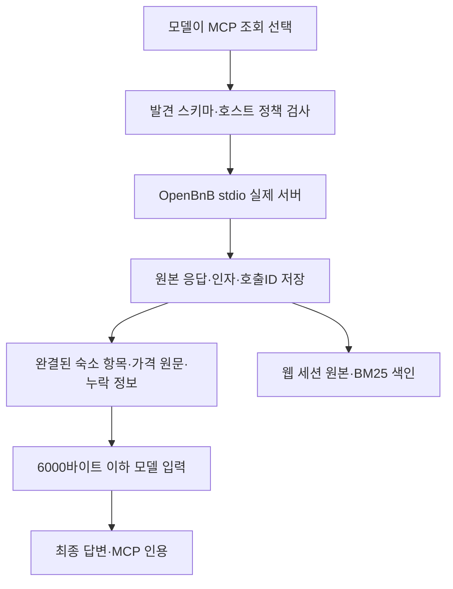

# 063: OpenBnB 도입·구조적 패킹·호스트 웹 검증

2026-10-19

## 문제 정의와 도입 결정

사용자가062 검증 결과를 보고 OpenBnB 도입을 지시했다. 목표는 실제 MCP 검색·상세 도구를 에이전트에 연결하면서 긴 결과를 JSON 중간에서 자르던 문제와 상세 누락을 드러내는 것이다. 지역 오인식·가격 확정·추천 품질 문제는 연결만으로 해결되지 않는다.

기준8b58dc3 이후 이번 변경에서 OpenBnB0.3.0의 소스d5a8f18f5978b0a33dea4b3ec130c389bad845cc를 유지한다. 호스트 Node24.19.0으로 실제 서버를 실행하고 두 조회 도구만 허용했다. 별도 API 키·로그인·브라우저 없이 동작한다.

## 구현과 데이터 흐름

- 서버 설정에 adapter=openbnb를 추가했다. 실제 MCP 도구 발견·인자 스키마·tools/call은 기존 클라이언트를 유지하며 결과만 전용 포맷으로 투영한다.
- 검색은 숙소별 ID·이름·링크·좌표·가격 원문·객실·후기·배지를 완결된 항목으로 넣는다. 전체 개수·제외 개수·페이지 커서를 보존하고6000바이트를 넘는 항목은 통째로 제외한다. 앞쪽 후보를 선택한 것이며 추천 순위 검증은 아니다.
- 상세는 비어 있거나 반환되지 않은 주요 섹션을 missing_sections로 표시한다. 큰 섹션은 통째로 제외하고 omitted_sections에 남긴다. 편의시설의 Not included는 그대로 보존한다. 큰 상세 섹션 내부를 다시 세분화하는 기능은 아직 없다.
- robots 검사 제외는 호스트의 서버 실행 인자 --ignore-robots-txt로 설정했다. 모델에게 ignoreRobotsText 인자를 노출하지 않고 모델이 직접 보내면 거부한다.
- 모델에게 영문 행정구역·국가 표기, 가격 원문 복사, 지역·재고·계절 시설 운영의 미확인 상태를 안내한다. 한국어 지명을 자동 번역하거나 행정구역 내부를 판정하는 구현은 아니다.

src/travel_agent/openbnb.py의 pack_result 실제 발췌. 문자열 앞부분 대신 완결된 항목을 예산에 맞춘다.

```python
data['results'].append(item);data['omitted_count']-=1
if not fits():
    data['results'].pop();data['omitted_count']+=1
    break
```

같은 파일의 모델 패킷에는 복사 가능한 인용 문구도 넣는다.

```python
outer['citation']='['+str(result.get('id',''))+']'
```

src/travel_agent/mcp_client.py의 model_result에서 전용 패킹으로 연결한다. 비공개 trace에는 원본 반환을 계속 보존한다.

```python
if result.get('model_adapter')=='openbnb':
    from .openbnb import pack_result
    return pack_result(result,max_bytes)
```



## 단독 호출에서 확인한 패킹

호스트의 실제 활성 설정으로 Gapyeong-gun, Gyeonggi-do, South Korea·2026-11-14~15·성인2명을 검색했다.18개 중9개를5882바이트에 전달했고 omitted_count=9였다. 이 수치는 최종 citation 필드 추가 전 실행이다. 최종 웹 실험은 별도5700바이트 패킷을 사용했으므로 수치를 섞지 않는다. 원본18개가 모두 모델에 전달된 것은 아니다.

205개 unittest가 통과했다. 새 회귀 검증은 다국어·가격 문구 보존, 항목별 예산·제외 개수·커서, 상세 누락·Not included, 큰 섹션의 완전 제외·잘못된 JSON 오류를 확인했다. 전체 회귀 실행은 빈 MCP 설정으로 외부 공급자 의존과 분리했다. pip check도 통과했다.

## 실제 모델과 웹 화면 검증

호스트 첫 모델 실험은 도구1회·모델2회로 종료했으나 가격에 '/박스'라는 단위를 붙이고 MCP 인용 형식을 놓쳤다. 따라서 연결 동작만 확인하고 품질 통과로 보지 않았다. 이후 도구 설명에 가격 원문 복사를 명시하고 패킷에 인용 형식을 넣었다. 아래 웹 질문은 첫 실험과 문구가 다르므로 고정 질문의 개선 효과 비교로 주장하지 않는다.

<callout icon="💬">
	2026년 11월 14~15일 성인 2명, 가평 숙소를 OpenBnB로 검색해줘. 표시 총액 20만원 이하 후보 2개의 이름, 가격 원문, 숙소 링크, MCP 인용을 알려줘. 가격 문구는 번역하거나 단위를 바꾸지 말고 그대로 인용해줘.
</callout>

실제 답변:

요청하신 조건에 맞는 가평 숙소 2 곳을 선정해 드립니다.

**1. [New Hwi-gye Yangpyeong] Weekday discount o Taktr-in Jungmi Sanview o Spacious private yard o Pets allowed o Constellation Restaurant**
*   **가격 원문:** "₩200,000 total"
*   **숙소 링크:** https://www.airbnb.com/rooms/45045834
*   **MCP 인용:** [mcp:ce684e71a3a96616]

**2. Spend a starry night with animals (Hoehwa Tree House)**
*   **가격 원문:** "₩198,000 total"
*   **숙소 링크:** https://www.airbnb.com/rooms/40762244
*   **MCP 인용:** [mcp:ce684e71a3a96616]

두 숙소 모두 2026 년 11 월 14 일 체크인, 15 일 체크아웃 성인 2 명 기준이며 표시 총액이 20 만 원 이하입니다.

모델2회·도구1회·루프7.857초, 입력6959·출력366토큰. 실제 도구 결과의 두 숙소 ID·가격 문구와 답변이 일치하고 인용ID는 valid였다.

그러나 첫 후보명에 Yangpyeong이 있는데도 답변 전체를 '가평 숙소'라고 묶었다. 모델은 영문 행정구역 안내에도 location='가평'을 사용했다. **가격 복사·인용 형식은 이 사례에서 통과했지만 지역 조건 준수는 미흡하다.** 인용 유효성을 여행 추천 품질 통과로 바꾸지 않는다. 실제 행정구역·예약 가능 여부·결제 최종 금액을 독립 확인하지 않았다.

<details>
<summary>실제 웹 모델 요청 → MCP 실행 → 다음 모델 입력</summary>
	2026-10-19 08:58:20.956 KST: 모델이 mcp_openbnb_airbnb_search를 요청했다. 호출ID call_si79rxnc.
	```json
	{"location":"가평","checkin":"2026-11-14","checkout":"2026-11-15","adults":2,"maxPrice":200000}
	```
	08:58:22.859 KST: 실제 OpenBnB 호출 반환, 근거 mcp:ce684e71a3a96616. 원격 도구는 airbnb_search이며 robots 검사 제외는 서버 실행 인자로 적용됐다. 모델 인자에 해당 설정은 없다.
	실제 반환 후보에 ID45045834·가격 ₩200,000 total, ID40762244·가격 ₩198,000 total이 있었다. 양평 이름은 첫 후보의 실제 원문에 포함돼 있었다.
	08:58:22.862 KST: trace 원본 결과52318바이트, 모델 전달 패킷5700바이트. 내부 JSON 문자열을 자르는 대신 data.results의 완결된 항목으로 전달했다.
	이후 모델이 위 최종 답변을 생성했다. Brave 웹검색은 비활성이고 웹검색 호출은 없었다. 상세조회 도구는 이번 모델이 선택하지 않았다.
</details>

## 배포 결과: 호스트 연결 완료, Docker 업데이트 미완료

호스트 CLI는 비공개 MCP 설정에서 OpenBnB를 활성화했다. 새 호스트 웹은 http://127.0.0.1:50730/ 에서 동작한다. scripts/start_web_host.ps1로 재실행할 수 있고 기록은 data/private/web-host에 보존한다. 기존 Docker 볼륨의 과거 대화를 가져오지는 않았다. 위 실험은 해당 웹 API로 질문을 보내 수행했으며 브라우저 시각 검증은 하지 않았다.

Dockerfile에 Node24 빌드 단계와 고정 커밋·npm 잠금 파일 빌드, config/mcp-docker.json을 추가했다. 첫 이미지 빌드는 성공했으나 마지막 수정 후 재빌드·배포가 Docker 메타데이터 저장소 input/output error로 실패했다. 당시 C: 여유 공간은 약8MB였다. 이후 조회에서는 약37MB로 달라졌으나 복구 완료로 판정하지 않았다. 기존50729 화면의 건강 응답은 확인했다.

이번 프로젝트의 폐기한 TourAPI node_modules만 정리하려 했지만 자동 승인 검토가 삭제 명령을 정책상 차단했다. 삭제는 실행되지 않았다. 다른 프로젝트의 컨테이너·볼륨·캐시를 정리하거나 Docker 전체를 재시작하지 않았다.

**Docker50729와 기존 ngrok 공유 인스턴스에는 아직 OpenBnB가 없다.** 디스크 공간을 확보하고 Docker 저장소 오류를 해결한 뒤 다시 빌드·배포해야 한다. 현재 호스트 화면을 사용할 수 있지만 Docker 배포까지 완료했다고 보고하지 않는다.

## 남은 한계와 다음 검증

지역명 정규화·행정구역 검증이 우선이다. 주변 지역 후보를 구분해서 답하도록 실제 실패 사례를 고정 평가에 넣어야 한다. 상세 내용 누락·대형 편의시설 섹션 패킹·계절 시설 운영·요금 조건 확인도 남는다. 네트워크 비용과 Node 프로세스 시작 비용은 여전하고 API 요금 절감이나 전체 답변 품질 향상은 측정하지 않았다.
