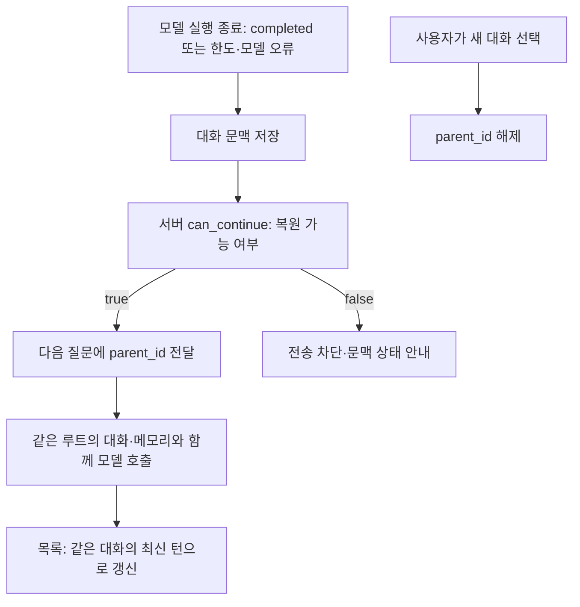

# 065 — 실행 한도를 늘리고, 한도 종료 뒤 대화가 끊기는 오류를 고치다

## 문제 정의

사용자는 도구 호출 한도를 늘리고, 이어서 질문할 때 새 세션처럼 바뀌는 문제를 고쳐 달라고 요청했다. 좋은 동작의 기준은 한도에 도달해도 저장된 대화를 이어가고, 사용자가 새 대화를 선택할 때만 부모 연결을 끊는 것이다.

## 문제 분석

서버 submit과 화면 showConversation은 result.status가 completed일 때만 부모 실행을 허용했다. 그래서 tool_limit 답변에는 문맥 체크포인트가 이미 저장돼 있어도 화면의 parentId가 null로 바뀌었다. 다음 질문의 부모 ID가 빠져 별도 대화로 생성될 수 있는 코드였다. 부모를 명시하면 서버도400으로 거절했다. 왼쪽 목록은 대화가 아닌 모든 실행을 나열해 같은 대화의 질문도 별개 항목으로 보였다.

모델이 이전 조건을 잊었다는 문제와 구분해야 한다. 여기서는 애플리케이션이 이전 문맥 연결 자체를 버렸다. 내부 실행 ID는 질문마다 새로 만드는 것이 맞지만, 같은 대화의 루트 ID와 문맥은 계속 유지해야 한다.

## 해결

- 기본 도구 호출8→20회, 모델 호출12→24회. 순차 도구20회와 최종 정리를 수용한다. 웹180초·출력4096·입력 바이트 제한·도구 병렬3개는 유지한다. CLI도 같은 기본값을 쓴다.
- 서버는 done 상태이고 복원할 문맥이 있으면 can_continue=true를 보낸다. tool_limit·step_limit·output_limit·timeout·model_error·protocol_error·context_limit도 포함한다. 성공 여부를 completed로 바꾸지는 않는다.
- 화면은 서버의 can_continue로 부모를 연결한다. 기록 로드 실패·실행 중에는 전송을 막아 몰래 새 대화로 바꾸지 않는다. 새 대화 버튼만 부모를 명시적으로 해제한다.
- 왼쪽 목록은 대화 루트별로 묶고 최신 턴을 연다. 부분 답변도 과거 대화에 표시한다. 같은 제목이더라도 루트가 다르면 별도 대화다.

## 실제 질문 → 답변

064에서 실제로 검색하다 도구8회 한도로 끝난 공개 테스트를 부모로 사용했다. 원래 질문은 다음과 같다.

<callout icon="💬">
	강릉 오죽헌의 관람시간과 휴관일을 공식 출처에서 찾아줘. 검색 후 필요한 본문을 확인하고, 확인하지 못한 내용은 미확인이라고 적어줘.
</callout>

당시 답변은 관람시간·휴관일을 미확인으로 남겼고 tool_limit으로 끝났다. 전체 초기 답변·검색 로그는064에 있다. 이번에는 같은 실행을 부모로 다음 질문을 보냈다.

<callout icon="💬">
	방금 확인하려던 관광지 이름과 미확인 항목만 요약해줘. 새 검색은 하지 마.
</callout>

**관광지:** 강릉 오죽헌·시립박물관

**미확인 항목:**
- 관람시간
- 휴관일

Nexus gpt-oss-120b 요청으로 모델1회·도구0회,0.881초에 completed였다. 부모 ID가 유지됐고 대화 배열 길이는2, 왼쪽 목록은 같은 루트의 최신 실행 하나와2턴을 반환했다. 실제 새 실행 trace의 한도는 모델24·도구20·180초·병렬3이었다. 이번 후속 질문에는 도구 호출이 없었으므로 새 툴콜 로그도 없다. 과거 검색 도구 기록은064의 접힌 영역을 따른다.

이 결과는 문맥 연결 복구를 확인한다. 오죽헌의 시간·휴관일을 새로 검증하거나 여행 추천 품질이 개선됐다는 뜻은 아니다. 실제 호출 사용량은 입력4013·출력71토큰으로 보고됐고 비용 금액은 측정하지 않았다.

## 실제 코드와 흐름

출발 기준 커밋은0b5b1fb다. 다음은 이번065 변경 작업 트리에서 가져온 `src/travel_agent/web_app.py:RunManager.can_continue`다. 저장된 문맥의 존재를 확인하며 답변 내용의 정확성을 판단하지 않는다.

```python
    def can_continue(self, job):
        # Execution success and having a usable conversation checkpoint differ.
        if job['state'] != 'done':
            return False
        try:
            return bool(self.continuation(job))
        except (OSError, ValueError, KeyError, TypeError):
            return False
```

화면 `showConversation`의 부모 선택도 실제 코드 한 줄로 바뀐다.

```javascript
parentId=job.can_continue===true?job.id:null;
```



## 검증

실제 테스트 출력:

```text
----------------------------------------------------------------------
Ran 214 tests in 22.966s

OK
PASS: budget-stop followup, missing-context guard, explicit new chat
```

Python 회귀 검사는 실제 외부 검색을 하지 않고 모델·도구를 모킹한다. 새 검사는 일곱 종료 상태의 부모 문맥 전달, 같은 루트 목록 묶음·동일 제목의 다른 대화 분리, 실행 중·문맥 없는 대화의 거절, 순차20개 도구 실행 후21번째 모델 호출로 한도 정리를 확인한다. 이20개 조회는 합성 검사이며 외부 검색20회 성공을 뜻하지 않는다. 별도 Node 검사는 실제 app.js의 함수·전송 핸들러를 실행해 부모 ID 유지, 문맥 없을 때 POST 차단, 새 대화 버튼으로만 부모 해제를 검증했다. 브라우저 전체 시각 검사는 아니다.

## 적용 범위와 한계

수정 서버는 http://127.0.0.1:50732/ 이며 기존 비공개 web-host 저장소를 사용한다. 이전 서버의 종료 명령이064에서 자동 승인 검토에 차단된 이력이 있어 이번에는 종료를 재시도하지 않고 별도 포트에 띄웠다.50731·50730과 Docker·ngrok은 이번 서버 수정이 적용된 인스턴스가 아니다. start_web_host.ps1의 기본 포트도50732로 맞췄다.

모델 한도나 도구 한도가 늘어도 시간 제한·원문 접근 실패·중복 호출 오류는 남는다. 기존에 이미 별도 루트로 생성된 대화를 자동 합치지 않는다. 실행 중이거나 서버 자체 error·interrupted 상태이며 문맥을 저장하지 못한 경우는 이어가지 않는다. 대화 길이100턴·최근 실행 보관 정책은 유지한다.
