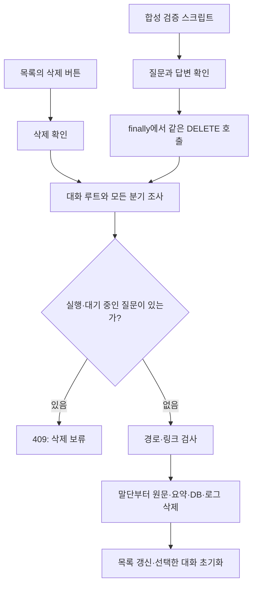

# 066 — 대화 삭제 인터페이스와 테스트 세션 정리

## 문제 정의

사용자가 대화를 지울 수 없었고, 개발 검증용 대화가 목록에 계속 남았다. 사용자는 세션 삭제 인터페이스와 테스트 종료 후 세션 정리를 요청했다. 좋은 동작의 기준은 선택한 대화만 모든 분기와 함께 지우고, 실행 중인 작업·다른 대화는 보존하며, 새 테스트도 결과를 확인한 뒤 앱 목록에서 없애는 것이다.

## 분석과 결정

화면 목록은 대화 루트별로 묶였지만 저장은 질문별 폴더라서 마지막 질문만 지우면 조상·다른 분기가 남는다. 메모리의 최근30개 실행만 순회해도 오래된 분기를 놓칠 수 있다. 삭제 대상은 대화 루트와 디스크에 저장된 모든 하위 실행으로 확정했다. 각 실행 폴더의 run.json·context.json·SQLite 메모리·trace를 함께 삭제한다. 연구일지에 남긴 비민감 검증 사례와 별도 연구 산출물까지 지우는 기능은 아니다.

## 해결

왼쪽 대화마다 × 삭제 버튼과 접근성 이름을 추가했다. 삭제 전 전체 대화·로그·메모리가 지워진다는 확인창을 보여준다. 현재 보는 대화를 지우면 새 대화 화면으로 돌아가고 마지막 실행 ID도 지운다. 다른 대화 삭제나 실패 시 현재 대화는 유지한다. 목록의8개 표시 제한도 제거해 현재 조회된 대화의 삭제 버튼에 접근할 수 있다.

서버는 DELETE /api/conversations/{id}를 받는다. 하위 실행 ID를 보내도 전체 대화를 삭제하며, 실행 중·대기 중인 하위 실행이 있으면409로 거절한다. 기존 Host·Origin 검사도 그대로 적용한다. 삭제하기 전에 모든 대상의 절대 경로가 지정 저장소의 직접 하위인지 검사하고 심볼릭 링크·정션을 거부한다. 파일 잠금으로 중단되면 남은 실행의 조상이 유지되도록 말단부터 지운다. 재시도할 수 있지만 삭제 전체가 파일시스템 트랜잭션인 것은 아니다.

## 실제 질문 → 답변 → 삭제

Nexus 연결이 된 새 서버에서 다음 두 질문을 보냈다.

<callout icon="💬">
	합성 테스트입니다. 여행 인원은 성인 두 명입니다. 검색하지 말고 확인만 해주세요.
</callout>

네, 확인했습니다. 여행 인원은 성인 두 명입니다. 검색은 진행하지 않겠습니다.

<callout icon="💬">
	방금 말한 인원은 몇 명인가요? 검색하지 말고 답해주세요.
</callout>

방금 말씀드린 여행 인원은 성인 **두 명**입니다.

두 응답은 모두 completed였다. 이 검증에는 도구 호출이 없었으므로 새 툴콜 로그는 없다. `scripts/smoke_web_session.py`는 첫 실행 ID를 보관하고 finally에서 그 루트의 DELETE를 요청한다. 실제 삭제 응답의 deleted_count는2였다. 두 실행 디렉터리가 사라졌고, 실행 API는 각각404를 반환하며 목록에서도 대화가 제거됐다.

064·065에서 만든 것으로 확인된 기존 테스트 루트2개도 삭제했다. 각 루트의 모든 하위 ID가 알려진 테스트 ID 집합에 속하는지 먼저 검사했다. 사용자 후속 질문처럼 모르는 하위 실행이 붙어 있으면 보존하도록 정리 절차를 구성했다. 이번에는 각2개 실행이었고 새 테스트까지 합쳐 대화3개·실행6개를 정리했다. 일반 사용자 대화는 삭제하지 않았다.

## 실제 코드

출발 기준 커밋은 f53bd7c다. 아래는 이번066 변경 작업 트리의 `src/travel_agent/web_app.py:RunManager.delete_conversation`이다. 메모리에 없는 분기까지 조사하고 모든 대상 경로를 검증한 뒤 삭제한다.

```python
    def delete_conversation(self, run_id):
        """Delete a whole root and its branches, including uncached disk records."""
        with self.lock:
            root_id=self.conversation(self._job(run_id))[0]['id']
            records={}
            for path in self.directory.glob('*/run.json'):
                if not RUN_ID.fullmatch(path.parent.name):
                    continue
                try:
                    record=json.loads(path.read_text(encoding='utf-8'))
                    if record.get('id')==path.parent.name:
                        records[record['id']]=record
                except (OSError,ValueError):
                    continue
            records.update(self.jobs)
            selected={root_id}
            while True:
                descendants={key for key,job in records.items() if job.get('parent_id') in selected}
                expanded=selected|descendants
                if expanded==selected:
                    break
                selected=expanded
            if any(records.get(key,{}).get('state') in {'queued','running'} for key in selected):
                raise RuntimeError('실행 중이거나 대기 중인 질문이 있습니다. 종료 후 삭제해주세요.')
            root=self.directory.resolve()
            targets=[]
            def depth(key):
                ancestors=set()
                while key!=root_id:
                    if key in ancestors:
                        raise ValueError('Invalid conversation chain')
                    ancestors.add(key)
                    key=records[key]['parent_id']
                return len(ancestors)
            # Leaves first: if a locked file interrupts deletion, surviving
            # records still have their ancestors and the operation can be retried.
            for key in sorted(selected,key=depth,reverse=True):
                if not RUN_ID.fullmatch(key):
                    raise ValueError('Invalid conversation record')
                target=self.directory/key
                if target.is_symlink() or target.is_junction() or target.resolve().parent!=root:
                    raise ValueError('Unsafe conversation path')
                targets.append(target)
            for target in targets:
                if target.exists():
                    shutil.rmtree(target)
                self.jobs.pop(target.name,None)
            return {'conversation_id':root_id,'deleted_ids':sorted(selected),'deleted_count':len(selected)}
```



테스트 스크립트는 모델 실패 시에도 삭제를 시도한다. 아직 작업이 실행 중이거나 파일 잠금 등으로 삭제할 수 없으면 오류를 드러내며, 실행 중인 세션을 강제 삭제하지 않는다. 질문·응답 등 필요한 연구 내용은 삭제 전에 기록한다.

## 검증 결과

실제 터미널 출력:

```text
----------------------------------------------------------------------
Ran 218 tests in 25.930s

OK
PASS: budget-stop followup, missing-context guard, explicit new chat
PASS: deletion cancel, active-chat preservation, failure handling, successful reset
```

새 Python 검사는 전체 분기·캐시에 없는 실행 삭제, 다른 대화 보존, 서버를 다시 만들었을 때 삭제된 기록이 돌아오지 않음, 실행 중인 분기 거절, 외부 Origin·잘못된 ID 거절, 링크 경로 거부, 파일 잠금 후 재시도를 검증했다. 실제 JS 삭제 함수 검사에서는 확인 취소·다른 대화 유지·실패 시 유지·성공 시 초기화를 확인했다. 브라우저 전체 시각 검사를 수행했다는 뜻은 아니다.

## 적용과 남은 범위

현재 삭제 기능 적용 화면은 http://127.0.0.1:50733/ 이다. 기존 서버 종료 명령이064에서 자동 승인 검토에 차단된 이력이 있어 이전 프로세스를 종료하지 않고 새 포트에서 실행했다. start_web_host.ps1 기본 포트도50733이다. 기존50732·이전 포트와 Docker·ngrok에는 새 서버 코드가 적용되지 않았다. 여러 예전 화면을 동시에 사용하지 않고 현재 화면을 사용한다.

앞으로 개발자가 만드는 실사용 검증 세션은 생성 ID를 추적하고 검증 후 삭제한다. 사용자가 직접 만든 일반 대화를 자동 판별해 지우지는 않는다. UI 삭제 대상은 현재 서버의 대화 저장소이며 별도 공유 인스턴스의 기록과 별개다.
