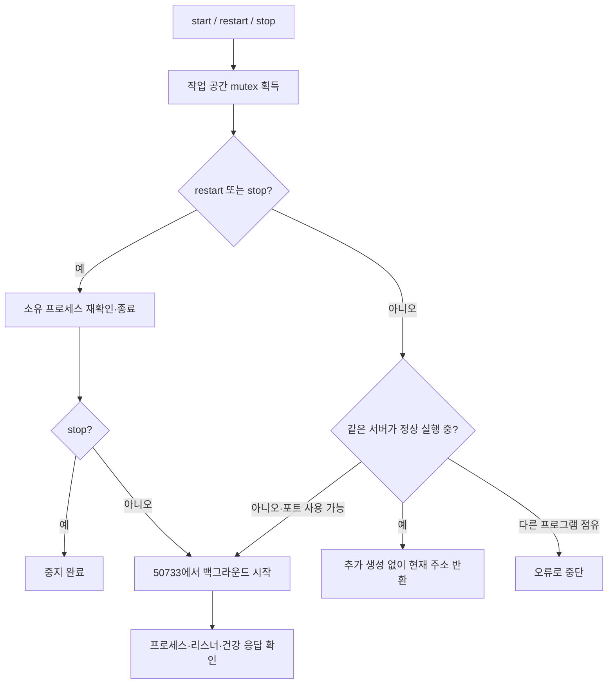

# 067 — 공유를 중단하고, 하나의 로컬 주소로 재시작 운영

## 문제 정의

서버를 갱신할 때 기존 프로세스를 남겨두고 새 포트를 추가했다. 확인 당시 여행 웹은 호스트4개(50730~50733)와 Docker2개(50729·공유용62254), 총6개였다. ngrok도 실행 중이었다. 사용자가 쓰는 주소와 코드 버전이 달라지고, 같은 저장소를 여러 프로세스가 사용하는 불필요한 운영 상태였다.

<callout icon="💬">
	이제 공유 안할꺼니까 싹다 내리고 로컬주소 하나로 고정하고 재시작 방식으로 바꾸삼...
</callout>

좋은 결과의 기준은 여행 웹의 접근 주소가127.0.0.1:50733 하나이고, 코드 갱신 때 같은 포트에서 기존 프로세스를 교체하며, 공유 터널과 Docker 웹이 자동으로 돌아오지 않는 것이다.

## 분석과 결정

기존 종료 명령의 자동 승인 검토 차단 뒤에 계속 새 포트를 추가한 운영 방식이 문제였다. 사용자가 이번에 전체 종료와 재시작 운영을 명시적으로 요청했다. 실제 프로젝트 프로세스와 부모·자식 관계를 다시 확인한 뒤 종료했고, 이번 실행에서는 정상 처리됐다. 이전 차단의 구체적인 내부 원인은 확인하지 않았다.

단순히 python이나 ngrok이라는 이름으로 모두 종료하면 다른 프로젝트에 영향을 줄 수 있다. 이 저장소의 venv 실행 경로와 travel_agent.web_app 명령, 자식 관계로 웹 프로세스를 정했다. 종료 직전에 생성 시각과 명령이 같은지도 확인했다. 공유 터널도 이 저장소의 share 설정 경로가 들어간 ngrok만 종료했다. Nexus·Ollama 등 LLM 공급자와 다른 프로젝트 서비스는 유지했다.

## 실제 적용 결과

- 호스트의 이전 웹4개를 종료한 뒤50733 하나로 시작했다.
- travel-agent-lab-web-1과 travel-agent-share는 중지했고 restart=no로 바꿨다. 컨테이너·볼륨은 삭제하지 않았다.
- 프로젝트 ngrok의 실행 파일과 런처 모두 종료해 남은 ngrok은0개다.
- 최종 여행 웹 리스너는127.0.0.1:50733 하나다. Python venv 런처와 자식 서버라는 두 프로세스가 있어도 리스닝 서버는1개다.
- 기존 web-host 대화·메모리와 별도 Docker 볼륨, 비공개 공급자 설정은 유지했다.

실제 명령 출력:

```text
Web UI: http://127.0.0.1:50733
Already running: http://127.0.0.1:50733
Web UI: http://127.0.0.1:50733
PowerShell syntax OK: 4 scripts
Already running: http://127.0.0.1:50733
Alternate port rejected
```

```text
/travel-agent-share exited restart=no
/travel-agent-lab-web-1 exited restart=no
```

## 재현한 검증

start_web.ps1을 다시 실행했을 때 서버 PID는 98780에서 98780로 그대로였다. restart_web.ps1을 실행하자 37848로 바뀌었다. 두 경우 주소는 동일했다. 별도 포트50734 지정은 실행 전에 거절됐다.

건강 응답은 status=ok, provider=openai, model=gpt-oss-120b, llm_connected=true, brave_configured=true였다. 게이트웨이 연결 상태 확인이며 새 모델 추론이나 여행 답변 품질 평가를 수행한 것은 아니다. 이번 작업에는 LLM 호출·툴콜·새 테스트 대화가 없다.

PowerShell4개 스크립트의 구문 검사와 실제 시작·반복 시작·재시작·포트 거절·최종 리스너 및 컨테이너 상태를 확인했다. 처음 검증 명령에서 PowerShell 스크립트 결과를 native 명령용 LASTEXITCODE로 검사해 잘못 실패 처리한 부분은 바로 고쳤다. 스크립트 실행의 예외와 실제 PID·리스너 상태로 검증했다.

## 운영 인터페이스와 코드

```powershell
.\scripts\start_web.ps1
.\scripts\restart_web.ps1
.\scripts\start_web.ps1 -Action stop
```

start_web.ps1은 이제 Docker를 띄우지 않고 호스트 관리 스크립트에 위임한다. 이미 정상 서버가 있으면 그대로 반환한다. 재시작은 이 저장소의 호스트 웹만 종료한 뒤 같은 주소로 다시 시작한다. 포트가 다른 프로세스에 점유되면 오류로 중단하고 새 포트로 우회하지 않는다. 작업 공간별 mutex로 시작·재시작 명령을 직렬화한다. PID·stdout·stderr는 비공개 런타임 폴더에 저장한다.

출발 기준 커밋은41843fa다. 다음은 이번067 변경 작업 트리의 실제 `scripts/start_web_host.ps1:Get-ManagedWebProcesses`다. 프로세스 이름만으로 종료하지 않기 위한 소유권 판별이다.

```powershell
function Get-ManagedWebProcesses {
    $taskCandidates = @(Get-CimInstance Win32_Process | Where-Object {
        $_.Name -match '^python(w)?\.exe$' -and
        $_.CommandLine -match '(?:^|\s)-m\s+travel_agent\.web_app(?:\s|$)'
    })
    $taskOwned = [Collections.Generic.HashSet[int]]::new()
    foreach ($taskCandidate in $taskCandidates) {
        if ($taskCandidate.ExecutablePath -eq $taskPython) {
            [void]$taskOwned.Add([int]$taskCandidate.ProcessId)
        }
    }
    do {
        $taskPreviousCount = $taskOwned.Count
        foreach ($taskCandidate in $taskCandidates) {
            if ($taskOwned.Contains([int]$taskCandidate.ParentProcessId)) {
                [void]$taskOwned.Add([int]$taskCandidate.ProcessId)
            }
        }
    } while ($taskPreviousCount -ne $taskOwned.Count)
    @($taskCandidates | Where-Object { $taskOwned.Contains([int]$_.ProcessId) })
}
```



## 남은 범위

재시작은 실행 중인 요청을 중단할 수 있다. 중단 없는 배포나 Windows 서비스 등록을 구현한 것은 아니다. 컨테이너·볼륨·공유 인증 설정은 복구 가능하도록 보존했지만 현재 공유 서비스는 실행하지 않는다. 이후 배포도50733에서 재시작하며 새 포트를 추가하지 않는다.
