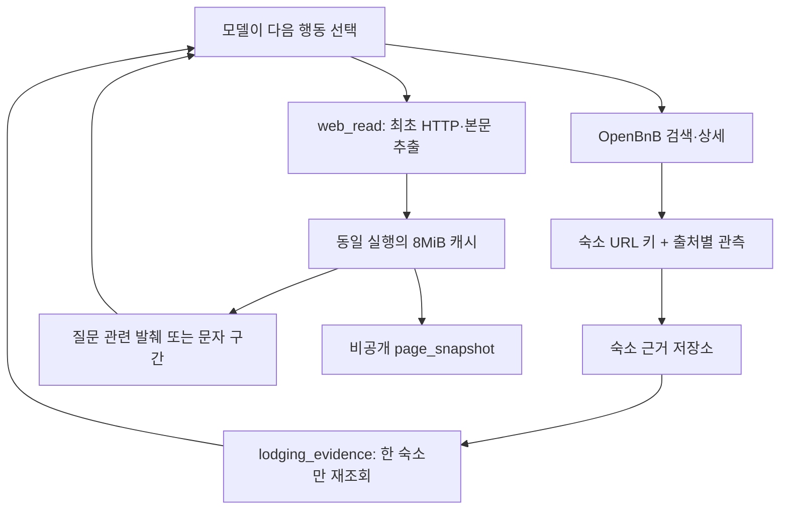

# 069 — 숙소별 근거를 다시 읽고, 같은 본문을 이어 읽기

## 문제 정의: 검색이 끝나도 근거가 섞이면 여행 결정을 돕지 못한다

068의 실제 여행3턴은 종료했지만 서로 다른 숙소의 시설을 섞었고, 가격 적용 조건을 미확인이라고 받은 뒤 확인됐다고 설명했다. 이번 목표는 검색 공급자를 더 추가하는 것이 아니라, 모델이 숙소 하나의 근거를 다시 꺼내고 발췌에서 빠진 내용을 같은 문서에서 추가로 읽게 하는 것이다.

좋은 답변의 기준은 A의 시설을 B로 옮기지 않기, 미확인과 명시적 미제공 구별하기, 요청 날짜·인원을 요금 검증으로 바꾸지 않기, 근거 인용하기다. 추가 읽기는 동일 추출문의 글자를 빠짐없이 재구성하고 HTTP 재조회 없이 동작해야 한다.

## 문제 분석과 설계

기존 OpenBnB 패킷에도 숙소별 항목은 있었지만 여러 호출을 모아 특정 숙소만 다시 조회할 수 없었다. 이름·지역으로 묶으면 동명 숙소와 주변 행정구역을 혼동할 수 있으므로 Airbnb의 /rooms/숫자 URL로만 식별한다. 웹 글의 임의 문장을 숙소 사실로 자동 분류하는 단계는 만들지 않았다.

기존 web_read는 질문 관련 발췌만 반환했다. 검색어를 바꾸면 다시 HTTP로 문서를 수집하므로 내용이 변할 수 있고, 원하는 문단이 선택되지 않을 수도 있다. 실행에 한정한 추출문 캐시와 문자 위치 기반 읽기를 붙인다. 원본 HTML 전체를 모델에 넣거나 모든 본문을 자동으로 읽도록 강제하지 않는다.



## 실험 1: 같은 질문에 대한 실제 모델 답변

아래는 실제 숙소 예약 정보가 아닌 합성 도구 자료를 실제 Nexus 모델에 넣은 통제 실험이다. 111은 Pool·BBQ grill, 222는 Record player를 포함하고 Washer는 Not included다. 두 곳 모두 취소규정은 누락이고 price_conditions_verified=false다. 요청 날짜는2026-11-14~15·성인2명이다. 모델 응답 자체는 생성 결과 그대로 기록했다.

초기 모델 입력의 도구 메시지는 실험용으로 구성한 자료이며 이 단계에서 외부 MCP를 호출한 것은 아니다. 초기 비교는5e9c79c의 시스템 지침·도구 목록과 당시 작업 중이던 보강 지침을 비교했다. 이후 발견한 어댑터 복원 문제와 본문 긴 문자열 문제는 아래에서 따로 설명한다. 여러 변경을 함께 적용했으므로 저장소 기능 하나의 효과를 분리한 실험은 아니다.

### 초기 답변

<callout icon="💬">
	합성 숙소 111과 222를 비교해줘. 각 숙소의 수영장, 바비큐, 레코드 플레이어, 세탁기, 취소규정의 확인 여부를 구분해줘. 요청 날짜와 인원이 있으니 예약 요금 조건까지 검증됐다고 봐도 될까? 다른 사이트를 검색하지 말고 제공된 근거만 사용해줘.
</callout>

**합성 숙소 비교 (2026‑11‑14 ~ 2026‑11‑15, 2인)**  

| 항목 | 숙소 111 | 숙소 222 | 비고 |
|------|----------|----------|------|
| **수영장** | ✅ 확인됨 (Outdoor → Pool) | ❌ 확인되지 않음 | 111에만 명시 |
| **바비큐** | ✅ 확인됨 (Outdoor → BBQ grill) | ❌ 확인되지 않음 | 111에만 명시 |
| **레코드 플레이어** | ❌ 확인되지 않음 | ✅ 확인됨 (Entertainment → Record player) | 222에만 명시 |
| **세탁기(워셔)** | ❌ 확인되지 않음 | ❌ 확인되지 않음 (“Not included → Washer”는 제공되지 않음) | 두 숙소 모두 제공 안 함 |
| **취소규정** | ❓ 확인 불가 (POLICIES_DEFAULT 누락) | ❓ 확인 불가 (POLICIES_DEFAULT 누락) | 정책 정보가 페이지에 없음 |
| **예약 요금·조건 검증** | ❓ 검증되지 않음 (price_conditions_verified = false) | ❓ 검증되지 않음 (price_conditions_verified = false) | 페이지 표시만 존재, 실제 요금·조건은 확인 불가 |

**결론**  
- 숙소 111은 수영장·바비큐가 확인됐고, 숙소 222는 레코드 플레이어가 확인됐습니다.  
- 두 숙소 모두 세탁기 제공 여부와 취소규정은 확인되지 않았으며, 가격·예약 조건도 검증되지 않았습니다.  

*출처*  
- 숙소 111 상세 정보: 【mcp:aaaaaaaaaaaaaaaa】  
- 숙소 222 상세 정보: 【mcp:bbbbbbbbbbbbbbbb】

실행: completed, 모델1회·도구0회. 이 실행에는 실제 도구 호출이 없었다.

### 지침 보강 답변

<callout icon="💬">
	합성 숙소 111과 222를 비교해줘. 각 숙소의 수영장, 바비큐, 레코드 플레이어, 세탁기, 취소규정의 확인 여부를 구분해줘. 요청 날짜와 인원이 있으니 예약 요금 조건까지 검증됐다고 봐도 될까? 다른 사이트를 검색하지 말고 제공된 근거만 사용해줘.
</callout>

**합성 숙소 111 vs 222 비교**

| 항목 | 숙소 111 | 숙소 222 |
|------|----------|----------|
| **수영장** | 확인 (‘Pool’ 포함)【mcp:aaaaaaaaaaaaaaaa】 | 미확인 (목록에 없음) |
| **바비큐** | 확인 (‘BBQ grill’ 포함)【mcp:aaaaaaaaaaaaaaaa】 | 미확인 (목록에 없음) |
| **레코드 플레이어** | 미확인 (목록에 없음) | 확인 (‘Record player’ 포함)【mcp:bbbbbbbbbbbbbbbb】 |
| **세탁기(워셔)** | 미확인 (목록에 없음) | **미포함** – ‘Washer’가 “Not included” 항목에 명시【mcp:bbbbbbbbbbbbbbbb】 |
| **취소규정** | 미확인 – `POLICIES_DEFAULT` 섹션이 누락됨【mcp:aaaaaaaaaaaaaaaa】 | 미확인 – `POLICIES_DEFAULT` 섹션이 누락됨【mcp:bbbbbbbbbbbbbbbb】 |

### 예약 요금 조건 검증 여부
- 두 숙소 모두 `price_conditions_verified` 가 **false**이며, `price_status` 가 **“page_display_only”** 로 표시됩니다【mcp:aaaaaaaaaaaaaaaa】【mcp:bbbbbbbbbbbbbbbb】.  
- 따라서 제공된 날짜·인원(2026‑11‑14~15, 2명)만으로 **요금 조건이 검증되었다고 보기 어렵습니다**. 실제 요금·예약 가능 여부는 별도로 확인이 필요합니다.

**요약**  
- 숙소 111은 수영장·바비큐가 확인됐고, 레코드 플레이어·세탁기·취소규정은 확인되지 않았습니다.  
- 숙소 222는 레코드 플레이어가 확인됐으며, 세탁기는 제공되지 않음이 명시되었습니다. 수영장·바비큐·취소규정은 확인되지 않았습니다.  
- 두 숙소 모두 요금·취소규정에 대한 검증이 이루어지지 않았으니, 실제 예약 전 추가 확인이 필요합니다.

실행: completed, 모델1회·도구0회. 이 실행에는 실제 도구 호출이 없었다.

초기 답변은 세탁기 행에서 222의 미제공을 설명하면서도 “두 숙소 모두 제공 안 함”으로 일반화했고 결론에서는 다시 두 곳 모두 미확인이라고 했다. 보강 답변은111 미확인과222 명시적 미제공을 구별했고 수영장·바비큐를222로 옮기지 않았다. 두 답변 모두 가격 조건을 검증됐다고 하지는 않았다. 쉬운 합성 사례1회이므로 일반 여행 품질 개선이나 정확도 수치로 확장하지 않는다.

## 실험 2: 실제 모델이 숙소 근거 도구를 호출하는가

첫 시도는 HTTP429로 답변을 받지 못했다. 자동429 재시도나 공급자 대체를 하지 않았다. 별도 검증에서 사용한 자료는 위와 같은 합성 자료다.

<callout icon="💬">
	lodging_evidence를 실제로 호출해서 airbnb:222의 근거만 다시 확인하고 시설과 미확인 항목을 답해줘.
</callout>

답변 없음. HTTP Error 429: Too Many Requests

실행: model_error, 모델1회·도구0회.

실제 도구 호출은 없었다.

<callout icon="💬">
	lodging_evidence를 실제로 호출해서 airbnb:222의 근거만 다시 확인하고 시설과 미확인 항목을 답해줘.
</callout>

**airbnb:222** 에 대한 확인된 근거는 다음과 같습니다.

| 항목 | 내용 |
|------|------|
| **제공 시설** | • **레코드 플레이어** (엔터테인먼트) |
| **제공되지 않음** | • **세탁기** (Not included) |
| **미확인·누락된 섹션** | • DESCRIPTION_DEFAULT (설명)<br>• HIGHLIGHTS_DEFAULT (특징)<br>• LOCATION_DEFAULT (위치 상세)<br>• POLICIES_DEFAULT (취소·체크인 정책) |

※ 위 “미확인·누락된 섹션”은 해당 페이지에 내용이 없거나 확인되지 않아 현재는 알 수 없는 정보입니다. 제공된 시설 외에 추가적인 편의시설이나 정책 등은 확인되지 않았습니다.

실행: completed, 모델2회·도구1회.

<details>
<summary>실제 도구 호출·결과·다음 모델에 전달된 내용</summary>
	```json
	[
	  {
	    "name": "lodging_evidence",
	    "tool_call_id": "chatcmpl-tool-836dca93e88ee789",
	    "span": "1.1",
	    "arguments": "{\"listing_key\": \"airbnb:222\"}",
	    "started_at": "2026-10-19T12:59:52.746921+00:00",
	    "finished_at": "2026-10-19T12:59:52.747461+00:00",
	    "result": {
	      "content_kind": "lodging_evidence",
	      "listing_key": "airbnb:222",
	      "url": "https://www.airbnb.com/rooms/222",
	      "guidance": "Only this listing. Observations are separate sources/conditions, not independent verification. Missing is unknown, not unavailable. Not included remains excluded.",
	      "observations": [
	        {
	          "source_id": "mcp:bbbbbbbbbbbbbbbb",
	          "observed_at": null,
	          "request_context": {
	            "adults": 2,
	            "checkin": "2026-11-14",
	            "checkout": "2026-11-15"
	          },
	          "price_conditions_verified": false,
	          "sections": [
	            {
	              "id": "AMENITIES_DEFAULT",
	              "seeAllAmenitiesGroups": {
	                "Entertainment": "Record player",
	                "Not included": "Washer"
	              }
	            }
	          ],
	          "missing_sections": [
	            "DESCRIPTION_DEFAULT",
	            "HIGHLIGHTS_DEFAULT",
	            "LOCATION_DEFAULT",
	            "POLICIES_DEFAULT"
	          ],
	          "omitted_sections": []
	        }
	      ],
	      "omitted_source_ids": [],
	      "omitted_source_count": 0
	    }
	  },
	  {
	    "next_model_tool_messages": [
	      {
	        "role": "tool",
	        "tool_name": "lodging_evidence",
	        "content": "{\"content_kind\":\"lodging_evidence\",\"guidance\":\"Only this listing. Observations are separate sources/conditions, not independent verification. Missing is unknown, not unavailable. Not included remains excluded.\",\"listing_key\":\"airbnb:222\",\"observations\":[{\"missing_sections\":[\"DESCRIPTION_DEFAULT\",\"HIGHLIGHTS_DEFAULT\",\"LOCATION_DEFAULT\",\"POLICIES_DEFAULT\"],\"observed_at\":null,\"omitted_sections\":[],\"price_conditions_verified\":false,\"request_context\":{\"adults\":2,\"checkin\":\"2026-11-14\",\"checkout\":\"2026-11-15\"},\"sections\":[{\"id\":\"AMENITIES_DEFAULT\",\"seeAllAmenitiesGroups\":{\"Entertainment\":\"Record player\",\"Not included\":\"Washer\"}}],\"source_id\":\"mcp:bbbbbbbbbbbbbbbb\"}],\"omitted_source_count\":0,\"omitted_source_ids\":[],\"url\":\"https://www.airbnb.com/rooms/222\"}",
	        "tool_call_id": "chatcmpl-tool-836dca93e88ee789"
	      }
	    ]
	  }
	]
	```
</details>

최종 검증은 실제 lodging_evidence 1회와 모델2회로 종료했다. 222의 Record player·Washer 미제공·누락된 정책을 구별하고111의 수영장을 가져오지 않았다. 다만 최종 답변에 원래 MCP 출처를 인용하지 않았다. **도구 왕복은 성공했지만 인용을 포함한 답변 품질 전체 통과는 아니다.** 도구를 명시적으로 요청한 실험이므로 모델이 자율적으로 항상 이 도구를 선택한다는 증거도 아니다.

회귀 검사에서는 초기 패킷에서 model_adapter를 제거하던 방식 때문에 요약 후 원문 복원이 되지 않는 것을 발견했다. 새 패킷은 식별자를 유지하고 기존 패킷은 Airbnb 공개 페이지 표식·remote_tool을 확인해 호환한다. 현재 사용자·세션 원문만 읽으며 다른 사용자의 합성 Pool 관측이 섞이지 않는 것을 검사했다.

## 실험 3: 실제 공개 본문을 한 번 수집하고 끝까지 이어 읽기

<callout icon="💬">
	직접 web_read 진단: https://www.yeogi.com/domestic-accommodations/45399?checkIn=2026-11-14&checkOut=2026-11-15&personal=2 / 확인할 내용: 숙소 주소 및 취소 규정
</callout>

이 실험은 모델이 검색해서 선택한 결과가 아니라 공개 URL을 지정한 독립 도구 진단이다. 모델 호출·검색 호출·예약 호출은 없다. HTML을 HTTP로 받아 본문을 추출한 뒤 질문 관련 발췌와 순차 구간을 만들었다. 아래 패킷은 모델에 보낼 수 있도록 실제 직렬화한 내용이며 이 진단에서 모델에 전송하지 않았다.

첫1600바이트 진단은 공백 없는 긴 문자열 경계에서 순차 발췌를 만들지 못했다. 완결 경계를 고집해 내용을 없애는 대신 text_is_fragment와 boundary_split으로 조각을 명시하고 UTF-8 문자를 보존하도록 수정했다. 초기 실패 뒤에는 새로 HTTP로 수집해 재검증했으므로 초기·후속 수집의 원문이 같았다고 주장하지 않는다.

후속 실제 결과: HTTP200, 최초 수집1회, 추출문3246문자, 순차12구간. 같은 토큰으로 읽은 구간들을 합쳐 해당 수집의 추출문과 완전히 일치했다. 결과 JSON은 각1600바이트 이하였다. 기본 런타임 예산3500바이트보다 작게 설정한 경계 검사다. 13회 함수 조회(최초 발췌+12구간)를 HTTP13회로 해석하지 않는다.

| 순서 | 모드 | 시작 문자 | 다음 문자 | 캐시 |
|---|---|---:|---:|---|
| 0 | query_excerpt | None | 0 | False |
| 1 | sequential | 0 | 415 | True |
| 2 | sequential | 415 | 671 | True |
| 3 | sequential | 671 | 992 | True |
| 4 | sequential | 992 | 1282 | True |
| 5 | sequential | 1282 | 1669 | True |
| 6 | sequential | 1669 | 1978 | True |
| 7 | sequential | 1978 | 2308 | True |
| 8 | sequential | 2308 | 2343 | True |
| 9 | sequential | 2343 | 2637 | True |
| 10 | sequential | 2637 | 2920 | True |
| 11 | sequential | 2920 | 3229 | True |
| 12 | sequential | 3229 | None | True |

<details>
<summary>실제 직접 조회 인자·결과와 모델 전달 예정 패킷</summary>
	모델이 요청한 tool_call_id는 없다. 직접 조회 순서와 실제 fetched_at·elapsed_ms를 아래에 남겼다. 첫 발췌와 첫 순차 구간은 실제 전달 예정 패킷을 그대로 보여준다. 이후 구간은 위치·길이·캐시 결과를 모두 표시하고 이번 분석과 관계없는 후기 본문은 싣지 않았다. 전체 실행 결과는 비공개로 보존한다.
	
	### 직접 조회 0
	
	실제 인자:
	```json
	{
	  "source_id": "web:4539900000000000",
	  "query": "숙소 주소 및 취소 규정"
	}
	```
	
	실제 결과 메타데이터 (text는 251문자):
	```json
	{
	  "id": "web:4539900000000000",
	  "title": "여기어때 공개 숙소 페이지 직접 읽기 진단",
	  "url": "https://www.yeogi.com/domestic-accommodations/45399?checkIn=2026-11-14&checkOut=2026-11-15&personal=2",
	  "content_kind": "page_excerpt",
	  "page_fetched": true,
	  "format": "markdown",
	  "verified_current": false,
	  "selection_query": "숙소 주소 및 취소 규정",
	  "body_signal": "text_extracted",
	  "truncated": true,
	  "selected_blocks": [
	    0
	  ],
	  "total_blocks": 11,
	  "download_bytes": 225249,
	  "method": "GET",
	  "http_status": 200,
	  "fetched_at": "2026-10-19T12:59:33.740991+00:00",
	  "document_token": "edba5c297b39d6e2",
	  "cache_hit": false,
	  "total_chars": 3246,
	  "start_index": null,
	  "next_start_index": 0,
	  "reading_mode": "query_excerpt",
	  "elapsed_ms": 666
	}
	```
	
	실제 모델 전달 예정 패킷:
	```text
	{"body_signal":"text_extracted","cache_hit":false,"content_kind":"page_excerpt","document_token":"edba5c297b39d6e2","fetched_at":"2026-10-19T12:59:33.740991+00:00","id":"web:4539900000000000","next_start_index":0,"page_fetched":true,"reading_mode":"query_excerpt","selection_query":"숙소 주소 및 취소 규정","start_index":null,"total_chars":3246,"truncated":true,"verified_current":false}
	여기어때 공개 숙소 페이지 직접 읽기 진단
	https://www.yeogi.com/domestic-accommodations/45399?checkIn=2026-11-14&checkOut=2026-11-15&personal=2
	숙소 페이지 JSON-LD 주소 (페이지 제공 정보·독립 검증 아님):
	[{"address":{"addressCountry":"KR","addressRegion":"가평","streetAddress":"경기 가평군 가평읍 경반리 583-19"},"independently_verified":false,"name":"가평 천상지애 펜션","source":"page_jsonld"}]
	
	# 가평 천상지애 펜션
	
	## 서비스 및 부대시설
	
	## 객실 선택
	```
	
	### 직접 조회 1
	
	실제 인자:
	```json
	{
	  "source_id": "web:4539900000000000",
	  "query": "숙소 주소 및 취소 규정",
	  "document_token": "edba5c297b39d6e2",
	  "start_index": 0
	}
	```
	
	실제 결과 메타데이터 (text는 415문자):
	```json
	{
	  "id": "web:4539900000000000",
	  "title": "여기어때 공개 숙소 페이지 직접 읽기 진단",
	  "url": "https://www.yeogi.com/domestic-accommodations/45399?checkIn=2026-11-14&checkOut=2026-11-15&personal=2",
	  "content_kind": "page_excerpt",
	  "page_fetched": true,
	  "format": "markdown",
	  "verified_current": false,
	  "selection_query": "숙소 주소 및 취소 규정",
	  "body_signal": "text_extracted",
	  "truncated": true,
	  "selected_blocks": [],
	  "total_blocks": 0,
	  "download_bytes": 225249,
	  "method": "GET",
	  "http_status": 200,
	  "fetched_at": "2026-10-19T12:59:33.740991+00:00",
	  "document_token": "edba5c297b39d6e2",
	  "cache_hit": true,
	  "total_chars": 3246,
	  "start_index": 0,
	  "next_start_index": 415,
	  "reading_mode": "sequential",
	  "text_is_fragment": true,
	  "boundary_split": false,
	  "elapsed_ms": 1
	}
	```
	
	실제 모델 전달 예정 패킷:
	```text
	{"body_signal":"text_extracted","boundary_split":false,"cache_hit":true,"content_kind":"page_excerpt","document_token":"edba5c297b39d6e2","fetched_at":"2026-10-19T12:59:33.740991+00:00","id":"web:4539900000000000","next_start_index":415,"page_fetched":true,"reading_mode":"sequential","selection_query":"숙소 주소 및 취소 규정","start_index":0,"text_is_fragment":true,"total_chars":3246,"truncated":true,"verified_current":false}
	여기어때 공개 숙소 페이지 직접 읽기 진단
	https://www.yeogi.com/domestic-accommodations/45399?checkIn=2026-11-14&checkOut=2026-11-15&personal=2
	숙소 페이지 JSON-LD 주소 (페이지 제공 정보·독립 검증 아님):
	[{"address":{"addressCountry":"KR","addressRegion":"가평","streetAddress":"경기 가평군 가평읍 경반리 583-19"},"independently_verified":false,"name":"가평 천상지애 펜션","source":"page_jsonld"}]
	
	# 가평 천상지애 펜션
	
	## 서비스 및 부대시설
	
	## 객실 선택
	
	- 2+A룸 (아그네스) 무료취소 - 11월 6일 23:59까지 입실 15:00·퇴실 11:00170,000원객실정보기준2인 · 최대4인 (유료)
	- 2+C룸 (칼리아) 무료취소 - 11월 6일 23:59까지 입실 15:00·퇴실 11:00170,000원객실정보기준2인 · 최대4인 (유료)
	```
	
	### 직접 조회 2
	
	실제 인자:
	```json
	{
	  "source_id": "web:4539900000000000",
	  "query": "숙소 주소 및 취소 규정",
	  "document_token": "edba5c297b39d6e2",
	  "start_index": 415
	}
	```
	
	실제 결과 메타데이터 (text는 256문자):
	```json
	{
	  "id": "web:4539900000000000",
	  "title": "여기어때 공개 숙소 페이지 직접 읽기 진단",
	  "url": "https://www.yeogi.com/domestic-accommodations/45399?checkIn=2026-11-14&checkOut=2026-11-15&personal=2",
	  "content_kind": "page_excerpt",
	  "page_fetched": true,
	  "format": "markdown",
	  "verified_current": false,
	  "selection_query": "숙소 주소 및 취소 규정",
	  "body_signal": "text_extracted",
	  "truncated": true,
	  "selected_blocks": [],
	  "total_blocks": 0,
	  "download_bytes": 225249,
	  "method": "GET",
	  "http_status": 200,
	  "fetched_at": "2026-10-19T12:59:33.740991+00:00",
	  "document_token": "edba5c297b39d6e2",
	  "cache_hit": true,
	  "total_chars": 3246,
	  "start_index": 415,
	  "next_start_index": 671,
	  "reading_mode": "sequential",
	  "text_is_fragment": true,
	  "boundary_split": false,
	  "elapsed_ms": 0
	}
	```
	
	### 직접 조회 3
	
	실제 인자:
	```json
	{
	  "source_id": "web:4539900000000000",
	  "query": "숙소 주소 및 취소 규정",
	  "document_token": "edba5c297b39d6e2",
	  "start_index": 671
	}
	```
	
	실제 결과 메타데이터 (text는 321문자):
	```json
	{
	  "id": "web:4539900000000000",
	  "title": "여기어때 공개 숙소 페이지 직접 읽기 진단",
	  "url": "https://www.yeogi.com/domestic-accommodations/45399?checkIn=2026-11-14&checkOut=2026-11-15&personal=2",
	  "content_kind": "page_excerpt",
	  "page_fetched": true,
	  "format": "markdown",
	  "verified_current": false,
	  "selection_query": "숙소 주소 및 취소 규정",
	  "body_signal": "text_extracted",
	  "truncated": true,
	  "selected_blocks": [],
	  "total_blocks": 0,
	  "download_bytes": 225249,
	  "method": "GET",
	  "http_status": 200,
	  "fetched_at": "2026-10-19T12:59:33.740991+00:00",
	  "document_token": "edba5c297b39d6e2",
	  "cache_hit": true,
	  "total_chars": 3246,
	  "start_index": 671,
	  "next_start_index": 992,
	  "reading_mode": "sequential",
	  "text_is_fragment": true,
	  "boundary_split": false,
	  "elapsed_ms": 0
	}
	```
	
	### 직접 조회 4
	
	실제 인자:
	```json
	{
	  "source_id": "web:4539900000000000",
	  "query": "숙소 주소 및 취소 규정",
	  "document_token": "edba5c297b39d6e2",
	  "start_index": 992
	}
	```
	
	실제 결과 메타데이터 (text는 290문자):
	```json
	{
	  "id": "web:4539900000000000",
	  "title": "여기어때 공개 숙소 페이지 직접 읽기 진단",
	  "url": "https://www.yeogi.com/domestic-accommodations/45399?checkIn=2026-11-14&checkOut=2026-11-15&personal=2",
	  "content_kind": "page_excerpt",
	  "page_fetched": true,
	  "format": "markdown",
	  "verified_current": false,
	  "selection_query": "숙소 주소 및 취소 규정",
	  "body_signal": "text_extracted",
	  "truncated": true,
	  "selected_blocks": [],
	  "total_blocks": 0,
	  "download_bytes": 225249,
	  "method": "GET",
	  "http_status": 200,
	  "fetched_at": "2026-10-19T12:59:33.740991+00:00",
	  "document_token": "edba5c297b39d6e2",
	  "cache_hit": true,
	  "total_chars": 3246,
	  "start_index": 992,
	  "next_start_index": 1282,
	  "reading_mode": "sequential",
	  "text_is_fragment": true,
	  "boundary_split": false,
	  "elapsed_ms": 0
	}
	```
	
	### 직접 조회 5
	
	실제 인자:
	```json
	{
	  "source_id": "web:4539900000000000",
	  "query": "숙소 주소 및 취소 규정",
	  "document_token": "edba5c297b39d6e2",
	  "start_index": 1282
	}
	```
	
	실제 결과 메타데이터 (text는 387문자):
	```json
	{
	  "id": "web:4539900000000000",
	  "title": "여기어때 공개 숙소 페이지 직접 읽기 진단",
	  "url": "https://www.yeogi.com/domestic-accommodations/45399?checkIn=2026-11-14&checkOut=2026-11-15&personal=2",
	  "content_kind": "page_excerpt",
	  "page_fetched": true,
	  "format": "markdown",
	  "verified_current": false,
	  "selection_query": "숙소 주소 및 취소 규정",
	  "body_signal": "text_extracted",
	  "truncated": true,
	  "selected_blocks": [],
	  "total_blocks": 0,
	  "download_bytes": 225249,
	  "method": "GET",
	  "http_status": 200,
	  "fetched_at": "2026-10-19T12:59:33.740991+00:00",
	  "document_token": "edba5c297b39d6e2",
	  "cache_hit": true,
	  "total_chars": 3246,
	  "start_index": 1282,
	  "next_start_index": 1669,
	  "reading_mode": "sequential",
	  "text_is_fragment": true,
	  "boundary_split": false,
	  "elapsed_ms": 0
	}
	```
	
	### 직접 조회 6
	
	실제 인자:
	```json
	{
	  "source_id": "web:4539900000000000",
	  "query": "숙소 주소 및 취소 규정",
	  "document_token": "edba5c297b39d6e2",
	  "start_index": 1669
	}
	```
	
	실제 결과 메타데이터 (text는 309문자):
	```json
	{
	  "id": "web:4539900000000000",
	  "title": "여기어때 공개 숙소 페이지 직접 읽기 진단",
	  "url": "https://www.yeogi.com/domestic-accommodations/45399?checkIn=2026-11-14&checkOut=2026-11-15&personal=2",
	  "content_kind": "page_excerpt",
	  "page_fetched": true,
	  "format": "markdown",
	  "verified_current": false,
	  "selection_query": "숙소 주소 및 취소 규정",
	  "body_signal": "text_extracted",
	  "truncated": true,
	  "selected_blocks": [],
	  "total_blocks": 0,
	  "download_bytes": 225249,
	  "method": "GET",
	  "http_status": 200,
	  "fetched_at": "2026-10-19T12:59:33.740991+00:00",
	  "document_token": "edba5c297b39d6e2",
	  "cache_hit": true,
	  "total_chars": 3246,
	  "start_index": 1669,
	  "next_start_index": 1978,
	  "reading_mode": "sequential",
	  "text_is_fragment": true,
	  "boundary_split": false,
	  "elapsed_ms": 0
	}
	```
	
	### 직접 조회 7
	
	실제 인자:
	```json
	{
	  "source_id": "web:4539900000000000",
	  "query": "숙소 주소 및 취소 규정",
	  "document_token": "edba5c297b39d6e2",
	  "start_index": 1978
	}
	```
	
	실제 결과 메타데이터 (text는 330문자):
	```json
	{
	  "id": "web:4539900000000000",
	  "title": "여기어때 공개 숙소 페이지 직접 읽기 진단",
	  "url": "https://www.yeogi.com/domestic-accommodations/45399?checkIn=2026-11-14&checkOut=2026-11-15&personal=2",
	  "content_kind": "page_excerpt",
	  "page_fetched": true,
	  "format": "markdown",
	  "verified_current": false,
	  "selection_query": "숙소 주소 및 취소 규정",
	  "body_signal": "text_extracted",
	  "truncated": true,
	  "selected_blocks": [],
	  "total_blocks": 0,
	  "download_bytes": 225249,
	  "method": "GET",
	  "http_status": 200,
	  "fetched_at": "2026-10-19T12:59:33.740991+00:00",
	  "document_token": "edba5c297b39d6e2",
	  "cache_hit": true,
	  "total_chars": 3246,
	  "start_index": 1978,
	  "next_start_index": 2308,
	  "reading_mode": "sequential",
	  "text_is_fragment": true,
	  "boundary_split": false,
	  "elapsed_ms": 0
	}
	```
	
	### 직접 조회 8
	
	실제 인자:
	```json
	{
	  "source_id": "web:4539900000000000",
	  "query": "숙소 주소 및 취소 규정",
	  "document_token": "edba5c297b39d6e2",
	  "start_index": 2308
	}
	```
	
	실제 결과 메타데이터 (text는 35문자):
	```json
	{
	  "id": "web:4539900000000000",
	  "title": "여기어때 공개 숙소 페이지 직접 읽기 진단",
	  "url": "https://www.yeogi.com/domestic-accommodations/45399?checkIn=2026-11-14&checkOut=2026-11-15&personal=2",
	  "content_kind": "page_excerpt",
	  "page_fetched": true,
	  "format": "markdown",
	  "verified_current": false,
	  "selection_query": "숙소 주소 및 취소 규정",
	  "body_signal": "text_extracted",
	  "truncated": true,
	  "selected_blocks": [],
	  "total_blocks": 0,
	  "download_bytes": 225249,
	  "method": "GET",
	  "http_status": 200,
	  "fetched_at": "2026-10-19T12:59:33.740991+00:00",
	  "document_token": "edba5c297b39d6e2",
	  "cache_hit": true,
	  "total_chars": 3246,
	  "start_index": 2308,
	  "next_start_index": 2343,
	  "reading_mode": "sequential",
	  "text_is_fragment": true,
	  "boundary_split": false,
	  "elapsed_ms": 0
	}
	```
	
	### 직접 조회 9
	
	실제 인자:
	```json
	{
	  "source_id": "web:4539900000000000",
	  "query": "숙소 주소 및 취소 규정",
	  "document_token": "edba5c297b39d6e2",
	  "start_index": 2343
	}
	```
	
	실제 결과 메타데이터 (text는 294문자):
	```json
	{
	  "id": "web:4539900000000000",
	  "title": "여기어때 공개 숙소 페이지 직접 읽기 진단",
	  "url": "https://www.yeogi.com/domestic-accommodations/45399?checkIn=2026-11-14&checkOut=2026-11-15&personal=2",
	  "content_kind": "page_excerpt",
	  "page_fetched": true,
	  "format": "markdown",
	  "verified_current": false,
	  "selection_query": "숙소 주소 및 취소 규정",
	  "body_signal": "text_extracted",
	  "truncated": true,
	  "selected_blocks": [],
	  "total_blocks": 0,
	  "download_bytes": 225249,
	  "method": "GET",
	  "http_status": 200,
	  "fetched_at": "2026-10-19T12:59:33.740991+00:00",
	  "document_token": "edba5c297b39d6e2",
	  "cache_hit": true,
	  "total_chars": 3246,
	  "start_index": 2343,
	  "next_start_index": 2637,
	  "reading_mode": "sequential",
	  "text_is_fragment": true,
	  "boundary_split": true,
	  "elapsed_ms": 0
	}
	```
	
	### 직접 조회 10
	
	실제 인자:
	```json
	{
	  "source_id": "web:4539900000000000",
	  "query": "숙소 주소 및 취소 규정",
	  "document_token": "edba5c297b39d6e2",
	  "start_index": 2637
	}
	```
	
	실제 결과 메타데이터 (text는 283문자):
	```json
	{
	  "id": "web:4539900000000000",
	  "title": "여기어때 공개 숙소 페이지 직접 읽기 진단",
	  "url": "https://www.yeogi.com/domestic-accommodations/45399?checkIn=2026-11-14&checkOut=2026-11-15&personal=2",
	  "content_kind": "page_excerpt",
	  "page_fetched": true,
	  "format": "markdown",
	  "verified_current": false,
	  "selection_query": "숙소 주소 및 취소 규정",
	  "body_signal": "text_extracted",
	  "truncated": true,
	  "selected_blocks": [],
	  "total_blocks": 0,
	  "download_bytes": 225249,
	  "method": "GET",
	  "http_status": 200,
	  "fetched_at": "2026-10-19T12:59:33.740991+00:00",
	  "document_token": "edba5c297b39d6e2",
	  "cache_hit": true,
	  "total_chars": 3246,
	  "start_index": 2637,
	  "next_start_index": 2920,
	  "reading_mode": "sequential",
	  "text_is_fragment": true,
	  "boundary_split": false,
	  "elapsed_ms": 0
	}
	```
	
	### 직접 조회 11
	
	실제 인자:
	```json
	{
	  "source_id": "web:4539900000000000",
	  "query": "숙소 주소 및 취소 규정",
	  "document_token": "edba5c297b39d6e2",
	  "start_index": 2920
	}
	```
	
	실제 결과 메타데이터 (text는 309문자):
	```json
	{
	  "id": "web:4539900000000000",
	  "title": "여기어때 공개 숙소 페이지 직접 읽기 진단",
	  "url": "https://www.yeogi.com/domestic-accommodations/45399?checkIn=2026-11-14&checkOut=2026-11-15&personal=2",
	  "content_kind": "page_excerpt",
	  "page_fetched": true,
	  "format": "markdown",
	  "verified_current": false,
	  "selection_query": "숙소 주소 및 취소 규정",
	  "body_signal": "text_extracted",
	  "truncated": true,
	  "selected_blocks": [],
	  "total_blocks": 0,
	  "download_bytes": 225249,
	  "method": "GET",
	  "http_status": 200,
	  "fetched_at": "2026-10-19T12:59:33.740991+00:00",
	  "document_token": "edba5c297b39d6e2",
	  "cache_hit": true,
	  "total_chars": 3246,
	  "start_index": 2920,
	  "next_start_index": 3229,
	  "reading_mode": "sequential",
	  "text_is_fragment": true,
	  "boundary_split": false,
	  "elapsed_ms": 0
	}
	```
	
	### 직접 조회 12
	
	실제 인자:
	```json
	{
	  "source_id": "web:4539900000000000",
	  "query": "숙소 주소 및 취소 규정",
	  "document_token": "edba5c297b39d6e2",
	  "start_index": 3229
	}
	```
	
	실제 결과 메타데이터 (text는 17문자):
	```json
	{
	  "id": "web:4539900000000000",
	  "title": "여기어때 공개 숙소 페이지 직접 읽기 진단",
	  "url": "https://www.yeogi.com/domestic-accommodations/45399?checkIn=2026-11-14&checkOut=2026-11-15&personal=2",
	  "content_kind": "page_excerpt",
	  "page_fetched": true,
	  "format": "markdown",
	  "verified_current": false,
	  "selection_query": "숙소 주소 및 취소 규정",
	  "body_signal": "text_extracted",
	  "truncated": false,
	  "selected_blocks": [],
	  "total_blocks": 0,
	  "download_bytes": 225249,
	  "method": "GET",
	  "http_status": 200,
	  "fetched_at": "2026-10-19T12:59:33.740991+00:00",
	  "document_token": "edba5c297b39d6e2",
	  "cache_hit": true,
	  "total_chars": 3246,
	  "start_index": 3229,
	  "next_start_index": null,
	  "reading_mode": "sequential",
	  "text_is_fragment": true,
	  "boundary_split": false,
	  "elapsed_ms": 0
	}
	```
	
</details>

## 실제 구현과 역할

기준은5e9c79c에서 시작한069 변경이다. 다음 코드는 설명용 의사 코드가 아니라 이번 작업 소스에서 가져왔다.

### src/travel_agent/lodging_evidence.py / listing_key

숙소 이름으로 합치지 않고 허용된 공급자의 숙소 ID만 사용한다.

```python
def listing_key(url):
    """Never join properties by display name, coordinates, or search region."""
    if not isinstance(url, str):
        return None
    try:
        parsed = urlsplit(url)
        valid = parsed.scheme == 'https' and parsed.hostname in {'airbnb.com', 'www.airbnb.com'} and parsed.port in (None,443) and not parsed.username
    except ValueError:
        return None
    if not valid:
        return None
    match = re.fullmatch(r'/rooms/(\d+)/?', parsed.path)
    return 'airbnb:' + match[1] if match else None
```

### src/travel_agent/lodging_evidence.py / read

숙소 키별 관측·요청 조건·원래 출처를 다시 돌려준다. 전체 관측 단위로 출력 예산을 지킨다.

```python
    def read(self, key=None, *, max_bytes=6000):
        if key is None:
            result = {'content_kind': 'lodging_evidence_index', 'listings': [], 'omitted_count': 0}
            for item in self.records.values():
                row = {k: item[k] for k in ('listing_key', 'url')}
                row['source_ids'] = list(item['observations'])
                result['listings'].append(row)
                if len(canonical(result).encode()) > max_bytes - 60:
                    result['listings'].pop()
                    result['omitted_count'] += 1
            return result
        if key not in self.records:
            raise ValueError('No observed listing with this listing_key; call without listing_key to list known properties')
        item = self.records[key]
        result = {'content_kind': 'lodging_evidence', 'listing_key': key, 'url': item['url'],
            'guidance': 'Only this listing. Observations are separate sources/conditions, not independent verification. Missing is unknown, not unavailable. Not included remains excluded.',
            'observations': [], 'omitted_source_ids': [], 'omitted_source_count': 0}
        # Most recent observations first; never splice an oversized source into a partial fact.
        for observation in reversed(list(item['observations'].values())):
            result['observations'].append(observation)
            if len(canonical(result).encode()) > max_bytes - 500:
                result['observations'].pop()
                result['omitted_source_count'] += 1
                if len(result['omitted_source_ids']) < 5:
                    result['omitted_source_ids'].append(observation['source_id'])
        return result
```

### src/travel_agent/web_read.py / load

한 실행의 같은 출처는 동결된 추출문을 재사용한다. 같은 출처만 직렬화하고 다른 출처는 병렬 수집한다.

```python
    def load(self, source, timeout, token=None):
        with self.lock:
            source_lock = self.source_locks.setdefault(source['id'], Lock())
        with source_lock:
            cached = self.pages.get(source['id'])
            if token is not None and (cached is None or cached['document_token'] != token):
                raise ValueError('Document token is not cached in this run; first read source_id with query only')
            if cached is not None:
                return cached, True
            body, info = fetch_public_page(source['url'], timeout)
            text = extract_page(body, source['url'])
            size = len(text.encode())
            cached = {'text': text, 'info': info, 'download_bytes': len(body),
                'fetched_at': datetime.now(timezone.utc).isoformat(),
                'document_token': hashlib.sha256((source['id'] + text).encode()).hexdigest()[:16]}
            with self.lock:
                if self.used_bytes + size > self.max_bytes:
                    raise ValueError('Page cache byte budget reached; cached documents remain readable')
                self.pages[source['id']] = cached
                self.used_bytes += size
            return cached, False
```

agent.run_agent는 범위가 지정된 원문과 도구 메시지에서 근거 저장소를 만들고, 새 MCP 모델 패킷을 수신할 때 추가한다. execute_tool이 숙소 조회와 캐시 본문 읽기를 기존 루프에 연결한다. web_context는 토큰·위치·조각 경고를 실제 모델 메시지에도 유지한다. 추출문 전체는 비공개 page_snapshot에만 기록하며 모델에는 선택한 구간을 준다.

## 해결 결과와 남은 한계

Python246개와 기존 UI JS3종 검사를 통과했다. 숙소 교차 오염·조회 조건별 분리·요약 후 복원·사용자 범위·갱신 후 재조회·한도·캐시 동시성·긴 한글 문자열 재조립을 포함한다. 실제 모델 도구 왕복과 실제 공개 페이지 순차 읽기는 위 범위로 검증했다. 최종 여행3턴 전체를 이번 버전으로 다시 실행한 것은 아니고,068의 품질fail은 유지한다.

모델은 여전히 도구 선택이나 인용을 빠뜨릴 수 있다. 근거 저장소는 모델의 자연어 답변을 강제로 사실에 맞추는 검사기가 아니다. 원사이트 본문 누락·정확한 날짜의 재고·결제 총액·지역 행정경계 문제도 별도다. 과거 관측은 현재 예약 조건으로 승격하지 않는다. OpenBnB 외 웹 문서의 숙소별 의미 분류와 사이트 간 동일 숙소 매칭은 구현하지 않았다.

추가 읽기와 근거 조회도 도구 횟수와 다음 모델 입력 토큰을 사용한다. 새 공급자·유료 API·MCP를 추가하지 않았지만 비용 절감이나 응답속도 향상을 측정해 입증한 것은 아니다. 실제 모델 통제 실험은 임시 SQLite 범위를 닫고 삭제했으며 웹 테스트 대화를 새로 만들지 않았다. 결과와 실행 추적은 비공개로 남겼다. 기존 사용자 대화는 삭제하지 않았다. 화면은 같은50733에서 재시작했다.
