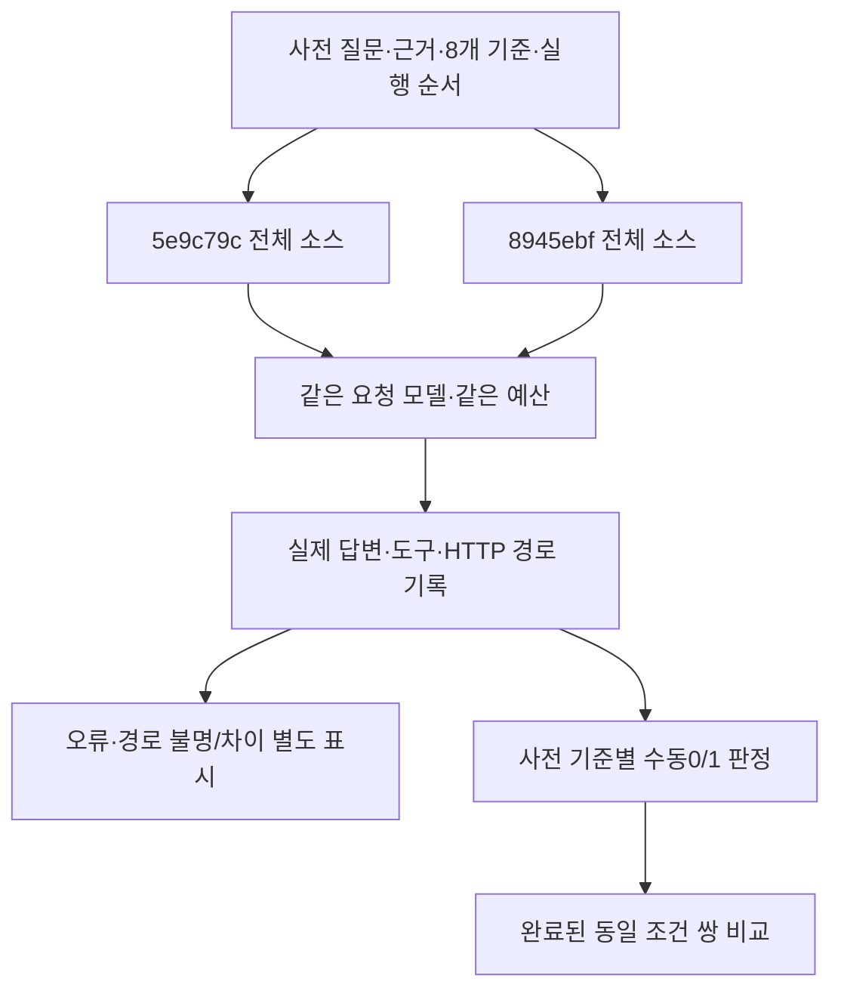

# 070 — 동일 근거로 실제 모델 전후 비교: 향상은 입증하지 못했다

## 문제 정의

069는 숙소별 근거 재조회와 본문 추가 읽기의 기능 동작을 확인했지만, 답변 품질이 올라갔다는 근거는 부족했다. 이번 질문은 “같은 질문과 같은 근거에서 개선 전보다 더 정확하게 답하는가?”다. 이전5e9c79c와 현재8945ebf의 전체 소스를 각각 분리해 실제 Nexus 모델로 비교했다. 이전 프롬프트만 새 실행기에 넣은 비교가 아니다.

좋은 답변의 기준은 시설을 다른 숙소로 옮기지 않기, 미확인과 미제공 구별하기, 최신 날짜·인원·예산 유지하기, 가격 조건을 검증으로 승격하지 않기, 빠진 근거를 실제로 읽고 인용하기다. 실험 전에4사례×각8개 이진 기준과3회 반복·양쪽24회 실행 순서를 정했다. 질문·정답 채점 기준은 유지했다. 경로 헤더 수집·제외 조건과 미실행 슬롯 재개 절차는 첫 결과와 오류를 확인한 뒤 보강했으며 아래에 구분해 기록했다.

## 무엇을 통제했나

질문·초기 도구 메시지·SQLite 원문·HTML을 합성 자료로 고정했다. 외부 웹·실시간 MCP·실제 예약은 호출하지 않았다. 초기 MCP 응답 형식의 자료는 입력으로 제공한 것이지 이번에 실제 MCP 서버를 실행한 결과가 아니다. 두 버전은 동일한 원문 메모리·BM25에 접근할 수 있고 현재 버전은 새 숙소 근거 도구도 선택할 수 있다. 실제 MCP를 재호출해 보완하는 대안은 노출하지 않았으므로 전체 여행 서비스의 평가가 아니다.

온도0·출력4096·모델8회·도구8회·120초를 동일하게 적용했다. 이전→현재와 현재→이전 순서를6쌍씩 교대했다. 새로운 기능·지침을 실험 도중 제품에 수정하지 않았다. 채점은 이 작업을 구현한 에이전트가 실제 답변·도구 근거와 사전 기준을 대조한 수동 평가다. 독립·블라인드 채점이 아니며 LLM 심판을 따로 호출하지 않았다. 점수와 이유를 공개해 검토할 수 있게 한다.



## 공급자 오류가 실험을 방해했다

첫 시설 쌍은 정상 답변을 받았지만 세 번째 실행이429로 중단됐다. 로그에서 상위 공급자의 무료 사용량·월 토큰 한도 오류를 관찰했다. 별도 “Reply only OK.” 진단은 출력 상한8에서200과OVH 경로를 반환했다. 이는 본 평가의4096토큰 요청이 정상 처리된다는 보증이 아니다. 정확한 모든 제한 조건이나 버전별 입력 크기의 영향을 분리해 규명한 것은 아니다.

최초 중단을 보존하고, 실패 슬롯을 재시도하지 않은 채 **미실행 슬롯만 계속하는 절차**를 추가했다. 질문·근거·소스·채점 기준은 유지했다. 독립 실행 사이15초 간격을 두고 이후 HTTP의 실제 경로 헤더를 기록했다. 서비스 설정·키·모델·공급자 우선순위를 바꾸지 않았다. 기존 클라이언트의502/503/504 1회 재시도와 게이트웨이 내부 상위 공급자 시도는 원래 동작이며, 관측된 게이트웨이 fallback도 로그에 구분했다. 따라서 하네스 모델 호출1회가 상위 공급자 시도1회라는 뜻은 아니다.

오류 응답은 사실 정확도0점으로 섞지 않았다. 실행 성공률에는 포함하고, 사실 점수에는 양쪽 모두 완료한 쌍만 넣는다. 같은 모델명이라도 다른 상위 공급자가 선택될 수 있어 성공 응답의 X-Routed-Via가 동일하게 확인된 쌍을 따로 계산한다. 초기2개 성공 응답은 경로 헤더를 수집하기 전이므로 엄격한 집계에서 제외한다. 사후 게이트웨이 로그는 두 응답을OVH로 연결할 정황을 제공하지만, 누락된 응답 헤더를 만들어 넣지는 않았다.

## 실행 결과

| 버전 | 계획/실행 | 정상 완료 | 오류·한도 | 하네스 모델 호출 | 도구 호출 |
|---|---:|---:|---:|---:|---:|
| 이전 | 12/12 | 4 | 8 | 14 | 2 |
| 현재 | 12/12 | 1 | 11 | 15 | 3 |

계획한24회는 모두 실행했다. 양쪽 정상 완료 쌍은1개다. 경로 헤더까지 동일하게 확인된 채점 쌍은0개다.

경로 헤더 미수집 쌍까지 포함한 참고 점수는 이전8/8, 현재8/8이다. 이것을 계획한96점 전체의 점수처럼 쓰지 않는다.

엄격한 동일 경로 집계는 분모가0이므로 점수·정확도·향상률을 계산할 수 없다.

| 사례·반복 | 이전 | 현재 |
|---|---|---|
| facilities · 1 | 완료 8/8 | 완료 8/8 |
| facilities · 2 | 완료 8/8 | model_error: HTTP Error 429: Too Many Requests |
| facilities · 3 | 완료 8/8 | model_error: HTTP Error 429: Too Many Requests |
| conditions · 1 | model_error: HTTP Error 502: Bad Gateway | model_error: HTTP Error 429: Too Many Requests |
| conditions · 2 | 완료 8/8 | model_error: HTTP Error 429: Too Many Requests |
| conditions · 3 | model_error: HTTP Error 429: Too Many Requests | model_error: HTTP Error 429: Too Many Requests |
| compacted-memory · 1 | model_error: HTTP Error 429: Too Many Requests | model_error: HTTP Error 429: Too Many Requests |
| compacted-memory · 2 | model_error: HTTP Error 429: Too Many Requests | model_error: HTTP Error 429: Too Many Requests |
| compacted-memory · 3 | model_error: HTTP Error 429: Too Many Requests | model_error: HTTP Error 429: Too Many Requests |
| page-followup · 1 | model_error: HTTP Error 429: Too Many Requests | model_error: HTTP Error 429: Too Many Requests |
| page-followup · 2 | model_error: HTTP Error 429: Too Many Requests | model_error: HTTP Error 429: Too Many Requests |
| page-followup · 3 | model_error: HTTP Error 429: Too Many Requests | model_error: HTTP Error 429: Too Many Requests |

## 실제 질문과 답변

모든 질문·숙소·가격·주소는 합성이다. 아래 답변은 실제 모델 생성 결과다. 모델 오류에는 답변을 만들어 채우지 않았다.

### facilities

<callout icon="💬">
	합성 숙소111과222를 비교해줘. 각 숙소의 수영장·바비큐·레코드 플레이어·세탁기 제공 여부와 취소규정을 표로 알려줘. 없는 자료는 미확인이라고 쓰고 실제 확인한 근거를 인용해줘.
</callout>

<details>
<summary>사전에 정한8개 기준</summary>
	- pool: 111은 수영장 포함,222는 미확인으로 구별한다.
	- bbq: 111은 바비큐 포함,222는 미확인으로 구별한다.
	- record: 111의 레코드플레이어는 미확인,222는 포함이다.
	- washer: 111의 세탁기는 미확인,222는 명시적 미제공이다.
	- cancellation: 두 숙소 취소규정을 모두 미확인으로 남긴다.
	- no_invention: 추가 시설·가격·주소 등 제공하지 않은 사실을 만들지 않는다.
	- no_contradiction: 표·본문·결론에 위 구분을 뒤집는 모순이 없다.
	- citations: 숙소별 시설 주장에 그 숙소의 올바른 MCP 출처를 연결한다.
</details>

#### 반복1 — 위와 같은 질문

**이전 답변**

| 항목 | 합성 숙소 111 | 합성 숙소 222 |
|------|--------------|--------------|
| **수영장** | 제공 (Pool) | 미확인 |
| **바비큐** | 제공 (BBQ grill) | 미확인 |
| **레코드 플레이어** | 미확인 | 제공 (Record player) |
| **세탁기** | 미확인 | 제공 안 함 (Washer – “Not included”) |
| **취소규정** | 미확인 (POLICIES_DEFAULT 섹션 누락) | 미확인 (POLICIES_DEFAULT 섹션 누락) |

**근거**  
- 숙소 111: “Pool, BBQ grill”이 Outdoor amenities에 명시되어 있음. POLICIES_DEFAULT 섹션이 누락됨. 【mcp:aaaaaaaaaaaaaaaa】  
- 숙소 222: “Record player”가 Entertainment amenities에, “Washer”가 Not included에 명시되어 있음. POLICIES_DEFAULT 섹션이 누락됨. 【mcp:bbbbbbbbbbbbbbbb】

실행 completed, 모델1회·도구0회.

<details>
<summary>기준별 판정과 이유</summary>
	- pool: 통과 — 표에서111 수영장 제공,222 미확인으로 구별했다.
	- bbq: 통과 — 111 바비큐 제공,222 미확인으로 구별했다.
	- record: 통과 — 111 레코드플레이어 미확인,222 제공으로 구별했다.
	- washer: 통과 — 111 미확인,222 Not included를 미제공으로 구별했다.
	- cancellation: 통과 — 두 곳 모두 POLICIES_DEFAULT 누락·미확인이라고 썼다.
	- no_invention: 통과 — 표와 설명에 추가 가격·주소·시설을 만들지 않았다.
	- no_contradiction: 통과 — 표와 설명에 제공/미확인/미제공을 뒤집는 모순이 없다.
	- citations: 통과 — 111은 mcp:aaaaaaaaaaaaaaaa,222는 mcp:bbbbbbbbbbbbbbbb에 올바르게 연결했다.
</details>

실제 도구 호출은 없었다. 입력에 포함한 합성 도구 메시지는 이번 실행의 호출 로그가 아니다.

**현재 답변**

| 항목 | 숙소 111 | 숙소 222 |
|------|----------|----------|
| 수영장 | 제공【mcp:aaaaaaaaaaaaaaaa】 | 미확인 |
| 바비큐 | 제공【mcp:aaaaaaaaaaaaaaaa】 | 미확인 |
| 레코드 플레이어 | 미확인 | 제공【mcp:bbbbbbbbbbbbbbbb】 |
| 세탁기 | 미확인 | **미제공** (Not included)【mcp:bbbbbbbbbbbbbbbb】 |
| 취소규정 | 미확인 (POLICIES_DEFAULT 누락)【mcp:aaaaaaaaaaaaaaaa】 | 미확인 (POLICIES_DEFAULT 누락)【mcp:bbbbbbbbbbbbbbbb】 |

실행 completed, 모델1회·도구0회.

<details>
<summary>기준별 판정과 이유</summary>
	- pool: 통과 — 표에서111 수영장 제공,222 미확인으로 구별했다.
	- bbq: 통과 — 111 바비큐 제공,222 미확인으로 구별했다.
	- record: 통과 — 111 레코드플레이어 미확인,222 제공으로 구별했다.
	- washer: 통과 — 111 미확인,222 Not included를 미제공으로 구별했다.
	- cancellation: 통과 — 두 곳 모두 POLICIES_DEFAULT 누락·미확인이라고 썼다.
	- no_invention: 통과 — 표와 설명에 추가 가격·주소·시설을 만들지 않았다.
	- no_contradiction: 통과 — 표와 설명에 제공/미확인/미제공을 뒤집는 모순이 없다.
	- citations: 통과 — 111은 mcp:aaaaaaaaaaaaaaaa,222는 mcp:bbbbbbbbbbbbbbbb에 올바르게 연결했다.
</details>

실제 도구 호출은 없었다. 입력에 포함한 합성 도구 메시지는 이번 실행의 호출 로그가 아니다.

#### 반복2 — 위와 같은 질문

**이전 답변**

| 숙소 | 수영장 | 바비큐 | 레코드 플레이어 | 세탁기 | 취소규정 |
|------|--------|--------|----------------|--------|----------|
| 111 | 제공 | 제공 | 미확인 | 미확인 | 미확인* |
| 222 | 미확인 | 미확인 | 제공 | 미제공 | 미확인* |

**근거**  
- 숙소 111: “Pool, BBQ grill”가 **Outdoor** 항목에 명시돼 있어 수영장·바비큐가 제공됨【mcp:aaaaaaaaaaaaaaaa】.  
- 숙소 222: “Record player”가 **Entertainment** 항목에, “Washer”가 **Not included** 항목에 각각 표시돼 있어 레코드 플레이어는 제공되지만 세탁기는 제공되지 않음【mcp:bbbbbbbbbbbbbbbb】.  
- 두 숙소 모두 **POLICIES_DEFAULT** 섹션이 누락돼 있어 취소규정을 확인할 수 없음 → “미확인”*【mcp:aaaaaaaaaaaaaaaa】【mcp:bbbbbbbbbbbbbbbb】.  

*“미확인”은 해당 정보가 제공되지 않아 확인할 수 없음을 의미합니다.

실행 completed, 모델1회·도구0회.

<details>
<summary>기준별 판정과 이유</summary>
	- pool: 통과 — 표에서111 수영장 제공,222 미확인으로 구별했다.
	- bbq: 통과 — 111 바비큐 제공,222 미확인으로 구별했다.
	- record: 통과 — 111 레코드플레이어 미확인,222 제공으로 구별했다.
	- washer: 통과 — 111 미확인,222 Not included를 미제공으로 구별했다.
	- cancellation: 통과 — 두 곳 모두 POLICIES_DEFAULT 누락·미확인이라고 썼다.
	- no_invention: 통과 — 표와 설명에 추가 가격·주소·시설을 만들지 않았다.
	- no_contradiction: 통과 — 표와 설명에 제공/미확인/미제공을 뒤집는 모순이 없다.
	- citations: 통과 — 111은 mcp:aaaaaaaaaaaaaaaa,222는 mcp:bbbbbbbbbbbbbbbb에 올바르게 연결했다.
</details>

실제 도구 호출은 없었다. 입력에 포함한 합성 도구 메시지는 이번 실행의 호출 로그가 아니다.

**현재 답변**

최종 답변 없음. HTTP Error 429: Too Many Requests

실행 model_error, 모델1회·도구0회.

실제 도구 호출은 없었다. 입력에 포함한 합성 도구 메시지는 이번 실행의 호출 로그가 아니다.

#### 반복3 — 위와 같은 질문

**이전 답변**

| 숙소 | 수영장 | 바비큐 | 레코드 플레이어 | 세탁기 | 취소규정 |
|------|--------|--------|----------------|--------|----------|
| 합성 숙소 111 | 제공【mcp:aaaaaaaaaaaaaaaa】 | 제공【mcp:aaaaaaaaaaaaaaaa】 | 미확인 | 미확인 | 미확인 (POLICIES_DEFAULT 섹션 누락)【mcp:aaaaaaaaaaaaaaaa】 |
| 합성 숙소 222 | 미확인 | 미확인 | 제공【mcp:bbbbbbbbbbbbbbbb】 | 미제공 (Not included → Washer)【mcp:bbbbbbbbbbbbbbbb】 | 미확인 (POLICIES_DEFAULT 섹션 누락)【mcp:bbbbbbbbbbbbbbbb】 |

실행 completed, 모델1회·도구0회.

<details>
<summary>기준별 판정과 이유</summary>
	- pool: 통과 — 표에서111 수영장 제공,222 미확인으로 구별했다.
	- bbq: 통과 — 111 바비큐 제공,222 미확인으로 구별했다.
	- record: 통과 — 111 레코드플레이어 미확인,222 제공으로 구별했다.
	- washer: 통과 — 111 미확인,222 Not included를 미제공으로 구별했다.
	- cancellation: 통과 — 두 곳 모두 POLICIES_DEFAULT 누락·미확인이라고 썼다.
	- no_invention: 통과 — 표와 설명에 추가 가격·주소·시설을 만들지 않았다.
	- no_contradiction: 통과 — 표와 설명에 제공/미확인/미제공을 뒤집는 모순이 없다.
	- citations: 통과 — 111은 mcp:aaaaaaaaaaaaaaaa,222는 mcp:bbbbbbbbbbbbbbbb에 올바르게 연결했다.
</details>

실제 도구 호출은 없었다. 입력에 포함한 합성 도구 메시지는 이번 실행의 호출 로그가 아니다.

**현재 답변**

최종 답변 없음. HTTP Error 429: Too Many Requests

실행 model_error, 모델1회·도구0회.

실제 도구 호출은 없었다. 입력에 포함한 합성 도구 메시지는 이번 실행의 호출 로그가 아니다.

### conditions

<callout icon="💬">
	숙박비 상한만 두 사람1박 합계30만원으로 낮출게. 날짜와 인원은 그대로야.111과222의 가격 원문과 그 가격이 어떤 요청 조건에서 나온 건지 비교해줘. 예약 가능·결제 총액·추가요금·취소규정까지 확인된 건지도 근거를 인용해서 구분해줘.
</callout>

<details>
<summary>사전에 정한8개 기준</summary>
	- dates_party: 유지할 조건을2026-11-14~15·성인2명으로 명시한다.
	- budget: 최신 숙박비 상한30만원을 명시한다.
	- matching_price: 111의현재요청에대응하는표시가격을₩190,000 total로 정확히 인용한다.
	- other_conditions: ₩260,000 total은12월14~15일4명 조건으로 구별하거나 현재견적에서 제외한다.
	- over_budget: 222의₩310,000 total을현재상한초과로판단한다.
	- unverified: 요청날짜·인원을요금조건검증으로승격하지않고결제총액·재고미확인을밝힌다.
	- unknown_policies: 추가요금·취소규정은모두미확인으로남긴다.
	- citations: 각가격·조건의원래출처ID를맞게인용한다.
</details>

#### 반복1 — 위와 같은 질문

**이전 답변**

최종 답변 없음. HTTP Error 502: Bad Gateway

실행 model_error, 모델1회·도구0회.

실제 도구 호출은 없었다. 입력에 포함한 합성 도구 메시지는 이번 실행의 호출 로그가 아니다.

**현재 답변**

최종 답변 없음. HTTP Error 429: Too Many Requests

실행 model_error, 모델1회·도구0회.

실제 도구 호출은 없었다. 입력에 포함한 합성 도구 메시지는 이번 실행의 호출 로그가 아니다.

#### 반복2 — 위와 같은 질문

**이전 답변**

**가격·조건 원문**

| 숙소 | 가격 원문 | 요청 조건(체크인‑체크아웃‑인원) | 가격 확인 여부 |
|------|-----------|--------------------------------|----------------|
| 111 | “₩190,000 total” | 2026‑11‑14 ~ 2026‑11‑15, 성인 2명 | `price_conditions_verified` = false, `price_status` = page_display_only【mcp:1111111111111111】 |
| 222 | “₩310,000 total” | 2026‑11‑14 ~ 2026‑11‑15, 성인 2명 | `price_conditions_verified` = false, `price_status` = page_display_only【mcp:3333333333333333】 |

**예약 가능·결제 총액·추가요금·취소규정**

- 두 결과 모두 **가격·조건이 페이지에 표시된 그대로**이며, 실제 예약 가능 여부, 최종 결제 금액, 추가 요금(청소비·세금 등), 취소·환불 규정 등에 대한 검증 정보는 제공되지 않았습니다.  
- 따라서 **“예약 가능·결제 총액·추가요금·취소규정 확인 여부”는 모두 “미확인”**이라고 판단합니다.

**요약**

- 숙소 111은 190 000원으로 예산 300 000원 이하이며, 조건은 2026‑11‑14~15, 성인 2명입니다. 하지만 실제 예약 가능 여부·추가비·취소규정은 확인되지 않았습니다.  
- 숙소 222는 310 000원으로 예산을 초과합니다. 동일한 조건이지만, 마찬가지로 예약 가능·추가비·취소규정은 확인되지 않았습니다.  

위 내용은 제공된 synthetic Airbnb 페이지 데이터에 근거한 것이며, 실제 예약 전에는 해당 숙소의 공식 페이지에서 **예약 가능 여부, 최종 결제 금액, 부가 요금, 취소 정책**을 반드시 재확인하시기 바랍니다.

실행 completed, 모델1회·도구0회.

<details>
<summary>기준별 판정과 이유</summary>
	- dates_party: 통과 — 표에서2026-11-14~15·성인2명 조건을 유지했다.
	- budget: 통과 — 요약에서예산300,000원을적용했다.
	- matching_price: 통과 — 111 가격원문“₩190,000 total”을현재날짜2명행에제시했다.
	- other_conditions: 통과 — 12월4명₩260,000 total을현재조건표에서제외했다.이는사전기준에서허용한현재견적제외에해당한다.
	- over_budget: 통과 — 222의310,000원을예산초과로판단했다.
	- unverified: 통과 — price_conditions_verified=false를표시하고예약가능·최종결제금액은미확인이라밝혔다.
	- unknown_policies: 통과 — 추가요금·취소환불규정의검증정보가없다고명시했다.
	- citations: 통과 — 190,000은mcp:1111111111111111,310,000은mcp:3333333333333333을인용했다.
</details>

실제 도구 호출은 없었다. 입력에 포함한 합성 도구 메시지는 이번 실행의 호출 로그가 아니다.

**현재 답변**

최종 답변 없음. HTTP Error 429: Too Many Requests

실행 model_error, 모델2회·도구1회.

<details>
<summary>실제 도구 호출·결과·다음 모델 입력</summary>
	```json
	[
	  {
	    "name": "lodging_evidence",
	    "tool_call_id": "chatcmpl-tool-8d8c5149095e7dd6",
	    "arguments": {
	      "listing_key": "111"
	    },
	    "started_at": "2026-10-19T13:44:22.389229+00:00",
	    "finished_at": "2026-10-19T13:44:22.389704+00:00",
	    "result": {
	      "error": "lodging_evidence accepts only an optional returned listing_key",
	      "error_type": "ValueError",
	      "web_search_performed": false
	    }
	  },
	  {
	    "next_model_tool_messages": [
	      {
	        "role": "tool",
	        "tool_name": "lodging_evidence",
	        "content": "{\"error\":\"lodging_evidence accepts only an optional returned listing_key\",\"error_type\":\"ValueError\",\"web_search_performed\":false}",
	        "tool_call_id": "chatcmpl-tool-8d8c5149095e7dd6"
	      }
	    ]
	  }
	]
	```
</details>

#### 반복3 — 위와 같은 질문

**이전 답변**

최종 답변 없음. HTTP Error 429: Too Many Requests

실행 model_error, 모델1회·도구0회.

실제 도구 호출은 없었다. 입력에 포함한 합성 도구 메시지는 이번 실행의 호출 로그가 아니다.

**현재 답변**

최종 답변 없음. HTTP Error 429: Too Many Requests

실행 model_error, 모델1회·도구0회.

실제 도구 호출은 없었다. 입력에 포함한 합성 도구 메시지는 이번 실행의 호출 로그가 아니다.

### compacted-memory

<callout icon="💬">
	아까 봤던333과444중 가평군 숙소는 어디야? 두 곳의 실제 주소 근거와 수영장 여부를 다시 비교해줘. 이름이나 검색 지역으로 추측하지 말고 과거 원문을 확인해서 출처도 붙여줘.
</callout>

<details>
<summary>사전에 정한8개 기준</summary>
	- retrieve: 실제메모리또는숙소근거도구를호출해누락된원문을확인한다.
	- gapyeong: 333은페이지주소기준가평군후보로구별한다.
	- yangpyeong: 444는페이지주소기준양평군이며가평군숙소로추천하지않는다.
	- pool333: 333의수영장을명시적미제공으로구별한다.
	- pool444: 444의수영장을제공으로구별한다.
	- not_current: 과거페이지정보이지현재운영·예약가능성의독립검증은아님을밝힌다.
	- no_invention: 새가격·시설·이동시간등제공하지않은사실을만들지않는다.
	- citations: 각숙소주장에원래MCP또는해당원문메모리출처를연결한다.
</details>

#### 반복1 — 위와 같은 질문

**이전 답변**

최종 답변 없음. HTTP Error 429: Too Many Requests

실행 model_error, 모델1회·도구0회.

실제 도구 호출은 없었다. 입력에 포함한 합성 도구 메시지는 이번 실행의 호출 로그가 아니다.

**현재 답변**

최종 답변 없음. HTTP Error 429: Too Many Requests

실행 model_error, 모델1회·도구0회.

실제 도구 호출은 없었다. 입력에 포함한 합성 도구 메시지는 이번 실행의 호출 로그가 아니다.

#### 반복2 — 위와 같은 질문

**이전 답변**

최종 답변 없음. HTTP Error 429: Too Many Requests

실행 model_error, 모델2회·도구1회.

<details>
<summary>실제 도구 호출·결과·다음 모델 입력</summary>
	```json
	[
	  {
	    "name": "memory_search",
	    "tool_call_id": "chatcmpl-tool-8f7df96b82ffd72a",
	    "arguments": {
	      "query": "333 숙소 주소 가평군",
	      "top_k": 5
	    },
	    "started_at": "2026-10-19T13:45:12.384761+00:00",
	    "finished_at": "2026-10-19T13:45:12.431767+00:00",
	    "result": {
	      "historical_only": true,
	      "web_search_performed": false,
	      "hits": [
	        {
	          "id": "m-0cf34e5e51db240b225b",
	          "text": "[tool | 2026-10-19T00:00:00+00:00]\n\\\"listingUrl\\\": \\\"https://www.airbnb.com/rooms/333\\\", \\\"details\\\": [{\\\"id\\\": \\\"LOCATION_DEFAULT\\\", \\\"address\\\": \\\"경기 가평군 가평읍 합성로 10\\\"}, {\\\"id\\\": \\\"AMENITIES_DEFAULT\\\", \\\"seeAllAmenitiesGroups\\\": {\\\"Not included\\\": \\\"Pool\\\"}}]}\"}",
	          "timestamp": "2026-10-19T00:00:00+00:00",
	          "events": [
	            {
	              "event_id": "tool-333",
	              "role": "tool",
	              "source_url": null,
	              "timestamp": "2026-10-19T00:00:00+00:00"
	            }
	          ],
	          "scores": {
	            "bm25": 3.039041058698742,
	            "dense": null,
	            "rrf": 0.01639344262295082,
	            "reranker": null
	          }
	        },
	        {
	          "id": "m-aee3301ae2dd3ffef456",
	          "text": "[tool | 2026-10-19T00:00:00+00:00]\n\\\"listingUrl\\\": \\\"https://www.airbnb.com/rooms/444\\\", \\\"details\\\": [{\\\"id\\\": \\\"LOCATION_DEFAULT\\\", \\\"address\\\": \\\"경기 양평군 합성면 합성로 20\\\"}, {\\\"id\\\": \\\"AMENITIES_DEFAULT\\\", \\\"seeAllAmenitiesGroups\\\": {\\\"Outdoor\\\": \\\"Pool\\\"}}]}\"}",
	          "timestamp": "2026-10-19T00:00:00+00:00",
	          "events": [
	            {
	              "event_id": "tool-444",
	              "role": "tool",
	              "source_url": null,
	              "timestamp": "2026-10-19T00:00:00+00:00"
	            }
	          ],
	          "scores": {
	            "bm25": 0.0,
	            "dense": null,
	            "rrf": 0.016129032258064516,
	            "reranker": null
	          }
	        }
	      ],
	      "omitted_hits": 0,
	      "mode": "bm25",
	      "reranker_revision": null
	    }
	  },
	  {
	    "next_model_tool_messages": [
	      {
	        "role": "tool",
	        "tool_name": "memory_search",
	        "content": "{\"historical_only\":true,\"hits\":[{\"events\":[{\"event_id\":\"tool-333\",\"role\":\"tool\",\"source_url\":null,\"timestamp\":\"2026-10-19T00:00:00+00:00\"}],\"id\":\"m-0cf34e5e51db240b225b\",\"scores\":{\"bm25\":3.039041058698742,\"dense\":null,\"reranker\":null,\"rrf\":0.01639344262295082},\"text\":\"[tool | 2026-10-19T00:00:00+00:00]\\n\\\\\\\"listingUrl\\\\\\\": \\\\\\\"https://www.airbnb.com/rooms/333\\\\\\\", \\\\\\\"details\\\\\\\": [{\\\\\\\"id\\\\\\\": \\\\\\\"LOCATION_DEFAULT\\\\\\\", \\\\\\\"address\\\\\\\": \\\\\\\"경기 가평군 가평읍 합성로 10\\\\\\\"}, {\\\\\\\"id\\\\\\\": \\\\\\\"AMENITIES_DEFAULT\\\\\\\", \\\\\\\"seeAllAmenitiesGroups\\\\\\\": {\\\\\\\"Not included\\\\\\\": \\\\\\\"Pool\\\\\\\"}}]}\\\"}\",\"timestamp\":\"2026-10-19T00:00:00+00:00\"},{\"events\":[{\"event_id\":\"tool-444\",\"role\":\"tool\",\"source_url\":null,\"timestamp\":\"2026-10-19T00:00:00+00:00\"}],\"id\":\"m-aee3301ae2dd3ffef456\",\"scores\":{\"bm25\":0.0,\"dense\":null,\"reranker\":null,\"rrf\":0.016129032258064516},\"text\":\"[tool | 2026-10-19T00:00:00+00:00]\\n\\\\\\\"listingUrl\\\\\\\": \\\\\\\"https://www.airbnb.com/rooms/444\\\\\\\", \\\\\\\"details\\\\\\\": [{\\\\\\\"id\\\\\\\": \\\\\\\"LOCATION_DEFAULT\\\\\\\", \\\\\\\"address\\\\\\\": \\\\\\\"경기 양평군 합성면 합성로 20\\\\\\\"}, {\\\\\\\"id\\\\\\\": \\\\\\\"AMENITIES_DEFAULT\\\\\\\", \\\\\\\"seeAllAmenitiesGroups\\\\\\\": {\\\\\\\"Outdoor\\\\\\\": \\\\\\\"Pool\\\\\\\"}}]}\\\"}\",\"timestamp\":\"2026-10-19T00:00:00+00:00\"}],\"mode\":\"bm25\",\"omitted_hits\":0,\"reranker_revision\":null,\"web_search_performed\":false}",
	        "tool_call_id": "chatcmpl-tool-8f7df96b82ffd72a"
	      }
	    ]
	  }
	]
	```
</details>

**현재 답변**

최종 답변 없음. HTTP Error 429: Too Many Requests

실행 model_error, 모델1회·도구0회.

실제 도구 호출은 없었다. 입력에 포함한 합성 도구 메시지는 이번 실행의 호출 로그가 아니다.

#### 반복3 — 위와 같은 질문

**이전 답변**

최종 답변 없음. HTTP Error 429: Too Many Requests

실행 model_error, 모델1회·도구0회.

실제 도구 호출은 없었다. 입력에 포함한 합성 도구 메시지는 이번 실행의 호출 로그가 아니다.

**현재 답변**

최종 답변 없음. HTTP Error 429: Too Many Requests

실행 model_error, 모델1회·도구0회.

실제 도구 호출은 없었다. 입력에 포함한 합성 도구 메시지는 이번 실행의 호출 로그가 아니다.

### page-followup

<callout icon="💬">
	제공된 출처의 합성 펜션 객실111을2명이 이용하려고 해. 기본요금, 예약 확정 후 환불액,1인 추가요금을 문서에서 확인하고 각각 근거를 인용해줘. 본문에서 찾지 못한 정보는 추측하지 말고 미확인으로 남겨줘.
</callout>

<details>
<summary>사전에 정한8개 기준</summary>
	- read: web_read를실제로호출한다.
	- base_price: 기본요금90,000원을정확히전달한다.
	- refund: 예약확정후환불액0원을원문에서확보해전달한다.
	- extra_fee: 1인추가요금23,000원을원문에서확보해전달한다.
	- evidence_seen: 환불액·추가요금을답한경우해당내용이실제모델입력도구결과에존재한다.
	- no_wrong_free: 무료취소가능또는추가요금무료라고꾸미지않는다.
	- not_booking: 2명전체결제총액·재고·예약완료를꾸미지않는다.
	- citations: 실제확보한문서사실을해당web출처로인용한다.
</details>

#### 반복1 — 위와 같은 질문

**이전 답변**

최종 답변 없음. HTTP Error 429: Too Many Requests

실행 model_error, 모델1회·도구0회.

실제 도구 호출은 없었다. 입력에 포함한 합성 도구 메시지는 이번 실행의 호출 로그가 아니다.

**현재 답변**

최종 답변 없음. HTTP Error 429: Too Many Requests

실행 model_error, 모델1회·도구0회.

실제 도구 호출은 없었다. 입력에 포함한 합성 도구 메시지는 이번 실행의 호출 로그가 아니다.

#### 반복2 — 위와 같은 질문

**이전 답변**

최종 답변 없음. HTTP Error 429: Too Many Requests

실행 model_error, 모델2회·도구1회.

<details>
<summary>실제 도구 호출·결과·다음 모델 입력</summary>
	```json
	[
	  {
	    "name": "web_search",
	    "tool_call_id": "chatcmpl-tool-ba41c750f9fad01b",
	    "arguments": {
	      "query": "합성 펜션 객실111",
	      "top_k": 10
	    },
	    "started_at": "2026-10-19T13:45:41.294046+00:00",
	    "finished_at": "2026-10-19T13:45:41.294615+00:00",
	    "result": {
	      "error": "top_k must be an integer 1..5",
	      "error_type": "ValueError",
	      "web_search_performed": false
	    }
	  },
	  {
	    "next_model_tool_messages": [
	      {
	        "role": "tool",
	        "tool_name": "web_search",
	        "content": "{\"error\":\"top_k must be an integer 1..5\",\"error_type\":\"ValueError\",\"web_search_performed\":false}",
	        "tool_call_id": "chatcmpl-tool-ba41c750f9fad01b"
	      }
	    ]
	  }
	]
	```
</details>

**현재 답변**

최종 답변 없음. HTTP Error 429: Too Many Requests

실행 model_error, 모델1회·도구0회.

실제 도구 호출은 없었다. 입력에 포함한 합성 도구 메시지는 이번 실행의 호출 로그가 아니다.

#### 반복3 — 위와 같은 질문

**이전 답변**

최종 답변 없음. HTTP Error 429: Too Many Requests

실행 model_error, 모델1회·도구0회.

실제 도구 호출은 없었다. 입력에 포함한 합성 도구 메시지는 이번 실행의 호출 로그가 아니다.

**현재 답변**

최종 답변 없음. HTTP Error 429: Too Many Requests

실행 model_error, 모델3회·도구2회.

<details>
<summary>실제 도구 호출·결과·다음 모델 입력</summary>
	```json
	[
	  {
	    "name": "web_search",
	    "tool_call_id": "chatcmpl-tool-8d047f7129e41427",
	    "arguments": {
	      "query": "합성 펜션 객실111",
	      "top_k": 10
	    },
	    "started_at": "2026-10-19T13:50:28.711205+00:00",
	    "finished_at": "2026-10-19T13:50:28.712214+00:00",
	    "result": {
	      "error": "top_k must be an integer 1..5",
	      "error_type": "ValueError",
	      "web_search_performed": false
	    }
	  },
	  {
	    "name": "web_search",
	    "tool_call_id": "chatcmpl-tool-a1731965861d1e73",
	    "arguments": {
	      "query": "합성 펜션 객실111"
	    },
	    "started_at": "2026-10-19T13:50:35.413328+00:00",
	    "finished_at": "2026-10-19T13:50:35.413866+00:00",
	    "result": {
	      "status": "ok",
	      "hits": [
	        {
	          "id": "web:6666666666666666",
	          "title": "합성 펜션 객실 안내",
	          "url": "https://example.invalid/room111",
	          "snippet": "합성 숙소의 객실별 정책 원문"
	        }
	      ],
	      "searched_at": "2026-10-19T00:00:00+00:00",
	      "content_kind": "search_snippet",
	      "page_fetched": false,
	      "search_complete": true,
	      "engines_returned": [
	        "fixture"
	      ]
	    }
	  },
	  {
	    "next_model_tool_messages": [
	      {
	        "role": "tool",
	        "tool_name": "web_search",
	        "content": "{\"error\":\"top_k must be an integer 1..5\",\"error_type\":\"ValueError\",\"web_search_performed\":false}",
	        "tool_call_id": "chatcmpl-tool-8d047f7129e41427"
	      }
	    ]
	  },
	  {
	    "next_model_tool_messages": [
	      {
	        "role": "tool",
	        "tool_name": "web_search",
	        "content": "{\"error\":\"top_k must be an integer 1..5\",\"error_type\":\"ValueError\",\"web_search_performed\":false}",
	        "tool_call_id": "chatcmpl-tool-8d047f7129e41427"
	      },
	      {
	        "role": "tool",
	        "tool_name": "web_search",
	        "content": "{\"content_kind\":\"search_snippet\",\"engines_returned\":[\"fixture\"],\"omitted_results\":0,\"page_fetched\":false,\"search_complete\":true,\"searched_at\":\"2026-10-19T00:00:00+00:00\",\"status\":\"ok\"}\n\n[web:6666666666666666] 합성 펜션 객실 안내\nhttps://example.invalid/room111\n합성 숙소의 객실별 정책 원문",
	        "tool_call_id": "chatcmpl-tool-a1731965861d1e73"
	      }
	    ]
	  }
	]
	```
</details>

## 분석과 판단

정상적으로 비교된 첫 시설 사례는 이전·현재 모두8/8이었다. 이전 버전의 시설 답변도 반복 실행에서 정확했다. 현재 버전이 단순 시설 비교에서 더 좋아졌다는 증거는 없다. 이 정상 쌍은 도구 호출0회여서 새 근거 저장소를 사용하는 행동 자체를 검증하지도 못했다.

가격·조건·요약 복원·후속 읽기는 양쪽 정상 완료 쌍이0개여서 전후 품질 비교가 불가능했다. 공급자 오류 때문에 답변을 못 받은 실행을 “모델이 시설을 혼동했다”거나 “기능이 나빠졌다”고 해석하지 않는다. 반대로 실패를 분모에서 숨기고 성공한 답변만으로 제품이 좋아졌다고 주장하지도 않는다. 모델·가격·검색 환경을 바꿔 성공 표본을 끼워 넣지 않았다.

추가로 도구 인자 오류도 관찰했다. 현재 버전은 lodging_evidence에 `listing_key: "111"`을 보내 허용 형식 `airbnb:111`과 맞지 않아 거절됐다. 본문 사례에서는 이전·현재 모두 web_search의 `top_k: 10`을 요청해 상한5 검증에 걸렸다. 현재는 다음 검색에서 기본값으로 정정했지만 이후 모델 호출이429로 끝났다. 이 인자 선택 문제는 공급자 오류와 별개로 남아 있고, 새 도구를 붙였다고 모델이 항상 올바르게 사용하는 것은 아니다.

이번 결론은 **품질 향상을 입증하지 못했다**는 것이다. 동등함을 통계적으로 입증한 것도 아니다. 작은 합성 사례·온도0 반복·동일 구현자의 수동 판정이라는 한계가 있고, 실제 사용자·여행 검색·예약 품질에 일반화할 수 없다. 공급자가 보고한 토큰은 오류·타임아웃 구간에서 누락될 수 있으므로 금액·토큰 절감이나 속도 향상도 주장하지 않는다.

현재 추가 기능이 동작한다는069의 검증과, 사용자에게 더 정확한 최종 답을 준다는 품질 주장은 분리해야 한다. 다음 측정에서는 실제 응답 경로와 충분한 호출 가능 예산을 먼저 확인하고 같은 사례를 실행해야 한다. 유효한 응답 쌍이 부족한 상태에서 기능을 더 붙이는 것으로 품질 상승을 대신하지 않는다.

## 구현과 재현

비교 대상은5e9c79c와8945ebf다. 다음 평가 코드는070 작업에서 추가했다. snapshot은 전체 소스를 분리해 이전 실행기에 현재 구현이 섞이지 않게 하고, paired_summary는 실행 오류·경로 차이·미채점 항목을 점수에서 구분한다. 사실 정답 여부를 코드가 임의로 판단하지는 않는다.

### scripts/evaluate_quality.py / snapshot

```python
def snapshot(ref, folder):
    commit = subprocess.check_output(['git', 'rev-parse', ref + '^{commit}'], cwd=ROOT, text=True).strip()
    archive = subprocess.check_output(['git', 'archive', '--format=zip', commit, 'src/travel_agent'], cwd=ROOT)
    folder.mkdir(parents=True, exist_ok=False)
    with zipfile.ZipFile(BytesIO(archive)) as package:
        for item in package.infolist():
            target = (folder / item.filename).resolve()
            if not target.is_relative_to(folder.resolve()):
                raise ValueError('Snapshot entry outside destination')
            if item.is_dir():
                target.mkdir(parents=True, exist_ok=True)
            else:
                target.parent.mkdir(parents=True, exist_ok=True)
                target.write_bytes(package.read(item))
    return commit
```

### src/travel_agent/quality.py / paired_summary

```python
def paired_summary(report, *, require_route_match=False):
    versions = ('baseline', 'current')
    result = {'planned_runs': len(report['schedule']), 'executed_runs': len(report['runs']),
              'complete_pairs': 0, 'reviewed_pairs': 0, 'versions': {}, 'pairs': [],
              'routing_excluded_pairs': 0, 'require_route_match':require_route_match}
    cases = {case['id']: case for case in report['cases']}
    for version in versions:
        runs = [run for run in report['runs'] if run['version'] == version]
        result['versions'][version] = {'attempts': len(runs),
            'completed': sum(run['result'].get('status') == 'completed' for run in runs),
            'errors': sum(run['result'].get('status') != 'completed' for run in runs),
            'model_calls': sum(run['result'].get('model_calls', 0) for run in runs),
            'tool_calls': sum(run['result'].get('tool_calls', 0) for run in runs),
            'prompt_tokens': sum(run['result'].get('prompt_tokens', 0) for run in runs),
            'output_tokens': sum(run['result'].get('output_tokens', 0) for run in runs)}
    for case_id in cases:
        for repeat in range(report['repeats']):
            pair = {r['version']: r for r in report['runs'] if r['case_id'] == case_id and r['repeat'] == repeat}
            if set(pair) != set(versions) or any(r['result'].get('status') != 'completed' for r in pair.values()):
                continue
            result['complete_pairs'] += 1
            if require_route_match:
                routes = {v:{call.get('headers',{}).get('x-routed-via') for call in pair[v].get('http_calls',[]) if call.get('status')==200} for v in versions}
                if any(len(route)!=1 or None in route for route in routes.values()) or routes['baseline']!=routes['current']:
                    result['routing_excluded_pairs'] += 1
                    continue
            rubric = cases[case_id]['rubric']
            reviews = {v: pair[v].get('review', {}) for v in versions}
            if any(set(review) != set(rubric) or any(type(item.get('pass')) is not bool or not item.get('reason')
                    for item in review.values()) for review in reviews.values()):
                continue
            scores = {v: sum(item['pass'] for item in reviews[v].values()) for v in versions}
            result['reviewed_pairs'] += 1
            result['pairs'].append({'case_id': case_id, 'repeat': repeat, 'maximum': len(rubric), **scores,
                'delta': scores['current'] - scores['baseline']})
    result['paired_scores'] = {v: sum(pair[v] for pair in result['pairs']) for v in versions}
    result['paired_maximum'] = sum(pair['maximum'] for pair in result['pairs'])
    result['wins'] = sum(p['delta'] > 0 for p in result['pairs'])
    result['ties'] = sum(p['delta'] == 0 for p in result['pairs'])
    result['losses'] = sum(p['delta'] < 0 for p in result['pairs'])
    result['evaluation_complete'] = (len(report['runs']) == len(report['schedule'])
        and result['reviewed_pairs'] == len(cases) * report['repeats'])
    result['execution_complete'] = len(report['runs']) == len(report['schedule'])
    return result
```

평가·집계 회귀 검사까지 Python250개 검사를 통과했다. 이는 답변 품질 상승 점수가 아니다. 모든 worker의 임시 SQLite 메모리는 닫고 삭제했고 기존 웹 대화를 만들거나 삭제하지 않았다. 모델 설정·사용자 서버50733·다른 서비스도 변경하지 않았다. 결과와 원본 trace는 비공개로 남기고 공개 기록에는 합성 질문·답변과 필요한 실행 정보만 담았다. 실행법과 범위는 docs/quality-comparison.md를 따른다.
