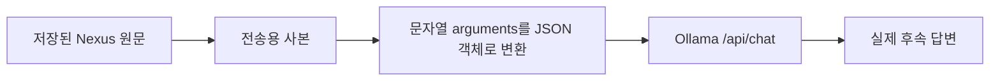

# 071 — Ollama 복귀와 기존 툴 호출 기록 호환

## 요청과 판단

사용자가 “그냥 다시 오라마로 돌아가자”고 요청했다. 070의 Nexus 평가는24회 중5회 완료·19회 모델API 오류로 끝났고, 정상 쌍1개는시설8/8 동점이었다. 이번 복귀는 로컬 모델의 품질 우위가 입증돼서 한 선택이 아니라 공급자 의존을 줄이려는 사용자의 명시적인 결정이다. 서로 다른 모델의 점수를070에 합치지 않는다.

Ollama 관리 스킬로 기존 서버와 설치 모델을 확인했다. 서버0.40.5는 정상이고 qwen3.5:4b-q4_K_M와 qwen35-32k:latest가 설치돼 있었다. 최초에는 로드된 모델이 없었다. 원래 사용하던 qwen3.5:4b-q4_K_M(4.2B·Q4_K_M)을 선택했다. 다운로드·삭제·업데이트는 하지 않았다.

## 전환과 실제 웹 응답

비공개 llm-config.json을 Ollama로 바꾸고 이전 Nexus 설정은 비공개 백업으로 보존했다. 호스트 서버를 같은127.0.0.1:50733에서 재시작했다. API 건강 확인의 실제 공급자는ollama, 모델은qwen3.5:4b-q4_K_M이고 설치·연결 상태가 모두true였다. 컨텍스트65536·출력4096·온도0, 기존 모델/도구 호출 예산을 유지했다.

<callout icon="💬">
	합성 테스트입니다. 여행 인원은 성인 두 명입니다. 검색하지 말고 확인만 해주세요.
</callout>

요청하신 합성 테스트에 대해 답변드립니다.

**여행 인원:** 성인 2명 (확인됨)
**검색 수행 여부:** 요청하신 대로 **검색은 하지 않았습니다.**

현재 요약에는 날짜, 예산, 선호 지역 등 숙소를 선택하는 데 필요한 추가 조건이 포함되어 있지 않습니다. 만약 실제 여행 계획을 세우시려면 다음 정보를 알려주시면 해당 조건에 맞는 숙소 후보를 검색해 드리겠습니다.

*   여행 기간 (입주/퇴주 날짜)
*   예산 범위
*   희망 지역 또는 도시

실행 completed, 모델1회·도구0회. 실제 도구 호출은 없었다.

<callout icon="💬">
	방금 말한 인원은 몇 명인가요? 검색하지 말고 답해주세요.
</callout>

요청하신 인원 수는 **성인 2명**입니다.

검색은 하지 않았습니다.

실행 completed, 모델1회·도구0회. 실제 도구 호출은 없었다.

두 번째 질문은 첫 번째 질문의 같은 대화에서 이어졌다. 인원2명을 유지하는 기능을 확인했고 루트와 후속 턴, 총2개 실행을 삭제했다. 기존 사용자 대화는 건드리지 않았다. 첫 답변은 확인만 해달라는 요청에 추가 질문을 붙여 장황했다. 따라서 연결과 대화 유지 확인을 로컬 모델의 더 좋은 여행 답변으로 표현하지 않는다.

## 발견한 문제: 이전 공급자의 툴 인자 형식

Nexus/OpenAI 형식은 툴 arguments를 JSON 문자열로 저장한다. Ollama는 이 기록을 그대로 받으면 객체 형태와 맞지 않는 오류를 냈다. 기존 사용자 대화에 시험 질문을 추가하지 않고, 합성 도구 이력을 같은 형식으로 구성해 재현했다. 합성 도구 결과는 실험 입력이며 실제 외부 예약 조회가 아니다.

<callout icon="💬">
	위에서 확인한 인원은 몇 명이야? 도구를 더 쓰지 말고 짧게 답해줘.
</callout>

**변환 전:** 모델 답변 없음. 실제 HTTP400 오류:

```text
Value looks like object, but can't find closing '}' symbol
```

**변환 후 — 같은 질문과 같은 합성 이력:**

2 명입니다.

추가 도구 실행 없이 실제 Ollama 응답이 stop으로 종료됐다. 이 직접 모델 호출에는 실행된 도구 호출이 없다. 오류 재현 입력에 포함한 과거 툴 이력을 이번의 실제 호출 로그처럼 쓰지 않는다.



## 실제 코드와 검증

기준은8945ebf 이후071 변경의 src/travel_agent/llm_client.py / ollama_messages다. 전송 사본만 변환하므로 저장된 대화·도구 결과 문자열·호출 ID를 바꾸지 않는다. 잘못된 JSON·배열·null·boolean을 빈 객체로 덮어 숨기지 않고 네트워크 호출 전에 오류로 알린다.

```python
def ollama_messages(messages):
    """Translate saved OpenAI tool arguments without mutating conversation history."""
    result = deepcopy(messages)
    for message in result:
        for call in message.get('tool_calls') or []:
            function = call['function']
            arguments = function.get('arguments')
            if isinstance(arguments, str):
                arguments = json.loads(arguments)
            if not isinstance(arguments, dict):
                raise ValueError('Ollama tool arguments must decode to a JSON object')
            function['arguments'] = arguments
    return result
```

실행 설정의 공개 예시는 examples/llm-config.ollama.example.json이다.

```json
{
  "provider": "ollama",
  "model": "qwen3.5:4b-q4_K_M",
  "base_url": "http://127.0.0.1:11434"
}
```

Python253개 검사를 통과했다. 혼합 형식·원문 불변·실제 전송 JSON·잘못된 인자의 네트워크 전 거절을 추가 검사했다. 동일한 합성 과거 이력의 실제400과 실제 수정 후 응답을 확인했고 수정 코드를50733에서 다시 재시작했다. 모델은64K 컨텍스트로 로드됐으며 /api/ps의 size_vram은5,216,676,084바이트였다. 이 값은 해당 시점의 모델 VRAM 관측이며 전체 시스템 사용량이나 최대 처리량 측정은 아니다.

## 남은 범위

공급자 복귀·기존 도구 기록 호환·2턴 대화 유지 확인까지다. 실제 사용자의 과거 대화를 일괄 재생하거나 여행 추천 품질을 다시 평가한 것은 아니다. Nexus 서비스·인증정보·다른 프로젝트 설정은 유지했고 자동 대체 공급자로 연결하지 않았다. 현재 사용자의 후속 질문은 로컬 Ollama로 처리한다. 웹 테스트2실행은 삭제했고 비공개 연구용 실행 기록은 남겼다.
