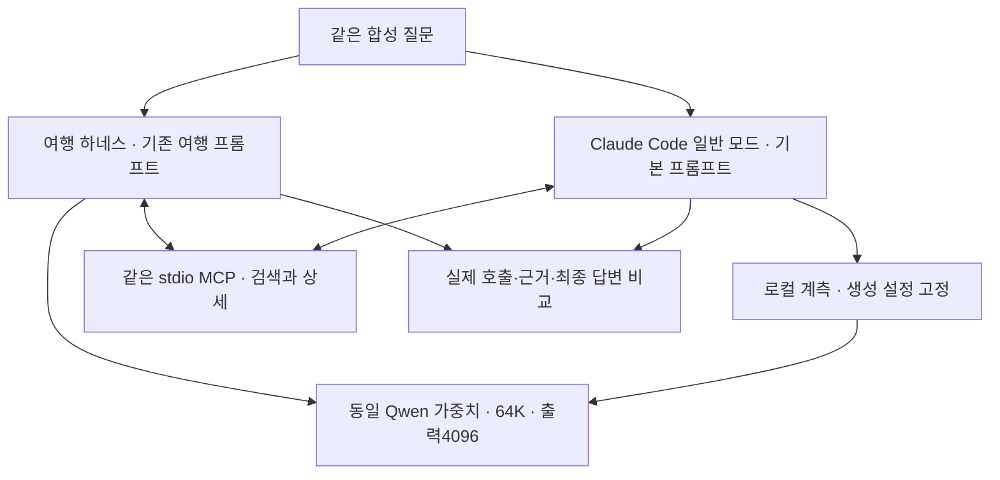

# 072 — 같은 Qwen으로 여행 에이전트와 Claude Code를 비교하다

> 범위 정정: 이 문서는 합성 MCP를 공통 제공한 예비 실험이다. 사용자가 요청한 실제 웹검색 도구를 사용하는 비교를 충족하지 못했다. 실제 검색 기반 비교는 [073](2026-10-20-073-live-harness-comparison.md)에서 다시 수행했으며, 이 결과를 실제 사용 환경의 하네스 우열 근거로 쓰지 않는다.

## 문제 정의: 모델과 하네스를 나눠서 보고 싶다

작은 Qwen의 답변 오류를 모델의 능력만으로 설명해도 되는지 확인하고 싶었다. 같은 가중치를 Claude Code의 실행기에 연결하면 도구를 더 잘 고르고, 얻은 근거를 더 정확하게 사용할까? 이번 목표는 두 개의 고정 질문에서 실제 호출과 답변을 나란히 확인하는 것이다.

좋은 답변은 검색했다는 말로 끝나지 않고 실제 검색·상세 도구를 호출해야 한다. 시설을 다른 숙소에 옮겨 붙이지 않고, 가격의 날짜·인원을 구분하며, 표시 가격과 결제 총액·재고를 혼동하지 않아야 한다. 실험 전에 질문마다 다섯 가지 기준을 정했다. 예산 산술 오류는 실행 뒤 발견한 추가 진단으로 별도 기록한다.

## 연구 과정: 공정한 조건부터 확인했다

Claude Code 2.1.303과 Ollama 0.40.5를 사용했다. 공식 문서의 로컬 Anthropic 호환 경로로 `Reply only OK.`를 보내 실제 `OK`를 받았다. 하지만 `/api/ps`에서 실제 컨텍스트가 4096인 것을 확인했다. CLI 화면의 200000 컨텍스트 표시는 실제 로컬 모델 설정과 달랐다.

기존 `qwen3.5:4b-q4_K_M` 가중치를 공유하는 임시 프로필을 만들고, 양쪽 모두 65536 컨텍스트·4096 출력·temperature 0·thinking off를 적용했다. 새 가중치는 다운로드하지 않았다. 기본 설정 파일이나 현재 웹 공급자는 바꾸지 않았다. 각 실행 직후 양쪽 모두 실제 context_length=65536을 확인했다.

검색 자료가 달라지는 영향을 없애려고 합성 숙소 자료를 돌려주는 같은 stdio MCP 서버를 연결했다. 두 도구는 `search_stays(location)`와 `read_stay(listing_id)`다. 우리 쪽은 빈 메모리와 웹 비활성화로 이 두 MCP 도구만 노출했다. Claude Code도 기본 도구를 비우고 같은 두 MCP 도구만 허용했다. 실제 여행 검색·숙소 예약 성능 비교는 아니다.

첫 계측기는 SDK의 `/v1/messages?beta=true` 경로를 받아들이지 못해 Claude 두 실행을 upstream 요청 전에 404로 막았다. 이는 Qwen 실패가 아니라 실험기 오류다. 쿼리를 제외한 경로를 검사하도록 고치고 재실행했다. SDK 결과는 `subtype=success`여도 `is_error=true`일 수 있어 상태 판정도 함께 고쳤다.

또 격리용 `--bare`가 기본 시스템 프롬프트를 줄인다는 점을 확인했다. bare 결과는 예비 실험으로 보존하고, 본 비교는 bare 없이 일반 모드로 다시 실행했다. 별도 CLAUDE_CONFIG_DIR·빈 setting sources·제한된 도구를 사용했다. 따라서 평소 모든 플러그인과 파일 도구를 켠 Claude Code 전체 환경의 평가도 아니다.

Claude 요청은 임시 loopback 계측기를 거쳐 로컬 Ollama `/v1/messages`로 그대로 전달했다. 프로토콜을 자체 변환하지 않았다. 계측기는 temperature=0·thinking disabled·max_tokens=4096만 명시적으로 고정하고 인증 정보를 전달·기록하지 않는다. 우리 쪽은 기존 `/api/chat`을 사용했다. 두 하네스의 기본 시스템 프롬프트·도구 별칭·결과 포장은 다르다. 따라서 순수 루프 코드 하나만의 인과 효과로 해석하지 않는다.



## 실행 조건과 결과 읽는 법

각 질문을 한 번씩, 총 네 실행으로 비교했다. 시설은 여행→Claude, 가격은 Claude→여행 순서다. 양쪽 모델 요청 최대8회·도구 최대8회·180초를 적용했다. 내부의 한도 처리·병렬 실행·프롬프트 길이·API 프로토콜까지 같지는 않다. 같은 MCP payload도 우리 어댑터는 근거 ID와 메타데이터로 감싸고 Claude는 MCP 콘텐츠로 전달한다.

실행 전 기준 커밋은 5ae5292다. 여행 실행기는 그 코드이고, 비교기 `scripts/compare_harnesses.py`와 `examples/harness-cases.json`은 이번 072에서 추가했다. 이후 추가한 모델 메타데이터 저장·context_verified 필드는 재실행 편의를 위한 개선이며 이번 실행 당시 생성된 필드로 설명하지 않는다. 이번 실제 컨텍스트 확인은 저장된 loaded_models에서 했다.

아래 답변은 일반 모드 본 비교의 실제 최종 답변이다. 토글에는 실제 MCP 실행과 모델 호출의 연결을 넣었다. 외부 웹 HTTP 요청은 없고 모델 HTTP는 로컬 Ollama로만 보냈다.

## 질문: facilities

<callout icon="💬">
	가평에서 성인 두 명이 묵을 숙소를 찾아줘. 수영장과 바비큐가 둘 다 있는 후보를 골라서 실제 시설 근거와 함께 알려줘. 날짜는 아직 미정이니 예약 가능 여부나 확정 요금은 말하지 마.
</callout>

좋은 답변의 사전 기준:

- 검색 도구를 실제 호출한다
- 후보 상세를 실제 읽는다
- 솔빛집 A를 두 시설이 있는 후보로 고른다
- 달빛집 B에 수영장이 있다고 하지 않는다
- 날짜 없는 확정 요금·재고를 만들지 않는다

### 우리 여행 에이전트

가평 지역을 검색한 결과 두 개의 숙소 후보가 나왔습니다.

*   **솔빛집 A**: 수영장 및 바비큐 시설이 모두 갖춰진 것으로 확인되었습니다.
*   **달빛집 B**: 바비큐는 있으나 수영장은 없는 것으로 확인되었습니다.

따라서 요청하신 조건 (수영장과 바비큐가 둘 다 있는 숙소) 을 충족하는 곳은 **'솔빛집 A'** 하나입니다.

**솔빛집 A**의 시설 근거:
*   **시설 목록**: [수영장, 바비큐]
*   **주소**: 경기도 가평군 (합성 주소)
*   **참고**: 예약 가능 여부나 확정 요금은 확인되지 않았습니다.

모델 3회 · 실제 MCP 3회 · 상태 completed · 전체 실행 8.89초.

<details>
<summary>실제 툴콜 · 인자 · 결과 · 다음 모델 전달 예시</summary>
	도구 호출 ID가 null인 여행 기록은 실제 native 응답에 ID가 없어 span으로 연결했다. 외부 검색·예약은 수행하지 않았다.
	```json
	{
	  "model_requested": [
	    {
	      "name": "mcp_fixture_search_stays",
	      "id": "call_i2zc8duk",
	      "span": "1.1",
	      "arguments": {
	        "location": "가평"
	      },
	      "time": "2026-10-19T14:22:24.491392+00:00"
	    },
	    {
	      "name": "mcp_fixture_read_stay",
	      "id": "call_9nqzb2kr",
	      "span": "2.1",
	      "arguments": {
	        "listing_id": "A"
	      },
	      "time": "2026-10-19T14:22:25.915818+00:00"
	    },
	    {
	      "name": "mcp_fixture_read_stay",
	      "id": "call_s6r98y8r",
	      "span": "2.2",
	      "arguments": {
	        "listing_id": "B"
	      },
	      "time": "2026-10-19T14:22:25.916875+00:00"
	    }
	  ],
	  "mcp_executed": [
	    {
	      "time": "2026-10-19T14:22:24.495701+00:00",
	      "ordinal": 1,
	      "name": "search_stays",
	      "arguments": {
	        "location": "가평"
	      },
	      "result": {
	        "synthetic": true,
	        "location": "가평",
	        "results": [
	          {
	            "id": "A",
	            "name": "솔빛집 A"
	          },
	          {
	            "id": "B",
	            "name": "달빛집 B"
	          }
	        ],
	        "note": "목록은 상세 시설·날짜·가격을 검증하지 않는다. read_stay로 확인한다."
	      }
	    },
	    {
	      "time": "2026-10-19T14:22:25.920004+00:00",
	      "ordinal": 2,
	      "name": "read_stay",
	      "arguments": {
	        "listing_id": "A"
	      },
	      "result": {
	        "synthetic": true,
	        "id": "A",
	        "name": "솔빛집 A",
	        "address": "경기도 가평군 (합성 주소)",
	        "facilities": [
	          "수영장",
	          "바비큐"
	        ],
	        "excluded_facilities": [],
	        "booking_availability_verified": false,
	        "checkout_total_verified": false
	      }
	    },
	    {
	      "time": "2026-10-19T14:22:25.921276+00:00",
	      "ordinal": 3,
	      "name": "read_stay",
	      "arguments": {
	        "listing_id": "B"
	      },
	      "result": {
	        "synthetic": true,
	        "id": "B",
	        "name": "달빛집 B",
	        "address": "경기도 가평군 (합성 주소)",
	        "facilities": [
	          "바비큐"
	        ],
	        "excluded_facilities": [
	          "수영장"
	        ],
	        "booking_availability_verified": false,
	        "checkout_total_verified": false
	      }
	    }
	  ],
	  "next_model_packet_example": {
	    "timestamp": "2026-10-19T14:22:24.503264+00:00",
	    "kind": "tool_message_prepared",
	    "step": 1,
	    "span": "1.1",
	    "name": "mcp_fixture_search_stays",
	    "format": "mcp_compact_json",
	    "full_result_bytes": 1280,
	    "model_content_bytes": 556
	  }
	}
	```
</details>

### Claude Code 일반 모드

가평에서 성인 두 명이 묵을 숙소로 **수영장과 바비큐 시설이 모두 있는 후보**를 찾았습니다.

## 🏠 솔빛집 A (솔빛집 A)

| 항목 | 내용 |
|------|------|
| 주소 | 경기도 가평군 (합성 주소) |
| 시설 | ✅ 수영장, ✅ 바비큐 |
| 예약 가능 여부 확인 | ❌ 미확인 |
| 확정 요금 확인 | ❌ 미확인 |

---

## 🏠 달빛집 B (달빛집 B)

| 항목 | 내용 |
|------|------|
| 주소 | 경기도 가평군 (합성 주소) |
| 시설 | ✅ 바비큐, ❌ 수영장 (없음) |
| 예약 가능 여부 확인 | ❌ 미확인 |
| 확정 요금 확인 | ❌ 미확인 |

---

## 📋 요약

**수영장과 바비큐가 모두 있는 숙소는 솔빛집 A 하나뿐**입니다. 달빛집 B 는 바비큐만 있어 수영장이 없습니다.

> ⚠️ **주의**: 이 정보는 합성 데이터이며, 예약 가능 여부나 확정 요금은 아직 검증되지 않았습니다. 실제 예약 전에는 직접 확인이 필요합니다.

모델 3회 · 실제 MCP 3회 · 상태 success · 전체 실행 10.25초.

<details>
<summary>실제 툴콜 · 인자 · 결과 · 다음 모델 전달 예시</summary>
	도구 호출 ID가 null인 여행 기록은 실제 native 응답에 ID가 없어 span으로 연결했다. 외부 검색·예약은 수행하지 않았다.
	```json
	{
	  "model_requested": [
	    {
	      "name": "mcp__fixture__search_stays",
	      "id": "call_t0vkunc5",
	      "arguments": {
	        "location": "가평"
	      },
	      "time": "2026-10-19T14:22:33.042Z"
	    },
	    {
	      "name": "mcp__fixture__read_stay",
	      "id": "call_h5muhaou",
	      "arguments": {
	        "listing_id": "A"
	      },
	      "time": "2026-10-19T14:22:33.947Z"
	    },
	    {
	      "name": "mcp__fixture__read_stay",
	      "id": "call_42xx1zn9",
	      "arguments": {
	        "listing_id": "B"
	      },
	      "time": "2026-10-19T14:22:34.332Z"
	    }
	  ],
	  "mcp_executed": [
	    {
	      "time": "2026-10-19T14:22:33.060476+00:00",
	      "ordinal": 1,
	      "name": "search_stays",
	      "arguments": {
	        "location": "가평"
	      },
	      "result": {
	        "synthetic": true,
	        "location": "가평",
	        "results": [
	          {
	            "id": "A",
	            "name": "솔빛집 A"
	          },
	          {
	            "id": "B",
	            "name": "달빛집 B"
	          }
	        ],
	        "note": "목록은 상세 시설·날짜·가격을 검증하지 않는다. read_stay로 확인한다."
	      }
	    },
	    {
	      "time": "2026-10-19T14:22:33.952997+00:00",
	      "ordinal": 2,
	      "name": "read_stay",
	      "arguments": {
	        "listing_id": "A"
	      },
	      "result": {
	        "synthetic": true,
	        "id": "A",
	        "name": "솔빛집 A",
	        "address": "경기도 가평군 (합성 주소)",
	        "facilities": [
	          "수영장",
	          "바비큐"
	        ],
	        "excluded_facilities": [],
	        "booking_availability_verified": false,
	        "checkout_total_verified": false
	      }
	    },
	    {
	      "time": "2026-10-19T14:22:34.339004+00:00",
	      "ordinal": 3,
	      "name": "read_stay",
	      "arguments": {
	        "listing_id": "B"
	      },
	      "result": {
	        "synthetic": true,
	        "id": "B",
	        "name": "달빛집 B",
	        "address": "경기도 가평군 (합성 주소)",
	        "facilities": [
	          "바비큐"
	        ],
	        "excluded_facilities": [
	          "수영장"
	        ],
	        "booking_availability_verified": false,
	        "checkout_total_verified": false
	      }
	    }
	  ],
	  "next_model_packet_example": {
	    "tool_use_id": "call_t0vkunc5",
	    "type": "tool_result",
	    "content": "{\"result\":\"{\\\"synthetic\\\": true, \\\"location\\\": \\\"가평\\\", \\\"results\\\": [{\\\"id\\\": \\\"A\\\", \\\"name\\\": \\\"솔빛집 A\\\"}, {\\\"id\\\": \\\"B\\\", \\\"name\\\": \\\"달빛집 B\\\"}], \\\"note\\\": \\\"목록은 상세 시설·날짜·가격을 검증하지 않는다. read_stay로 확인한다.\\\"}\"}"
	  }
	}
	```
</details>

## 질문: price-conditions

<callout icon="💬">
	2026년 11월 14~15일 성인 두 명, 숙박 예산 30만 원이야. 가평 숙소 A와 B를 조사해서 가격 조건을 비교하고 어느 쪽이 예산에 맞는지 알려줘. 조회된 표시 가격과 실제 결제 총액의 차이도 분명히 해줘.
</callout>

좋은 답변의 사전 기준:

- 검색 도구를 실제 호출한다
- A와 B의 상세를 모두 읽는다
- A의 19만 원이 12월·4인 조건임을 구분한다
- B의 28만 원이 요청 날짜·2인 표시 가격임을 구분한다
- 표시 가격만으로 결제 총액·예약 가능을 확정하지 않는다

### 우리 여행 에이전트

요청하신 조건 (2026 년 11 월 14~15 일, 성인 2 명) 에 맞춰 두 숙소를 비교해 드립니다.

**1. 솔빛집 A**
*   **시설:** 수영장, 바비큐
*   **표시 가격:** 190,000 원 (조건: 2026 년 12 월 5~6 일 체크인/아웃, 성인 4 명)
*   **실제 결제 총액 차이 확인 불가:** 표시 가격은 요청하신 날짜 (11 월 14~15 일) 와 인원 (2 명) 이 아닙니다. 실제 결제 총액과 표시 가격 차이는 확인할 수 없습니다.

**2. 달빛집 B**
*   **시설:** 바비큐 (수영장 없음)
*   **표시 가격:** 280,000 원 (조건: 2026 년 11 월 14~15 일 체크인/아웃, 성인 2 명)
*   **실제 결제 총액 차이 확인 불가:** 표시 가격은 요청하신 날짜와 인원 조건과 일치하지만, 실제 결제 총액과 표시 가격 차이는 확인할 수 없습니다.

**결론 및 예산 비교**
*   **달빛집 B** 는 요청하신 날짜 (11 월 14~15 일) 와 인원 (2 명) 에 맞춰 표시된 가격인 280,000 원이 있습니다. 이는 30 만 원 예산에 맞습니다.
*   **솔빛집 A** 의 표시 가격 (190,000 원) 은 요청하신 날짜와 인원이 아닙니다. 실제 결제 총액과 표시 가격 차이는 두 숙소 모두 확인되지 않았습니다.

따라서 현재 정보로는 **달빛집 B** 만이 요청하신 날짜와 인원 조건에 맞춰 예산 범위 내에 있는 것으로 보입니다. 솔빛집 A 의 실제 11 월 예약 가격은 확인할 수 없습니다.

모델 3회 · 실제 MCP 3회 · 상태 completed · 전체 실행 38.875초.

<details>
<summary>실제 툴콜 · 인자 · 결과 · 다음 모델 전달 예시</summary>
	도구 호출 ID가 null인 여행 기록은 실제 native 응답에 ID가 없어 span으로 연결했다. 외부 검색·예약은 수행하지 않았다.
	```json
	{
	  "model_requested": [
	    {
	      "name": "mcp_fixture_search_stays",
	      "id": "call_gpsexnvq",
	      "span": "1.1",
	      "arguments": {
	        "location": "가평"
	      },
	      "time": "2026-10-19T14:23:07.110377+00:00"
	    },
	    {
	      "name": "mcp_fixture_read_stay",
	      "id": "call_2z8xdixe",
	      "span": "2.1",
	      "arguments": {
	        "listing_id": "A"
	      },
	      "time": "2026-10-19T14:23:14.487031+00:00"
	    },
	    {
	      "name": "mcp_fixture_read_stay",
	      "id": "call_gb4z1u7v",
	      "span": "2.2",
	      "arguments": {
	        "listing_id": "B"
	      },
	      "time": "2026-10-19T14:23:14.488100+00:00"
	    }
	  ],
	  "mcp_executed": [
	    {
	      "time": "2026-10-19T14:23:07.115018+00:00",
	      "ordinal": 1,
	      "name": "search_stays",
	      "arguments": {
	        "location": "가평"
	      },
	      "result": {
	        "synthetic": true,
	        "location": "가평",
	        "results": [
	          {
	            "id": "A",
	            "name": "솔빛집 A"
	          },
	          {
	            "id": "B",
	            "name": "달빛집 B"
	          }
	        ],
	        "note": "목록은 상세 시설·날짜·가격을 검증하지 않는다. read_stay로 확인한다."
	      }
	    },
	    {
	      "time": "2026-10-19T14:23:14.490805+00:00",
	      "ordinal": 2,
	      "name": "read_stay",
	      "arguments": {
	        "listing_id": "A"
	      },
	      "result": {
	        "synthetic": true,
	        "id": "A",
	        "name": "솔빛집 A",
	        "address": "경기도 가평군 (합성 주소)",
	        "facilities": [
	          "수영장",
	          "바비큐"
	        ],
	        "excluded_facilities": [],
	        "booking_availability_verified": false,
	        "checkout_total_verified": false,
	        "display_price": {
	          "KRW": 190000,
	          "checkin": "2026-12-05",
	          "checkout": "2026-12-06",
	          "adults": 4,
	          "fees_included": "unknown"
	        }
	      }
	    },
	    {
	      "time": "2026-10-19T14:23:14.493426+00:00",
	      "ordinal": 3,
	      "name": "read_stay",
	      "arguments": {
	        "listing_id": "B"
	      },
	      "result": {
	        "synthetic": true,
	        "id": "B",
	        "name": "달빛집 B",
	        "address": "경기도 가평군 (합성 주소)",
	        "facilities": [
	          "바비큐"
	        ],
	        "excluded_facilities": [
	          "수영장"
	        ],
	        "booking_availability_verified": false,
	        "checkout_total_verified": false,
	        "display_price": {
	          "KRW": 280000,
	          "checkin": "2026-11-14",
	          "checkout": "2026-11-15",
	          "adults": 2,
	          "fees_included": "unknown"
	        }
	      }
	    }
	  ],
	  "next_model_packet_example": {
	    "timestamp": "2026-10-19T14:23:07.119198+00:00",
	    "kind": "tool_message_prepared",
	    "step": 1,
	    "span": "1.1",
	    "name": "mcp_fixture_search_stays",
	    "format": "mcp_compact_json",
	    "full_result_bytes": 1280,
	    "model_content_bytes": 556
	  }
	}
	```
</details>

### Claude Code 일반 모드

두 숙소의 정보를 비교해드리겠습니다.

## 📊 가평 숙소 가격 비교 (2026 년 11 월 14~15 일, 성인 2 명)

### **솔빛집 A**
- **표시 가격**: 190,000 원
- **시설**: 수영장, 바비큐
- **참고**: 예약 가능 여부 및 결제 총액 검증되지 않음

### **달빛집 B**
- **표시 가격**: 280,000 원
- **시설**: 바비큐 (수영장 없음)
- **참고**: 예약 가능 여부 및 결제 총액 검증되지 않음

---

## 💰 예산 분석 (30 만 원)

| 숙소 | 표시 가격 | 예산 내인가 | 여유 금액 |
|------|-----------|-------------|-----------|
| 솔빛집 A | 190,000 원 | ✅ 맞음 | +110,000 원 |
| 달빛집 B | 280,000 원 | ⚠️ 초과 | -80,000 원 |

---

## 🎯 결론

**솔빛집 A 가 예산에 더 적합합니다.**

- **솔빛집 A**: 표시 가격 19 만 원으로 예산 30 만 원 내에 들어갑니다 (11 만 원 여유)
- **달빛집 B**: 표시 가격 28 만 원으로 예산을 초과합니다 (8 만 원 부족)

---

## ⚠️ 주의사항

현재 조회된 정보는 **표시 가격**이며, 실제 결제 총액과 차이가 있을 수 있습니다. 두 숙소 모두 `booking_availability_verified` 와 `checkout_total_verified` 가 false 로 설정되어 있어:
- 표시 가격과 실제 결제 금액의 차이 확인이 필요
- 추가 요금 (세금, 서비스비 등) 이 포함될 수 있음

예산 계획 시에는 표시 가격보다 조금 더 여유를 두고 준비하시는 것을 권장합니다.

모델 4회 · 실제 MCP 3회 · 상태 success · 전체 실행 20.031초.

<details>
<summary>실제 툴콜 · 인자 · 결과 · 다음 모델 전달 예시</summary>
	도구 호출 ID가 null인 여행 기록은 실제 native 응답에 ID가 없어 span으로 연결했다. 외부 검색·예약은 수행하지 않았다.
	```json
	{
	  "model_requested": [
	    {
	      "name": "mcp__fixture__search_stays",
	      "id": "call_p9z7qrsf",
	      "arguments": {
	        "location": "가평"
	      },
	      "time": "2026-10-19T14:22:44.128Z"
	    },
	    {
	      "name": "mcp__fixture__read_stay",
	      "id": "call_eruv9xp7",
	      "arguments": {
	        "listing_id": "A"
	      },
	      "time": "2026-10-19T14:22:45.120Z"
	    },
	    {
	      "name": "mcp__fixture__read_stay",
	      "id": "call_inhoz2qj",
	      "arguments": {
	        "listing_id": "B"
	      },
	      "time": "2026-10-19T14:22:45.810Z"
	    }
	  ],
	  "mcp_executed": [
	    {
	      "time": "2026-10-19T14:22:44.147554+00:00",
	      "ordinal": 1,
	      "name": "search_stays",
	      "arguments": {
	        "location": "가평"
	      },
	      "result": {
	        "synthetic": true,
	        "location": "가평",
	        "results": [
	          {
	            "id": "A",
	            "name": "솔빛집 A"
	          },
	          {
	            "id": "B",
	            "name": "달빛집 B"
	          }
	        ],
	        "note": "목록은 상세 시설·날짜·가격을 검증하지 않는다. read_stay로 확인한다."
	      }
	    },
	    {
	      "time": "2026-10-19T14:22:45.130827+00:00",
	      "ordinal": 2,
	      "name": "read_stay",
	      "arguments": {
	        "listing_id": "A"
	      },
	      "result": {
	        "synthetic": true,
	        "id": "A",
	        "name": "솔빛집 A",
	        "address": "경기도 가평군 (합성 주소)",
	        "facilities": [
	          "수영장",
	          "바비큐"
	        ],
	        "excluded_facilities": [],
	        "booking_availability_verified": false,
	        "checkout_total_verified": false,
	        "display_price": {
	          "KRW": 190000,
	          "checkin": "2026-12-05",
	          "checkout": "2026-12-06",
	          "adults": 4,
	          "fees_included": "unknown"
	        }
	      }
	    },
	    {
	      "time": "2026-10-19T14:22:45.815995+00:00",
	      "ordinal": 3,
	      "name": "read_stay",
	      "arguments": {
	        "listing_id": "B"
	      },
	      "result": {
	        "synthetic": true,
	        "id": "B",
	        "name": "달빛집 B",
	        "address": "경기도 가평군 (합성 주소)",
	        "facilities": [
	          "바비큐"
	        ],
	        "excluded_facilities": [
	          "수영장"
	        ],
	        "booking_availability_verified": false,
	        "checkout_total_verified": false,
	        "display_price": {
	          "KRW": 280000,
	          "checkin": "2026-11-14",
	          "checkout": "2026-11-15",
	          "adults": 2,
	          "fees_included": "unknown"
	        }
	      }
	    }
	  ],
	  "next_model_packet_example": {
	    "tool_use_id": "call_p9z7qrsf",
	    "type": "tool_result",
	    "content": "{\"result\":\"{\\\"synthetic\\\": true, \\\"location\\\": \\\"가평\\\", \\\"results\\\": [{\\\"id\\\": \\\"A\\\", \\\"name\\\": \\\"솔빛집 A\\\"}, {\\\"id\\\": \\\"B\\\", \\\"name\\\": \\\"달빛집 B\\\"}], \\\"note\\\": \\\"목록은 상세 시설·날짜·가격을 검증하지 않는다. read_stay로 확인한다.\\\"}\"}"
	  }
	}
	```
</details>

## 문제 분석과 결과

시설 조건은 두 하네스 모두 실제 검색 후 A·B의 상세를 읽고 A만 수영장+바비큐 후보로 골랐다. 두 쪽 모두 미확인 요금·예약을 확정하지 않았다. 우리 일반 모드 답변에는 실제 근거 ID 인용이 빠졌다. 시설 사실이 맞았다는 것과 인용 품질은 별개다.

가격 조건은 우리 쪽이 A의 12월·4인과 B의 11월·2인 표시 가격을 구분하고 B의 28만 원을 30만 원 이내로 판단했다. 실제 총액은 모른다고 남겼다. Claude 쪽은 A의 다른 날짜·인원 조건을 최종 답변에서 누락하고 A를 추천했으며, B의 28만 원을 예산 초과·8만 원 부족이라고 잘못 계산했다. 두 쪽 모두 동일한 원문을 실제 읽었다. 이번 Claude 오류를 자료 접근 실패로 설명할 수는 없다.

사전 기준을 수동으로 판독하면 시설은 양쪽 모두 다섯 항목을 충족했다. 가격은 우리 쪽이 다섯 항목을 충족했다. Claude 쪽은 검색·상세 읽기·결제 총액 미확인은 충족했지만, A의 다른 날짜·인원을 구분하지 않았다. B의 날짜·인원은 표 제목에 요청 조건이 있을 뿐 개별 가격 조건 설명이 없다. 엄격한 명시 기준이라면 불충분하다. 최종 추천과 예산 산술까지 정답이라는 뜻은 아니다.

예산 산술은 사전 점수에 소급 추가하지 않았다. 계산 오류와 잘못된 최종 추천을 놓치는 루브릭의 빈틈도 발견한 셈이다. 이런 작은 사례에 종합 순위를 매기지 않는다. 평가자는 구현자와 같고 블라인드·독립 평가가 아니다.

예비 실행에서도 오류가 있었다. 첫 계측 실패 묶음에서 우리 쪽은 28만 원이 30만 원을 초과한다고 답했다. bare 비교에서는 우리 쪽이 이 계산을 맞혔지만 Claude 쪽은 A 조건과 계산을 틀렸다. 일반 모드 결과만 골라 우리 하네스가 안정적으로 더 정확하다고 주장할 수 없다. temperature 0도 반복 결과가 완전히 같다는 보장은 아니다.

이번에 확인한 것은 같은 작은 모델도 하네스·프롬프트·결과 포장에 따라 다른 답을 내고, 강한 제품의 실행기에 연결해도 근거 오독과 산술 오류가 남을 수 있다는 점이다. 어느 하네스가 일반적으로 더 우수한지, 실패 원인이 모델·프롬프트·어댑터 중 무엇인지는 분리 입증하지 못했다.

## 해결: 재현 가능한 비교 기반을 남겼다

`compare_harnesses.py`의 `fixture`는 두 숙소에 같은 고정 자료를 제공한다. `serve`는 진짜 MCP stdio 서버다. `run_travel`은 기존 실행기를 호출하고 `run_claude`는 설치된 CLI를 실행한다. `observed_endpoint`는 로컬 Anthropic 요청을 계측한다. `main`은 사전 프로토콜과 결과를 비공개로 저장하고 임시 프로필을 정리한다. 세션을 웹에 만들지 않아 사용자 대화 삭제는 없었다.

아래는 이번 실제 소스의 생성 설정 통제다. 시스템 프롬프트나 도구 응답 내용을 수정하는 코드는 아니다.

```python
            original = {k: body.get(k) for k in ('max_tokens', 'temperature', 'thinking')}
            body.update(max_tokens=4096, temperature=0, thinking={'type': 'disabled'})
            record = {'time': datetime.now(timezone.utc).isoformat(), 'incoming_path': self.path,
                      'original_controls': original, 'forwarded_request': body}
```

## 검증과 남은 과제

계측기 회귀 테스트는 SDK beta 쿼리 경로 통과, 생성 설정 고정과 인증 헤더 미전달을 검증한다. 합성 자료 테스트는 가격 조건 분리·수영장 근거 분리를 검증한다. 첫 전체 검사에서는 사용자 개인 MCP 설정이 자동 로드되어 기존 trace 순서 테스트 하나가 실패했다. 빈 예제 MCP 설정을 명시한 전체256개 검사는 통과했다. 일반 모드 비교4실행 모두 종료했고 도구 허용 거부는 없었다.

임시 프로필 제거를 확인했다. 기존 Ollama 모델·50733 웹·개인 Claude 설정은 유지했다. 계측 서버는 각 실행이 끝나면 종료한다. CLI의 달러 비용 표시는 로컬 전력비·API 청구액으로 쓰지 않았다. 실제 속도 비교는 캐시·모델 로드·SDK/MCP 시작 시간이 통제되지 않아 결론을 내리지 않는다.

다음 비교에서는 예산 산술·최종 추천 정합성을 사전 기준에 포함하고, 질문과 반복 횟수를 늘려 실패율을 본다. 이후 동일 프롬프트·동일 모델 전달 패킷 대조군을 추가하면 루프와 프롬프트/어댑터의 영향을 더 구분할 수 있다. 실제 Brave·OpenBnB 검색과 장기 메모리 비교는 별도 과제다.

## 실행과 참고

```powershell
.\.venv\Scripts\python.exe scripts/compare_harnesses.py --output data/private/harness-new
```

새 비공개 폴더를 지정한다. 기존 결과는 덮어쓰지 않는다. 기본은 일반 Claude 모드이고 `--minimal-claude`는 bare 예비 비교를 재현할 때만 사용한다. 기본 도구는 제공하지 않아 파일·셸·하위 에이전트가 실행될 수 없고 같은 합성 MCP 두 도구만 허용한다.

- [Ollama의 Claude Code 연결 안내](https://github.com/ollama/ollama/blob/main/docs/integrations/claude-code.mdx)
- [Ollama Anthropic 호환 범위](https://docs.ollama.com/api/anthropic-compatibility)
- [Claude Code CLI 공식 문서](https://code.claude.com/docs/en/cli-reference)
