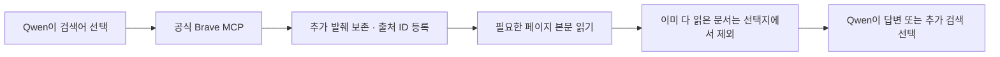

# 074 — 공식 Brave MCP를 연결하고 다시 평가했다

<callout icon="🧭" color="blue_bg">
	**검색 연결은 바꿨고, 같은 문서를 반복 읽던 문제도 보완했다.** 다만 추천 내용이 전부 정확해진 것은 아니다.
	우리 에이전트와 Claude Code는 이번에도 같은 로컬 Qwen3.5 4B를 썼다. Claude 모델을 사용한 비교가 아니다.
</callout>

## 지금은 어떻게 연결돼 있나

| 역할 | 이전 | 지금 |
|---|---|---|
| 웹검색 | Python에서 Brave API 직접 호출 | Brave가 제공하는 공식 검색 MCP |
| 숙소 조회 | OpenBnB MCP | 그대로 유지 |
| 검색 페이지 본문 | web_read | MCP 검색에서 찾은 출처도 읽을 수 있게 연결 |

Brave 검색과 MCP가 서로 다른 검색엔진이었던 것은 아니다. 같은 Brave를 다른 방식으로 호출하고 있었다. 차이는 모델이 받는 도구 설명과 자료였다. 공식 MCP는 추가 검색 발췌도 돌려주는데, 우리 직접 검색기는 대표 요약만 남겼다. OpenBnB는 별도의 커뮤니티 숙소 조회 MCP다.

## 무엇을 고쳤나

1. **공식 Brave MCP 연결.** 기존 직접 검색 도구는 함께 노출하지 않는다. MCP가 실패했다고 다른 검색으로 몰래 바꾸지 않는다.
2. **자료를 문장 중간에서 자르지 않게 변경.** 제목·URL·대표 요약·추가 발췌를 완전한 항목 단위로 전달한다. 한도 때문에 넣지 못한 항목은 개수로 표시한다.
3. **검색 방향 정리.** 사용자가 준 한국어 지명을 유지하고, 일반 펜션 탐색은 웹검색부터 하도록 안내한다. 검색어는 별도 생성기가 아니라 Qwen이 직접 선택한다. 검색문이나 사이트를 고정 대본으로 만들지는 않았다.
4. **다 읽은 문서는 다시 고르지 않게 변경.** 이번 실행에서 전체 내용을 이미 전달한 문서는 읽기 도구의 선택지에서 제외한다. 분할된 문서는 실제로 처음부터 끝까지 읽었을 때만 제외한다. 답변을 완성했는지 판단하는 것은 계속 모델이다.



## 다시 실행한 결과

| 질문 | MCP 연결 직후 우리 쪽 | 반복 읽기 보완 후 우리 쪽 | 이번 Claude Code |
|---|---|---|---|
| 펜션 찾기 | 모델21회·도구 요청20회. 중복 요청9회 후 시간 초과 | 모델6회·도구5회. 중복 오류0회, 답변 완료 | 모델6회·검색5회, 답변 완료 |
| 수목원 안내 | 모델4회·도구3회, 답변 완료 | 모델3회·도구2회, 답변 완료 | 모델2회·검색1회, 답변 완료 |

**확인된 변화:** 첫 펜션 실행은 같은 문서의0번 위치를 반복 요청했다. 보완 후에는 중복 오류 없이 다른 후보 페이지로 넘어가 답변을 마쳤다. 검색어도 이번 실행에서는 한국어 지명을 유지했다.

**아직 부족한 점:** 새 펜션 답변도 수영장이 확인되지 않은 후보를 포함하면서 첫 문장은 조건을 모두 갖춘 것처럼 썼다. 수목원 답변은 요금 계산이 맞지만, 읽은 공식 요금 페이지에 없는 시간·주차 정보를 공식 출처에 묶었다. 따라서 두 질문 모두 추천·출처 품질을 완전 통과했다고 평가하지 않는다.

**Claude 쪽도 완전 통과는 아니다.** 펜션 답변의 `경기도 가평군 애견동 47-2` 주소는 이번 전달 자료에서 근거를 찾지 못했다. 수목원 답변은 반려동물 안내를 `동반 인원`으로 잘못 옮겼고, 공식 본문을 읽지 않은 상태에서 확인 날짜를 공식 안내 기준처럼 적었다.

실제 웹검색을 각 질문에 한 번씩 수행한 결과다. 자료와 모델 출력은 실행마다 달라질 수 있어, 위 숫자로 일반적인 성능 향상률이나 하네스 순위를 계산하지 않는다.

## 실제 질문과 답변

좋은 답변의 기준은 간단하다. 펜션은 조건이 확인된 후보와 미확인 후보를 구분하고 이름·주소·시설별 근거를 보여줘야 한다. 수목원은 성인 요금과 두 명 합계,운영 시간·마감·주차를 실제 출처에 맞게 설명해야 한다. 답변이 끝났다는 표시만으로 통과시키지 않는다.


### 펜션 찾기

<callout icon="💬">
	가평에서 성인 두 명이 갈 펜션을 찾아줘. 수영장과 개별 바비큐가 둘 다 있는 후보를 최대 3곳 찾아서 이름, 실제 주소, 두 시설의 확인 근거와 출처 링크를 비교해줘. 날짜는 아직 미정이라 확정 가격이나 예약 가능 여부는 필요 없어. 공식 숙소 안내를 우선하고, 확인되지 않은 항목은 그대로 구분해줘.
</callout>

#### 개선 후 우리 에이전트

<callout icon="🤖" color="gray_bg">
	가평에서 수영장 및 개별 바비큐 시설이 모두 갖춰진 펜션을 찾았습니다. 각 후보의 공식 정보를 확인한 결과, 다음과 같은 정보가 수집되었습니다:

	## **1. 가평스파펜션 콜린**
	- **주소**: 경기 가평군 가평읍 태봉두밀로 269-45 (공식 홈페이지에서 명시됨)
	- **시설 확인 근거**:
	  - 수영장: 공식 홈페이지에 'Swimming Pool' 항목으로 명시되어 있음
	  - 개별 바비큐: 전 객실에 개별 실내 바베큐장이 마련되어 있으며, 사계절 이용 가능
	- **출처 링크**: https://collineps.com/special2.html

	## **2. 나비잠펜션**
	- **주소**: 경기도 가평군 북면 싸리재길 16 (공식 홈페이지에서 명시됨)
	- **시설 확인 근거**:
	  - 수영장: 공식 홈페이지에 야외바베큐장 및 개별바베큐장 준비로 언급됨 (수영장 명시 없음)
	  - 개별 바비큐: 개별바베큐장과 야외바베큐장 모두 준비되어 있음
	- **출처 링크**: https://navizam.kr/facility3

	## **3. 가평 뜰 독채 풀빌라 펜션**
	- **주소**: 공식 홈페이지에서 명시된 주소 없음 (지역 미확인)
	- **시설 확인 근거**:
	  - 수영장: 개별실내수영장 제공으로 명시됨
	  - 개별 바비큐: 바베큐장 및 개별바비큐 시설로 명시됨
	- **출처 링크**: https://xn--iq1bv8dtg52w3ysnjl.com/

	---

	**요약:**
	- **가평스파펜션 콜린**: 수영장 및 실내 개별 바비큐 모두 공식 홈페이지에서 확인 가능, 주소 명시됨
	- **나비잠펜션**: 개별 바비큐 시설 명확히 확인 가능, 수영장 언급은 간접적 (명시 없음)
	- **가평 뜰 독채 풀빌라 펜션**: 수영장 및 바비큐 시설 명시됨, 주소 미확인

	**추가 확인 필요:**
	- 나비잠펜션의 수영장 시설에 대한 공식 확인이 부족함
	- 가평 뜰 독채 풀빌라 펜션의 정확한 주소가 확인되지 않음

	사용자께서는 이 중 어떤 펜션을 더 선호하시나요? 아니면 추가적으로 확인하고 싶은 항목이 있으신가요?
</callout>

<details>
<summary>검색어와 도구 기록 보기</summary>
	검색어·인자는 실제 호출 그대로다. 받은 자료에서는 대표 제목과 링크만 표시했다. 설명 문장을 글자 수로 잘라 놓지 않았다. 전체 결과와 다음 모델 입력은 비공개 기록에 보존했다.
	**1. 검색**
	```json
	{
	  "query": "가평 펜션 수영장 개별 바비큐 시설",
	  "country": "KR",
	  "search_lang": "ko",
	  "ui_lang": "ko-KR",
	  "count": 10
	}
	```
	결과: 도구 응답 수신
	이 결과는 다음 모델 2번 호출에 전달됨 · content 18,630바이트
	추적 ID: `call_vnfnepnc`
	**2. 본문 읽기**
	```json
	{
	  "query": "수영장 개별 바비큐 시설 주소",
	  "source_id": "web:9bfb57a07ed32264"
	}
	```
	읽은 페이지: [가평 콜린스파 펜션](https://collineps.com/special2.html)
	내용: 본문 반환 · 일부 구간만 전달
	이 결과는 다음 모델 3번 호출에 전달됨 · content 1,000바이트
	추적 ID: `call_2qo4asyu`
	**3. 본문 읽기**
	```json
	{
	  "query": "주소 시설 수영장 바비큐",
	  "source_id": "web:9bfb57a07ed32264",
	  "document_token": "0ed819a9b3d9c5f0",
	  "start_index": 0
	}
	```
	읽은 페이지: [가평 콜린스파 펜션](https://collineps.com/special2.html)
	내용: 본문 반환
	이 결과는 다음 모델 4번 호출에 전달됨 · content 1,105바이트
	추적 ID: `call_yaus5woc`
	**4. 본문 읽기**
	```json
	{
	  "query": "주소 시설 수영장 바비큐",
	  "source_id": "web:0a909a324684e778"
	}
	```
	읽은 페이지: [가평 뜰 독채 풀빌라 펜션](https://xn--iq1bv8dtg52w3ysnjl.com/)
	내용: 본문 반환 · 일부 구간만 전달
	이 결과는 다음 모델 5번 호출에 전달됨 · content 996바이트
	추적 ID: `call_gcgsqjjb`
	**5. 본문 읽기**
	```json
	{
	  "query": "주소 시설 수영장 바비큐",
	  "source_id": "web:c35398fb21f4a56f"
	}
	```
	읽은 페이지: [나비잠펜션](https://navizam.kr/facility3)
	내용: 본문 반환 · 일부 구간만 전달
	이 결과는 다음 모델 6번 호출에 전달됨 · content 1,064바이트
	추적 ID: `call_uj8orwtl`
</details>

#### Claude Code + Brave MCP

<callout icon="🤖" color="gray_bg">
	가평에서 수영장과 개별 바비큐 시설이 모두 있는 펜션을 찾았습니다. 공식 안내를 바탕으로 3 곳의 후보를 정리해 드립니다.

	---

	## 가평 수영장 및 개별 바비큐 펜션 추천 (최대 3곳)

	### 1. 가평 가보자독채애견풀빌라수영장펜션
	| 항목 | 내용 | 출처 링크 |
	|------|------|-----------|
	| **숙소명** | 가평 가보자독채애견풀빌라수영장펜션 | [야놀자](https://nol.yanolja.com/stay/domestic/10063510) |
	| **실제 주소** | 경기도 가평군 애견동 47-2 | [여기어때](https://www.yeogi.com/domestic-accommodations/84961) |
	| **수영장 시설 확인 근거** | - 야외 대형 풀장 (가로 20M × 세로 13M, 물높이 1M)<br>- 야외 유아 풀장 운영<br>- 사계절 이용 가능 (미온수 30도)<br>- VIP 객실: 가로 3M × 세로 5M, 물높이 70CM | [여기어때 공식 안내](https://www.yeogi.com/domestic-accommodations/84961) |
	| **개별 바비큐 시설 확인 근거** | - 개별 테라스 바베큐 (숯불)<br>- 공용 바베큐장<br>- 비용: 2인 기준 20,000원 / 인원 추가 시 1인당 5,000원<br>- 준비시간: 입실 후 ~ 오후 9시<br>- 우천 및 동계 이용 가능 | [여기어때 공식 안내](https://www.yeogi.com/domestic-accommodations/84961) |
	| **입실 시간** | 15:00 (퇴실 11:00)<br>21시 이후 입실 시 사전 연락 필수 | [여기어때 공식 안내](https://www.yeogi.com/domestic-accommodations/84961) |
	| **특이사항** | - 애견 동반 펜션<br>- 현재 특실 3 객실은 개별 미끄럼틀 철거되어 이용 불가 | [반려생활](https://ban-life.com/accommodation/21739) |

	---

	### 2. 가평 콜린스파 펜션
	| 항목 | 내용 | 출처 링크 |
	|------|------|-----------|
	| **숙소명** | 가평 콜린스파 펜션 | [공식 홈페이지](https://collineps.com/) |
	| **실제 주소** | 경기도 가평군 가평읍 태봉두밀로 269-45 | [G마켓 투어](https://gtour.gmarket.co.kr/TourV2/Item?goodscode=2275065702) |
	| **수영장 시설 확인 근거** | - 야외 수영장 운영<br>- 스파 시설 포함 | [야놀자 공식 안내](https://place-site.yanolja.com/places/10045237) |
	| **개별 바비큐 시설 확인 근거** | - 전 객실 실내 개별 테라스 바베큐<br>- 사계절 이용 가능한 프라이빗한 개별 바베큐장 | [G마켓 투어 공식 안내](https://gtour.gmarket.co.kr/TourV2/Item?goodscode=2275065702) |
	| **입실 시간** | 15시 이후 (퇴실 11시 이전)<br>21시 이후 입실 시 펜션으로 사전 연락 필수 | [G마켓 투어 공식 안내](https://gtour.gmarket.co.kr/TourV2/Item?goodscode=2275065702) |
	| **특이사항** | - 남이섬, 가평레일바이크 인근 위치<br>- 전 객실 넷플릭스 이용 가능 (개인 ID 사용)<br>- 마트 픽업: 농수산물마켓, 조은마트, 씨씨할인마트 | [공식 홈페이지](https://collineps.com/) |

	---

	### 3. 가평 보타니칼펜션
	| 항목 | 내용 | 출처 링크 |
	|------|------|-----------|
	| **숙소명** | 가평 보타니칼펜션 | [야놀자](https://www.yanolja.com/pension/1000111770) |
	| **실제 주소** | 경기도 가평군 아침고요수목원 인근 (구체적 주소 미확인) | [여기어때](https://www.yeogi.com/domestic-accommodations/62421) |
	| **수영장 시설 확인 근거** | - 수영장 운영<br>- 동남아를 연상시키는 이국적인 수영장 특징 | [여행 블로그](https://travel-hotel-culinary.tistory.com/2244) |
	| **개별 바비큐 시설 확인 근거** | - 개별 바베큐 시설<br>- 사랑하는 사람과 맛있는 바비큐 파티 가능 | [야놀자 공식 안내](https://www.yanolja.com/pension/1000111770) |
	| **입실 시간** | 미확인 (공식 안내 확인 필요) | - |
	| **특이사항** | - 애견 동반 가능<br>- 주차 가능<br>- 커피숍 운영<br>- 복층 구조<br>- 마트 픽업: 365마트 (청평역에서 하차 후 택시 이용)<br>- 펜션 자체 픽업 운영 안함 | [여기어때](https://www.yeogi.com/domestic-accommodations/62421) |

	---

	## 요약
	| 순위 | 숙소명 | 수영장 | 개별 바비큐 | 주소 확인 여부 |
	|------|--------|--------|-------------|----------------|
	| 1 | 가평 가보자독채애견풀빌라수영장펜션 | ✅ (야외대형+유아풀) | ✅ (개별테라스+공용) | ✅ |
	| 2 | 가평 콜린스파 펜션 | ✅ (야외) | ✅ (전 객실 개별테라스) | ✅ |
	| 3 | 가평 보타니칼펜션 | ✅ (이국적 수영장) | ✅ (개별 바베큐) | ⚠️ (미확인) |

	**참고사항:**
	- 날짜가 미정이라 확정 가격이나 예약 가능 여부는 확인되지 않았습니다.
	- 공식 숙소 안내를 우선으로 작성하였으며, 일부 항목은 실제 방문 후 확인이 필요합니다.
	- 가보자독채애견풀빌라수영장펜션은 애견 동반 펜션임을 고려하여 반려동물 동반 여부를 확인하시기 바랍니다.
</callout>

<details>
<summary>검색어와 도구 기록 보기</summary>
	검색어·인자는 실제 호출 그대로다. 받은 자료에서는 대표 제목과 링크만 표시했다. 설명 문장을 글자 수로 잘라 놓지 않았다. 전체 결과와 다음 모델 입력은 비공개 기록에 보존했다.
	**1. 검색**
	```json
	{
	  "query": "가평 펜션 수영장 개별 바비큐 시설 두 가지 모두",
	  "count": 15
	}
	```
	받은 자료: 15개 · 아래는 대표 결과
	- [가평 실내수영장 온수무료펜션](https://nol.yanolja.com/stay/domestic/10042159)
	- [가평 콜린스파 펜션](https://collineps.com/special2.html)
	- [가평 실내수영장 온수 무료 펜션, 남이섬·가평읍, 가평 - 여기어때 특가](https://www.yeogi.com/domestic-accommodations/62421)
	이 결과는 다음 모델 2번 호출에 전달됨 · content 23,322바이트
	추적 ID: `call_wk7tbrkb → MCP 2`
	**2. 검색**
	```json
	{
	  "query": "가평 가보자독채애견풀빌라수영장펜션 수영장 개별 바비큐 시설 공식 안내",
	  "count": 5
	}
	```
	받은 자료: 5개 · 아래는 대표 결과
	- [가평 가보자독채애견풀빌라수영장펜션](https://nol.yanolja.com/stay/domestic/10063510)
	- [가평 가보자 독채 애견 풀빌라 수영장펜션, 아침고요수목원·상면, 가평 - 여기어때 특가](https://www.yeogi.com/domestic-accommodations/84961)
	- [가평 가보자독채애견풀빌라수영장펜션, 경기 가평군 애견동반 숙소, 펜션 - 반려생활](https://ban-life.com/accommodation/21739)
	이 결과는 다음 모델 3번 호출에 전달됨 · content 9,878바이트
	추적 ID: `call_okghsamk → MCP 3`
	**3. 검색**
	```json
	{
	  "query": "가평 콜린스파 펜션 수영장 개별 바비큐 공식 안내",
	  "count": 5
	}
	```
	받은 자료: 5개 · 아래는 대표 결과
	- [가평 콜린스파 펜션](https://collineps.com/)
	- [가평 콜린스파펜션 펜션/풀빌라 사진, 가격, 위치소개 | NOL](https://place-site.yanolja.com/places/10045237)
	- [경기/가평 가평 콜린스파 펜션 (바베큐장/수영장/스파/개별바베큐/테라스/](https://gtour.gmarket.co.kr/TourV2/Item?goodscode=2275065702&pos_class_cd=300025407&pos_class_kind=S&pos_shop_cd=GE&selDateE=&selDateS=)
	이 결과는 다음 모델 4번 호출에 전달됨 · content 9,617바이트
	추적 ID: `call_nhzf68f0 → MCP 4`
	**4. 검색**
	```json
	{
	  "query": "가평 보타니칼펜션 수영장 개별 바비큐 공식 안내",
	  "count": 5
	}
	```
	받은 자료: 5개 · 아래는 대표 결과
	- [가평 보타니칼 펜션](https://botanical.kr/special1.html)
	- [가평 보타니칼펜션 사진, 가격, 위치소개 | 야놀자](https://www.yanolja.com/pension/1000111770)
	- [[가평펜션] 수영장, 개별 바베큐, 감성 인테리어 "보타니칼" :: 마트 픽업, 근처 편의점](https://www.keyzard.cc/ssolssol_log/nb/223173177146)
	이 결과는 다음 모델 5번 호출에 전달됨 · content 5,530바이트
	추적 ID: `call_0h0o0b4m → MCP 5`
	**5. 검색**
	```json
	{
	  "query": "\"가평 가보자독채애견풀빌라수영장펜션\" 공식 홈페이지 수영장 개별 바비큐 시설 안내",
	  "count": 3
	}
	```
	받은 자료: 3개
	- [가평 가보자독채애견풀빌라수영장펜션, 경기 가평군 애견동반 숙소, 펜션 - 반려생활](https://ban-life.com/accommodation/21739)
	- [가평 가보자독채애견풀빌라수영장펜션 펜션/풀빌라 사진, 가격, 위치소개 | NOL](https://place-site.yanolja.com/places/10063510)
	- [가평 가보자독채애견풀빌라수영장펜션](https://nol.yanolja.com/stay/domestic/10063510)
	이 결과는 다음 모델 6번 호출에 전달됨 · content 5,844바이트
	추적 ID: `call_u2hxh4mw → MCP 6`
</details>

### 수목원 방문 안내

<callout icon="💬">
	2026년 10월 말에 성인 두 명이 아침고요수목원을 방문하려고 해. 공식 안내를 찾아서 일반 성인 입장료, 운영 시간과 입장 마감, 주차 안내를 정리해줘. 두 명 입장료 합계도 계산하고, 계절·행사 때문에 달라질 수 있는 사항과 확인한 출처 링크를 분명히 해줘.
</callout>

#### 개선 후 우리 에이전트

<callout icon="🤖" color="gray_bg">
	아침고요수목원의 공식 안내를 확인했습니다. 2026 년 10 월 말 방문을 위한 정보를 정리해 드립니다.

	## 📍 아침고요수목원 이용 정보 (2026 년 10 월 기준)

	### 💰 입장료 (성인 2 명 합계)
	- **일반 성인**: 11,000 원 × 2 명 = **22,000 원**
	- 우대 성인 (경로/유공자/장애인): 9,000 원 × 2 명 = **18,000 원**
	- 가평군민 할인: 별도 적용 필요 (신분증 제시 시)

	### 🕒 운영 시간 및 입장 마감
	- **운영 시간**: 매일 오전 8시 30 분 ~ 오후 7 시 (연중무휴)
	- **입장 마감**: 오후 6 시까지 (오후 7 시에는 입장 불가)
	- **참고**: 계절 행사 기간에는 운영 시간이 달라질 수 있음

	### 🅿️ 주차 안내
	- **주차료**: 무료
	- 주차 스트레스를 줄이려면 주말에는 오전 9 시 이전에 도착하는 것이 좋습니다.

	### ⚠️ 확인해야 할 사항 (계절/행사 영향)
	1. **2026 년 10 월 중순 ~ 11 월 중순**에 국화 전시회가 운영되며, 산수경온실과 아침마루 등에서 특별 행사 진행 가능
	2. 단풍 시즌 (10 월 말~11 월 초) 에는 방문객이 많아 주차가 어려울 수 있음
	3. **오후 6 시 이후 방문 계획**이라면 당일 공식 홈페이지에서 운영 시간 재확인 필요

	### 📝 기타 안내사항
	- 입장권은 **방문 당일 현장 매표소**에서만 구매 가능 (사전 예매 불가)
	- 반려동물 동반 불가
	- 체육용품 반입 금지
	- 재입장 불가
	- 36 개월 미만 영유아는 무료

	---

	### 📌 공식 출처 링크
	- [아침고요수목원 공식 홈페이지](https://www.morningcalm.co.kr/)
	- [입장료·운영시간·할인 안내 페이지](https://www.morningcalm.co.kr/use/use01.php)

	**참고**: 기상 및 시설 사정에 따라 운영 시간과 입장료가 변경될 수 있으므로, 방문 당일 공식 홈페이지를 다시 확인하시는 것을 권장합니다.
</callout>

<details>
<summary>검색어와 도구 기록 보기</summary>
	검색어·인자는 실제 호출 그대로다. 받은 자료에서는 대표 제목과 링크만 표시했다. 설명 문장을 글자 수로 잘라 놓지 않았다. 전체 결과와 다음 모델 입력은 비공개 기록에 보존했다.
	**1. 검색**
	```json
	{
	  "query": "아침고요수목원 공식 안내 입장료 운영 시간 주차 2026 년 10 월",
	  "country": "KR",
	  "search_lang": "ko",
	  "ui_lang": "ko-KR",
	  "count": 10
	}
	```
	결과: 도구 응답 수신
	이 결과는 다음 모델 2번 호출에 전달됨 · content 14,057바이트
	추적 ID: `call_plgxasq0`
	**2. 본문 읽기**
	```json
	{
	  "source_id": "web:130b07a5987274bf",
	  "query": "입장료 운영 시간 주차 안내 2026 년 10 월"
	}
	```
	읽은 페이지: [아침고요수목원 입장료·운영시간·할인 안내](https://www.morningcalm.co.kr/use/use01.php)
	내용: 본문 반환
	이 결과는 다음 모델 3번 호출에 전달됨 · content 2,596바이트
	추적 ID: `call_mv2wo6ic`
</details>

#### Claude Code + Brave MCP

<callout icon="🤖" color="gray_bg">
	공식 홈페이지와 관련 정보를 바탕으로 아침고요수목원의 이용 정보를 정리해드리겠습니다.

	---

	## 🌿 아침고요수목원 방문 안내 (2026 년 10 월)

	### 💰 입장료 (성인 기준)

	| 구분 | 요금 |
	|------|------|
	| **일반 성인** | 11,000 원/명 |
	| 우대 성인 | 9,000 원/명 |
	| 가평군민 할인 | 지역 할인 적용 (증빙 필요) |

	**두 명 입장료 합계:** 22,000 원 (일반 성인 기준)

	---

	### 🕒 운영 시간 및 입장 마감

	| 구분 | 시간 |
	|------|------|
	| **개장 시간** | 08:30 |
	| **폐장 시간** | 19:00 |
	| **입장 마감 시간** | 18:00 (폐장보다 1 시간 앞선다) |

	> ⚠️ **주의사항:** 계절·행사 기간에 운영 시간이 달라질 수 있습니다. 특히 오색별빛정원전 등 특별 행사 시에는 운영 시간이 변경될 수 있으므로 방문 당일 공식 홈페이지를 확인하세요.

	---

	### 🅿️ 주차 안내

	| 구분 | 정보 |
	|------|------|
	| **주차료** | 무료 |
	| **주차장 위치** | 수목원 입구 인근 |
	| **참고사항** | 성수기 주말에는 주차장이 조기 만차가 될 수 있으므로 오전 10 시 이전 도착을 권장합니다. |

	---

	### 📝 기타 이용 정보

	- **입장권 구매:** 방문 당일 현장 매표소만 (사전 예매 시스템은 운영되지 않음)
	- **반려동물 동반:** 불가
	- **동반 인원:** 원내 동반 입장이 불가능하며 안내견 등 불가피한 경우 방문 전 수목원에 문의해야 합니다.
	- **관람 소요 시간:** 천천히 걸으면 약 2 시간, 사진 촬영을 겸하거나 아이와 함께하면 2 시간 30 분 이상 권장

	---

	### 📌 계절·행사 관련 확인 사항

	1. **오색별빛정원전 등 특별 행사 기간**에는 운영 시간이 달라질 수 있습니다.
	2. **야간 점등:** 2025~2026 시즌 (12 월 5 일 ~ 3 월 15 일) 에는 야간 개장이 있었으나, 10 월은 주간 운영만 확인됩니다.
	3. **단풍 시기:** 10 월 말은 단풍 절정기입니다. 단풍 명소 방문 시에는 오후 6 시 이후 방문을 피하는 것이 좋습니다.

	---

	### 🔗 공식 출처 링크

	- [아침고요수목원 공식 홈페이지](https://www.morningcalm.co.kr/)
	- [입장료·운영시간·할인 안내 페이지](https://www.morningcalm.co.kr/use/use01.php)
	- [관람안내 페이지](https://www.morningcalm.co.kr/info/info01.php)

	---

	**최종 확인:** 2026 년 8 월 25 일 기준 공식 안내입니다. 기상 및 시설 사정에 따라 변경될 수 있으므로 방문 당일 공식 홈페이지를 다시 한번 확인하는 것이 안전합니다.
</callout>

<details>
<summary>검색어와 도구 기록 보기</summary>
	검색어·인자는 실제 호출 그대로다. 받은 자료에서는 대표 제목과 링크만 표시했다. 설명 문장을 글자 수로 잘라 놓지 않았다. 전체 결과와 다음 모델 입력은 비공개 기록에 보존했다.
	**1. 검색**
	```json
	{
	  "query": "아침고요수목원 입장료 운영 시간 주차 안내 2026 년",
	  "count": 10
	}
	```
	받은 자료: 10개 · 아래는 대표 결과
	- [아침고요수목원 입장료·운영시간·할인 안내](https://www.morningcalm.co.kr/use/use01.php)
	- [아침고요수목원](https://www.morningcalm.co.kr/)
	- [2026 아침고요수목원 입장료·할인 총정리｜무료주차·운영시간·소요시간](https://soso-cho.com/entry/2026-%EC%95%84%EC%B9%A8%EA%B3%A0%EC%9A%94%EC%88%98%EB%AA%A9%EC%9B%90-%EC%9E%85%EC%9E%A5%EB%A3%8C%C2%B7%ED%95%A0%EC%9D%B8-%EC%B4%9D%EC%A0%95%EB%A6%AC%EF%BD%9C%EB%AC%B4%EB%A3%8C%EC%A3%BC%EC%B0%A8%C2%B7%EC%9A%B4%EC%98%81%EC%8B%9C%EA%B0%84%C2%B7%EC%86%8C%EC%9A%94%EC%8B%9C%EA%B0%84)
	이 결과는 다음 모델 2번 호출에 전달됨 · content 14,681바이트
	추적 ID: `call_ob6fh7i7 → MCP 2`
</details>

## 실패도 남긴다

공식 MCP를 붙인 첫 펜션 실행은 실패했다. 더 많은 정보를 받는 것만으로 해결되지 않았다. 같은 위치를 다시 읽지 말라는 오류를 받아도 Qwen이 반복 요청했고, 최종 답변은 없었다. 이 결과를 성공한 실행으로 바꿔 적지 않았다.

<details>
<summary>첫 실패의 검색어와 반복 요청</summary>
	최종 답변 없음 · 오류: timed out ·180초 ·모델21회·도구 요청20회. 이 중9회는 중복 검사에서 거절돼 실제 페이지를 다시 조회하지 않았다. 오류도 다음 모델 입력에 전달됐지만 반복이 이어졌다.


	검색어: `가평 펜션 수영장 개별 바비큐 시설`

	검색어: `가평 펜션 수영장과 개별 바비큐 둘 다 있는 곳`

	검색어: `가평 풀빌라아쿠아밸리 공식 홈페이지 수영장 바비큐`

	검색어: `가평 펜션 수영장과 개별 바비큐 둘 다 있는 곳 공식 홈페이지`

	대표 중복 요청:
	```json
	{
	  "id": "call_vygma7j5",
	  "arguments": {
	    "document_token": "0ed819a9b3d9c5f0",
	    "query": "수영장 시설 확인",
	    "start_index": 0,
	    "source_id": "web:9bfb57a07ed32264"
	  },
	  "error": "Identical tool call already attempted; change query or answer from available evidence"
	}
	```
</details>

<details>
<summary>보완 전 수목원 답변도 보기</summary>
	같은 수목원 질문에 대한 MCP 연결 직후의 첫 답변이다. 위의 개선 후 답변과 구분해 보존한다.

	<callout icon="💬">
		2026년 10월 말에 성인 두 명이 아침고요수목원을 방문하려고 해. 공식 안내를 찾아서 일반 성인 입장료, 운영 시간과 입장 마감, 주차 안내를 정리해줘. 두 명 입장료 합계도 계산하고, 계절·행사 때문에 달라질 수 있는 사항과 확인한 출처 링크를 분명히 해줘.
	</callout>

	<callout icon="🤖" color="gray_bg">
		공식 홈페이지의 관람안내 페이지에서도 운영 시간과 주차 안내가 포함되어 있지 않습니다. 검색 결과에서 확인된 공식 정보를 바탕으로 정리해 드리겠습니다.

		## 아침고요수목원 이용 정보 (2026 년 10 월)

		### 📍 위치
		- **주소**: 경기도 가평군 상면 수목원로 432

		### 💰 입장료 (2026 년 10 월 기준)
		| 구분 | 일반 요금 | 우대/할인 요금 |
		|------|-----------|----------------|
		| 성인 | 11,000 원 | 9,000 원 (경로, 유공자, 장애인) |
		| 청소년 | 8,500 원 | 6,500 원 (장애인) |
		| 어린이 | 7,500 원 | 6,000 원 (장애인) |

		**2 명 성인 입장료 합계**: 22,000 원

		### 🕐 운영 시간 및 입장이상
		- **운영 시간**: 매일 오전 8시 30분 ~ 오후 7시까지 (연중무휴)
		- **입장 마감**: 오후 6 시 (오후 7 시에는 입장 불가)
		- **주차**: 무료

		### ⚠️ 계절·행사 관련 주의사항
		1. **2026 년 10 월 중순 ~ 11 월 중순**에 국화 전시회가 운영되며, 산수경온실과 아침마루 등에서 특별 행사 진행 가능
		2. **단풍철 (10 월 중순~11 월)**에는 주말 오후 주차가 어려울 수 있음
		3. **오후 6 시 이후 방문** 계획시 당일 운영 시간 재확인 필요
		4. 계절·행사 사정에 따라 운영 시간이 변경될 수 있음

		### 📝 공식 안내 사항
		- **입장권 구매**: 방문 당일 현장 매표소만 (사전 예매 불가)
		- **반려동물 동반**: 불가능
		- **재입장**: 퇴장 후 재입장 불가
		- **취사행위 금지**
		- **금연, 금주 지역**
		- **드론 촬영 및 화단 내 촬영 금지**

		### 🔗 출처 링크
		- 공식 홈페이지: https://www.morningcalm.co.kr/use/use01.php (입장료·할인 안내)
		- 관람안내: https://www.morningcalm.co.kr/info/info01.php

		---

		**주의**: 2026 년 10 월 방문 시에는 **출발 전 공식 홈페이지에 다시 한번 운영 시간과 입장 마감 시간을 확인**하시는 것을 권장합니다. 계절·행사, 기상 조건 등에 따라 변경될 수 있습니다.
	</callout>
</details>

## 보고서도 정리했다

지난 보고서의 검색 설명이 중간에 끊겨 보였던 것은 내가 글자 수로 잘라 표시했기 때문이다. 읽기 좋게 설명하는 방법이 아니었다. 073 페이지도 함께 고쳐 결론·비교표·실제 질문과 답변 순서로 정리했다. 검색 기록은 접힌 영역으로 옮겼고, 설명을 잘라 붙이는 대신 온전한 제목과 링크를 보여준다. 모델이 실제로 쓴 답변의 어색한 문장은 임의로 고치지 않았다.

## 남은 개선

다음에는 **추천 문장과 후보별 근거가 서로 맞는지**를 평가해야 한다. 수영장 미확인 후보를 넣었다면 '조건을 모두 갖춘3곳'이라고 쓰면 안 된다. 공식 본문에서 요금만 읽었다면 시간·주차까지 공식 확인으로 묶어서도 안 된다. 이번 변경으로 이런 내용 오류까지 해결됐다고 주장하지 않는다.

<details>
<summary>비교 조건과 구현 코드</summary>
	모델은 qwen3.5:4b-q4_K_M의 같은 가중치다. 문맥65536·출력4096·temperature0·thinking off,모델 최대24회·도구 최대20회·180초를 유지했다. 첫4실행 뒤 발견한 반복 읽기를 보완하고 우리 질문2개만 추가 실행했다. 먼저 한 실패를 다시 실행해 덮어쓰지 않았다.
	Claude Code는 일반 모드에 공식 Brave 웹검색 MCP만 허용했다. 우리 쪽은 같은 공식 MCP에 본문 읽기와 OpenBnB를 더한 구성이다. 모델은 같지만 도구 구성과 지침은 다르므로 순수한 하네스 코드의 효과만 분리한 비교는 아니다.
	이번 우리 검색은 country=KR,search_lang=ko,ui_lang=ko-KR를 명시했다. 이 값과 실제 검색어는 모델이 고른 인자로 기록했다. 검색 원본·도구 응답·다음 모델 입력은 비공개로 보존하며 키·개인 대화는 공개하지 않는다.
	공식 MCP2.1.4와 Claude Code2.1.303을 사용했다. 264개 Python 검사가 통과했다. 실제6실행의 종료 여부와 별개로 위 두 질문의 내용 평가는 미통과다.
	변경 전 제품 기준은84d3796이다. 아래 코드는 이번 변경의 실제 소스다. `src/travel_agent/brave_mcp.py`의 pack_result는 추가 발췌를 보존하고, agent.py의 readable_tools는 아직 읽을 수 있는 출처만 선택지에 넣는다. 가짜 도구나 의사 코드를 실제 구현처럼 적지 않았다.


	항목을 통째로 보존하는 코드:
	```python
	    # Never leave a broken sentence/JSON object. Skip a whole oversized record.
	    for hit in hits:
	        trial = {**packet, 'hits': [*packet['hits'], hit]}
	        if len(canonical(trial).encode('utf-8')) <= max_bytes-64:
	            packet['hits'].append(hit)
	```

	이미 전달한 전체 문서를 제외하는 코드:
	```python
	def readable_tools(tools, sources, complete):
	    """Only offer known pages whose complete text is not already in this run."""
	    readable = sorted(set(sources)-complete)
	    selected = []
	    for tool in tools:
	        if tool['function']['name'] != 'web_read':
	            selected.append(tool)
	        elif readable:
	            copied = deepcopy(tool)
	            copied['function']['parameters']['properties']['source_id']['enum'] = readable
	            copied['function']['description'] += ' source_id는 열거된 아직 읽을 수 있는 출처 중에서 고른다. 이미 전체를 전달한 문서는 다시 읽을 수 없다.'
	            selected.append(copied)
	    return selected
	```
</details>

## 지금 사용할 화면

웹은 기존 http://127.0.0.1:50733/ 에서 같은 포트로 재시작했다. 개인 Claude 설정·기존 사용자 대화·Ollama 원본 모델은 유지했다. 실험용 모델과 소유 프로세스는 정리했다. 테스트는 별도 비공개 폴더에서 실행해 사용자 대화 목록에 새 세션을 만들지 않았다.

[공식 Brave MCP](https://github.com/brave/brave-search-mcp-server) · [정리한 이전 보고서](https://app.notion.com/p/3fed058c022e8109a5afe1c580283459)
