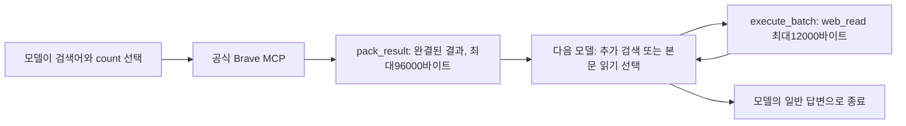

# 075 · 검색과 본문 읽기 범위 확대

## 문제와 좋은 답변의 기준
074에서는 검색 결과10개를 받고 후보3곳을 바로 골랐다. 이번 요청은 검색과 본문 전달량을 늘려 더 넓게 조사할 수 있게 하는 것이다. 좋은 답변은 주소·수영장·개별 바비큐 근거를 숙소별로 연결하고, 다른 후보보다 적합한 이유를 설명해야 한다. 종료나 조회 수만으로 품질 통과라 하지 않는다.

## 바꾼 내용
| 설정 | 이전 | 이번 |
|---|---|---|
| 첫 Brave 검색 안내 | 넓게 찾기, 실제10개 요청 | count=20 요청 안내 |
| Brave 결과 전달 예산 | 48000바이트 | 96000바이트 |
| 본문 읽기 전달 예산 | 3500바이트 | 12000바이트 |
| 모델 호출 | 24회 | 40회 |
| 도구 호출 | 20회 | 36회 |
| 웹 실행 기한 | 180초 | 360초 |

첫 검색 뒤 후보 이름과 빠진 조건으로 추가 검색하고, 예약 사이트도 활용하도록 지침을 보완했다. 처음 보인3곳에 바로 고정하지 않도록 안내했다. 검색 횟수를 코드로 강제하지 않으며 최종 선택과 종료는 계속 모델이 결정한다. 문맥65536토큰·출력4096토큰·전체 입력196608바이트·병렬3개는 유지했다. 결과 전달 예산은 토큰 수가 아니라 UTF-8바이트다.

## 같은 질문으로 실행
이전074와 같은 공개 여행 질문을 현재 Ollama Qwen3.5 4B Q4_K_M과 실제 Brave MCP에 보냈다. 반복 실행 평균이나 프롬프트만의 인과 비교는 아니다.
<callout icon="💬">
	가평에서 성인 두 명이 갈 펜션을 찾아줘. 수영장과 개별 바비큐가 둘 다 있는 후보를 최대 3곳 찾아서 이름, 실제 주소, 두 시설의 확인 근거와 출처 링크를 비교해줘. 날짜는 아직 미정이라 확정 가격이나 예약 가능 여부는 필요 없어. 공식 숙소 안내를 우선하고, 확인되지 않은 항목은 그대로 구분해줘.
</callout>

### 이전 답변
<callout icon="🤖">
	가평에서 수영장 및 개별 바비큐 시설이 모두 갖춰진 펜션을 찾았습니다. 각 후보의 공식 정보를 확인한 결과, 다음과 같은 정보가 수집되었습니다:
	
	## **1. 가평스파펜션 콜린**
	- **주소**: 경기 가평군 가평읍 태봉두밀로 269-45 (공식 홈페이지에서 명시됨)
	- **시설 확인 근거**: 
	  - 수영장: 공식 홈페이지에 'Swimming Pool' 항목으로 명시되어 있음
	  - 개별 바비큐: 전 객실에 개별 실내 바베큐장이 마련되어 있으며, 사계절 이용 가능
	- **출처 링크**: https://collineps.com/special2.html
	
	## **2. 나비잠펜션**
	- **주소**: 경기도 가평군 북면 싸리재길 16 (공식 홈페이지에서 명시됨)
	- **시설 확인 근거**: 
	  - 수영장: 공식 홈페이지에 야외바베큐장 및 개별바베큐장 준비로 언급됨 (수영장 명시 없음)
	  - 개별 바비큐: 개별바베큐장과 야외바베큐장 모두 준비되어 있음
	- **출처 링크**: https://navizam.kr/facility3
	
	## **3. 가평 뜰 독채 풀빌라 펜션**
	- **주소**: 공식 홈페이지에서 명시된 주소 없음 (지역 미확인)
	- **시설 확인 근거**: 
	  - 수영장: 개별실내수영장 제공으로 명시됨
	  - 개별 바비큐: 바베큐장 및 개별바비큐 시설로 명시됨
	- **출처 링크**: https://xn--iq1bv8dtg52w3ysnjl.com/
	
	---
	
	**요약:**
	- **가평스파펜션 콜린**: 수영장 및 실내 개별 바비큐 모두 공식 홈페이지에서 확인 가능, 주소 명시됨
	- **나비잠펜션**: 개별 바비큐 시설 명확히 확인 가능, 수영장 언급은 간접적 (명시 없음)
	- **가평 뜰 독채 풀빌라 펜션**: 수영장 및 바비큐 시설 명시됨, 주소 미확인
	
	**추가 확인 필요:**
	- 나비잠펜션의 수영장 시설에 대한 공식 확인이 부족함
	- 가평 뜰 독채 풀빌라 펜션의 정확한 주소가 확인되지 않음
	
	사용자께서는 이 중 어떤 펜션을 더 선호하시나요? 아니면 추가적으로 확인하고 싶은 항목이 있으신가요?
</callout>

### 이번 답변
<callout icon="🤖">
	최종 답변 없음
</callout>

## 실제 결과와 남은 한계
상태: model_error · 모델28회 · 도구27회 · 360.016초. 검색 요청은1회였고 도구 오류는23회다.

첫 검색은 count=20으로 요청했고 20개를 다음 모델에 전달했다. 생략은0개였다. 확대된 검색 결과 수신은 확인했지만 동일 본문 요청을 반복했다. 검색량·실행 예산 확대가 후보 비교와 반복 제어까지 해결한 것은 아니다. 이번 실행을 좋은 답변으로 통과시키지 않는다. 더 오래 실행하고 문맥을 많이 읽을 수 있어 지연·연산량이 증가할 수 있다. API 검색 비용 절감이나 품질 향상은 입증하지 않았다.

<details>
<summary>실제 검색과 본문 도구 기록</summary>
	모델이 요청한 인자와 실행 결과를 순서대로 연결했다. 검색 응답 원본과 다음 모델 입력은 비공개 보존하며 아래는 결과 제목·URL과 본문 읽기 상태를 표시한다.
	**1.1 · mcp_brave_brave_web_search · 2026-10-19T17:49:25.766002+00:00**
	호출 ID: `call_bkh6186o`
	```json
{
  "query": "가평 펜션 수영장 개별 바비큐",
  "country": "KR",
  "search_lang": "ko",
  "ui_lang": "ko-KR",
  "count": 20
}
	```
	- [2026 경기 가평 추천 펜션 풀빌라 베스트 10](https://www.yeogi.com/accommodation/pension/kr/%EA%B2%BD%EA%B8%B0%EB%8F%84/%EA%B0%80%ED%8F%89%EA%B5%B0)
	- [불쾌지수 낮추는 시원한, 가평 수영장 펜션 베스트 5 - 계곡? 수영장? 어디든 좋아! 가평 펜션 추천 5곳 - Go Guides](https://kr.hotels.com/go/south-korea/blog-gapyeong-pool-pensions-best-5)
	- [가평 콜린스파 펜션](https://collineps.com/special2.html)
	- [가평 실내수영장 온수무료펜션](https://nol.yanolja.com/stay/domestic/10042159)
	- [2026 가평군 가평읍 근처 펜션 풀빌라 베스트 10](https://www.yeogi.com/accommodation/pension/kr/attraction/%EA%B0%80%ED%8F%89%EA%B5%B0%EA%B0%80%ED%8F%89%EC%9D%8D)
	- [크림스톤 풀빌라](https://creamstone.kr/)
	- [가평 실내수영장 온수무료펜션 펜션/풀빌라 사진, 가격, 위치소개 | NOL](https://place-site.yanolja.com/places/10042159)
	- [요즘 같은 시기에 딱 좋은 프라이빗한 가평독채펜션🙋🏻‍♀️ | 여행 이야기 | 세상의 모든 머무름 - Allstay](https://allstay.com/alltrip/post/gapyeong-villa-pension)
	- [가평 개별수영장펜션 모음 : 네이버 블로그](https://m.blog.naver.com/penzava/221608778044)
	- [가평 힐링풀빌라펜션타운](http://healing-town.kr/)
	- [2026 경기 가평 추천 숙소 베스트 10](https://www.yeogi.com/accommodation/kr/%EA%B2%BD%EA%B8%B0%EB%8F%84/%EA%B0%80%ED%8F%89%EA%B5%B0)
	- [가평 포인 풀빌라 펜션](https://poinpension.co.kr/special2.html)
	- [가평 뜰 독채 풀빌라 펜션](https://xn--iq1bv8dtg52w3ysnjl.com/)
	- [가평 온수풀 펜션 BEST 5 사계절 내내 따끈하게 즐기는 수영장 숙소.ZIP | 여행 이야기 | 세상의 모든 머무름 - Allstay](https://allstay.com/alltrip/post/5-best-gapyeong-private-jacuzzi-and-swimming-pool-pensions)
	- [가평 풀빌라 펜션 추천 BEST 3 | 실내 수영장, 키즈 펜션, 가족여행 독채 숙소 모음](https://www.yeogi.com/content/dom-ko-gapyeong-poolvilla-bx2-gapyeong-pool-villa-pension-best-3)
	- [개별 바베큐 펜션 | NOL(야놀자)](https://nol.yanolja.com/exhibition/5490)
	- [가평 보타니칼 펜션](https://botanical.kr/special1.html)
	- [가평 가둘기정원 키즈풀빌라 가족 스파 온수수영장 펜션](http://www.gadulgi.kr/)
	- [2026 가평군 가평터미널 근처 펜션 풀빌라 베스트 10](https://www.yeogi.com/accommodation/pension/kr/attraction/%EA%B0%80%ED%8F%89%EA%B5%B0%EA%B0%80%ED%8F%89%ED%84%B0%EB%AF%B8%EB%84%90)
	- [2026 경기도 청평역 근처 펜션 풀빌라 베스트 10 - 가평군](https://www.yeogi.com/accommodation/pension/kr/attraction/%EA%B0%80%ED%8F%89%EA%B5%B0%EC%B2%AD%ED%8F%89%EC%97%AD)
	다음 모델에 준비된 도구 내용: 36016바이트.
	**2.1 · web_read · 2026-10-19T17:49:34.621770+00:00**
	호출 ID: `call_6bnql2rv`
	```json
{
  "query": "수영장 개별 바비큐 부대시설",
  "source_id": "web:0a909a324684e778"
}
	```
	본문 결과: https://xn--iq1bv8dtg52w3ysnjl.com/ · HTTP 200 · 전달 525바이트 · 잘림 True
	다음 모델에 준비된 도구 내용: 1002바이트.
	**3.1 · web_read · 2026-10-19T17:49:36.158977+00:00**
	호출 ID: `call_r2knguwu`
	```json
{
  "query": "수영장 개별 바비큐 부대시설",
  "source_id": "web:32a93374c40ac0f3"
}
	```
	본문 결과: https://poinpension.co.kr/special2.html · HTTP 200 · 전달 1043바이트 · 잘림 False
	다음 모델에 준비된 도구 내용: 1524바이트.
	**4.1 · web_read · 2026-10-19T17:49:44.080399+00:00**
	호출 ID: `call_fw60ocxu`
	```json
{
  "query": "수영장 개별 바비큐 부대시설",
  "source_id": "web:844ec63c1a79ed3b"
}
	```
	본문 결과: https://www.yeogi.com/accommodation/pension/kr/attraction/%EA%B0%80%ED%8F%89%EA%B5%B0%EC%B2%AD%ED%8F%89%EC%97%AD · HTTP 200 · 전달 3069바이트 · 잘림 True
	다음 모델에 준비된 도구 내용: 3661바이트.
	**5.1 · web_read · 2026-10-19T17:49:50.751363+00:00**
	호출 ID: `call_xq7f3zfb`
	```json
{
  "query": "수영장 개별 바비큐 부대시설",
  "source_id": "web:844ec63c1a79ed3b"
}
	```
	결과: Identical tool call already attempted; change query or answer from available evidence
	다음 모델에 준비된 도구 내용: 152바이트.
	**6.1 · web_read · 2026-10-19T17:49:59.555560+00:00**
	호출 ID: `call_9d9rh9tv`
	```json
{
  "query": "수영장 개별 바비큐 부대시설",
  "source_id": "web:844ec63c1a79ed3b"
}
	```
	결과: Identical tool call already attempted; change query or answer from available evidence
	다음 모델에 준비된 도구 내용: 152바이트.
	**7.1 · web_read · 2026-10-19T17:50:13.010072+00:00**
	호출 ID: `call_xeh50rw0`
	```json
{
  "query": "수영장 개별 바비큐 부대시설",
  "source_id": "web:844ec63c1a79ed3b"
}
	```
	결과: Identical tool call already attempted; change query or answer from available evidence
	다음 모델에 준비된 도구 내용: 152바이트.
	**8.1 · web_read · 2026-10-19T17:50:26.838311+00:00**
	호출 ID: `call_fupzrvgg`
	```json
{
  "query": "수영장 개별 바비큐 부대시설",
  "source_id": "web:844ec63c1a79ed3b"
}
	```
	결과: Identical tool call already attempted; change query or answer from available evidence
	다음 모델에 준비된 도구 내용: 152바이트.
	**9.1 · web_read · 2026-10-19T17:50:40.646590+00:00**
	호출 ID: `call_azdu92rj`
	```json
{
  "query": "수영장 개별 바비큐 부대시설",
  "source_id": "web:844ec63c1a79ed3b"
}
	```
	결과: Identical tool call already attempted; change query or answer from available evidence
	다음 모델에 준비된 도구 내용: 152바이트.
	**10.1 · web_read · 2026-10-19T17:50:54.689320+00:00**
	호출 ID: `call_fgsisjjx`
	```json
{
  "query": "수영장 개별 바비큐 부대시설",
  "source_id": "web:844ec63c1a79ed3b"
}
	```
	결과: Identical tool call already attempted; change query or answer from available evidence
	다음 모델에 준비된 도구 내용: 152바이트.
	**11.1 · web_read · 2026-10-19T17:51:08.527370+00:00**
	호출 ID: `call_7so3ld3h`
	```json
{
  "query": "수영장 개별 바비큐 부대시설",
  "source_id": "web:844ec63c1a79ed3b"
}
	```
	결과: Identical tool call already attempted; change query or answer from available evidence
	다음 모델에 준비된 도구 내용: 152바이트.
	**12.1 · web_read · 2026-10-19T17:51:22.539738+00:00**
	호출 ID: `call_4q0s15cu`
	```json
{
  "query": "수영장 개별 바비큐 부대시설",
  "source_id": "web:844ec63c1a79ed3b"
}
	```
	결과: Identical tool call already attempted; change query or answer from available evidence
	다음 모델에 준비된 도구 내용: 152바이트.
	**13.1 · web_read · 2026-10-19T17:51:37.243577+00:00**
	호출 ID: `call_vcwj4mx3`
	```json
{
  "query": "수영장 개별 바비큐 부대시설",
  "source_id": "web:844ec63c1a79ed3b"
}
	```
	결과: Identical tool call already attempted; change query or answer from available evidence
	다음 모델에 준비된 도구 내용: 152바이트.
	**14.1 · web_read · 2026-10-19T17:51:51.830334+00:00**
	호출 ID: `call_xk4exqp7`
	```json
{
  "query": "수영장 개별 바비큐 부대시설",
  "source_id": "web:844ec63c1a79ed3b"
}
	```
	결과: Identical tool call already attempted; change query or answer from available evidence
	다음 모델에 준비된 도구 내용: 152바이트.
	**15.1 · web_read · 2026-10-19T17:52:06.000704+00:00**
	호출 ID: `call_i3li4crp`
	```json
{
  "query": "수영장 개별 바비큐 부대시설",
  "source_id": "web:844ec63c1a79ed3b"
}
	```
	결과: Identical tool call already attempted; change query or answer from available evidence
	다음 모델에 준비된 도구 내용: 152바이트.
	**16.1 · web_read · 2026-10-19T17:52:20.383313+00:00**
	호출 ID: `call_ej1filmv`
	```json
{
  "query": "수영장 개별 바비큐 부대시설",
  "source_id": "web:844ec63c1a79ed3b"
}
	```
	결과: Identical tool call already attempted; change query or answer from available evidence
	다음 모델에 준비된 도구 내용: 152바이트.
	**17.1 · web_read · 2026-10-19T17:52:34.567888+00:00**
	호출 ID: `call_lsm7u9qo`
	```json
{
  "query": "수영장 개별 바비큐 부대시설",
  "source_id": "web:844ec63c1a79ed3b"
}
	```
	결과: Identical tool call already attempted; change query or answer from available evidence
	다음 모델에 준비된 도구 내용: 152바이트.
	**18.1 · web_read · 2026-10-19T17:52:49.045146+00:00**
	호출 ID: `call_jytr31p9`
	```json
{
  "query": "수영장 개별 바비큐 부대시설",
  "source_id": "web:844ec63c1a79ed3b"
}
	```
	결과: Identical tool call already attempted; change query or answer from available evidence
	다음 모델에 준비된 도구 내용: 152바이트.
	**19.1 · web_read · 2026-10-19T17:53:03.660358+00:00**
	호출 ID: `call_dpsauvum`
	```json
{
  "query": "수영장 개별 바비큐 부대시설",
  "source_id": "web:844ec63c1a79ed3b"
}
	```
	결과: Identical tool call already attempted; change query or answer from available evidence
	다음 모델에 준비된 도구 내용: 152바이트.
	**20.1 · web_read · 2026-10-19T17:53:18.018126+00:00**
	호출 ID: `call_zgl7by6z`
	```json
{
  "query": "수영장 개별 바비큐 부대시설",
  "source_id": "web:844ec63c1a79ed3b"
}
	```
	결과: Identical tool call already attempted; change query or answer from available evidence
	다음 모델에 준비된 도구 내용: 152바이트.
	**21.1 · web_read · 2026-10-19T17:53:32.318776+00:00**
	호출 ID: `call_sk5quiaa`
	```json
{
  "query": "수영장 개별 바비큐 부대시설",
  "source_id": "web:844ec63c1a79ed3b"
}
	```
	결과: Identical tool call already attempted; change query or answer from available evidence
	다음 모델에 준비된 도구 내용: 152바이트.
	**22.1 · web_read · 2026-10-19T17:53:46.395238+00:00**
	호출 ID: `call_zcuu4qmp`
	```json
{
  "query": "수영장 개별 바비큐 부대시설",
  "source_id": "web:844ec63c1a79ed3b"
}
	```
	결과: Identical tool call already attempted; change query or answer from available evidence
	다음 모델에 준비된 도구 내용: 152바이트.
	**23.1 · web_read · 2026-10-19T17:54:00.855306+00:00**
	호출 ID: `call_bxnuf1ad`
	```json
{
  "query": "수영장 개별 바비큐 부대시설",
  "source_id": "web:844ec63c1a79ed3b"
}
	```
	결과: Identical tool call already attempted; change query or answer from available evidence
	다음 모델에 준비된 도구 내용: 152바이트.
	**24.1 · web_read · 2026-10-19T17:54:15.057784+00:00**
	호출 ID: `call_o9b8597o`
	```json
{
  "query": "수영장 개별 바비큐 부대시설",
  "source_id": "web:844ec63c1a79ed3b"
}
	```
	결과: Identical tool call already attempted; change query or answer from available evidence
	다음 모델에 준비된 도구 내용: 152바이트.
	**25.1 · web_read · 2026-10-19T17:54:31.332234+00:00**
	호출 ID: `call_e3nrllc8`
	```json
{
  "query": "수영장 개별 바비큐 부대시설",
  "source_id": "web:844ec63c1a79ed3b"
}
	```
	결과: Identical tool call already attempted; change query or answer from available evidence
	다음 모델에 준비된 도구 내용: 152바이트.
	**26.1 · web_read · 2026-10-19T17:54:45.848354+00:00**
	호출 ID: `call_5k5gvfmm`
	```json
{
  "query": "수영장 개별 바비큐 부대시설",
  "source_id": "web:844ec63c1a79ed3b"
}
	```
	결과: Identical tool call already attempted; change query or answer from available evidence
	다음 모델에 준비된 도구 내용: 152바이트.
	**27.1 · web_read · 2026-10-19T17:55:02.104237+00:00**
	호출 ID: `call_fwe8e2u2`
	```json
{
  "query": "수영장 개별 바비큐 부대시설",
  "source_id": "web:844ec63c1a79ed3b"
}
	```
	결과: Identical tool call already attempted; change query or answer from available evidence
	다음 모델에 준비된 도구 내용: 152바이트.
</details>

## 구현과 검증
기준 코드는 변경 전9f5509f다. 실제 변경 소스의 실행 경로는 다음과 같다.

`src/travel_agent/agent.py`의 `run_agent`와 `execute_batch`에서 예산을 바꿨다. 본문 예산 확대는 다른 메모리 도구의3500바이트 한도를 바꾸지 않는다.
```python
max_steps=40, max_tool_calls=36, timeout=360, max_input_bytes=None,
max_bytes=12000 if name == 'web_read' else 3500,
```
`brave_mcp.py`의 `pack_result`와 `mcp_client.py`의 `model_result`는 검색 기본 예산을 함께96000바이트로 사용한다. 실제 함수 선언:
```python
def pack_result(result, max_bytes=96000):
```
265개 Python 검사가 통과했다. 20개의 긴 합성 검색 결과를 이전48000바이트와 확대 예산으로 비교해 완결된 추가 발췌 보존을 확인했고, 실제 MCP 왕복 검사에서 web_read에12000바이트가 전달됨을 검사했다. 도구36회 뒤 정리 응답과 모델40회 상한도 확인했다. 첫 검사에서는 실제 호스트 MCP가 합성 도구 검사에 끼어 실패했고, 빈 MCP 설정으로 격리한 뒤 남은 기존24회·20회 기대값을 새 한도로 갱신하여 전체를 재검증했다. 실제 검색 품질 검증과 이 자동 검사는 다르다.

로컬50733을 같은 포트로 재시작했다. 이 실험은 웹 대화 세션을 만들지 않았고 기존 사용자 대화와 원본 모델을 유지했다.
