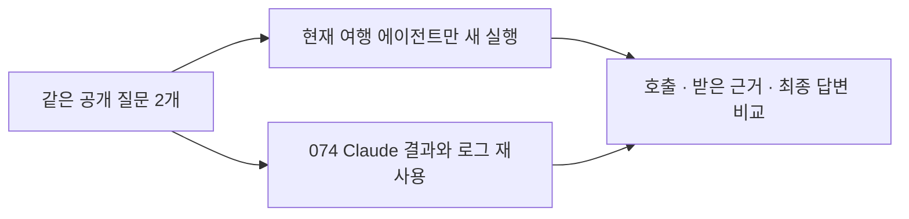

# 076 · 우리 에이전트 재실행과 이전 Claude 비교

## 무엇을 다시 확인했나
사용자는 검색량을 늘린 우리 에이전트만 다시 실행하고, 저장된 이전 Claude Code 결과와 비교해 달라고 했다. 코드와 프롬프트를 바꾸지 않고 공개 여행 질문 두 개를 각각 새 메모리에서 실행했다. Claude Code는 이번에 실행하지 않았다.

좋은 답변의 기준은 기존 질문에 적힌 조건을 따른다. 펜션은 숙소별 주소·수영장·개별 바비큐와 근거 연결, 수목원은 공식 안내의 요금·시간·주차와 두 명 합계가 핵심이다. 완료 상태나 인용 개수만으로 통과시키지 않는다.

## 실행 결과
| 질문 | 구성 | 상태 | 모델 호출 | 검색 요청 | 성공한 본문 읽기 | 도구 오류 | 시간 |
|---|---|---|---|---|---|---|---|
| gapyeong-stays | 우리 재실행 | model_error | 27 | 1 | 3 | 26 | 360.049초 |
| gapyeong-stays | 이전 Claude | success | 6 | 5 | 0 | 0 | 151.766초 |
| garden-visit | 우리 재실행 | completed | 2 | 1 | 0 | 0 | 58.207초 |
| garden-visit | 이전 Claude | success | 2 | 1 | 0 | 0 | 64.625초 |

## 비교에서 드러난 차이

**가평은 이전 Claude Code 쪽이 더 유용한 결과를 냈다.** 우리 재실행은 검색1회로20개 결과를 받고, 콜린·뜰·포인3곳의 본문을 읽었다. 이후 숙소 이름으로 검색을 추가하지 않고 같은 읽기를26회 반복 요청했다. 중복 검사에서 거절돼 실제 HTTP 조회를26번 더 한 것은 아니다. 360.049초에 모델 호출이 시간 초과로 끝나 최종 추천이 없었다. 이전 Claude는 넓은 검색15개 뒤 숙소 이름별 검색4회를 추가했고 비교표를 작성했다.

따라서 도구 요청30회를 검색30회나 자료30건 확보로 해석하면 안 된다. 성공한 실행은 검색1회와 본문 읽기3회였다. 검색 결과를 늘렸어도 실제로 더 넓게 비교하는 행동은 나오지 않았다. 처음 고른3곳보다 다른 후보가 왜 덜 적합한지 판단한 기록도 없다.

### 이번에는 출력 토큰 부족으로 잘린 것이 아니다

가평의 응답을 받은 모델 호출 중 최대 입력 사용량은22915토큰, 최대 출력은351토큰이었다. 해당 응답의 종료 사유는 모두 stop이고 length는 없었다. 설정은 문맥65536·출력4096이다. 마지막 호출 자체는 전체 실행 기한에 걸려 시간 초과였다. 관측된 실패는 출력 상한 도달이 아니라 반복 요청이 시간을 소모한 흐름이다. 이 수치만으로 모델과 하네스 중 한쪽을 유일한 원인으로 확정하지 않는다.

처음 읽은 추출문은 콜린358자·뜰305자·포인509자였다. 콜린과 뜰은 관련 발췌에서 일부가 빠졌고 추가 읽기용 토큰과 next_start_index=0을 반환했다. 포인은 추출문 전체를 전달했다. 모두12000바이트보다 짧아서 이번 문제를 본문 전달 용량 부족으로 설명할 수 없다. 모델은 추가 읽기 인자로 바꾸지 않고 같은 요청을 재사용했다. 짧은 추출문이 원사이트의 모든 정보를 담았다는 뜻도 아니다.

### 수목원은 답변했지만 공식 근거 확인은 남았다

우리는 검색1회·모델2회·58.207초에 답변했다. 이전 Claude도 검색1회·모델2회·64.625초였다. 단일 관찰에서 시간이 짧았을 뿐 일반적인 속도 우위는 아니다.

이번 우리 검색에는 공식 사이트2개가 있었지만 두 항목의 설명은 “We cannot provide a description for this page right now”였고 추가 발췌도 없었다. 실제 요금·시간·주차 내용은 제3자 기사와 블로그의 검색 발췌에서 왔다. 본문 읽기는0회였다. 성인11000원×2=22000원 계산은 맞지만, 사용자가 요청한 공식 안내 확인을 달성했다고 판정할 수 없다. 겨울 행사는2025~2026년의 과거 시즌을 소개했으며 요청한2026년10월 이후 일정 확인과 구분해야 한다.

이전 Claude도 공식 본문을 읽지 않았고, 반려동물 제한을 “동반 인원”으로 옮긴 오류가 있었다. 가평 답변에는 다른 숙소로 반환된 여기어때 링크를 보타니칼 근거로 붙인 문제도 있다. **가평의 작업 완료와 답변 구성은 Claude 쪽이 낫지만, 두 질문의 엄격한 근거 품질은 양쪽 모두 미통과**로 기록한다.

## 다음 개선의 우선순위

이번 결과는 검색 개수나 실행 한도를 다시 늘릴 근거가 아니다. 우선 해결할 것은 같은 오류 이후 행동을 바꾸지 못하는 반복, 관련 발췌와 전체 문서 읽기 상태를 모델이 이해하기 어려운 인터페이스, 후보별 필수 조건과 출처 연결이다. 해결 방법의 효과는 별도 변경과 동일 질문 재실행으로 확인해야 한다. 이번 비교 중에는 제품 코드를 바꾸지 않았다.


## 가평 펜션 비교
<callout icon="💬">
	가평에서 성인 두 명이 갈 펜션을 찾아줘. 수영장과 개별 바비큐가 둘 다 있는 후보를 최대 3곳 찾아서 이름, 실제 주소, 두 시설의 확인 근거와 출처 링크를 비교해줘. 날짜는 아직 미정이라 확정 가격이나 예약 가능 여부는 필요 없어. 공식 숙소 안내를 우선하고, 확인되지 않은 항목은 그대로 구분해줘.
</callout>
### 우리 에이전트 재실행
<callout icon="🤖">
	최종 답변 없음
</callout>
### 이전 Claude Code 답변
<callout icon="🤖">
	가평에서 수영장과 개별 바비큐 시설이 모두 있는 펜션을 찾았습니다. 공식 안내를 바탕으로 3 곳의 후보를 정리해 드립니다.
	
	---
	
	## 가평 수영장 및 개별 바비큐 펜션 추천 (최대 3곳)
	
	### 1. 가평 가보자독채애견풀빌라수영장펜션
	| 항목 | 내용 | 출처 링크 |
	|------|------|-----------|
	| **숙소명** | 가평 가보자독채애견풀빌라수영장펜션 | [야놀자](https://nol.yanolja.com/stay/domestic/10063510) |
	| **실제 주소** | 경기도 가평군 애견동 47-2 | [여기어때](https://www.yeogi.com/domestic-accommodations/84961) |
	| **수영장 시설 확인 근거** | - 야외 대형 풀장 (가로 20M × 세로 13M, 물높이 1M)<br>- 야외 유아 풀장 운영<br>- 사계절 이용 가능 (미온수 30도)<br>- VIP 객실: 가로 3M × 세로 5M, 물높이 70CM | [여기어때 공식 안내](https://www.yeogi.com/domestic-accommodations/84961) |
	| **개별 바비큐 시설 확인 근거** | - 개별 테라스 바베큐 (숯불)<br>- 공용 바베큐장<br>- 비용: 2인 기준 20,000원 / 인원 추가 시 1인당 5,000원<br>- 준비시간: 입실 후 ~ 오후 9시<br>- 우천 및 동계 이용 가능 | [여기어때 공식 안내](https://www.yeogi.com/domestic-accommodations/84961) |
	| **입실 시간** | 15:00 (퇴실 11:00)<br>21시 이후 입실 시 사전 연락 필수 | [여기어때 공식 안내](https://www.yeogi.com/domestic-accommodations/84961) |
	| **특이사항** | - 애견 동반 펜션<br>- 현재 특실 3 객실은 개별 미끄럼틀 철거되어 이용 불가 | [반려생활](https://ban-life.com/accommodation/21739) |
	
	---
	
	### 2. 가평 콜린스파 펜션
	| 항목 | 내용 | 출처 링크 |
	|------|------|-----------|
	| **숙소명** | 가평 콜린스파 펜션 | [공식 홈페이지](https://collineps.com/) |
	| **실제 주소** | 경기도 가평군 가평읍 태봉두밀로 269-45 | [G마켓 투어](https://gtour.gmarket.co.kr/TourV2/Item?goodscode=2275065702) |
	| **수영장 시설 확인 근거** | - 야외 수영장 운영<br>- 스파 시설 포함 | [야놀자 공식 안내](https://place-site.yanolja.com/places/10045237) |
	| **개별 바비큐 시설 확인 근거** | - 전 객실 실내 개별 테라스 바베큐<br>- 사계절 이용 가능한 프라이빗한 개별 바베큐장 | [G마켓 투어 공식 안내](https://gtour.gmarket.co.kr/TourV2/Item?goodscode=2275065702) |
	| **입실 시간** | 15시 이후 (퇴실 11시 이전)<br>21시 이후 입실 시 펜션으로 사전 연락 필수 | [G마켓 투어 공식 안내](https://gtour.gmarket.co.kr/TourV2/Item?goodscode=2275065702) |
	| **특이사항** | - 남이섬, 가평레일바이크 인근 위치<br>- 전 객실 넷플릭스 이용 가능 (개인 ID 사용)<br>- 마트 픽업: 농수산물마켓, 조은마트, 씨씨할인마트 | [공식 홈페이지](https://collineps.com/) |
	
	---
	
	### 3. 가평 보타니칼펜션
	| 항목 | 내용 | 출처 링크 |
	|------|------|-----------|
	| **숙소명** | 가평 보타니칼펜션 | [야놀자](https://www.yanolja.com/pension/1000111770) |
	| **실제 주소** | 경기도 가평군 아침고요수목원 인근 (구체적 주소 미확인) | [여기어때](https://www.yeogi.com/domestic-accommodations/62421) |
	| **수영장 시설 확인 근거** | - 수영장 운영<br>- 동남아를 연상시키는 이국적인 수영장 특징 | [여행 블로그](https://travel-hotel-culinary.tistory.com/2244) |
	| **개별 바비큐 시설 확인 근거** | - 개별 바베큐 시설<br>- 사랑하는 사람과 맛있는 바비큐 파티 가능 | [야놀자 공식 안내](https://www.yanolja.com/pension/1000111770) |
	| **입실 시간** | 미확인 (공식 안내 확인 필요) | - |
	| **특이사항** | - 애견 동반 가능<br>- 주차 가능<br>- 커피숍 운영<br>- 복층 구조<br>- 마트 픽업: 365마트 (청평역에서 하차 후 택시 이용)<br>- 펜션 자체 픽업 운영 안함 | [여기어때](https://www.yeogi.com/domestic-accommodations/62421) |
	
	---
	
	## 요약
	| 순위 | 숙소명 | 수영장 | 개별 바비큐 | 주소 확인 여부 |
	|------|--------|--------|-------------|----------------|
	| 1 | 가평 가보자독채애견풀빌라수영장펜션 | ✅ (야외대형+유아풀) | ✅ (개별테라스+공용) | ✅ |
	| 2 | 가평 콜린스파 펜션 | ✅ (야외) | ✅ (전 객실 개별테라스) | ✅ |
	| 3 | 가평 보타니칼펜션 | ✅ (이국적 수영장) | ✅ (개별 바베큐) | ⚠️ (미확인) |
	
	**참고사항:**
	- 날짜가 미정이라 확정 가격이나 예약 가능 여부는 확인되지 않았습니다.
	- 공식 숙소 안내를 우선으로 작성하였으며, 일부 항목은 실제 방문 후 확인이 필요합니다.
	- 가보자독채애견풀빌라수영장펜션은 애견 동반 펜션임을 고려하여 반려동물 동반 여부를 확인하시기 바랍니다.
</callout>
<details>
<summary>우리 에이전트의 실제 검색·본문 호출</summary>
	모델 요청과 실행 결과를 호출 순서대로 연결했다. 받은 자료에서는 온전한 제목·URL과 본문 상태를 표시한다. 원본 응답과 다음 모델 입력은 비공개 보존했다.
	**1.1 · mcp_brave_brave_web_search · 2026-10-19T18:17:33.275798+00:00**
	호출 ID: `call_cuodscoo`
	```json
{
  "query": "가평 펜션 수영장 개별 바비큐",
  "country": "KR",
  "search_lang": "ko",
  "ui_lang": "ko-KR",
  "count": 20
}
	```
	- [2026 경기 가평 추천 펜션 풀빌라 베스트 10](https://www.yeogi.com/accommodation/pension/kr/%EA%B2%BD%EA%B8%B0%EB%8F%84/%EA%B0%80%ED%8F%89%EA%B5%B0)
	- [불쾌지수 낮추는 시원한, 가평 수영장 펜션 베스트 5 - 계곡? 수영장? 어디든 좋아! 가평 펜션 추천 5곳 - Go Guides](https://kr.hotels.com/go/south-korea/blog-gapyeong-pool-pensions-best-5)
	- [가평 실내수영장 온수무료펜션](https://nol.yanolja.com/stay/domestic/10042159)
	- [가평 실내수영장 온수무료펜션 펜션/풀빌라 사진, 가격, 위치소개 | NOL](https://place-site.yanolja.com/places/10042159)
	- [가평 콜린스파 펜션](https://collineps.com/special2.html)
	- [크림스톤 풀빌라](https://creamstone.kr/)
	- [요즘 같은 시기에 딱 좋은 프라이빗한 가평독채펜션🙋🏻‍♀️ | 여행 이야기 | 세상의 모든 머무름 - Allstay](https://allstay.com/alltrip/post/gapyeong-villa-pension)
	- [가평 개별수영장펜션 모음 : 네이버 블로그](https://m.blog.naver.com/penzava/221608778044)
	- [2026 가평군 가평읍 근처 펜션 풀빌라 베스트 10](https://www.yeogi.com/accommodation/pension/kr/attraction/%EA%B0%80%ED%8F%89%EA%B5%B0%EA%B0%80%ED%8F%89%EC%9D%8D)
	- [가평 힐링풀빌라펜션타운](http://healing-town.kr/)
	- [2026 경기 가평 추천 숙소 베스트 10](https://www.yeogi.com/accommodation/kr/%EA%B2%BD%EA%B8%B0%EB%8F%84/%EA%B0%80%ED%8F%89%EA%B5%B0)
	- [가평 포인 풀빌라 펜션](https://poinpension.co.kr/special2.html)
	- [가평 온수풀 펜션 BEST 5 사계절 내내 따끈하게 즐기는 수영장 숙소.ZIP | 여행 이야기 | 세상의 모든 머무름 - Allstay](https://allstay.com/alltrip/post/5-best-gapyeong-private-jacuzzi-and-swimming-pool-pensions)
	- [가평 뜰 독채 풀빌라 펜션](https://xn--iq1bv8dtg52w3ysnjl.com/)
	- [개별 바베큐 펜션 | NOL(야놀자)](https://nol.yanolja.com/exhibition/5490)
	- [가평 풀빌라 펜션 추천 BEST 3 | 실내 수영장, 키즈 펜션, 가족여행 독채 숙소 모음](https://www.yeogi.com/content/dom-ko-gapyeong-poolvilla-bx2-gapyeong-pool-villa-pension-best-3)
	- [가평 보타니칼 펜션](https://botanical.kr/special1.html)
	- [가평 가둘기정원 키즈풀빌라 가족 스파 온수수영장 펜션](http://www.gadulgi.kr/)
	- [2026 가평군 가평터미널 근처 펜션 풀빌라 베스트 10](https://www.yeogi.com/accommodation/pension/kr/attraction/%EA%B0%80%ED%8F%89%EA%B5%B0%EA%B0%80%ED%8F%89%ED%84%B0%EB%AF%B8%EB%84%90)
	- [2026 경기도 청평역 근처 펜션 풀빌라 베스트 10 - 가평군](https://www.yeogi.com/accommodation/pension/kr/attraction/%EA%B0%80%ED%8F%89%EA%B5%B0%EC%B2%AD%ED%8F%89%EC%97%AD)
	다음 모델용 도구 응답: 36016바이트.
	**2.1 · web_read · 2026-10-19T18:17:43.598790+00:00**
	호출 ID: `call_o2nkezxo`
	```json
{
  "query": "수영장, 개별 바비큐 시설 이용안내",
  "source_id": "web:9bfb57a07ed32264"
}
	```
	본문: https://collineps.com/special2.html · HTTP 200 · 추출문 358자 · 전달 본문 530바이트 · 잘림 True
	다음 모델용 도구 응답: 1007바이트.
	**2.2 · web_read · 2026-10-19T18:17:43.599843+00:00**
	호출 ID: `call_6tvta0bq`
	```json
{
  "query": "수영장, 개별 바비큐 시설 이용안내",
  "source_id": "web:0a909a324684e778"
}
	```
	본문: https://xn--iq1bv8dtg52w3ysnjl.com/ · HTTP 200 · 추출문 305자 · 전달 본문 525바이트 · 잘림 True
	다음 모델용 도구 응답: 1010바이트.
	**2.3 · web_read · 2026-10-19T18:17:43.600372+00:00**
	호출 ID: `call_6o0mxv8r`
	```json
{
  "query": "수영장, 개별 바비큐 시설 이용안내",
  "source_id": "web:32a93374c40ac0f3"
}
	```
	본문: https://poinpension.co.kr/special2.html · HTTP 200 · 추출문 509자 · 전달 본문 1043바이트 · 잘림 False
	다음 모델용 도구 응답: 1532바이트.
	**3.1 · web_read · 2026-10-19T18:17:58.451099+00:00**
	호출 ID: `call_lkskbb81`
	```json
{
  "query": "수영장, 개별 바비큐 시설 이용안내",
  "source_id": "web:9bfb57a07ed32264"
}
	```
	오류: Identical tool call already attempted; change query or answer from available evidence
	다음 모델용 도구 응답: 152바이트.
	**3.2 · web_read · 2026-10-19T18:17:58.451640+00:00**
	호출 ID: `call_a2kf6629`
	```json
{
  "query": "수영장, 개별 바비큐 시설 이용안내",
  "source_id": "web:0a909a324684e778"
}
	```
	오류: Identical tool call already attempted; change query or answer from available evidence
	다음 모델용 도구 응답: 152바이트.
	**3.3 · web_read · 2026-10-19T18:17:58.452719+00:00**
	호출 ID: `call_qcy86mxx`
	```json
{
  "query": "수영장, 개별 바비큐 시설 이용안내",
  "source_id": "web:32a93374c40ac0f3"
}
	```
	오류: Identical tool call already attempted; change query or answer from available evidence
	다음 모델용 도구 응답: 152바이트.
	**4.1 · web_read · 2026-10-19T18:18:08.606350+00:00**
	호출 ID: `call_jcjwplzn`
	```json
{
  "query": "수영장, 개별 바비큐 시설 이용안내",
  "source_id": "web:9bfb57a07ed32264"
}
	```
	오류: Identical tool call already attempted; change query or answer from available evidence
	다음 모델용 도구 응답: 152바이트.
	**5.1 · web_read · 2026-10-19T18:18:21.568279+00:00**
	호출 ID: `call_su6qlais`
	```json
{
  "query": "수영장, 개별 바비큐 시설 이용안내",
  "source_id": "web:9bfb57a07ed32264"
}
	```
	오류: Identical tool call already attempted; change query or answer from available evidence
	다음 모델용 도구 응답: 152바이트.
	**6.1 · web_read · 2026-10-19T18:18:34.844402+00:00**
	호출 ID: `call_24m9rwp9`
	```json
{
  "query": "수영장, 개별 바비큐 시설 이용안내",
  "source_id": "web:9bfb57a07ed32264"
}
	```
	오류: Identical tool call already attempted; change query or answer from available evidence
	다음 모델용 도구 응답: 152바이트.
	**7.1 · web_read · 2026-10-19T18:18:48.182859+00:00**
	호출 ID: `call_m8q33szr`
	```json
{
  "query": "수영장, 개별 바비큐 시설 이용안내",
  "source_id": "web:9bfb57a07ed32264"
}
	```
	오류: Identical tool call already attempted; change query or answer from available evidence
	다음 모델용 도구 응답: 152바이트.
	**8.1 · web_read · 2026-10-19T18:19:01.616877+00:00**
	호출 ID: `call_dv6mk1g5`
	```json
{
  "query": "수영장, 개별 바비큐 시설 이용안내",
  "source_id": "web:9bfb57a07ed32264"
}
	```
	오류: Identical tool call already attempted; change query or answer from available evidence
	다음 모델용 도구 응답: 152바이트.
	**9.1 · web_read · 2026-10-19T18:19:14.957202+00:00**
	호출 ID: `call_csujv3ht`
	```json
{
  "query": "수영장, 개별 바비큐 시설 이용안내",
  "source_id": "web:9bfb57a07ed32264"
}
	```
	오류: Identical tool call already attempted; change query or answer from available evidence
	다음 모델용 도구 응답: 152바이트.
	**10.1 · web_read · 2026-10-19T18:19:28.535003+00:00**
	호출 ID: `call_7g57jfux`
	```json
{
  "query": "수영장, 개별 바비큐 시설 이용안내",
  "source_id": "web:9bfb57a07ed32264"
}
	```
	오류: Identical tool call already attempted; change query or answer from available evidence
	다음 모델용 도구 응답: 152바이트.
	**11.1 · web_read · 2026-10-19T18:19:42.013435+00:00**
	호출 ID: `call_8w86m3qb`
	```json
{
  "query": "수영장, 개별 바비큐 시설 이용안내",
  "source_id": "web:9bfb57a07ed32264"
}
	```
	오류: Identical tool call already attempted; change query or answer from available evidence
	다음 모델용 도구 응답: 152바이트.
	**12.1 · web_read · 2026-10-19T18:19:55.741176+00:00**
	호출 ID: `call_cqebaz7q`
	```json
{
  "query": "수영장, 개별 바비큐 시설 이용안내",
  "source_id": "web:9bfb57a07ed32264"
}
	```
	오류: Identical tool call already attempted; change query or answer from available evidence
	다음 모델용 도구 응답: 152바이트.
	**13.1 · web_read · 2026-10-19T18:20:09.296168+00:00**
	호출 ID: `call_6bqh04bc`
	```json
{
  "query": "수영장, 개별 바비큐 시설 이용안내",
  "source_id": "web:9bfb57a07ed32264"
}
	```
	오류: Identical tool call already attempted; change query or answer from available evidence
	다음 모델용 도구 응답: 152바이트.
	**14.1 · web_read · 2026-10-19T18:20:22.992777+00:00**
	호출 ID: `call_dn7201c3`
	```json
{
  "query": "수영장, 개별 바비큐 시설 이용안내",
  "source_id": "web:9bfb57a07ed32264"
}
	```
	오류: Identical tool call already attempted; change query or answer from available evidence
	다음 모델용 도구 응답: 152바이트.
	**15.1 · web_read · 2026-10-19T18:20:36.608856+00:00**
	호출 ID: `call_fy43ovge`
	```json
{
  "query": "수영장, 개별 바비큐 시설 이용안내",
  "source_id": "web:9bfb57a07ed32264"
}
	```
	오류: Identical tool call already attempted; change query or answer from available evidence
	다음 모델용 도구 응답: 152바이트.
	**16.1 · web_read · 2026-10-19T18:20:50.385047+00:00**
	호출 ID: `call_nv2zvowb`
	```json
{
  "query": "수영장, 개별 바비큐 시설 이용안내",
  "source_id": "web:9bfb57a07ed32264"
}
	```
	오류: Identical tool call already attempted; change query or answer from available evidence
	다음 모델용 도구 응답: 152바이트.
	**17.1 · web_read · 2026-10-19T18:21:04.150644+00:00**
	호출 ID: `call_pdn57jkg`
	```json
{
  "query": "수영장, 개별 바비큐 시설 이용안내",
  "source_id": "web:9bfb57a07ed32264"
}
	```
	오류: Identical tool call already attempted; change query or answer from available evidence
	다음 모델용 도구 응답: 152바이트.
	**18.1 · web_read · 2026-10-19T18:21:18.396284+00:00**
	호출 ID: `call_653grjqj`
	```json
{
  "query": "수영장, 개별 바비큐 시설 이용안내",
  "source_id": "web:9bfb57a07ed32264"
}
	```
	오류: Identical tool call already attempted; change query or answer from available evidence
	다음 모델용 도구 응답: 152바이트.
	**19.1 · web_read · 2026-10-19T18:21:32.915831+00:00**
	호출 ID: `call_k1pty8li`
	```json
{
  "query": "수영장, 개별 바비큐 시설 이용안내",
  "source_id": "web:9bfb57a07ed32264"
}
	```
	오류: Identical tool call already attempted; change query or answer from available evidence
	다음 모델용 도구 응답: 152바이트.
	**20.1 · web_read · 2026-10-19T18:21:46.941178+00:00**
	호출 ID: `call_91bhj86n`
	```json
{
  "query": "수영장, 개별 바비큐 시설 이용안내",
  "source_id": "web:9bfb57a07ed32264"
}
	```
	오류: Identical tool call already attempted; change query or answer from available evidence
	다음 모델용 도구 응답: 152바이트.
	**21.1 · web_read · 2026-10-19T18:22:01.328558+00:00**
	호출 ID: `call_h1jaomh0`
	```json
{
  "query": "수영장, 개별 바비큐 시설 이용안내",
  "source_id": "web:9bfb57a07ed32264"
}
	```
	오류: Identical tool call already attempted; change query or answer from available evidence
	다음 모델용 도구 응답: 152바이트.
	**22.1 · web_read · 2026-10-19T18:22:15.663754+00:00**
	호출 ID: `call_bbylubgd`
	```json
{
  "query": "수영장, 개별 바비큐 시설 이용안내",
  "source_id": "web:9bfb57a07ed32264"
}
	```
	오류: Identical tool call already attempted; change query or answer from available evidence
	다음 모델용 도구 응답: 152바이트.
	**23.1 · web_read · 2026-10-19T18:22:30.364322+00:00**
	호출 ID: `call_rhqfm95o`
	```json
{
  "query": "수영장, 개별 바비큐 시설 이용안내",
  "source_id": "web:9bfb57a07ed32264"
}
	```
	오류: Identical tool call already attempted; change query or answer from available evidence
	다음 모델용 도구 응답: 152바이트.
	**24.1 · web_read · 2026-10-19T18:22:44.516083+00:00**
	호출 ID: `call_5qorv9wk`
	```json
{
  "query": "수영장, 개별 바비큐 시설 이용안내",
  "source_id": "web:9bfb57a07ed32264"
}
	```
	오류: Identical tool call already attempted; change query or answer from available evidence
	다음 모델용 도구 응답: 152바이트.
	**25.1 · web_read · 2026-10-19T18:22:59.995245+00:00**
	호출 ID: `call_ojs2t6fb`
	```json
{
  "query": "수영장, 개별 바비큐 시설 이용안내",
  "source_id": "web:9bfb57a07ed32264"
}
	```
	오류: Identical tool call already attempted; change query or answer from available evidence
	다음 모델용 도구 응답: 152바이트.
	**26.1 · web_read · 2026-10-19T18:23:13.615406+00:00**
	호출 ID: `call_3s4ybwpe`
	```json
{
  "query": "수영장, 개별 바비큐 시설 이용안내",
  "source_id": "web:9bfb57a07ed32264"
}
	```
	오류: Identical tool call already attempted; change query or answer from available evidence
	다음 모델용 도구 응답: 152바이트.
</details>
<details>
<summary>이전 Claude Code의 실제 검색 호출 — 재실행 아님</summary>
	**2026-10-19T16:00:52.427Z · mcp__brave-search__brave_web_search**
	모델 호출 ID: `call_wk7tbrkb` · MCP 요청 ID: `2`
	```json
{
  "query": "가평 펜션 수영장 개별 바비큐 시설 두 가지 모두",
  "count": 15
}
	```
	- [가평 실내수영장 온수무료펜션](https://nol.yanolja.com/stay/domestic/10042159)
	- [가평 콜린스파 펜션](https://collineps.com/special2.html)
	- [가평 실내수영장 온수 무료 펜션, 남이섬·가평읍, 가평 - 여기어때 특가](https://www.yeogi.com/domestic-accommodations/62421)
	- [가평 개별수영장펜션 모음 : 네이버 블로그](https://m.blog.naver.com/penzava/221608778044)
	- [불쾌지수 낮추는 시원한, 가평 수영장 펜션 베스트 5 - 계곡? 수영장? 어디든 좋아! 가평 펜션 추천 5곳 - Go Guides](https://kr.hotels.com/go/south-korea/blog-gapyeong-pool-pensions-best-5)
	- [2026 경기 가평 추천 펜션 풀빌라 베스트 10](https://www.yeogi.com/accommodation/pension/kr/%EA%B2%BD%EA%B8%B0%EB%8F%84/%EA%B0%80%ED%8F%89%EA%B5%B0)
	- [가평 가보자독채애견풀빌라수영장펜션](https://nol.yanolja.com/stay/domestic/10063510)
	- [가평 풀빌라 펜션 추천 BEST 3 | 실내 수영장, 키즈 펜션, 가족여행 독채 숙소 모음](https://www.yeogi.com/content/dom-ko-gapyeong-poolvilla-bx2-gapyeong-pool-villa-pension-best-3)
	- [요즘 같은 시기에 딱 좋은 프라이빗한 가평독채펜션🙋🏻‍♀️ | 여행 이야기 | 세상의 모든 머무름 - Allstay](https://allstay.com/alltrip/post/gapyeong-villa-pension)
	- [가평 실내수영장 온수무료펜션 펜션/풀빌라 사진, 가격, 위치소개 | NOL](https://place-site.yanolja.com/places/10042159)
	- [가평 팡팡 독채펜션](https://www.pangpangpension.com/)
	- [크림스톤 풀빌라](https://creamstone.kr/)
	- [가평 보타니칼 펜션](https://botanical.kr/special1.html)
	- [가평 뜰 독채 풀빌라 펜션](https://xn--iq1bv8dtg52w3ysnjl.com/special2.html)
	- [가평 가둘기정원 키즈풀빌라 가족 스파 온수수영장 펜션](http://www.gadulgi.kr/)
	모델 2번 호출에 전달 · 23322바이트. 별도 본문 읽기 없음.
	**2026-10-19T16:01:08.656Z · mcp__brave-search__brave_web_search**
	모델 호출 ID: `call_okghsamk` · MCP 요청 ID: `3`
	```json
{
  "query": "가평 가보자독채애견풀빌라수영장펜션 수영장 개별 바비큐 시설 공식 안내",
  "count": 5
}
	```
	- [가평 가보자독채애견풀빌라수영장펜션](https://nol.yanolja.com/stay/domestic/10063510)
	- [가평 가보자 독채 애견 풀빌라 수영장펜션, 아침고요수목원·상면, 가평 - 여기어때 특가](https://www.yeogi.com/domestic-accommodations/84961)
	- [가평 가보자독채애견풀빌라수영장펜션, 경기 가평군 애견동반 숙소, 펜션 - 반려생활](https://ban-life.com/accommodation/21739)
	- [가평 가보자 독채 애견 풀빌라 수영장펜션](https://www.waug.com/ko/accommodations/46100)
	- [가평 가보자독채애견풀빌라수영장펜션 | NOL 인터파크투어](https://travel.interpark.com/checkinnow/goods/GY0002357354)
	모델 3번 호출에 전달 · 9878바이트. 별도 본문 읽기 없음.
	**2026-10-19T16:01:19.391Z · mcp__brave-search__brave_web_search**
	모델 호출 ID: `call_nhzf68f0` · MCP 요청 ID: `4`
	```json
{
  "query": "가평 콜린스파 펜션 수영장 개별 바비큐 공식 안내",
  "count": 5
}
	```
	- [가평 콜린스파 펜션](https://collineps.com/)
	- [가평 콜린스파펜션 펜션/풀빌라 사진, 가격, 위치소개 | NOL](https://place-site.yanolja.com/places/10045237)
	- [경기/가평 가평 콜린스파 펜션 (바베큐장/수영장/스파/개별바베큐/테라스/](https://gtour.gmarket.co.kr/TourV2/Item?goodscode=2275065702&pos_class_cd=300025407&pos_class_kind=S&pos_shop_cd=GE&selDateE=&selDateS=)
	- [가평 온수풀 펜션 BEST 5 사계절 내내 따끈하게 즐기는 수영장 숙소.ZIP | 여행 이야기 | 세상의 모든 머무름 - Allstay](https://allstay.com/alltrip/post/5-best-gapyeong-private-jacuzzi-and-swimming-pool-pensions)
	- [가평 실내수영장 온수무료펜션](https://nol.yanolja.com/stay/domestic/10042159)
	모델 4번 호출에 전달 · 9617바이트. 별도 본문 읽기 없음.
	**2026-10-19T16:01:29.463Z · mcp__brave-search__brave_web_search**
	모델 호출 ID: `call_0h0o0b4m` · MCP 요청 ID: `5`
	```json
{
  "query": "가평 보타니칼펜션 수영장 개별 바비큐 공식 안내",
  "count": 5
}
	```
	- [가평 보타니칼 펜션](https://botanical.kr/special1.html)
	- [가평 보타니칼펜션 사진, 가격, 위치소개 | 야놀자](https://www.yanolja.com/pension/1000111770)
	- [[가평펜션] 수영장, 개별 바베큐, 감성 인테리어 "보타니칼" :: 마트 픽업, 근처 편의점](https://www.keyzard.cc/ssolssol_log/nb/223173177146)
	- [가평 여름에 가기 좋은 수영장 펜션 3곳, 후기 좋은 추천 숙소](https://travel-hotel-culinary.tistory.com/2244)
	- [카리브펜션](http://caribps.com/)
	모델 5번 호출에 전달 · 5530바이트. 별도 본문 읽기 없음.
	**2026-10-19T16:01:39.484Z · mcp__brave-search__brave_web_search**
	모델 호출 ID: `call_u2hxh4mw` · MCP 요청 ID: `6`
	```json
{
  "query": "\"가평 가보자독채애견풀빌라수영장펜션\" 공식 홈페이지 수영장 개별 바비큐 시설 안내",
  "count": 3
}
	```
	- [가평 가보자독채애견풀빌라수영장펜션, 경기 가평군 애견동반 숙소, 펜션 - 반려생활](https://ban-life.com/accommodation/21739)
	- [가평 가보자독채애견풀빌라수영장펜션 펜션/풀빌라 사진, 가격, 위치소개 | NOL](https://place-site.yanolja.com/places/10063510)
	- [가평 가보자독채애견풀빌라수영장펜션](https://nol.yanolja.com/stay/domestic/10063510)
	모델 6번 호출에 전달 · 5844바이트. 별도 본문 읽기 없음.
</details>

## 아침고요수목원 안내
<callout icon="💬">
	2026년 10월 말에 성인 두 명이 아침고요수목원을 방문하려고 해. 공식 안내를 찾아서 일반 성인 입장료, 운영 시간과 입장 마감, 주차 안내를 정리해줘. 두 명 입장료 합계도 계산하고, 계절·행사 때문에 달라질 수 있는 사항과 확인한 출처 링크를 분명히 해줘.
</callout>
### 우리 에이전트 재실행
<callout icon="🤖">
	아침고요수목원의 공식 안내를 확인하기 위해 공식 홈페이지와 주요 검색 결과를 바탕으로 정보를 정리해 드립니다.
	
	## 📍 아침고요수목원 이용 정보 (2026 년 10 월 기준)
	
	### 💰 입장료 (성인 2 명 기준)
	- **일반 성인**: 11,000 원 × 2 명 = **22,000 원**
	- 우대 성인: 9,000 원 × 2 명 = 18,000 원
	- 가평군민 할인: 별도 적용 (증빙 필요)
	
	### 🕒 운영 시간 및 입장 마감
	- **일반 운영 시간**: 오전 8시 30분 ~ 오후 7시까지
	- **입장 마감 시간**: 오후 6 시
	- 연중무휴 운영
	
	### 🅿️ 주차 안내
	- **주차 요금**: 무료
	- 주차장 조기 만차 가능성: 성수기 주말에는 오전 10 시 이전 도착 권장
	
	### ⚠️ 계절·행사 관련 주의사항
	- 2026 년 10 월 중순 ~ 11 월 중순: 국화 전시회 운영 (산수경온실, 아침마루 등)
	- 야간 개장 시즌 (2025 년 12 월 5 일 ~ 2026 년 3 월 15 일): 야간 점등 운영 (오후 5 시 ~ 밤 9 시, 토요일은 밤 11 시까지)
	- 계절 행사 기간에는 운영 시간이 달라질 수 있음
	
	### 📝 기타 안내사항
	- **입장권 구매**: 방문 당일 현장 매표소만 (사전 예매 불가)
	- 반려동물 동반: 불가능
	- 관람 소요 시간: 약 2 시간 ~ 2 시간 30 분
	- 주소: 경기도 가평군 상면 수목원로 432
	
	### 🔗 확인한 출처 링크
	1. 공식 홈페이지: https://www.morningcalm.co.kr/use/use01.php
	2. 여행 정보 사이트: https://thetravelnews.co.kr/2026/07/gapyeong-morning-calm-garden-admission-parking-course/
	
	**참고**: 기상 및 시설 사정에 따라 운영 시간과 입장료가 변경될 수 있으므로, 방문 전 공식 홈페이지를 다시 확인하시는 것을 권장합니다.
</callout>
### 이전 Claude Code 답변
<callout icon="🤖">
	공식 홈페이지와 관련 정보를 바탕으로 아침고요수목원의 이용 정보를 정리해드리겠습니다.
	
	---
	
	## 🌿 아침고요수목원 방문 안내 (2026 년 10 월)
	
	### 💰 입장료 (성인 기준)
	
	| 구분 | 요금 |
	|------|------|
	| **일반 성인** | 11,000 원/명 |
	| 우대 성인 | 9,000 원/명 |
	| 가평군민 할인 | 지역 할인 적용 (증빙 필요) |
	
	**두 명 입장료 합계:** 22,000 원 (일반 성인 기준)
	
	---
	
	### 🕒 운영 시간 및 입장 마감
	
	| 구분 | 시간 |
	|------|------|
	| **개장 시간** | 08:30 |
	| **폐장 시간** | 19:00 |
	| **입장 마감 시간** | 18:00 (폐장보다 1 시간 앞선다) |
	
	> ⚠️ **주의사항:** 계절·행사 기간에 운영 시간이 달라질 수 있습니다. 특히 오색별빛정원전 등 특별 행사 시에는 운영 시간이 변경될 수 있으므로 방문 당일 공식 홈페이지를 확인하세요.
	
	---
	
	### 🅿️ 주차 안내
	
	| 구분 | 정보 |
	|------|------|
	| **주차료** | 무료 |
	| **주차장 위치** | 수목원 입구 인근 |
	| **참고사항** | 성수기 주말에는 주차장이 조기 만차가 될 수 있으므로 오전 10 시 이전 도착을 권장합니다. |
	
	---
	
	### 📝 기타 이용 정보
	
	- **입장권 구매:** 방문 당일 현장 매표소만 (사전 예매 시스템은 운영되지 않음)
	- **반려동물 동반:** 불가
	- **동반 인원:** 원내 동반 입장이 불가능하며 안내견 등 불가피한 경우 방문 전 수목원에 문의해야 합니다.
	- **관람 소요 시간:** 천천히 걸으면 약 2 시간, 사진 촬영을 겸하거나 아이와 함께하면 2 시간 30 분 이상 권장
	
	---
	
	### 📌 계절·행사 관련 확인 사항
	
	1. **오색별빛정원전 등 특별 행사 기간**에는 운영 시간이 달라질 수 있습니다.
	2. **야간 점등:** 2025~2026 시즌 (12 월 5 일 ~ 3 월 15 일) 에는 야간 개장이 있었으나, 10 월은 주간 운영만 확인됩니다.
	3. **단풍 시기:** 10 월 말은 단풍 절정기입니다. 단풍 명소 방문 시에는 오후 6 시 이후 방문을 피하는 것이 좋습니다.
	
	---
	
	### 🔗 공식 출처 링크
	
	- [아침고요수목원 공식 홈페이지](https://www.morningcalm.co.kr/)
	- [입장료·운영시간·할인 안내 페이지](https://www.morningcalm.co.kr/use/use01.php)
	- [관람안내 페이지](https://www.morningcalm.co.kr/info/info01.php)
	
	---
	
	**최종 확인:** 2026 년 8 월 25 일 기준 공식 안내입니다. 기상 및 시설 사정에 따라 변경될 수 있으므로 방문 당일 공식 홈페이지를 다시 한번 확인하는 것이 안전합니다.
</callout>
<details>
<summary>우리 에이전트의 실제 검색·본문 호출</summary>
	모델 요청과 실행 결과를 호출 순서대로 연결했다. 받은 자료에서는 온전한 제목·URL과 본문 상태를 표시한다. 원본 응답과 다음 모델 입력은 비공개 보존했다.
	**1.1 · mcp_brave_brave_web_search · 2026-10-19T18:23:38.483843+00:00**
	호출 ID: `call_v7zk57pn`
	```json
{
  "query": "아침고요수목원 공식 안내 입장료 운영 시간 주차 2026 년 10 월",
  "country": "KR",
  "search_lang": "ko",
  "ui_lang": "ko-KR",
  "count": 10
}
	```
	- [아침고요수목원 입장료·운영시간·할인 안내](https://www.morningcalm.co.kr/use/use01.php)
	- [아침고요수목원](https://www.morningcalm.co.kr/)
	- [가평 아침고요수목원 입장료·주차·관람 코스](https://thetravelnews.co.kr/2026/07/gapyeong-morning-calm-garden-admission-parking-course/)
	- [아침고요수목원 가을 단풍 명소 입장료 할인과 예약 방법](https://www.sano.co.kr/%EC%95%84%EC%B9%A8%EA%B3%A0%EC%9A%94%EC%88%98%EB%AA%A9%EC%9B%90-%EA%B0%80%EC%9D%84-%EB%8B%A8%ED%92%8D-%EB%AA%85%EC%86%8C-%EC%9E%85%EC%9E%A5%EB%A3%8C-%ED%95%A0%EC%9D%B8%EA%B3%BC-%EC%98%88%EC%95%BD)
	- [아침고요수목원 단풍시기 2026년 절정과 실속 방문 팁](https://www.sano.co.kr/%EC%95%84%EC%B9%A8%EA%B3%A0%EC%9A%94%EC%88%98%EB%AA%A9%EC%9B%90-%EB%8B%A8%ED%92%8D%EC%8B%9C%EA%B8%B0-2026%EB%85%84-%EC%A0%88%EC%A0%95%EA%B3%BC-%EC%8B%A4%EC%86%8D-%EB%B0%A9%EB%AC%B8-%ED%8C%81)
	- [2026 아침고요수목원 입장료·할인 총정리｜무료주차·운영시간·소요시간](https://soso-cho.com/entry/2026-%EC%95%84%EC%B9%A8%EA%B3%A0%EC%9A%94%EC%88%98%EB%AA%A9%EC%9B%90-%EC%9E%85%EC%9E%A5%EB%A3%8C%C2%B7%ED%95%A0%EC%9D%B8-%EC%B4%9D%EC%A0%95%EB%A6%AC%EF%BD%9C%EB%AC%B4%EB%A3%8C%EC%A3%BC%EC%B0%A8%C2%B7%EC%9A%B4%EC%98%81%EC%8B%9C%EA%B0%84%C2%B7%EC%86%8C%EC%9A%94%EC%8B%9C%EA%B0%84)
	- [아침고요수목원 입장료 운영시간 예약 안내 정리 – 정보나라2](https://good.mindpang.com/morning-calm-arboretum)
	- [2026년 가평 아침고요수목원 총정리｜입장료·운영시간·주차·아이와 가볼 만한 곳](https://29house.tistory.com/105)
	- [“지금부터가 진짜 시작이다”…10만 평 정원이 단풍으로 물드는 ‘이곳’, 실내 온실까지](https://www.news-wa.com/article/travel/tour-korea/2026/10/17/20261017500048)
	- [아침고요수목원 예약과 입장 — 입장권, 야간개장, 관람 코스, 가족 나들이 | 비행테라스](https://baby.tali.kr/morning-calm-arboretum)
	다음 모델용 도구 응답: 16285바이트.
</details>
<details>
<summary>이전 Claude Code의 실제 검색 호출 — 재실행 아님</summary>
	**2026-10-19T16:03:27.886Z · mcp__brave-search__brave_web_search**
	모델 호출 ID: `call_ob6fh7i7` · MCP 요청 ID: `2`
	```json
{
  "query": "아침고요수목원 입장료 운영 시간 주차 안내 2026 년",
  "count": 10
}
	```
	- [아침고요수목원 입장료·운영시간·할인 안내](https://www.morningcalm.co.kr/use/use01.php)
	- [아침고요수목원](https://www.morningcalm.co.kr/)
	- [2026 아침고요수목원 입장료·할인 총정리｜무료주차·운영시간·소요시간](https://soso-cho.com/entry/2026-%EC%95%84%EC%B9%A8%EA%B3%A0%EC%9A%94%EC%88%98%EB%AA%A9%EC%9B%90-%EC%9E%85%EC%9E%A5%EB%A3%8C%C2%B7%ED%95%A0%EC%9D%B8-%EC%B4%9D%EC%A0%95%EB%A6%AC%EF%BD%9C%EB%AC%B4%EB%A3%8C%EC%A3%BC%EC%B0%A8%C2%B7%EC%9A%B4%EC%98%81%EC%8B%9C%EA%B0%84%C2%B7%EC%86%8C%EC%9A%94%EC%8B%9C%EA%B0%84)
	- [아침고요수목원 단풍시기 2026년 절정과 실속 방문 팁](https://www.sano.co.kr/%EC%95%84%EC%B9%A8%EA%B3%A0%EC%9A%94%EC%88%98%EB%AA%A9%EC%9B%90-%EB%8B%A8%ED%92%8D%EC%8B%9C%EA%B8%B0-2026%EB%85%84-%EC%A0%88%EC%A0%95%EA%B3%BC-%EC%8B%A4%EC%86%8D-%EB%B0%A9%EB%AC%B8-%ED%8C%81)
	- [가평 아침고요수목원 입장료·주차·관람 코스](https://thetravelnews.co.kr/2026/07/gapyeong-morning-calm-garden-admission-parking-course/)
	- [아침고요수목원 입장료 운영시간 예약 안내 정리 – 정보나라2](https://good.mindpang.com/morning-calm-arboretum)
	- [관람안내](https://www.morningcalm.co.kr/info/info01.php)
	- [2026년 가평 아침고요수목원 총정리｜입장료·운영시간·주차·아이와 가볼 만한 곳](https://29house.tistory.com/105)
	- [가평 아침고요수목원 예약 방법 및 2026년 입장료](https://brunch.co.kr/@7661c0fdf107418/197)
	- [아침고요수목원 예약과 입장 — 입장권, 야간개장, 관람 코스, 가족 나들이 | 비행테라스](https://baby.tali.kr/morning-calm-arboretum)
	모델 2번 호출에 전달 · 14681바이트. 별도 본문 읽기 없음.
</details>

## 비교 조건과 해석 범위
새 실행 기준은7c381c2다. 현재 모델은 Ollama의 qwen3.5:4b-q4_K_M, 이전 Claude Code도 같은 Qwen 가중치를 사용했다. 문맥65536·출력4096·temperature0·thinking off를 사용한다. 새 실행은 모델40회·도구36회·360초, 이전 Claude는 모델24회·도구20회·180초였다. 도구 구성·지침·검색 시점·지역 설정·검색어가 달라 하네스 한 요소의 인과 효과를 분리한 비교가 아니다. 시간은 해당 실행의 관찰값이며 속도 벤치마크 평균이 아니다.



새 실행은 빈 SQLite 메모리와 실제 MCP를 사용했다. 모델 요청·실제 도구 응답·다음 모델 입력을 비공개로 저장했다. 웹 대화 세션을 만들지 않아 삭제할 테스트 대화가 없고, 기존 사용자 대화와 모델을 유지했다. 재부팅 후 저장된 두 결과의 완료를 확인해 새 추론은 하지 않았고, Ollama0.40.5와 기존 웹50733을 다시 시작하여 health=ok를 확인했다. 이번은 실험 기록 작업이며 제품 코드 변경과 자동 검사 재실행은 없다.
