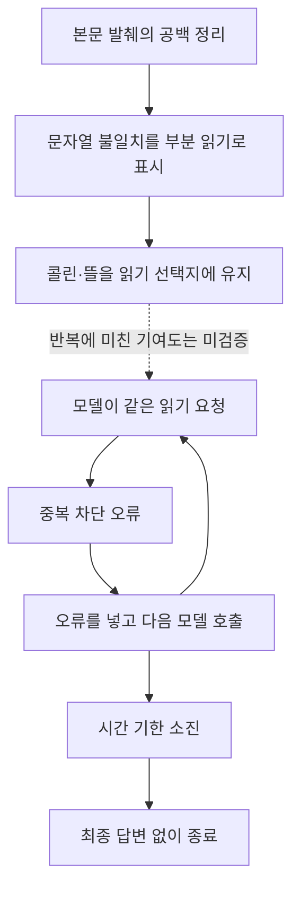

# 077 · 왜 우리 재실행은 더 떨어지는 결과를 냈나

<callout icon="📌" color="blue_bg">
	**가평의 직접 실패는 ‘검색 결과를 못 받음’이 아니라, 받은 뒤 같은 읽기를 반복하고 마지막 답변을 만들지 못한 데 있었다.**
	새로 확인한 구현 문제는 **공백 차이를 정보 누락으로 잘못 표시한 읽기 상태 판정**이다. 다만 이것만 고치면 반복이 해결된다는 인과는 아직 입증하지 않았다.
</callout>

## 검토 범위와 최종 판단

서브에이전트는 대화 이력을 넘기지 않는 fork_context=false로 시작했다. 제공한 것은 실험 조건, 공개 여행 질문 두 개, 해당 실행 기록과 관련 코드 위치뿐이다. 독립 보고서를 받은 뒤 내가 저장 추출문·모델 입력·호출 기록·종료 코드를 다시 대조했다. 이번에는 제품 코드 수정이나 새 여행 추론을 하지 않았다.

| 판단할 항목 | 우리 재실행 | 이전 Claude Code | 최종 판단 |
|---|---|---|---|
| 가평 요청 완료 | 최종 답변 없음 | 후보별 표와 비교표 완성 | 작업 완료·출력 구성은 Claude 우세 |
| 가평 조사 행동 | 검색1회, 본문3곳, 중복 거절26회 | 검색5회, 숙소 이름별 후속 검색 | 우리는 조사 방향 전환에 실패 |
| 후보 사이 선택 이유 | 처음 고른3곳의 상대적 우열 근거 없음 | 조건 설명은 있으나 탈락 후보와 우열 근거 부족 | 어느 쪽도 체계적인 후보 비교 입증은 아님 |
| 수목원 안내 | 검색1회로 답변, 공식 본문 미조회 | 검색1회로 답변, 공식 본문 미조회 | 양쪽 모두 공식 근거 확인 기준 미충족 |
| 주장과 출처 연결 | 공식 URL 발견을 내용 확인처럼 표현 | 다른 숙소 링크·미확인 주소·문구 오독 포함 | 보기 좋은 표와 사실 품질을 분리해야 함 |

## 어느 지점에서 갈라졌나

| 지점 | 우리에게 실제 일어난 일 | Claude에게 실제 일어난 일 | 차이의 의미 |
|---|---|---|---|
| 첫 검색 | “가평 펜션 수영장 개별 바비큐”, 한국 locale,20개 수신 | 다른 검색어,locale 생략,15개 수신 | 같은 MCP여도 처음 받은 자료부터 같지 않음 |
| 두 번째 모델 응답 | 콜린·뜰·포인3곳을 고르고 본문3건을 한 묶음으로 요청 | 가보자 등 숙소 이름으로 구체화 검색 시작 | 핵심 행동 분기: 원사이트 읽기와 후보별 추가 검색 |
| 자료를 받은 다음 | 같은3건을 다시 요청하고, 이후 콜린 요청을 반복 | 콜린·보타니칼·가보자에 관한 검색을 추가 | 새 근거를 확보하는 방향으로 전환했는지의 차이 |
| 실행 끝 | 모델27회 요청 중26회 응답, 전체 기한 소진 | 모델6회·검색5회 뒤 최종 표 작성 | 우리 결과에는 비교할 최종 추천 자체가 없음 |

우리 첫 검색의20개는 다음 모델에 전부 전달됐다. 추가 발췌도 보존됐고 생략은0개였다. 야놀자·여기어때가 패킷에서 사라진 것이 아니었다. 그렇다고20개 결과가 서로 다른 숙소20곳을 뜻하지도 않는다.

## 1. 확인된 구현 문제: 공백 차이가 ‘아직 덜 읽음’이 됐다

본문 도구는 관련 부분을 발췌하면서 공백과 줄 간격을 정리한다. 그런데 완료 상태는 정리 전 원문과 발췌문의 **문자열 전체가 같은지**로 판단했다. 내용이 같아도 공백이 다르면 truncated=true가 된다.

| 문서 | 저장 추출문 | 전달 본문 | 공백을 정리해 대조 | 실제 표시 |
|---|---:|---:|---|---|
| 콜린 | 358자 | 290자 | 동일 | 부분 읽기 |
| 뜰 | 305자 | 302자 | 동일 | 부분 읽기 |
| 포인 | 509자 | 509자 | 문자열 자체가 동일 | 전체 전달 |

내가 저장된 세 문서를 직접 대조해 재확인했다. 콜린·뜰에서는 비공백 내용이 빠진 것이 확인되지 않았다. 따라서076의 “일부가 빠졌다”는 설명은 **상태값을 실제 내용 누락으로 오해한 설명**이었고, 기존 보고서도 정정했다.

이 잘못된 표시는 콜린·뜰을 계속 읽을 수 있는 선택지에 남겼다. 그러나 포인은 이미 선택지에서 제외됐는데도 모델이 다시 요청했다. 따라서 “잘못된 표시가 반복을 전부 일으켰다”는 결론은 성립하지 않는다.

또한 비교한 것은 HTML에서 추출한 짧은 텍스트다. 그 텍스트를 모두 전달했더라도 사이트 전체·주소·객실별 시설 조건을 모두 확보했다는 뜻은 아니다.

## 2. 직접 실패 메커니즘: 중복 차단 뒤 행동을 바꾸지 못했다

중복 검사는 같은 인자의 HTTP 재실행을 막았다. 그 기능은 작동했다. 문제는 오류를 모델에 돌려준 뒤에도 같은 요청이 계속 나왔다는 것이다.

전체 도구 요청30건의 구성은 **검색 성공1건＋본문 성공3건＋중복 거절26건**이다. 네트워크로 본문을29번 읽거나 검색을30번 한 것이 아니다. 중복 오류26건은 콜린24건·뜰1건·포인1건이다.

현재 실행기는 오류를 대화에 붙이고 다음 모델 호출을 진행한다. 반복 오류의 연속 횟수에 따라 상태를 바꾸거나 정리로 전환하는 별도 경로는 없다. 모델도 새 검색·다른 후보·추가 읽기 인자 중 어느 쪽으로도 전환하지 않았다.

확정할 수 있는 것은 이 동작이다. 왜 모델이 오류를 보고도 전환하지 않았는지, 도구 설명·입력 포장·시스템 지침·모델 특성이 각각 얼마나 영향을 줬는지는 이 비교만으로 분리할 수 없다.

## 3. 시간 예산을 늘렸지만 정리할 시간을 남기지 못했다

강제 정리는 모델·도구의 **횟수 한도**에 주로 연결돼 있다. 남은 시간이 적어질 때 최종 정리를 위한 여유를 따로 확보하지 않는다.

마지막27번째 모델 요청은 시작 시점이348.675초였고, 남은 시간은 약11.3초였다. 그런데 final_turn=false로 도구 선택을 계속 허용했다. 그 호출이 전체360초 기한에 걸리면서 최종 답변은 빈 상태로 끝났다.

응답이 돌아온 호출에서 최대 입력 사용량은22915토큰, 최대 출력은351토큰이었다. 종료 사유는 모두 stop이었다. 마지막 입력도93399바이트로 앱 한도196608바이트 이내였다. 관측된 실패를 출력4096토큰 부족이나 입력 상한 도달로 설명할 근거는 없다. 실패한 마지막 호출의 토큰 사용량은 알 수 없다.

## 4. 후보를 일찍 고르고, 근거를 채우는 과정이 약했다

우리 모델은 첫 검색 뒤 곧바로3곳을 “주요 후보”로 정했다. 그3곳이 나머지 결과보다 왜 적합한지, 주소나 필수 시설이 부족하면 어떤 후보로 교체할지는 기록하지 않았다. 프롬프트에는 넓게 비교하라는 지침이 있지만 실제 수행을 보장하지 않았다.

Claude는 숙소 이름별 추가 검색으로 더 구체적인 자료를 모았다. 이것이 최종 표에 쓸 내용을 늘린 차이다. 다만 Claude 역시 탈락 후보와 선택 이유를 체계적으로 남기지 않아 “모든 후보를 더 깊이 판단해서 골랐다”고 단정할 수는 없다. 숨은 사고를 복원한 분석도 아니다.

같은 모델·같은 MCP만으로 조건이 같아지지는 않는다. 우리는 본문 읽기·OpenBnB 등의 선택지도 갖고 있고, API 형식·지침·검색어·locale·예산도 달랐다. 복잡한 도구 인터페이스나 지침의 부담은 가능한 원인 가설이지만, 이번 자료가 그것의 독립적인 효과를 입증하지는 않는다.

## 5. Claude가 더 보기 좋았지만, 검증까지 더 잘한 것은 아니다

Claude는 숙소별 항목과 출처를 같은 표에 배치하고 마지막 비교표를 제공했다. 사용자에게 읽히는 구성은 더 좋았다. 그러나 보타니칼에 붙인 여기어때62421 링크는 검색 결과에서 다른 숙소로 반환된 링크였다. 가보자의 “애견동47-2” 주소도 모델에 전달된 검색 자료에서 찾을 수 없었다. 실제 올바른 주소를 새로 확인한 것은 아니며, 그 주소를 확인 완료로 쓸 근거가 없다는 판정이다.

수목원에서는 우리와 Claude 모두 검색만 하고 본문을 읽지 않았다. 공식 URL 두 개의 검색 설명은 비어 있었고 요금·시간·주차 정보는 제3자 발췌에 있었다. 성인11000원×2=22000원 계산과 일부 안내는 제공 자료에 맞지만, 사용자가 요구한 공식 확인은 별개다. Claude의 “동반 인원은 입장 불가” 문장은 반려동물 제한을 잘못 옮긴 사례다.

따라서 **이번 가평에서 Claude가 더 나은 결과물을 냈다는 판단은 유지한다.** 다만 완료·읽기 편한 구성의 우세를 사실 정확성 전체의 우세로 확대하지 않는다.

## 검증할 개선 순서

| 우선순위 | 바꿔 볼 요소 | 가장 작은 검증 | 통과 기준 |
|---|---|---|---|
| 1 | 공백 변화와 실제 누락을 구분하는 완료 상태 | 저장된 세 문서만으로 판정 재현 | 같은 내용은 완료, 실제 누락은 부분 읽기로 구분 |
| 2 | 반복 오류 뒤 탈출 및 시간 종료 정리 | 같은 성공·오류 기록을 고정하고 정책만 비교 | 동일 오류 누적을 제한하고 미완료 상태를 설명하는 결과 확보 |
| 3 | 후보별 근거와 부족한 조건 표시 | 같은 검색 결과로 후보 관리 방식만 비교 | 다른 숙소 근거 혼합 없이 채택·보류 이유를 확인 가능 |
| 4 | 지침·API 형식·도구 설명 | 자료·모델·예산을 맞추고 하나씩 변경 | 추가 검색·반복 수·주장별 정확도를 각각 비교 |

시간이나 반복 예산을 관리하는 장치는 ‘여행 요청이 의미적으로 완료됐는지’를 대신 판단하는 장치와 다르다. 모델이 조사·선택을 결정하는 구조와 native 종료를 유지하면서도 반복 소모는 별도로 제한할 수 있다. finish 태그나 도구를 다시 도입해야 한다는 결론은 이번 근거에서 나오지 않는다.

위 항목은 후속 실험 제안이다. 이번에는 구현 효과를 시험하거나 품질 향상을 주장하지 않았다.

## 비교의 한계와 검토 결과

단일 재실행과 과거 Claude 결과를 비교했다. 검색 시각과 입력·도구·예산이 다르므로 순수한 하네스 성능 순위나 모델 지능의 결론으로 쓰지 않는다.

시간도 같은 구간이 아니다. 우리의360.049초·58.207초는 MCP 연결 뒤 에이전트 내부 기록이고, Claude의151.766초·64.625초는 CLI·중계 서버 준비와 정리를 포함한 외부 측정이다. 이를 직접 빼서 속도 차이를 주장할 수 없다. Claude 측에도 검색 MCP 중계기가20회 초과 요청을 오류로 막는 제한이 있었다. 다만 우리 실행기의 ‘한도에서 최종 정리’와 처리 방식은 다르다. 이번 Claude 검색은5회·1회여서 한도 근처에는 가지 않았다.

내 검토에서는 서브에이전트의 **집계·공백 판정 문제·반복 경로·시간 정리 부재·출처 오류**를 원본으로 확인해 채택했다. 반면 공백 문제·프롬프트 길이·API 포장 중 하나를 반복의 유일한 원인으로 삼는 결론과, 수정 후 개선될 것이라는 주장은 채택하지 않았다. 원인별 기여도는 통제 실험이 필요하다.

독립 보고서의 ‘Claude에는 도구20회 차단이 없다’는 설명은 채택하지 않았다. 실행 함수만 보면 놓칠 수 있지만, 실제 MCP 중계기 relay의 count > 20 분기가 요청을 거절하는 것을 확인해 바로잡았다.

실제 질문·전체 답변과 전체 호출 기록은 [076 비교 기록](https://app.notion.com/p/3ffd058c022e8106b57ddef319e09eb0)에 함께 보존했다.

## 실제 동작의 연결



<details>
<summary>가평 펜션의 실제 질문과 답변</summary>
	<callout icon="💬">
		가평에서 성인 두 명이 갈 펜션을 찾아줘. 수영장과 개별 바비큐가 둘 다 있는 후보를 최대 3곳 찾아서 이름, 실제 주소, 두 시설의 확인 근거와 출처 링크를 비교해줘. 날짜는 아직 미정이라 확정 가격이나 예약 가능 여부는 필요 없어. 공식 숙소 안내를 우선하고, 확인되지 않은 항목은 그대로 구분해줘.
	</callout>
	### 우리 실제 결과
	최종 답변 없음. 마지막 모델 호출의 시간 초과로 answer가 비어 있었다.
	
	### 저장된 Claude 실제 답변
	<callout icon="🤖">
		가평에서 수영장과 개별 바비큐 시설이 모두 있는 펜션을 찾았습니다. 공식 안내를 바탕으로 3 곳의 후보를 정리해 드립니다.
		
		---
		
		## 가평 수영장 및 개별 바비큐 펜션 추천 (최대 3곳)
		
		### 1. 가평 가보자독채애견풀빌라수영장펜션
		| 항목 | 내용 | 출처 링크 |
		|------|------|-----------|
		| **숙소명** | 가평 가보자독채애견풀빌라수영장펜션 | [야놀자](https://nol.yanolja.com/stay/domestic/10063510) |
		| **실제 주소** | 경기도 가평군 애견동 47-2 | [여기어때](https://www.yeogi.com/domestic-accommodations/84961) |
		| **수영장 시설 확인 근거** | - 야외 대형 풀장 (가로 20M × 세로 13M, 물높이 1M)<br>- 야외 유아 풀장 운영<br>- 사계절 이용 가능 (미온수 30도)<br>- VIP 객실: 가로 3M × 세로 5M, 물높이 70CM | [여기어때 공식 안내](https://www.yeogi.com/domestic-accommodations/84961) |
		| **개별 바비큐 시설 확인 근거** | - 개별 테라스 바베큐 (숯불)<br>- 공용 바베큐장<br>- 비용: 2인 기준 20,000원 / 인원 추가 시 1인당 5,000원<br>- 준비시간: 입실 후 ~ 오후 9시<br>- 우천 및 동계 이용 가능 | [여기어때 공식 안내](https://www.yeogi.com/domestic-accommodations/84961) |
		| **입실 시간** | 15:00 (퇴실 11:00)<br>21시 이후 입실 시 사전 연락 필수 | [여기어때 공식 안내](https://www.yeogi.com/domestic-accommodations/84961) |
		| **특이사항** | - 애견 동반 펜션<br>- 현재 특실 3 객실은 개별 미끄럼틀 철거되어 이용 불가 | [반려생활](https://ban-life.com/accommodation/21739) |
		
		---
		
		### 2. 가평 콜린스파 펜션
		| 항목 | 내용 | 출처 링크 |
		|------|------|-----------|
		| **숙소명** | 가평 콜린스파 펜션 | [공식 홈페이지](https://collineps.com/) |
		| **실제 주소** | 경기도 가평군 가평읍 태봉두밀로 269-45 | [G마켓 투어](https://gtour.gmarket.co.kr/TourV2/Item?goodscode=2275065702) |
		| **수영장 시설 확인 근거** | - 야외 수영장 운영<br>- 스파 시설 포함 | [야놀자 공식 안내](https://place-site.yanolja.com/places/10045237) |
		| **개별 바비큐 시설 확인 근거** | - 전 객실 실내 개별 테라스 바베큐<br>- 사계절 이용 가능한 프라이빗한 개별 바베큐장 | [G마켓 투어 공식 안내](https://gtour.gmarket.co.kr/TourV2/Item?goodscode=2275065702) |
		| **입실 시간** | 15시 이후 (퇴실 11시 이전)<br>21시 이후 입실 시 펜션으로 사전 연락 필수 | [G마켓 투어 공식 안내](https://gtour.gmarket.co.kr/TourV2/Item?goodscode=2275065702) |
		| **특이사항** | - 남이섬, 가평레일바이크 인근 위치<br>- 전 객실 넷플릭스 이용 가능 (개인 ID 사용)<br>- 마트 픽업: 농수산물마켓, 조은마트, 씨씨할인마트 | [공식 홈페이지](https://collineps.com/) |
		
		---
		
		### 3. 가평 보타니칼펜션
		| 항목 | 내용 | 출처 링크 |
		|------|------|-----------|
		| **숙소명** | 가평 보타니칼펜션 | [야놀자](https://www.yanolja.com/pension/1000111770) |
		| **실제 주소** | 경기도 가평군 아침고요수목원 인근 (구체적 주소 미확인) | [여기어때](https://www.yeogi.com/domestic-accommodations/62421) |
		| **수영장 시설 확인 근거** | - 수영장 운영<br>- 동남아를 연상시키는 이국적인 수영장 특징 | [여행 블로그](https://travel-hotel-culinary.tistory.com/2244) |
		| **개별 바비큐 시설 확인 근거** | - 개별 바베큐 시설<br>- 사랑하는 사람과 맛있는 바비큐 파티 가능 | [야놀자 공식 안내](https://www.yanolja.com/pension/1000111770) |
		| **입실 시간** | 미확인 (공식 안내 확인 필요) | - |
		| **특이사항** | - 애견 동반 가능<br>- 주차 가능<br>- 커피숍 운영<br>- 복층 구조<br>- 마트 픽업: 365마트 (청평역에서 하차 후 택시 이용)<br>- 펜션 자체 픽업 운영 안함 | [여기어때](https://www.yeogi.com/domestic-accommodations/62421) |
		
		---
		
		## 요약
		| 순위 | 숙소명 | 수영장 | 개별 바비큐 | 주소 확인 여부 |
		|------|--------|--------|-------------|----------------|
		| 1 | 가평 가보자독채애견풀빌라수영장펜션 | ✅ (야외대형+유아풀) | ✅ (개별테라스+공용) | ✅ |
		| 2 | 가평 콜린스파 펜션 | ✅ (야외) | ✅ (전 객실 개별테라스) | ✅ |
		| 3 | 가평 보타니칼펜션 | ✅ (이국적 수영장) | ✅ (개별 바베큐) | ⚠️ (미확인) |
		
		**참고사항:**
		- 날짜가 미정이라 확정 가격이나 예약 가능 여부는 확인되지 않았습니다.
		- 공식 숙소 안내를 우선으로 작성하였으며, 일부 항목은 실제 방문 후 확인이 필요합니다.
		- 가보자독채애견풀빌라수영장펜션은 애견 동반 펜션임을 고려하여 반려동물 동반 여부를 확인하시기 바랍니다.
	</callout>
</details>

<details>
<summary>수목원의 실제 질문과 답변</summary>
	<callout icon="💬">
		2026년 10월 말에 성인 두 명이 아침고요수목원을 방문하려고 해. 공식 안내를 찾아서 일반 성인 입장료, 운영 시간과 입장 마감, 주차 안내를 정리해줘. 두 명 입장료 합계도 계산하고, 계절·행사 때문에 달라질 수 있는 사항과 확인한 출처 링크를 분명히 해줘.
	</callout>
	### 우리 실제 결과
	<callout icon="🤖">
		아침고요수목원의 공식 안내를 확인하기 위해 공식 홈페이지와 주요 검색 결과를 바탕으로 정보를 정리해 드립니다.
		
		## 📍 아침고요수목원 이용 정보 (2026 년 10 월 기준)
		
		### 💰 입장료 (성인 2 명 기준)
		- **일반 성인**: 11,000 원 × 2 명 = **22,000 원**
		- 우대 성인: 9,000 원 × 2 명 = 18,000 원
		- 가평군민 할인: 별도 적용 (증빙 필요)
		
		### 🕒 운영 시간 및 입장 마감
		- **일반 운영 시간**: 오전 8시 30분 ~ 오후 7시까지
		- **입장 마감 시간**: 오후 6 시
		- 연중무휴 운영
		
		### 🅿️ 주차 안내
		- **주차 요금**: 무료
		- 주차장 조기 만차 가능성: 성수기 주말에는 오전 10 시 이전 도착 권장
		
		### ⚠️ 계절·행사 관련 주의사항
		- 2026 년 10 월 중순 ~ 11 월 중순: 국화 전시회 운영 (산수경온실, 아침마루 등)
		- 야간 개장 시즌 (2025 년 12 월 5 일 ~ 2026 년 3 월 15 일): 야간 점등 운영 (오후 5 시 ~ 밤 9 시, 토요일은 밤 11 시까지)
		- 계절 행사 기간에는 운영 시간이 달라질 수 있음
		
		### 📝 기타 안내사항
		- **입장권 구매**: 방문 당일 현장 매표소만 (사전 예매 불가)
		- 반려동물 동반: 불가능
		- 관람 소요 시간: 약 2 시간 ~ 2 시간 30 분
		- 주소: 경기도 가평군 상면 수목원로 432
		
		### 🔗 확인한 출처 링크
		1. 공식 홈페이지: https://www.morningcalm.co.kr/use/use01.php
		2. 여행 정보 사이트: https://thetravelnews.co.kr/2026/07/gapyeong-morning-calm-garden-admission-parking-course/
		
		**참고**: 기상 및 시설 사정에 따라 운영 시간과 입장료가 변경될 수 있으므로, 방문 전 공식 홈페이지를 다시 확인하시는 것을 권장합니다.
	</callout>
	### 저장된 Claude 실제 답변
	<callout icon="🤖">
		공식 홈페이지와 관련 정보를 바탕으로 아침고요수목원의 이용 정보를 정리해드리겠습니다.
		
		---
		
		## 🌿 아침고요수목원 방문 안내 (2026 년 10 월)
		
		### 💰 입장료 (성인 기준)
		
		| 구분 | 요금 |
		|------|------|
		| **일반 성인** | 11,000 원/명 |
		| 우대 성인 | 9,000 원/명 |
		| 가평군민 할인 | 지역 할인 적용 (증빙 필요) |
		
		**두 명 입장료 합계:** 22,000 원 (일반 성인 기준)
		
		---
		
		### 🕒 운영 시간 및 입장 마감
		
		| 구분 | 시간 |
		|------|------|
		| **개장 시간** | 08:30 |
		| **폐장 시간** | 19:00 |
		| **입장 마감 시간** | 18:00 (폐장보다 1 시간 앞선다) |
		
		> ⚠️ **주의사항:** 계절·행사 기간에 운영 시간이 달라질 수 있습니다. 특히 오색별빛정원전 등 특별 행사 시에는 운영 시간이 변경될 수 있으므로 방문 당일 공식 홈페이지를 확인하세요.
		
		---
		
		### 🅿️ 주차 안내
		
		| 구분 | 정보 |
		|------|------|
		| **주차료** | 무료 |
		| **주차장 위치** | 수목원 입구 인근 |
		| **참고사항** | 성수기 주말에는 주차장이 조기 만차가 될 수 있으므로 오전 10 시 이전 도착을 권장합니다. |
		
		---
		
		### 📝 기타 이용 정보
		
		- **입장권 구매:** 방문 당일 현장 매표소만 (사전 예매 시스템은 운영되지 않음)
		- **반려동물 동반:** 불가
		- **동반 인원:** 원내 동반 입장이 불가능하며 안내견 등 불가피한 경우 방문 전 수목원에 문의해야 합니다.
		- **관람 소요 시간:** 천천히 걸으면 약 2 시간, 사진 촬영을 겸하거나 아이와 함께하면 2 시간 30 분 이상 권장
		
		---
		
		### 📌 계절·행사 관련 확인 사항
		
		1. **오색별빛정원전 등 특별 행사 기간**에는 운영 시간이 달라질 수 있습니다.
		2. **야간 점등:** 2025~2026 시즌 (12 월 5 일 ~ 3 월 15 일) 에는 야간 개장이 있었으나, 10 월은 주간 운영만 확인됩니다.
		3. **단풍 시기:** 10 월 말은 단풍 절정기입니다. 단풍 명소 방문 시에는 오후 6 시 이후 방문을 피하는 것이 좋습니다.
		
		---
		
		### 🔗 공식 출처 링크
		
		- [아침고요수목원 공식 홈페이지](https://www.morningcalm.co.kr/)
		- [입장료·운영시간·할인 안내 페이지](https://www.morningcalm.co.kr/use/use01.php)
		- [관람안내 페이지](https://www.morningcalm.co.kr/info/info01.php)
		
		---
		
		**최종 확인:** 2026 년 8 월 25 일 기준 공식 안내입니다. 기상 및 시설 사정에 따라 변경될 수 있으므로 방문 당일 공식 홈페이지를 다시 한번 확인하는 것이 안전합니다.
	</callout>
</details>

<details>
<summary>실제 툴콜 발췌 — 받은 결과와 다음 모델 입력</summary>
	아래는 전체 로그 중 첫 성공과 첫 반복을 연결한 발췌다. 전체26건의 중복과 Claude 검색5건은076의 접힌 로그에 있다. 비밀 설정·인증 헤더·쿠키는 포함하지 않는다.
	**1.1 · mcp_brave_brave_web_search · 2026-10-19T18:17:33.275798+00:00**
	호출 ID: `call_cuodscoo`
	```json
{
  "query": "가평 펜션 수영장 개별 바비큐",
  "country": "KR",
  "search_lang": "ko",
  "ui_lang": "ko-KR",
  "count": 20
}
	```
	실제 실행: Brave MCP 성공.20개 결과가 다음 모델에 전부 전달됐고 생략0개.
	다음 모델용 내용: 36016바이트. 해당 메시지는 다음 model_start에 포함됨을 확인했다.
	**2.1 · web_read · 2026-10-19T18:17:43.598790+00:00**
	호출 ID: `call_o2nkezxo`
	```json
{
  "query": "수영장, 개별 바비큐 시설 이용안내",
  "source_id": "web:9bfb57a07ed32264"
}
	```
	실제 실행: HTTP 200 · https://collineps.com/special2.html · 추출문358자, 전달문290자 · truncated=True. 공백 정규화 후 내용 동일.
	다음 모델용 내용: 1007바이트. 해당 메시지는 다음 model_start에 포함됨을 확인했다.
	**3.1 · web_read · 2026-10-19T18:17:58.451099+00:00**
	호출 ID: `call_lkskbb81`
	```json
{
  "query": "수영장, 개별 바비큐 시설 이용안내",
  "source_id": "web:9bfb57a07ed32264"
}
	```
	실제 실행: 중복 검사에서 거절. 오류: Identical tool call already attempted; change query or answer from available evidence
	다음 모델용 내용: 152바이트. 해당 메시지는 다음 model_start에 포함됨을 확인했다.
</details>

<details>
<summary>확인한 코드와 실행 근거</summary>
	코드 기준은 fd7425c다. 실험 제품 기준7c381c2와 관련 제품 코드 차이는 없다. 서브에이전트 보고서는 비공개로 보존하고 아래는 내가 확인한 부분을 정리했다.
	**잘못된 부분 읽기 판정** — `src/travel_agent/web_read.py`, `web_read`,169–171행:
	```python
excerpt, selected, total = select_excerpt(text, query, max(0, available))
result.update(text=excerpt, selected_blocks=selected, total_blocks=total,
              truncated=excerpt!=text, elapsed_ms=round((time.perf_counter()-started)*1000))
	```
	문자열 불일치가 내용 누락을 뜻하지 않는데 같은 것으로 처리한다. 저장된 page_snapshot과 tool_end의 본문에 공백을 정규화해 콜린·뜰이 동일함을 확인했다. 이는 오프라인 문자열 대조이며 새 모델 실험이 아니다.
	**전체 읽기 제외** — `src/travel_agent/agent.py`, `run_agent`,575–576행:
	```python
if result.get('reading_mode', 'query_excerpt') == 'query_excerpt' and not result['truncated']:
    completed_pages.add(result['id'])
	```
	위 상태값이 완료 목록에 영향을 준다. `readable_tools`는 완료 목록을 읽기 선택지에서 제외한다. 세 번째 모델 입력의 enum은 포인을 제외했지만 모델은 포인을 다시 요청했다. 선택지 제시와 모델의 준수는 별개다.
	**시간 종료** — `agent.py`, `run_agent`,426–459행. final_turn 조건은 횟수/강제정리 상태를 확인하며 남은 시간에 따른 정리 여유는 없다. 마지막 모델 오류는 model_error로 반환된다.
	**추적 지점** — 가평: step1/span1.1 검색 `call_cuodscoo`, step2/span2.1–2.3 본문3건, step3/span3.1–3.3 첫 중복3건, 이후 콜린 중복23건. 마지막 step27/seq200의 final_turn=false, 입력93399바이트. seq201은 timed out, seq202는 빈 최종 결과다.
	**모델에 전달된 상태** — 가평 page_snapshot seq20–22와 tool_end seq16–18, 세 번째 모델 입력을 연결했다. 추가 읽기 토큰과 next_start_index는 전달됐다. 그 인자를 숨겨서 재요청한 상황은 아니다.
	**시간 집계** — `scripts/compare_live_harnesses.py`184–194행의 외부 타이머와 `mcp_client.with_mcp`/`agent.run_agent`/`trace.Trace`의 내부 타이머는 시작·종료 구간이 다르다.
</details>
