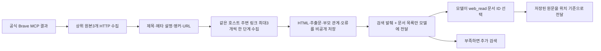

# 078 · 검색 결과와 주변 페이지를 문서로 수집하기

## 문제와 이번 목표
검색 결과 한 페이지의 메뉴를 본문에서 읽어도, 해당 메뉴의 실제 연결 페이지를 골라 읽는 재료가 부족했다. 사용자는 검색 MCP를 래핑해 본문과 주변 페이지를 미리 문서화하고, 모델에는 목록을 제공한 뒤 필요할 때 열람하도록 요청했다.

이번 목표는 후보 추천의 점수를 높였다고 주장하는 것이 아니라 **수집 → 저장 → 목록 → 모델 선택 → 저장 본문 읽기**를 확인하는 것이다. 독립 기능·검증 설계와 실행을 먼저 마친 뒤 에이전트에 연결했다.
<callout icon="💬">
	MCP 웹검색 → 주변링크 수집 + 본문 + 주변링크 본문 문서화 작업으로 먼저 기능개발과 검증테스트 설계부터 하고 에이전트 적용 순서로 넘어가자.
</callout>
## 설계한 흐름


본문은 자동 수집하지만 모델 문맥에 전부 넣지 않는다. 목록의 ready는 본문이 저장됐다는 뜻이고 모델이 읽었다는 뜻은 아니다. 새 모델 요약은 만들지 않는다. 제목·설명은 실제 title/meta, 연결 관계는 실제 링크에서 얻는다.

원본당 주변3개·한 단계·같은 hostname·실행 전체16문서·HTML/추출문32MiB·HTTP병렬3개로 제한했다. 페이지당 링크 검사는128개까지다. 검색어와 앵커/경로 단어가 겹치는 링크를 먼저 수집하지만 추천 순위를 정하는 것은 아니다. 개수 제한으로 놓친 링크·외부 호스트·수집 실패를 표시한다. 리다이렉트나 JavaScript로만 나오는 내용을 확보한다고 보장하지 않는다.

## 먼저 정한 검증 기준
| 검증 항목 | 기대 결과 |
|---|---|
| 상대 링크·중복·외부 링크 | 올바른 URL 대응, fragment 중복 수집 방지, 외부는 자동 수집 제외 |
| 깊이·저장·시간 예산 | 자식에서 재귀 수집하지 않고 생략·오류 표시 |
| 문서 정체와 본문 분리 | 목록에는 실제 메타 정보, 본문은 별도 저장 |
| 실패와 빈 추출 | 403·HTML 해석 실패·empty를 ready로 표시하지 않음 |
| 저장 문서 열람 | 재개방 후 HTTP 없이 같은 텍스트 반환 |
| 이어 읽기 | 공백·UTF-8·따옴표를 보존해 원문 그대로 재조립 |
| MCP와 모델 연결 | 원래 검색에 없던 주변 ID도 목록에서 선택해 읽을 수 있음 |
| 전달 예산 | 긴 목록 항목은 통째로 생략하고 개수 표시 |
| 실제 모델 | 도구 동작과 답변 사실 품질을 별도로 확인 |

합성 입력의 fake HTTP 응답과 실제 stdio MCP SDK 왕복으로 먼저 계약을 검사했다. 이후 실제 검색·HTTP 수집을 실행했고, 그 다음 에이전트에 연결했다.

## 독립 수집 결과
<callout icon="💬">
	site:collineps.com 수영장 바베큐
</callout>
검색 MCP만 호출하고 모델 추론 없이 문서5개를 수집했다. 모두 ready였고 HTML과 추출문을 저장했다. 목록의 실제 항목은 아래와 같다.

| 문서 | 링크에서 얻은 이름 | URL | 추출문 문자 수 |
|---|---|---|---|
| 가평 콜린스파 펜션 | 실내바베큐 | https://collineps.com/special2.html | 358 |
| 가평 콜린스파 펜션 | 수영장 | https://collineps.com/special3.html | 107 |
| 가평 콜린스파 펜션 | 검색 원본 | https://collineps.com/room.html | 112 |
| 가평 콜린스파 펜션 | 검색 원본 | https://collineps.com/index.html | 194 |
| 가평 콜린스파 펜션 | ABOUT펜션소개 | https://collineps.com/about.html | 418 |

이 한 번의 수집에서 범위 밖 링크12건·개수 제한으로 주변 링크39건을 생략했다. 링크 수는 원본별 관측을 합친 값이고 고유 페이지 수가 아니다. 모든 주변 링크 수집을 완료한 것이 아니다. 저장소를 다시 열어5개 본문이 파일과 정확히 같은지, 추가 HTTP 없이 읽히는지 오프라인으로 확인했다.
## 에이전트에 연결한 실제 기능 질문
아래는 저장 문서 목록에서 본문을 선택하도록 명시한 기능 확인 질문이다. 기존3숙소 비교 질문과 다르므로 전후 품질 개선 실험으로 해석하지 않는다.
<callout icon="💬">
	가평 콜린스파펜션의 수영장과 개별 바비큐 안내를 찾아줘. 검색 결과에 저장 문서 목록이 있으면 시설 안내 문서를 골라 본문을 확인하고, 확인된 내용과 출처만 간단히 알려줘.
</callout>
<callout icon="🤖">
	가평 콜린스파펜션의 수영장 및 바비큐 시설 안내는 다음과 같습니다.
	
	**수영장**
	*   **시설**: 전 객실에 실내 수영장이 마련되어 있으며, 야외 수영장도 운영됩니다. (9 월 이후에는 낚시 체험으로 변경)
	*   **이용 방법**: 무료 이용 가능
	*   **운영 시간**: 종료시간 30 분 전 퇴실 필요. 휴식 및 점검 시간은 매 시각 50 분부터 정각까지입니다. 아쿠아로빅 수업(13:40~15:00) 중에는 자유 수영이 불가능합니다.
	
	**개별 바비큐**
	*   **시설**: 모든 객실에 사계절 이용 가능한 프라이빗한 개별 실내 바베큐장이 마련되어 있습니다.
	*   **이용 방법**: 무료 이용 가능 (양념 등 즐길거리는 별도 제공)
	
	출처: [가평 콜린스파 펜션 공식 홈페이지](https://collineps.com/special2.html)
</callout>

모델3회·도구2회·25.681초에 completed로 끝났다. 자동 수집 관측은9개이며 모델이 요청한 도구 호출 수와 다르다. 모델은 바비큐 문서1개를 선택했고 저장소의358자 전체를 HTTP 재조회 없이 전달받았다. truncated=false로 공백을 보존했다. 수영장 주변 문서도 목록에 있었지만 이번 실제 모델은 그 문서를 열지 않았다.
### 기능은 동작했지만 답변 품질은 실패
위 답변의 아쿠아로빅 시간·점검 시간은 콜린이 아니라 **한석봉체육관**의 검색 발췌에 있었다. 9월 이후 낚시 체험은 **가평 실내수영장 온수 무료 펜션**의 여기어때 후기에서 왔다. 모델은 이 정보를 콜린의 시설 설명에 섞었고 출처는 바비큐 페이지 하나만 제시했다. 전 객실 실내 수영장·무료 바비큐도 읽은 바비큐 본문이 증명하지 않는다.

수집기는 문서별 URL·부모 관계를 유지했지만, 모델의 최종 문장은 근거를 잘못 연결했다. 문서 목록과 저장 본문 열람의 기능 성공을 최종 답변 정확성으로 부풀리지 않는다. 이 실행은 후보별 근거 연결과 추가 조사 선택을 다음에 평가해야 함을 보여준다.
<details>
<summary>실제 MCP·자동 수집·모델 선택 기록</summary>
	**독립 수집의 MCP 호출** — 모델 호출이 아닌 명령행 실행이다.
	관측 ID: `mcp:ae11e205a62ca83d` · 도구: `mcp_brave_brave_web_search`
	```json
{
  "count": 20,
  "country": "KR",
  "query": "site:collineps.com 수영장 바베큐",
  "search_lang": "ko",
  "ui_lang": "ko-KR"
}
	```
	응답에서 나온 원본과 주변 페이지5개의 HTML·추출문을 저장했다. 원본 MCP 응답은 비공개로 보존했다.
	**1.1 · mcp_brave_brave_web_search · 2026-10-20T12:36:17.609551+00:00**
	모델 호출 ID: `call_fd7muu45`
	```json
{
  "query": "가평 콜린스파펜션 수영장 바비큐 시설 안내",
  "country": "KR",
  "search_lang": "ko",
  "ui_lang": "ko-KR",
  "count": 10
}
	```
	다음 모델 전달 내용: 21919바이트.
	**MCP 응답 뒤 래퍼가 수행한 자동 HTTP 수집** — 아래는 모델이 요청한 별도 도구 호출이 아니다. 관측은 실행 누적이며 여기서는 검색1회다.
	- 2026-10-20T12:36:18.588510+00:00 · https://collineps.com/special2.html · ready · 438ms
	- 2026-10-20T12:36:18.588510+00:00 · https://place-site.yanolja.com/places/10045237 · failed · 141ms · Page HTTP failure; redirects are not followed
	- 2026-10-20T12:36:18.591500+00:00 · https://www.gpfmc.or.kr/page/selectPage.do?muNo=500 · ready · 485ms
	- 2026-10-20T12:36:19.078482+00:00 · https://collineps.com/special3.html · ready · 219ms
	- 2026-10-20T12:36:19.081492+00:00 · https://collineps.com/about.html · ready · 172ms
	- 2026-10-20T12:36:19.081861+00:00 · https://collineps.com/room.html?room_id=20529 · ready · 265ms
	- 2026-10-20T12:36:19.251387+00:00 · https://www.gpfmc.or.kr/ · ready · 562ms
	- 2026-10-20T12:36:19.305276+00:00 · https://www.gpfmc.or.kr/board/facList.do?stNo=11&muNo=452&muGpNo=350 · ready · 265ms
	- 2026-10-20T12:36:19.345710+00:00 · https://www.gpfmc.or.kr/board/facList.do?stNo=11&muNo=459&muGpNo=350 · ready · 282ms
	문서 목록에는 URL·제목·앵커·설명·부모·수집 상태만 전달했다. 전체 본문을 검색 결과에 주입하지 않았다.
	**2.1 · web_read · 2026-10-20T12:36:23.680001+00:00**
	모델 호출 ID: `call_kro739y6`
	```json
{
  "source_id": "web:9bfb57a07ed32264",
  "query": "수영장 개별 바비큐 시설 운영 시간 이용 방법"
}
	```
	다음 모델 전달 내용: 996바이트.
	실제 결과: from_document_store=true · cache_hit=true · sequential · 전체358자 · truncated=false. HTTP를 새로 요청하지 않았다.
</details>
## 코드에서 바뀐 부분
제품 변경 전 기준은0001fee다. `web_documents.py`의 `DocumentCollection.collect`가 수집과 저장을 담당하고, `read`가 모델이 선택한 저장 문서를 위치로 읽는다. 실제 소스 발췌:
```python
    def read(self, sid, *, start_index=0, document_token=None, max_bytes=12000):
```
전체 전달 여부를 공백 비교로 판정하지 않고 다음 위치로 결정한다. 실제 `read`의 핵심 줄:
```python
end = start_index+len(fragment)
out.update(text=fragment, truncated=end < len(text), next_start_index=end if end < len(text) else None,
           text_is_fragment=start_index > 0 or end < len(text))
```
`agent.execute_tool`은 성공한 Brave 결과를 래핑하고, 알려진 문서 ID의 `web_read`를 저장소로 보낸다. `brave_mcp.pack_result`는 본문 대신 완결된 문서 목록을96000바이트 안에 추가한다. 목록에서 실제 전달된 ID만 허용 출처에 등록한다. `document_collection` trace는 모델 요청과 자동 HTTP 수집을 구분해 남긴다.

## 결과와 남은 범위
273개 Python 검사를 통과했다. 첫 링크 선택 검사는 합성 HTML에 문자 인코딩 선언이 없어 한글 앵커를 잘못 읽었고, UTF-8을 선언한 올바른 입력으로 검증했다. 실제 HTML의 선언을 따르는 파서를 유지했으며 비정상 HTML·빈 추출·예산 초과는 별도 상태로 남긴다.

모델 도구 호출을 늘리지 않고도 HTTP 수집량·저장 공간·검색 대기시간은 증가한다. 비용이나 토큰 절감 효과는 측정하지 않았다. 사이트 title/meta가 일반적이면 문서 정체 구분에 앵커·URL·부모가 필요하다. 같은 호스트 한 단계만 다루므로 다른 예약 사이트 정보는 새 검색으로 확보해야 한다.

기본 활성화하며 WEB_DOCUMENT_COLLECTION=0으로 기존 경로와 비교할 수 있다. 검색을 항상 반복하거나 수집 문서를 모두 읽도록 강제하지 않는다. 본문 읽기/웹 비활성일 때 자동 수집도 하지 않는다. 기존 미수집 출처의 본문 읽기는 남아 있으며077의 기존 경로 상태 판정 문제를 전부 수정한 것은 아니다. 사용자 대화는 노션이나 공개 Git에 자동 게시하지 않는다.

정리하면 독립 기능→계약 검증→실제 수집→에이전트 연결을 완료했고, 이후 과제는 선택한 후보에 맞는 문서를 충분히 읽고 그 근거만 답변에 쓰는지 평가하는 것이다. 이번 실제 응답은 그 품질 기준을 통과하지 못했다.
