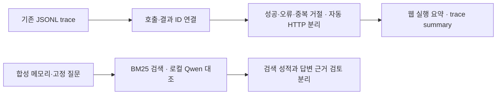

# 고정 메모리 평가와 실행 요약 — 082

## 문제와 이번에 완료한 범위
081 계획을 시작했다. 기존 RAG 설명을 새로 발명하지 않고, 작은 고정 평가로 현재 웹 BM25 경로를 확인하고 기존 실행 로그에서 실제 수치를 계산하는 기능을 추가했다. 여행 추천 전체의 품질 개선이나 계획 전체 완료를 주장하지 않는다.

공개 합성12문항은 실행 전에 문항·정답 이벤트·개발/최종 확인 분할·목표를 고정했다. 근거 있는8문항, 기록 없음2문항, 다른 세션/분기2문항이다. 목표는 정답 근거 상위3개 포함7/8 이상과 범위 밖 근거 반환0/2였다. 결과를 보고 문항이나 목표를 수정하지 않았다. 기준 파일은 `examples/memory-eval-v1.json`이다.

## 검색 평가 결과
| 항목 | 결과 | 해석 |
|---|---|---|
| BM25 정답 근거 상위3개 포함 | 8/8 | 작은 합성 문항의 근거 검색 통과 |
| MRR@3 | 0.875 | 모든 정답이1위는 아님 |
| 다른 세션/분기 근거 누출 | 0/2 | 로컬 네임스페이스 검색 범위 검사 |
| 기록 없음 | 2문항 | 정답 근거 없음과 생성 모델의 미확인 응답을 별도 확인 |

Dense·Hybrid·리랭킹을 새로 실행하거나 모델 파일을 다운로드하지 않았다.007의4문항 실험은 과거 결과로 보존한다. 이번 문항은 짧고 명시적인 합성 기록이라 표현 변형·긴 대화·실사용 기억 정확도 전체를 입증하지 않는다.

## 실제 Qwen 답변 비교
같은4질문에 원문 전체/full, 손실 요약만/summary, 같은 요약+BM25 검색/summary_rag의3조건으로 총12회 실제 모델을 호출했다. 시스템 지침·질문·모델·생성 설정은 같고 제공 기록만 바꿨다. 손실 요약은 직접 준비한 통제 입력이며 자연 발생 요약 손실을 측정한 것이 아니다.

Ollama qwen3.5:4b-q4_K_M·문맥65536·출력4096·온도0·thinking 비활성이다. 웹과 MCP를 끄고 로컬 모델만 호출했다. 아래는 실제 답변 그대로다.

### 최신 정정된 여행 총예산은?
<callout icon="💬">
	최신 정정된 여행 총예산은?
</callout>
**원문 전체**
<callout icon="🤖">
	최신 여행 총예산은 40 만 원을 취소하고 25 만 원으로 변경되었습니다 [budget-new].
</callout>
**손실 요약만**
<callout icon="🤖">
	제공된 기록에는 여행 총예산에 대한 정보가 포함되어 있지 않습니다.
</callout>
**동일 요약+검색 근거**
<callout icon="🤖">
	최신 여행 총예산은 25 만 원입니다 [budget-new].
</callout>

### 강릉 후보를 제외한 이유는?
<callout icon="💬">
	강릉 후보를 제외한 이유는?
</callout>
**원문 전체**
<callout icon="🤖">
	숙소로 가는 환승 시간이 길어 이동 부담이 컸기 때문입니다 [exclude].
</callout>
**손실 요약만**
<callout icon="🤖">
	제공된 기록에는 강릉 후보 제외의 세부 이유가 명시되어 있지 않습니다.
</callout>
**동일 요약+검색 근거**
<callout icon="🤖">
	숙소로 가는 환승 시간이 길어 이동 부담이 컸기 때문입니다 [exclude].
</callout>

### 여행 동행인의 이름은?
<callout icon="💬">
	여행 동행인의 이름은?
</callout>
**원문 전체**
<callout icon="🤖">
	제공된 기록에는 여행 동행인의 이름에 대한 정보가 없습니다.
</callout>
**손실 요약만**
<callout icon="🤖">
	제공된 기록에는 여행 동행인의 이름에 대한 정보가 없습니다.
</callout>
**동일 요약+검색 근거**
<callout icon="🤖">
	제공된 기록에는 여행 동행인의 이름에 대한 정보가 없습니다.
</callout>

### 확정한 여행 출발 날짜는?
<callout icon="💬">
	확정한 여행 출발 날짜는?
</callout>
**원문 전체**
<callout icon="🤖">
	제공된 기록에는 여행 출발 날짜에 대한 정보가 없습니다.
</callout>
**손실 요약만**
<callout icon="🤖">
	제공된 기록에는 여행 출발 날짜에 대한 정보가 없습니다.
</callout>
**동일 요약+검색 근거**
<callout icon="🤖">
	제공된 기록에는 여행 출발 날짜에 대한 정보가 없습니다.
</callout>

## 답변 판정과 한계
| 기준 | 원문 전체 | 손실 요약만 | 요약+검색 |
|---|---|---|---|
| 최신 예산·제외 이유 복원 | 2/2 | 0/2 | 2/2 |
| 기록 없는 이름·날짜를 지어내지 않음 | 2/2 | 2/2 | 2/2 |

최신 예산은25만 원이고 강릉 제외 이유는 환승 부담이다. 원문 전체와 검색 조건에서는 해당 값·이유와 올바른 이벤트 ID를 인용했고, 기록 없는 항목은 세 조건 모두 모른다고 답했다. 판정은 구현자가 직접 수행했으며 독립·블라인드 검토가 아니다. 요약만 조건에서 모른다고 한 답변은 환각 실패가 아니라 주어진 정보의 한계다. 이번 비교는 작은 조건별 근거 복원 결과이며 제품 전체가 개선됐다는 실험은 아니다. 기존079 여행2질문 근거 검토0/2는 그대로 남긴다.

## 실행 환경 오류도 보존했다
첫 시도는 Ollama가 꺼져 있어12개 요청이 모두 연결 거부로 끝났다. 이는 실제 모델 응답12개가 틀린 결과가 아니다. 오류 기록을 보존하고 설치된 Ollama 앱을 시작했다. 시작 직후 준비 확인이 한 번 시간 초과됐으며, 다음 확인 뒤 실제 응답12개가 모두 돌아왔다. 신규 다운로드·모델 교체·외부 검색 호출은 없었다.
평가 실행기에는 모델 설치/연결 사전 검사를 추가해 준비되지 않은 서버로 전체 행렬을 호출하지 않도록 했다. 기존007 평가 스크립트는 보존하고 새 실행기는 `evaluate_memory_fixed.py`로 분리했다.

## 실행 관측 기능
기존 trace의 모델/도구 요청과 실제 완료·오류를 연결하는 `observability.summarize`를 추가했다. `trace summary` 명령과 웹의 실행 요약에 사용한다. 사용자 질문·본문을 요약 결과에 싣지 않는다. 자동 HTTP 관측은 누적 스냅샷에서 같은 문서를 다시 세지 않는다. token 미수집은0이 아니라 미수집이고 일부 합계에는 완전성 표시를 남긴다.



079 저장 자료를 다시 집계했으며 새 여행 검색은 하지 않았다.
| 저장된 실행 | 모델 | 도구 요청 | 성공 | 중복 거절 | HTTP 오류 | 자동 수집 |
|---|---|---|---|---|---|---|
| 펜션 | 12 | 13 | 9 | 3 | 1 | 6 |
| 수목원 | 3 | 2 | 2 | 0 | 0 | 6 |
펜션의 자동 수집은ready4·failed2다. 자동 수집을 모델의 별도 도구 요청6회로 더하지 않는다. 미완료 호출·모델 오류·불완전한 도구 메타데이터도 별도 표시한다. 이번 범위는 실행 관측이며 모델 내부 사고·품질 드리프트 모니터링은 아니다. 실행 간 비교 목록 화면과 집계 완료율은 아직 추가하지 않았다.

## 검증·배포와 다음 작업
전체 Python278개 검사와 실제 JS 핸들러4종 검사를 통과했다. 처음 전체 검사에서는 span이 없는 불완전 도구 로그가 집계기에서 예외를 내는 문제1건을 발견했다. 불완전 메타데이터를 별도 집계하고 기록 조회를 유지하도록 수정한 뒤 재검사를 통과했다. 새 지표 JS 검사는 미수집 token을0으로 표시하지 않는지, 성공/오류/중복/자동 HTTP가 분리되는지 확인했다.
기존 주소127.0.0.1:50733에서 재시작하고 모델 연결·설치 상태·64K/4096 설정을 확인했다. 새 사용자 웹 대화를 만들지 않았으므로 삭제할 테스트 세션은 없다. 임시 메모리 DB는 실행 종료 때 정리했다. 원본 실험과 모델 입력/응답은 비공개로 보존했다.
다음은 실행 간 비교 표시·응답 지침 보완·기존 여행2질문의 근거 검토·3턴 제품 흐름이다. 외부 검색 과금/모델 다운로드/외부 공개는 필요할 때 먼저 결정받는다.

<details>
<summary>실행 방법과 실제 코드 — 구현09626f2</summary>
	`observability.summarize`는 누적 수집 관측을 다음 키로 중복 제거한다. 실행마다 같은 관측을 모델 도구 호출과 별개로 세기 위한 코드다.
	```python
http[(o.get('id'), o.get('started_at'))] = o
	```
	`evaluate_memory_fixed.evaluate`는 반환 청크의 이벤트 ID와 정답 이벤트가 처음 일치하는 순위를 찾는다. 부정 문항을 검색 성적의 분모에 섞지 않는다.
	```python
rank=next((i for i, ids in enumerate(ranks,1) if ids.intersection(case['gold'])),None)
	```
	[집계 코드](https://github.com/yuchanahn/travel-agent/blob/09626f2/src/travel_agent/observability.py) · [평가 실행기](https://github.com/yuchanahn/travel-agent/blob/09626f2/scripts/evaluate_memory_fixed.py)
	```powershell
.\.venv\Scripts\python.exe scripts/evaluate_memory_fixed.py --output data/private/memory-eval-next --generate
.\.venv\Scripts\python.exe -m travel_agent trace summary REQUEST_ID --dir data/private/traces
	```
</details>
<details>
<summary>실제 검색·모델 요청 기록 — 기본 접힘</summary>
	이번 생성 실험의 에이전트 도구 호출·웹검색·MCP 호출은0회다. 검색은 평가기가 직접 수행했으며 모델이 선택한 도구 요청으로 표시하지 않는다. 다음은 실제 조회와 모델 입력 연결이다.
	- 평가 조회 budget · memory.search · mode=bm25 · session=trip · query=최신 정정된 여행 총예산은? · 정답 포함=True · 반환 이벤트=[['budget-old'], ['budget-new']]
	- 평가 조회 exclude · memory.search · mode=bm25 · session=trip · query=강릉 후보를 제외한 이유는? · 정답 포함=True · 반환 이벤트=[['exclude']]
	- 평가 조회 car · memory.search · mode=bm25 · session=trip · query=이동 수단은 자가용이었나? · 정답 포함=True · 반환 이벤트=[['car'], ['past-price'], ['exclude']]
	- 평가 조회 food · memory.search · mode=bm25 · session=trip · query=매운 음식 취향은? · 정답 포함=True · 반환 이벤트=[['food']]
	- 평가 조회 past-price · memory.search · mode=bm25 · session=trip · query=2025년 5월 숙소 A 조회 요금은? · 정답 포함=True · 반환 이벤트=[['past-price'], ['exclude']]
	- 평가 조회 old-budget · memory.search · mode=bm25 · session=trip · query=처음 정한 여행 총예산은? · 정답 포함=True · 반환 이벤트=[['budget-old'], ['budget-new']]
	- 평가 조회 missing-name · memory.search · mode=bm25 · session=trip · query=여행 동행인의 이름은? · 정답 포함=None · 반환 이벤트=[['budget-old'], ['budget-new']]
	- 평가 조회 sibling · memory.search · mode=bm25 · session=trip · query=형제 분기 전용 숙소 암호는? · 정답 포함=None · 반환 이벤트=[['exclude'], ['past-price']]
	- 평가 조회 budget-paraphrase · memory.search · mode=bm25 · session=trip · query=여행 예산을 바꾼 후 금액을 알려줘 · 정답 포함=True · 반환 이벤트=[['budget-old'], ['budget-new']]
	- 평가 조회 exclude-paraphrase · memory.search · mode=bm25 · session=trip · query=강릉 이동 환승 부담 때문에 빠졌던 이유를 알려줘 · 정답 포함=True · 반환 이벤트=[['exclude'], ['car']]
	- 평가 조회 missing-date · memory.search · mode=bm25 · session=trip · query=확정한 여행 출발 날짜는? · 정답 포함=None · 반환 이벤트=[['budget-new'], ['budget-old']]
	- 평가 조회 other · memory.search · mode=bm25 · session=trip · query=다른 세션 전용 예약번호는? · 정답 포함=None · 반환 이벤트=[]
	- 모델 요청 1 · 2026-10-23T03:18:43.008864+00:00 · budget/full · completed · 5.652초 · 입력token=240 · 출력token=26 · tool_calls=0
	- 모델 요청 2 · 2026-10-23T03:18:48.666640+00:00 · budget/summary · completed · 0.271초 · 입력token=108 · 출력token=15 · tool_calls=0
	- 모델 요청 3 · 2026-10-23T03:18:48.942129+00:00 · budget/summary_rag · completed · 0.269초 · 입력token=221 · 출력token=17 · tool_calls=0
	- 모델 요청 4 · 2026-10-23T03:18:49.214817+00:00 · exclude/full · completed · 0.353초 · 입력token=238 · 출력token=20 · tool_calls=0
	- 모델 요청 5 · 2026-10-23T03:18:49.571349+00:00 · exclude/summary · completed · 0.287초 · 입력token=106 · 출력token=17 · tool_calls=0
	- 모델 요청 6 · 2026-10-23T03:18:49.862867+00:00 · exclude/summary_rag · completed · 0.28초 · 입력token=162 · 출력token=20 · tool_calls=0
	- 모델 요청 7 · 2026-10-23T03:18:50.146626+00:00 · missing-name/full · completed · 0.321초 · 입력token=238 · 출력token=15 · tool_calls=0
	- 모델 요청 8 · 2026-10-23T03:18:50.472330+00:00 · missing-name/summary · completed · 0.284초 · 입력token=106 · 출력token=15 · tool_calls=0
	- 모델 요청 9 · 2026-10-23T03:18:50.761380+00:00 · missing-name/summary_rag · completed · 0.258초 · 입력token=219 · 출력token=15 · tool_calls=0
	- 모델 요청 10 · 2026-10-23T03:18:51.024340+00:00 · missing-date/full · completed · 0.277초 · 입력token=238 · 출력token=13 · tool_calls=0
	- 모델 요청 11 · 2026-10-23T03:18:51.306080+00:00 · missing-date/summary · completed · 0.257초 · 입력token=106 · 출력token=13 · tool_calls=0
	- 모델 요청 12 · 2026-10-23T03:18:51.567962+00:00 · missing-date/summary_rag · completed · 0.24초 · 입력token=219 · 출력token=13 · tool_calls=0
</details>
