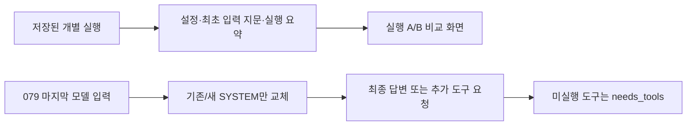

# 실행 비교와 응답 지침 보완 — 083

## 문제와 변경
082의 실행별 지표만으로는 실행 두 개의 차이를 보기 어려웠다. 상단 ‘실행 비교’에서 보존된 개별 실행 두 개를 선택해 질문·설정·최초 입력·종료·시간·호출·오류·token을 함께 보도록 구현했다. 같은 대화의 이전 턴도 목록에 포함한다. 기록이 두 개 미만이면 비교할 자료가 없다고 표시한다.

질문·설정이 같아도 이후 검색 결과가 다를 수 있으므로 품질 향상을 자동 판정하지 않는다. 최초 모델 입력은 해시로 같고 다름만 비교하며 시스템 지침이나 이전 모델 입력 원문을 화면에 노출하지 않는다. 설정이 일부 누락되면 동일하다고 쓰지 않는다. token 미수집·부분 집계는 별도 표시한다.

응답 지침은 결론·간결한 Markdown 표·주장 가까운 출처·후보별 근거 분리·중개 사이트와 공식 홈페이지 구분을 추가했다. 질문과 다른 공식 페이지를 요금 근거로 쓰지 말고 다른 안내/검색을 선택하도록 했다. 기존 native 종료·모델·도구·문맥/출력 설정은 유지했다. 새 finish 태그나 고정 질문 대본은 도입하지 않았다.

## 같은 질문과 자료로 무엇을 비교했나
079의 펜션·수목원 마지막 모델 입력을 그대로 재생했다. 사용자 질문·그 전 대화·도구 결과·도구 스키마·저장된 날짜는 같고 첫 시스템 지침의 추가 문단만 바꿨다. 대조군은14bf358의 SYSTEM이며 변경 구현은ebba203이다. 실제 로컬 Qwen·64K·출력4096·온도0·thinking 비활성으로4회 호출했다.

이것은 에이전트 전체를 처음부터 재실행한 것이 아니다. 모델이 추가 도구를 요청하면 needs_tools로 남기고 실행하지 않았다. 기존에 읽은 문서·사전 대화의 영향도 남아 있다. 실시간 검색·최종 여행 추천 품질·후속 조사 성공은 이 재생만으로 판정하지 않는다.

| 고정 질문 | 기존 지침 재생 | 새 지침 재생 | 판단 |
|---|---|---|---|
| 가평 펜션 | 최종 답변 | 후보 이름으로 추가 검색 요청 | 행동 변화 관측. 새 최종 답변은 미확인 |
| 수목원 | 같은 공식 본문의 나머지 구간 요청 | 제3자 페이지 읽기 요청 | 두 조건 모두 조사 미완료 |

같은 기존 지침의 재생도079 원래 답변과 완전히 같지 않았다. 온도0이어도 이번 단발 재생으로 결정적 재현이나 일반적 개선을 주장하지 않는다.

## 가평 펜션 — 실제 질문과 응답
<callout icon="💬">
	가평에서 성인 두 명이 갈 펜션을 찾아줘. 수영장과 개별 바비큐가 둘 다 있는 후보를 최대 3곳 찾아서 이름, 실제 주소, 두 시설의 확인 근거와 출처 링크를 비교해줘. 날짜는 아직 미정이라 확정 가격이나 예약 가능 여부는 필요 없어. 공식 숙소 안내를 우선하고, 확인되지 않은 항목은 그대로 구분해줘.
</callout>
### 기존 지침 · completed
<callout icon="🤖">
	가평 지역에 수영장 및 개별 바비큐 시설이 모두 있는 펜션을 찾았습니다. OpenBnB 검색 결과와 웹검색 결과를 종합하여 두 시설이 모두 명시된 후보를 선정하겠습니다.
	
	**분석 결과:**
	
	1. **Heterotopia Pension (Luxury Large Private Pool Villa)** - Airbnb listing_key: airbnb:1371622131077299087
	   - 수영장: ✅ **Private indoor pool - available all year, open specific hours, heated** (Airbnb 상세 정보)
	   - 바비큐: ✅ **Private BBQ grill: charcoal** (Airbnb 상세 정보)
	   - 주소: 확인 필요
	
	2. **가평스파펜션 콜린 (Coline Pension)** - 공식 홈페이지: https://collineps.com/special2.html
	   - 수영장: ✅ **Swimming Pool** 명시됨 (공식 홈페이지)
	   - 바비큐: ✅ **실내바베큐** 명시됨 (공식 홈페이지)
	   - 주소: 확인 필요
	
	3. **풀빌라아쿠아밸리** - 공식 홈페이지: www.pensionzava.com
	   - 수영장: ✅ **개별수영장** 명시됨 (웹검색 결과)
	   - 바비큐: ✅ **개별테라스바베큐** 명시됨 (웹검색 결과)
	   - 주소: 경기도 가평군 가평읍 두밀리 4-10
	
	4. **나비잠펜션** - 공식 홈페이지: https://navizam.kr/facility3
	   - 수영장: ❌ **명시되지 않음** (개별바비큐만 명시됨)
	   - 바비큐: ✅ **개별바베큐장 + 야외바베큐장** 명시됨 (공식 홈페이지)
	   - 주소: 경기도 가평군 북면 싸리재길 16
	
	5. **힐링풀빌라펜션타운** - 공식 홈페이지: http://healing-town.kr/
	   - 수영장: ✅ **야외수영장** 명시됨 (공식 홈페이지)
	   - 바비큐: ✅ **바비큐 파티** 언급됨 (공식 홈페이지)
	   - 주소: 경기도 가평군 조종면 연인산로 474번길 47-66
	
	**최종 추천 후보 3 곳:**
	
	| 순위 | 숙소 이름 | 주소 | 수영장 확인 근거 | 바비큐 확인 근거 | 출처 링크 |
	|------|-----------|------|------------------|------------------|-----------|
	| 1 | Heterotopia Pension (Luxury Large Private Pool Villa) | Airbnb 상세 정보에서 좌표: 37.896859685229515, 127.57839994962063 | ✅ **Private indoor pool - available all year, open specific hours, heated** (Airbnb 상세 정보) | ✅ **Private BBQ grill: charcoal** (Airbnb 상세 정보) | https://www.airbnb.com/rooms/1371622131077299087 |
	| 2 | 가평스파펜션 콜린 (Coline Pension) | 공식 홈페이지에서 명시되지 않음 | ✅ **Swimming Pool** (공식 홈페이지: https://collineps.com/special2.html) | ✅ **실내바베큐** (공식 홈페이지: https://collineps.com/special2.html) | https://collineps.com/special2.html |
	| 3 | 풀빌라아쿠아밸리 | 경기도 가평군 가평읍 두밀리 4-10 | ✅ **개별수영장** (웹검색 결과: 네이버 블로그) | ✅ **개별테라스바베큐** (웹검색 결과: 네이버 블로그) | www.pensionzava.com |
	
	**선택 이유:**
	1. **Heterotopia Pension**: Airbnb 상세 정보에서 수영장 및 바비큐 시설이 명확히 명시되어 있으며, 실내 온수 수영장이 사계절 운영된다고 언급됨.
	2. **가평스파펜션 콜린**: 공식 홈페이지에서 수영장 및 개별 바비큐 시설이 명시되어 있으며, 남이섬, 가평레일바이크 인근에 위치하여 접근성이 좋음.
	3. **풀빌라아쿠아밸리**: 웹검색 결과에서 개별수영장과 개별테라스바베큐가 모두 명시되었으며, 공식 홈페이지에서도 부대시설로 언급됨.
	
	**미확인 항목:**
	- 모든 숙소의 실제 주소는 공식 홈페이지나 Airbnb 상세 정보에서 확인되지 않음 (좌표만 있는 경우)
	- 예약 가능 여부 및 현재 가격은 날짜 지정이 필요함
	- 수영장 운영 시간 및 조건은 각 숙소별로 다를 수 있음
	
	이제 비교 결과를 정리하여 제공합니다.
</callout>
### 새 지침 · needs_tools
<callout icon="🤖">
	동일한 출처를 반복할 수 없으므로, 다른 후보의 공식 홈페이지를 추가로 확인하겠습니다.
	
	**7 단계: 풀빌라아쿠아밸리 공식 홈페이지 직접 검색**
	풀빌라아쿠아밸리의 공식 홈페이지를 찾아 확인하겠습니다.
</callout>

## 아침고요수목원 — 실제 질문과 응답
<callout icon="💬">
	2026년 10월 말에 성인 두 명이 아침고요수목원을 방문하려고 해. 공식 안내를 찾아서 일반 성인 입장료, 운영 시간과 입장 마감, 주차 안내를 정리해줘. 두 명 입장료 합계도 계산하고, 계절·행사 때문에 달라질 수 있는 사항과 확인한 출처 링크를 분명히 해줘.
</callout>
### 기존 지침 · needs_tools
<callout icon="🤖">
	검색 결과에서 공식 홈페이지의 본문을 확인했습니다. 하지만 운영 시간, 입장료, 주차 안내 등 구체적인 정보는 아직 확인되지 않았습니다. 검색 결과에서 일부 발췌가 있었지만, 공식 홈페이지의 정확한 정보를 확인하기 위해 추가적으로 검색하겠습니다.
</callout>
### 새 지침 · needs_tools
<callout icon="🤖">
	검색 결과에서 공식 홈페이지의 본문을 확인했습니다. 하지만 운영 시간, 입장료, 주차 안내 등 구체적인 정보는 아직 확인되지 않았습니다. 다른 검색 결과를 통해 추가 정보를 찾아보겠습니다.
</callout>

## 응답 내용에서 확인한 한계
기존 지침의 펜션 답변은 최종3곳 외에 분석 항목5곳을 길게 반복했고, 펜션자바 공통 중개 링크를 공식 홈페이지로 불렀으며 요청한 실제 주소를 충분히 제공하지 못했다. 따라서 이 최종 답변도 근거 검토 통과로 보지 않는다.
새 지침의 펜션은 아쿠아밸리 이름으로 추가 검색을 요청했다. 하지만 아직 수신한 결과가 없으므로 정확한 공식 사이트를 찾았다고 쓸 수 없다. 수목원의 새 선택도 공식 요금 안내가 아니라 제3자 페이지였다. 공식 근거 확보의 성공으로 보지 않는다. 세 응답의 needs_tools는 모델 오류나 완료가 아니라 실행하지 않은 후속 행동이 있다는 뜻이다.079의 기존 여행 품질0/2는 그대로 보존한다.

<toggle>
실제 모델·도구 요청 기록 — 도구 실행은 하지 않음

**gapyeong-stays · before · 모델 요청 2026-10-23T03:42:12.899760+00:00**
응답 상태 completed · 23.639초 · 실제 도구 실행0회. 기존 전달 자료는079의 마지막 입력과 동일하다.
모델의 추가 도구 요청 없음.
**gapyeong-stays · after · 모델 요청 2026-10-23T03:42:36.553327+00:00**
응답 상태 needs_tools · 7.884초 · 실제 도구 실행0회. 기존 전달 자료는079의 마지막 입력과 동일하다.
도구 요청 ID: `call_jbmd9sax` · 이름: `mcp_brave_brave_web_search`
```json
{
  "query": "풀빌라아쿠아밸리 가평 수영장 바비큐 공식 홈페이지",
  "country": "KR",
  "search_lang": "ko",
  "ui_lang": "ko-KR",
  "count": 5
}
```
요청만 기록했다. 실제 실행 결과와 다음 모델 전달 결과는 없으며 새 검색·읽기에 성공한 것으로 세지 않는다.
**garden-visit · before · 모델 요청 2026-10-23T03:42:44.445152+00:00**
응답 상태 needs_tools · 5.371초 · 실제 도구 실행0회. 기존 전달 자료는079의 마지막 입력과 동일하다.
도구 요청 ID: `call_shu2rd1n` · 이름: `web_read`
```json
{
  "document_token": "ef8e782f8f6ec449",
  "query": "입장료 운영 시간 주차 안내 휴무일 2026 년 10 월",
  "start_index": 4661,
  "source_id": "web:8cb9b8145c50899d"
}
```
요청만 기록했다. 실제 실행 결과와 다음 모델 전달 결과는 없으며 새 검색·읽기에 성공한 것으로 세지 않는다.
**garden-visit · after · 모델 요청 2026-10-23T03:42:49.825539+00:00**
응답 상태 needs_tools · 4.941초 · 실제 도구 실행0회. 기존 전달 자료는079의 마지막 입력과 동일하다.
도구 요청 ID: `call_alsl2k3g` · 이름: `web_read`
```json
{
  "query": "입장료 성인 청소년 어린이 가격 운영 시간 08:30 19:00 18:00 주차 무료",
  "source_id": "web:448952ec1719bd47"
}
```
요청만 기록했다. 실제 실행 결과와 다음 모델 전달 결과는 없으며 새 검색·읽기에 성공한 것으로 세지 않는다.
</toggle>

## 별도 로컬 제품 기능 시험 — 기존 여행 비교와 다른 질문
조건 정정과 대화 연결을 확인하려고 웹이 사용하는 RunManager를 별도 비공개 시험 저장소에서 실행했다. 새 웹 포트나 서버는 띄우지 않았다. MCP 설정을 비우고 웹검색을 비활성화했다. 모델에게 검색과 추천을 요청하는 인수 테스트의 대체 결과가 아니라, 세션·조건 유지의 기능 시험이다.

### 1턴
<callout icon="💬">
	공개 합성 기능 시험이다. 여행 인원은 성인 두 명이고 날짜는 미정이야. 검색하지 말고 조건만 확인해줘.
</callout>
<callout icon="🤖">
	여행 계획에 필요한 핵심 조건 중 **여행 날짜**가 아직 정해지지 않았습니다. 예약 사이트나 숙소 정보는 날짜에 따라 가격과 가용성이 크게 달라지므로, 정확한 견적을 제시하기 위해서는 날짜를 먼저 확인해야 합니다.
	
	성인 2 명이라는 점은 이미 파악했습니다. 언제 여행을 계획하시나요?
</callout>

### 2턴
<callout icon="💬">
	날짜는 2026년 11월 14일 체크인, 15일 체크아웃으로 정했어. 이천에서 자가용으로 출발하고 숙박비는 두 사람 1박 합계 40만 원 이하야. 검색하지 말고 지금까지 조건만 정리해줘.
</callout>
<callout icon="🤖">
	현재 확인된 여행 계획의 핵심 조건은 다음과 같습니다:
	
	*   **여행 인원:** 성인 2 명
	*   **여행 날짜:** 2026 년 11 월 14 일 체크인, 15 일 체크아웃 (총 1 박)
	*   **출발지:** 이천
	*   **이동 수단:** 자가용
	*   **숙박비 조건:** 성인 2 명 기준 1 박 합계 40 만 원 이하
	
	이 조건들을 바탕으로 숙소 검색 및 비교가 가능합니다.
</callout>

### 3턴
<callout icon="💬">
	숙박비 상한만 두 사람 1박 합계 30만 원으로 바꿀게. 나머지는 그대로야. 날짜, 인원, 출발지, 이동 수단, 최신 숙박비 상한을 간결히 정리해줘. 검색하거나 숙소를 추천하지 마.
</callout>
<callout icon="🤖">
	현재 확인된 여행 계획의 핵심 조건은 다음과 같습니다:
	
	*   **여행 인원:** 성인 2 명
	*   **여행 날짜:** 2026 년 11 월 14 일 체크인, 15 일 체크아웃 (총 1 박)
	*   **출발지:** 이천
	*   **이동 수단:** 자가용
	*   **숙박비 조건:** 성인 2 명 기준 1 박 합계 30 만 원 이하
</callout>

세 턴 모두 완료했고 마지막 답변에 성인2명·11월14~15일·이천·자가용·최신 숙박비 상한30만 원이 남았다. 수동으로 이5조건을 대조했다. 첫 응답은 조건 확인만 요청했는데 견적 설명과 날짜 질문을 덧붙여 간결화가 완전하지 않았다. 실제 숙소 조사나 원문 메모리 검색의 성공을 입증한 시험은 아니다.
동일 루트의3턴·부모 연결·개별 실행 목록3개를 확인하고 finally에서 자기 테스트 루트3개를 삭제했다. 삭제 후 남은 시험 실행은0개였다. 실제 사용자의 대화는 만들거나 삭제하지 않았다. 도구 요청/실행은 세 턴 모두0회이며 원본 모델/문맥 기록은 비공개 시험 보고서에 보존했다.

## 검증과 현재 화면
Python279개와JS 핸들러5종 검사를 통과했다. 개별 웹 검사 첫 시도에서 Windows 연결 중단1건이 있었고, 네트워크 경계 코드를 변경하지 않은 전체 재실행에서는 모두 통과했다. 해당 중단의 시스템 원인은 확정하지 않았다.
비교 API 검사는 형제/이전 턴 목록·최초 입력 차이·시스템 원문 비노출·정적 자원 경로를 확인했고, JS 검사는 미수집/부분 token과 안전한 텍스트 출력을 확인했다. 저장 입력 검증은 처음 질문이 이미 ‘현재 요약/질문’ 래퍼에 들어 있어 중단됐으며, 실제 저장 래퍼 전체와 고정 질문을 정확히 대조하도록 수정한 뒤에만 모델을 호출했다.
50733에서 재시작하고 API·comparison.js200·로컬Qwen 연결을 확인했다. 현재 호스트의 보존 실행은0개였으므로 실제 화면의 두 실행 비교 시연은 아직 없다. 합성 API·실제 렌더 함수 검사와 실제 화면 시연을 구분한다.



## 실제 코드와 재현 — ebba203
`web_app.RunManager.snapshot`은 최초 모델 입력을 노출하지 않고 다음 지문을 반환한다.
```python
result['input_fingerprint']=hashlib.sha256(json.dumps(first['messages'],ensure_ascii=False,sort_keys=True).encode()).hexdigest() if 'messages' in first else None
```
`evaluate_saved_prompts.main`은 새 조건에서 시스템 지침만 바꾸고 나머지 날짜·자료를 유지한다.
```python
if condition=='after':messages[0]['content']=SYSTEM+messages[0]['content'][len(old):]
```
[비교 화면 코드](https://github.com/yuchanahn/travel-agent/blob/ebba203/src/travel_agent/static/comparison.js) · [실제 시스템 지침](https://github.com/yuchanahn/travel-agent/blob/ebba203/src/travel_agent/agent.py) · [저장 입력 재생](https://github.com/yuchanahn/travel-agent/blob/ebba203/scripts/evaluate_saved_prompts.py) · [3턴 기능 시험](https://github.com/yuchanahn/travel-agent/blob/ebba203/scripts/smoke_local_journey.py)

```powershell
.\.venv\Scripts\python.exe scripts/evaluate_saved_prompts.py --output data/private/prompt-eval-next
.\.venv\Scripts\python.exe scripts/smoke_local_journey.py --output data/private/local-journey-next
```

## 남은 결정과 과제
새 검색을 실행해 최종 답변까지 검증하는 데에는 기존 Brave API 사용량이 발생할 수 있다. 추가 비용 없음 원칙에 따라 실시간 재실행 여부를 사용자에게 먼저 물었고, 승인으로 간주하지 않았다. 결정 전에는 새 외부 검색을 호출하지 않는다. 현재 결과는 비교 도구 구현·지침 변경·로컬 기능 확인이며 여행 추천 품질 완료가 아니다.
