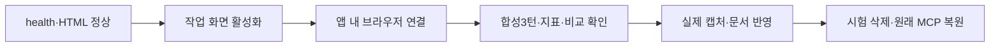

# 085 · 브라우저 연결 복구와 실제 화면 시연

## 문제와 해결

서버가 꺼진 것인지, 원격 환경 때문에 창을 열어야 하는지 확인했다. 로컬50733의 health는ok·Ollama연결·모델설치를 보고했고 첫 페이지도HTTP200이었다. Docker는 현재 호스트 실행에 필요하지 않았다.

브라우저 도구 목록은 비어 있었다. 앱에 로컬 URL을 열라는 요청은queued였지만, 해당 작업 화면으로 이동한 뒤 같은 도구가 실제 앱 내 브라우저 탭을 발견했다. Windows Chrome의 URL 확인 실패를 우회하지 않고 연결된 앱 내 브라우저로 화면을 확인했다. 원격 환경이면 언제나 같은 문제가 난다는 결론은 아니다.

이전에는 서버와 무관한 연결 문제에서 멈췄으나 이번에는 실제 화면 캡처까지 진행했다. 새 포트·Docker·외부 공개·브라우저 설치는 없었다.

## 이번 시험의 기준

083과 같은 공개 합성3질문을 브라우저에서 직접 입력한다. 부모 대화 연결, 최신 예산 정정과 나머지 조건 유지, 지표·비교 표시, 자기 시험 대화 삭제를 확인한다. 비용을 늘리지 않기 위해 시연 동안 MCP를 빈 설정으로 재시작하고 웹 검색을 해제했다. 시연 후 원래 MCP 설정과 다크 테마로 복원했다.

검색·추천 품질이나 요약 후 원문 RAG 복원 시험은 아니다. 에이전트 도구 호출은0회이며 툴콜 로그를 만들지 않았다. 모델 요청/응답 원본은 비공개로 보존했다.

## 실제 질문과 답변

### 1턴

<callout icon="💬">
	공개 합성 기능 시험이다. 여행 인원은 성인 두 명이고 날짜는 미정이야. 검색하지 말고 조건만 확인해줘.
</callout>

**실제 Qwen 답변**

여행 계획에 필요한 핵심 조건 중 **여행 날짜**가 아직 정해지지 않았습니다. 예약 사이트나 숙소 정보는 날짜에 따라 가격과 가용성이 크게 달라지므로, 정확한 견적을 제시하기 위해서는 날짜를 먼저 확인해야 합니다.

성인 2 명이라는 점은 이미 파악했습니다. 언제 여행을 계획하시나요?

### 2턴

<callout icon="💬">
	날짜는 2026년 11월 14일 체크인, 15일 체크아웃으로 정했어. 이천에서 자가용으로 출발하고 숙박비는 두 사람 1박 합계 40만 원 이하야. 검색하지 말고 지금까지 조건만 정리해줘.
</callout>

**실제 Qwen 답변**

현재 확인된 여행 계획의 핵심 조건은 다음과 같습니다:

*   **여행 인원:** 성인 2 명
*   **여행 날짜:** 2026 년 11 월 14 일 체크인, 15 일 체크아웃 (총 1 박)
*   **출발지:** 이천
*   **이동 수단:** 자가용
*   **숙박비 조건:** 성인 2 명 기준 1 박 합계 40 만 원 이하

이 조건들을 바탕으로 숙소 검색 및 비교가 가능합니다.

### 3턴

<callout icon="💬">
	숙박비 상한만 두 사람 1박 합계 30만 원으로 바꿀게. 나머지는 그대로야. 날짜, 인원, 출발지, 이동 수단, 최신 숙박비 상한을 간결히 정리해줘. 검색하거나 숙소를 추천하지 마.
</callout>

**실제 Qwen 답변**

현재 확인된 여행 계획의 핵심 조건은 다음과 같습니다:

*   **여행 인원:** 성인 2 명
*   **여행 날짜:** 2026 년 11 월 14 일 체크인, 15 일 체크아웃 (총 1 박)
*   **출발지:** 이천
*   **이동 수단:** 자가용
*   **숙박비 조건:** 성인 2 명 기준 1 박 합계 30 만 원 이하

첫 답변은 조건만 확인하라는 요청에 불필요한 날짜 질문과 견적 설명을 덧붙였다.2·3턴은 지정한 날짜·성인2명·이천·자가용을 유지하고 숙박비40→30만 원 정정을 반영했다. 답변의 간결함까지 완벽하다고 평가하지 않았다.

## 실행 결과와 화면 대조

| 턴 | 종료 | 시간(초) | 모델/도구 | 입력/출력token |
|---|---|---|---|---|
| 1 | completed | 6.567 | 1/0 | 2092/68 |
| 2 | completed | 2.111 | 1/0 | 2573/115 |
| 3 | completed | 1.52 | 1/0 | 2756/103 |

각 턴의 도구 오류·자동HTTP는0회다. 같은 대화1개에 실행3개가 연결됐다. 비교 화면은3턴(A)과2턴(B)의 ‘질문 다름·설정 동일·최초 입력 다름’을 표시했고 시간·호출·token이 API 값과 일치했다. 다른 질문의 수치 차이를 성능 개선으로 해석하지 않았다. CSS 변경으로 재시작한 후 기존 대화3턴도 다시 표시됐다.

화면 점검에서 비교 표의 항목명이 한 글자씩 세로로 줄바꿈되는 문제를 발견했다.첫 열의 최소 폭과 줄바꿈 규칙을 보완하고 같은 화면을 다시 캡처했다. 실제 비교 JS 검사는 통과했다. 직전084의Python279·UI JS5종·연구용8검사는 그대로이며 이번 CSS 변경 후 전체Python을 새로 실행했다고 쓰지 않는다.

<details>
<summary>실제 수정 코드</summary>

`src/travel_agent/static/theme.css` · 기준 f5f4a56. 첫 열의 항목명이 좁은 화면에서 세로로 쪼개지지 않게 했다.

```css
#compare-dialog th:first-child{min-width:6.5em;white-space:nowrap;overflow-wrap:normal}
```
</details>



## 실제 캡처


## 정리와 남은 한계

이번 루트의3실행만 화면에서 삭제했다. API 실행 목록0개와 삭제한 루트404를 확인했다. 비공개 원본과 공개 합성 화면은 별도로 보존했다. 기존 MCP 설정으로 같은50733을 재시작했으며 다크 테마를 유지했다.

실제 브라우저 시연과 문서용 캡처는 완료했다. 기존079의 실제 여행 근거 검토0/2와083 새 지침 최종품질미확인은 유지한다. 새 외부 검색·모델 다운로드·추가 유료 서비스는 실행하지 않았다.

Notion 동기화·읽기 검토: https://app.notion.com/p/402d058c022e81bab8a8cdd1d743bf83 . 주 포트폴리오 사진5개·코드블록8개·자식4개, 연구일지 사진7개·실제3질문과답변을 확인했다.
