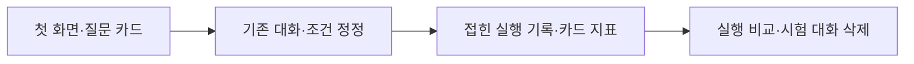

# 088 · 여행 노트 UI와 기능 중심 포트폴리오

## 바꾼 기능 화면

‘예쁘고 깔끔하게, 기능 위주로 짧게 설명하고 사진을 다시 찍어 달라’는 요청을 반영했다. ‘여행 노트’ 첫 화면과 예시 질문 카드, 다크/라이트 테마, 대화 입력창을 정돈했다. 모델·문맥 정보는 ‘연결 정보’에 접어두고, 실행 지표는 카드로, 실행 비교는 정돈한 표로 표시했다.

기존 질문·에이전트 지침·검색 동작은 바꾸지 않았다. 여행 조건 자동 추출·후보 노트 패널은 이번 구현에 포함하지 않았다. 포트폴리오 본문은 기능3항목과 기술명·짧은 결과로 줄이고 그림3개·코드토글3개를 유지했다. 새 UI 캡처는 표지와 실행 비교 항목에 반영했다.

## 실제 확인

브라우저에서 질문 카드의 입력, 연결 정보 열기, 테마 전환, 기존과 같은 합성3턴, 실행 지표·비교, 자기 시험 대화 삭제를 확인했다. 각 턴이1모델/0도구·자동HTTP0으로 종료했고 최신30만 원 정정과 나머지 조건을 유지했다. 비교 화면은 설정 동일·질문/최초입력 다름을 표시했다. 이는 검색 없는 기능 시험이며 실제 여행 추천의 품질 대조가 아니다.

시연 동안 빈 MCP 설정과 웹 검색 해제를 사용했다. 종료 후 자기 시험 실행3개를 삭제하고 목록0개·루트404를 확인했으며 원래 MCP 설정과 고정50733·다크 테마로 복원했다. 원본 실행은 비공개로 보존했다.

Python279개·UI JS5종·과거 연구용JS8검사가 통과했다. 새 모델 다운로드·유료 호출·외부 공유는 없다. 기존079 여행 품질0/2를 유지한다.



<details>
<summary>실제 코드 · 두 테마의 화면 색상</summary>

`src/travel_agent/static/theme.css` · 기준 ef9145c. 같은 화면 구성에서 색상 변수를 전환하도록 했다.

```css
:root[data-theme="dark"]{--paper:#182521;--surface:#202f29;--side:#14201c;--ink:#e7ede3;--muted:#a4b3a8;--accent:#bfd5a8;--tint:#2a3b30;--line:#35483d;--bubble:#2e4235;--shadow:0 12px 40px #0002}
```

[UI 소스](https://github.com/yuchanahn/travel-agent/blob/ef9145c/src/travel_agent/static/index.html)
</details>

## 새 실제 화면


<details>
<summary>실제 합성3턴 질문과 답변</summary>

### 1턴

<callout icon="💬">
	공개 합성 기능 시험이다. 여행 인원은 성인 두 명이고 날짜는 미정이야. 검색하지 말고 조건만 확인해줘.
</callout>

여행 계획에 필요한 핵심 조건 중 **여행 날짜**가 아직 정해지지 않았습니다. 예약 사이트나 숙소 정보는 날짜에 따라 가격과 가용성이 크게 달라지므로, 정확한 견적을 제시하기 위해서는 날짜를 먼저 확인해야 합니다.

성인 2 명이라는 점은 이미 파악했습니다. 언제 여행을 계획하시나요?

### 2턴

<callout icon="💬">
	날짜는 2026년 11월 14일 체크인, 15일 체크아웃으로 정했어. 이천에서 자가용으로 출발하고 숙박비는 두 사람 1박 합계 40만 원 이하야. 검색하지 말고 지금까지 조건만 정리해줘.
</callout>

현재 확인된 여행 계획의 핵심 조건은 다음과 같습니다:

*   **여행 인원:** 성인 2 명
*   **여행 날짜:** 2026 년 11 월 14 일 체크인, 15 일 체크아웃 (총 1 박)
*   **출발지:** 이천
*   **이동 수단:** 자가용
*   **숙박비 조건:** 성인 2 명 기준 1 박 합계 40 만 원 이하

이 조건들을 바탕으로 숙소 검색 및 비교가 가능합니다.

### 3턴

<callout icon="💬">
	숙박비 상한만 두 사람 1박 합계 30만 원으로 바꿀게. 나머지는 그대로야. 날짜, 인원, 출발지, 이동 수단, 최신 숙박비 상한을 간결히 정리해줘. 검색하거나 숙소를 추천하지 마.
</callout>

현재 확인된 여행 계획의 핵심 조건은 다음과 같습니다:

*   **여행 인원:** 성인 2 명
*   **여행 날짜:** 2026 년 11 월 14 일 체크인, 15 일 체크아웃 (총 1 박)
*   **출발지:** 이천
*   **이동 수단:** 자가용
*   **숙박비 조건:** 성인 2 명 기준 1 박 합계 30 만 원 이하

에이전트 도구 호출은0회여서 툴콜 로그는 없다. 첫 답변에는 조건 확인 이상으로 날짜를 묻는 행동이 남았다. 응답 스타일이나 추천 품질이 이번 UI 변경으로 개선됐다고 주장하지 않는다.
</details>

Notion 동기화·읽기 검토: https://app.notion.com/p/402d058c022e8151856dcc55c92d4e88 . 새사진7장·실제질문/답변을 확인했고, 포트폴리오는이미지3/코드토글3·새표지/비교사진을확인했다.
