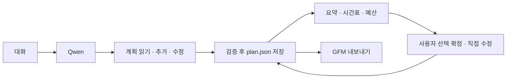

# 090 · 대화에서 채우고 바로 여는 여행 계획서

## 문제와 선택

추천 답변이 대화에 흩어져 일정·숙소·비용을 다시 정리해야 했다. 버튼을 누를 때 새 답변을 생성하기보다 대화 중 구조화한 초안을 저장하고, 같은 데이터를 요약·시간표·예산으로 보여주기로 했다. 모델은 초안을 기록하고 사용자가 선택 확정한다.

## 실제 질문 → 저장 결과

로컬 Qwen, 웹검색 해제·빈 MCP로 합성 장소만 사용했다. 실제 여행 조회나 예약 실험이 아니다.

### 첫 기록

<callout icon="💬" color="blue_bg">
공개 합성 계획서 기능 시험이야. 검색하지 마. 2026년 11월 14일 10:00~12:00에 합성 정원 A에서 산책, 숙소는 합성 숙소 B, 교통은 이천에서 자가용으로 정했어. 숙박비는 성인2명 1박 합계 예상 24만 원이야. 실제 장소나 예약이 아니야. 이 내용을 여행 계획서 초안에 기록하고 간단히 확인해줘.
</callout>

여행 계획서 초안이 기록되었습니다.

*   **합성 정원 A 산책**: 2026 년 11 월 14 일 10:00~12:00
*   **합성 숙소 B 숙박**: 성인 2 명, 1 박 예상 비용 24 만 원 (추정)

이제 확인해 보겠습니다.

실제 모델 2회 · 도구 1회 · completed.

### 조건 정정

<callout icon="💬" color="blue_bg">
숙소 B의 성인 2명 1박 예상 숙박비만 20만 원으로 바꾸고, 산책 시작을 11:00으로 바꿔줘(종료 12:00 유지). 빠진 교통 항목 ‘이천에서 자가용’도 추가해줘. 날짜와 나머지는 그대로고 검색하지 마. 기존 계획 항목은 실제 ID로 수정해줘.
</callout>

요청하신 수정이 완료되었습니다.

*   **합성 숙소 B**: 성인 2 명, 1 박 예상 비용 **20 만 원**으로 변경됨
*   **합성 정원 A 산책**: 시작 시간을 **11:00**로 변경 (12:00 종료 유지)
*   **이천에서 자가용 이동**: 추가됨

현재 계획서 초안에는 3 개의 항목이 기록되었습니다.

실제 모델 2회 · 도구 2회 · completed.

첫 턴은 일정·숙소2개만 저장했고 교통을 빠뜨렸다. 추가 요청에서 비용24→20만원·시작10→11시 수정과 교통 추가를 확인했다. 숙소의 선택 확정은 비용 변경 뒤 해제됐다. 숙박 날짜는 기록하지 않아 미정으로 남았다. 답변이 저장됐다고 말하는 것과 실제 저장 필드의 완전성은 별도다.

## 실패에서 바꾼 것

- 계획 결과를 웹검색 결과처럼 처리해 KeyError가 났다. 계획 도구 분기를 분리했다.
- 초기 독립 실행은 날짜·시간 형식과 비용 필드 제약 때문에36번 호출 후 한도 종료했다. 날짜가 일치하는 ISO 날짜·시간은 손실 없이 정규화하고 숙소 자체에 비용을 기록하게 했다.
- 다음 실행은 새 항목에 임의 ID를 보내 저장하지 못했다. 추가(plan_add)와 기존 ID 수정(plan_update)을 별도 스키마로 나눈 뒤 위2턴을 실행했다. 모델을 바꾸지 않고 인터페이스를 보완한 기능 실험이며 일반적인 품질 개선 수치는 아니다.

## 화면과 검증


실제 브라우저에서 선택 확정·확정 필터·미확인 식비 직접 추가·보기 전환·Markdown 다운로드·서버 재시작 후 복원을 확인했다. 열람과 수동 편집은 모델 호출 없이 API로 처리한다. 인쇄 버튼과 CSS는 구현했지만 실제 PDF 저장은 확인하지 않았다.

Python288개·UI JS6종·기존 연구 JS8개 통과. 첫 전체 검사에서는 기존 Origin 검사에 Windows 연결 중단10053이1회 발생했고, 코드 변경 없이 재실행해 통과했다. 단일 실행으로 그 연결 중단의 원인을 확정하지 않는다.

## 구조와 실제 코드

기준 커밋 de4bd63. 여행 추천의 사실 정확도는 이번 기능 검사 대상이 아니며079의 근거 품질0/2는 유지한다.



<details>
<summary>저장·충돌 검사 코드</summary>

`src/travel_agent/web_app.py`의 `RunManager.update_plan`. 사용자의 오래된 편집이 최신 계획을 덮어쓰지 않게 한다.

```python
    def update_plan(self,run_id,payload,*,model=False):
        if not isinstance(payload,dict) or set(payload)-{'revision','action','items','id','confirmed'}:raise ValueError('계획 변경 형식을 확인해주세요.')
        with self.lock:
            job=self._job(run_id)
            plan=self._plan(job)
            if not model and (type(payload.get('revision')) is not int or payload['revision']!=plan['revision']):
                raise RuntimeError('계획이 변경됐습니다. 새로고침 후 다시 편집해주세요.')
            updated=mutate_plan(plan,payload.get('action'),payload,model=model,run_id=run_id)
            if len(json.dumps(updated,ensure_ascii=False).encode())>60000:raise ValueError('계획 저장 크기를 초과했습니다. 항목을 줄여주세요.')
            write_json(self.directory/run_id/'plan.json',updated)
            return updated

```
</details>

<details>
<summary>실제 계획 도구 호출 로그</summary>

합성2턴의 모델 요청 인자와 실제 실행 결과다. 웹·외부 HTTP는 호출하지 않았다. 반환된 계획은 도구 메시지로 다음 모델 입력에 전달된다.


### 첫 기록

```json
{
  "sequence": 6,
  "timestamp": "2026-10-23T13:04:46.288763+00:00",
  "kind": "tool_start",
  "step": 1,
  "name": "plan_add",
  "span": "1.1",
  "tool_call_id": "call_6wn1x8fa",
  "arguments": {
    "items": [
      {
        "date": "2026-11-14",
        "end": "12:00",
        "kind": "activity",
        "place": "합성 정원 A",
        "start": "10:00",
        "title": "합성 정원 A 산책"
      },
      {
        "amount_won": 240000,
        "basis": "성인 2명, 1 박",
        "cost_status": "estimate",
        "kind": "lodging",
        "title": "합성 숙소 B"
      }
    ]
  }
}
```

```json
{
  "sequence": 7,
  "timestamp": "2026-10-23T13:04:46.290952+00:00",
  "kind": "tool_end",
  "step": 1,
  "name": "plan_add",
  "span": "1.1",
  "result": {
    "version": 1,
    "revision": 1,
    "items": [
      {
        "date": "2026-11-14",
        "end": "12:00",
        "kind": "activity",
        "place": "합성 정원 A",
        "start": "10:00",
        "title": "합성 정원 A 산책",
        "id": "5371372cb55f4676",
        "confirmed": false,
        "recorded_by": "model",
        "updated_from": "aa2d684466e0451b95b419933b714364"
      },
      {
        "amount_won": 240000,
        "basis": "성인 2명, 1 박",
        "cost_status": "estimate",
        "kind": "lodging",
        "title": "합성 숙소 B",
        "id": "7f47d5953b9d4cbc",
        "confirmed": false,
        "recorded_by": "model",
        "updated_from": "aa2d684466e0451b95b419933b714364"
      }
    ],
    "updated_at": "2026-10-23T13:04:46.289366+00:00"
  },
  "elapsed_seconds": 0.001629
}
```


### 조건 정정

```json
{
  "sequence": 6,
  "timestamp": "2026-10-23T13:10:24.378635+00:00",
  "kind": "tool_start",
  "step": 1,
  "name": "plan_update",
  "span": "1.1",
  "tool_call_id": "call_wnq8twds",
  "arguments": {
    "items": [
      {
        "amount_won": 200000,
        "basis": "성인 2 명, 1 박",
        "cost_status": "estimate",
        "id": "7f47d5953b9d4cbc",
        "kind": "lodging",
        "title": "합성 숙소 B"
      },
      {
        "id": "5371372cb55f4676",
        "start": "11:00",
        "title": "합성 정원 A 산책"
      }
    ]
  }
}
```

```json
{
  "sequence": 7,
  "timestamp": "2026-10-23T13:10:24.380252+00:00",
  "kind": "tool_end",
  "step": 1,
  "name": "plan_update",
  "span": "1.1",
  "result": {
    "version": 1,
    "revision": 3,
    "items": [
      {
        "date": "2026-11-14",
        "end": "12:00",
        "kind": "activity",
        "place": "합성 정원 A",
        "start": "11:00",
        "title": "합성 정원 A 산책",
        "id": "5371372cb55f4676",
        "confirmed": false,
        "recorded_by": "model",
        "updated_from": "7bf490d582034520b71751d1843df3ec"
      },
      {
        "amount_won": 200000,
        "basis": "성인 2 명, 1 박",
        "cost_status": "estimate",
        "kind": "lodging",
        "title": "합성 숙소 B",
        "id": "7f47d5953b9d4cbc",
        "confirmed": false,
        "recorded_by": "model",
        "updated_from": "7bf490d582034520b71751d1843df3ec"
      }
    ],
    "updated_at": "2026-10-23T13:10:24.379169+00:00"
  },
  "elapsed_seconds": 0.001549
}
```

```json
{
  "sequence": 8,
  "timestamp": "2026-10-23T13:10:24.380252+00:00",
  "kind": "tool_start",
  "step": 1,
  "name": "plan_add",
  "span": "1.2",
  "tool_call_id": "call_zogxqt3i",
  "arguments": {
    "items": [
      {
        "kind": "transport",
        "place": "이천에서 자가용",
        "title": "이천에서 자가용 이동"
      }
    ]
  }
}
```

```json
{
  "sequence": 9,
  "timestamp": "2026-10-23T13:10:24.387271+00:00",
  "kind": "tool_end",
  "step": 1,
  "name": "plan_add",
  "span": "1.2",
  "result": {
    "version": 1,
    "revision": 4,
    "items": [
      {
        "date": "2026-11-14",
        "end": "12:00",
        "kind": "activity",
        "place": "합성 정원 A",
        "start": "11:00",
        "title": "합성 정원 A 산책",
        "id": "5371372cb55f4676",
        "confirmed": false,
        "recorded_by": "model",
        "updated_from": "7bf490d582034520b71751d1843df3ec"
      },
      {
        "amount_won": 200000,
        "basis": "성인 2 명, 1 박",
        "cost_status": "estimate",
        "kind": "lodging",
        "title": "합성 숙소 B",
        "id": "7f47d5953b9d4cbc",
        "confirmed": false,
        "recorded_by": "model",
        "updated_from": "7bf490d582034520b71751d1843df3ec"
      },
      {
        "kind": "transport",
        "place": "이천에서 자가용",
        "title": "이천에서 자가용 이동",
        "id": "f67cc060cb7f46cb",
        "confirmed": false,
        "recorded_by": "model",
        "updated_from": "7bf490d582034520b71751d1843df3ec"
      }
    ],
    "updated_at": "2026-10-23T13:10:24.387271+00:00"
  },
  "elapsed_seconds": 0.007929
}
```

</details>

## 정리와 남은 한계

예상 비용과 조회 비용을 분리하고 미확인을0원으로 취급하지 않는다. 선택 확정은 예약이나 사실 검증이 아니다. 의미상 비용 중복·일정 충돌을 자동 판정하지 않고, 모델의 교통 누락처럼 기록 누락도 남아 직접 편집을 제공한다.

독립 합성 시험 대화는 기록 보존 후 삭제하고 API404를 확인했다. 별도로 기존 대화에 잘못 연결된 시험 턴1개는 개별 삭제가 자동 승인 검토에서 정책상 차단되어 보존했다. 기존 사용자 대화를 포함하는 전체 삭제는 하지 않았다. 비공개 대화 내용은 이 문서에 옮기지 않았다.

원래 MCP 설정·다크 테마·고정50733으로 복원했다. 신규 외부 검색·모델 다운로드·유료 서비스 도입은 없다.
