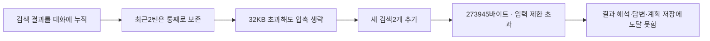

# 092 · 실제 여행 대화에서 계획서가 비어 있던 이유

## 결론

090의 합성 시험은 저장·수정·뷰어 기능을 확인했을 뿐, 일반 여행 상담이 자동으로 계획서를 만드는 흐름을 입증하지 못했다. 실제 최근3턴은 마지막 응답이 입력 한도로 중단됐고 모든 턴의 계획은 revision0·항목0이었다. 서버 장애나 저장 예외가 아니라 문맥 관리·계획 생성 연결·답변 검증의 결함이다.

개인 대화와 원본 로그는 비공개로 보존한다. 이 문서는 요청 문장과 실제 답변 전체를 공개하지 않고 관찰한 기술 지표만 기록한다. 신규 검색·모델 호출·기능 변경 없이 저장된 trace와 코드로 분석했다. 기준 구현 de4bd63.

## 실행 흐름

| 턴 | 모델/도구 | 마지막 모델 입력 | 종료 | 계획 저장 |
|---|---|---|---|---|
| 1 | 2 / 3 | 116,788바이트 | completed | 0항목 |
| 2 | 2 / 3 | 183,890바이트 | completed | 0항목 |
| 3 | 1 / 2 | 첫 호출189,516바이트 → 검색 후273,945바이트 | context_limit | 0항목 |

3턴의8개 도구는 전부 Brave 검색이었다. 계획·본문 열람·숙소 상세 도구 호출은 없었다. 마지막 검색2개는 성공해 모델 전달용49,619+31,801바이트를 만들었으나 다음 모델 호출 전에196,608바이트 제한을 초과했다. 최종 답변은 빈 문자열이다. 화면의 실행 state=done은 작업자가 끝났다는 뜻이며 추천 성공을 뜻하지 않는다. 목록이 이를 ‘응답 완료’로 표시하는 것도 개선 대상이다.

## 왜 문맥이 넘쳤나

압축 기준은32,000바이트인데 최근2사용자 턴을 그대로 남기는 정책이 우선했다. 첫 턴 뒤93,886바이트·둘째 뒤160,735바이트에 대해 압축 함수가 `recent_turns_exceed_threshold`로 원문 그대로 반환했다. 같은 저장 문맥을 함수에 다시 넣어 두 경우 모두 압축·모델 호출0회와 동일 반환을 재현했다.



직접 종료 원인은 실행기의 바이트 제한이다. 마지막 실제 모델 입력 토큰도64,784로 문맥65,536에 가까웠다. 출력은245토큰이어서 출력4096 소진으로 끝난 사례가 아니다. 전체 prompt_tokens는 여러 호출의 누적값일 수 있어 한 호출의 문맥 사용량과 구분한다.

<details>
<summary>압축이 생략되는 실제 코드</summary>

`src/travel_agent/session_context.py`의 `compact_context`. 최근 턴 수 보호가 크기 기준보다 우선한다.

```python
starts = [i for i,m in enumerate(history) if m['role']=='user']
if len(starts) <= keep:
    info['warning'] = 'recent_turns_exceed_threshold'
    return history, summary, info
```

`src/travel_agent/agent.py`의 `run_agent`. 모델 호출 전에 중단되므로 검색 응답이 성공했어도 후속 해석은 실행되지 않는다.

```python
if input_bytes > max_input_bytes:
    return finish("context_limit", input_bytes=input_bytes)
```
</details>

## 왜 계획서가 없었나

계획서는 채팅 답변에서 자동 추출하지 않는다. `plan_add`·`plan_update`를 모델이 호출해야 저장된다. 이3턴은 두 도구 모두0회였다. 도구가 오류로 저장을 거절한 것이 아니라 저장 요청 자체가 없었다. 첫2턴도 비어 있었으므로 마지막 context_limit만 고쳐서는 해결되지 않는다.

090은 ‘계획서 초안에 기록해줘’라고 직접 요청한 합성 시험이었다. 일반 상담→조건 확정→계획 보기의 인수 검사가 빠졌다. 뷰어 구현과 자동 기록 흐름을 구분하지 않고 제품 기능을 설명한 것이 검증상의 문제였다.

## 답변 품질은 별도 실패

저장된 실제 모델 입력에 저가 숙소 가격대 발췌가 있었는데 답변은 훨씬 높은 금액을 근거 없이 제시했다. 발췌의 과거 가격대가 지정 날짜의 실예약가를 증명하지도 않는다. 필요한 동작은 날짜·인원 조건으로 추가 확인하거나 금액을 미확인으로 두는 것이다.

첫 답변의 비용 행을 더하면378,000원인데 총합은302,000원이었다. 또한 실내 대안을 요구한 맥락에서 야외 활동을 비 대비 선택지처럼 제시했다. 검색 성공·모델 completed를 품질 통과로 볼 수 없다. 모델이4B라 생긴 현상일 가능성은 있으나 원인을 모델 크기로 확정하는 실험은 하지 않았다.

## 개선 순서와 통과 기준 — 아직 제안

1. **도구 결과의 문맥 예산:** 원본은 저장하고 최근 턴 안의 오래된 도구 결과도 요약·검색 가능한 참조로 바꾼다. 도구 요청/응답 쌍은 유지한다. 매 모델 호출 전에 전체 입력과 다음 결과를 위한 여유를 확보한다. 기준: 검색 묶음이 추가돼도 안전하게 재포장하고, 토큰·바이트·생략량을 기록한다.
2. **계획 기록을 별도 단계로 연결:** 메인 모델의 자발적 저장만 기다리지 않고 응답 뒤 구조화 추출·검증 단계를 설계한다. 사용자의 확정 조건과 모델 후보를 구분하고 후보는 초안으로 저장한다. 실패하면 UI에 저장 실패를 표시한다. 기준: ‘저장해줘’ 없이 여행 조건을 정한 대화에서 초안이 생성되고 정정이 반영된다. 추가 모델 호출 비용/시간은 측정해야 한다.
3. **금액·근거 검증:** 총합은 코드로 계산한다. 출처의 날짜·인원·숙박일 조건이 안 맞으면 예약가격으로 쓰지 않는다. 기준: 미확인 가격을 확정 금액으로 만들지 않고 계산은 입력 행과 일치한다.
4. **실패 표시:** 작업 종료와 결과 성공을 분리하고 목록에도 context_limit을 표시한다. 답변이 없으면 이유·재개 상태를 보여준다. 계획도 빈 상태와 기록 실패를 구분한다.
5. **검증 범위 확대:** 합성 저장 API 시험에 더해 일반 여행 상담→날짜 확정→저가 후보 재탐색→계획 보기까지 같은 흐름을 검사한다. 저장된 도구 응답을 재생하는 오프라인 회귀 검사부터 하고, 실제 검색·Qwen 종합 검증은 별도 단계로 평가한다. 종료·계획 생성·근거 적합성은 각각 판정한다.

호출 횟수·출력 한도·문맥 크기만 늘리거나 종료 태그를 재도입하는 것은 이번 원인을 해결하지 못한다. 이번은 분석이며 위 개선 구현·추천 품질 통과·새로운 성공 답변을 주장하지 않는다.

<details>
<summary>실행 로그에서 확인한 핵심 수치</summary>

실제 도구 인자·호출ID·원본 결과는 사용자 대화와 함께 비공개 보존했다. 공개 기록에는 호출 없는 로그를 만들지 않고 아래 관찰값만 남긴다.

```json
{
  "turn_3": {
    "model_calls": 1,
    "tool_calls": 2,
    "tool_names": ["mcp_brave_brave_web_search", "mcp_brave_brave_web_search"],
    "model_content_bytes": [49619, 31801],
    "input_bytes_before_search": 189516,
    "input_bytes_after_search": 273945,
    "max_input_bytes": 196608,
    "status": "context_limit",
    "plan_revision": 0,
    "plan_items": 0
  }
}
```
</details>
