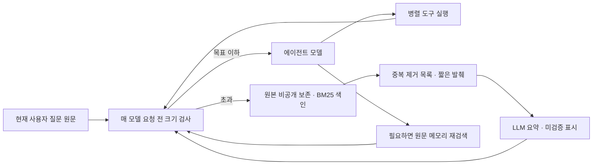

# 093 · 턴 수 대신 매 모델 호출 전에 문맥을 관리한다

## 문제 정의

<callout icon="💬" color="blue_bg">
최근 2턴을 보존하지말고, 모델응답 잠시 중시( 툴 호출등으로 잠시 스트리밍 중단 ) 시에도 컨텍스트 검사와 함께, 압축을 실행하는 컨텍스트 관리 규칙이 필요함.
</callout>

개발 요청의 핵심은 검색 결과를 받을 때마다 커지는 문맥을 제어하는 것이다. 현재 모델 HTTP는 비스트리밍이며, 실제 구현 지점은 도구 실행이 끝난 뒤 다음 모델 요청 직전이다. 사용자 개인 여행 문장·답변 전체는 공개하지 않고 원본을 비공개로 보존했다.

## 입력이 커진 이유

검색엔진 전체 HTML이나 모든 웹페이지 본문을 매번 넣은 것은 아니다. 하지만 요청한 검색5~10개 결과의 description·extra_snippets와 자동 수집한 주변 문서 목록이 모델에 들어갔다. 이 자료가 선택 조회용 저장소에만 있던 것이 아니라 이전 대화 메시지에도 그대로 남았다.

| 저장된 실행에서 측정 | 바이트 |
|---|---:|
| 첫 검색3개가 모델에 보낸 패킷 합계 | 85,090 |
| 그중 hits의 직렬화된 값 | 40,278 |
| 그중 document_catalog의 직렬화된 값 | 43,138 |
| 첫 턴 이후 보존된 문맥 | 93,886 |
| 둘째 턴 이후 보존된 문맥 | 160,735 |
| 마지막 검색 후 입력 제한 검사값 | 273,945 |

필드 값 크기에는 외부 JSON 래퍼·이스케이프 등 공통 비용을 포함하지 않으므로 패킷 합계와 정확히 합산되지 않는다. 누적 문서 목록·description 반복도 크기를 키웠다. 화면의 전체 툴 반환 래퍼와 실제 모델용 패킷은 같지 않지만, 모델용 패킷 자체가 충분히 컸다.

기존 압축은 LLM 요약이었다. 다만 최근 사용자2턴을 먼저 보존하는 규칙 때문에 이 대화의 압축 모델 호출은0회였다. 따라서 이 실패의 직접 원인은 나쁜 압축률이 아니라 **압축을 실행하지 않은 정책 + 큰 검색 패킷의 누적**이었다.

## 구현한 변경

기준 커밋 `0a8e7c5`.

- 웹의 매 모델 호출 전에 messages와 활성 도구 스키마를 함께 검사한다. 병렬 툴 결과 뒤에도 검사한다.
- 기본 목표64,000바이트와 하드 제한의65% 중 작은 값을 사용한다. 턴 수는 판단 기준에서 제거했다.
- 시스템과 현재 사용자 질문은 그대로 남긴다. 과거 사용자 메시지도 합계12,000바이트 이하이면 원문을 남긴다.
- 큰 검색 자료는 원본을 먼저 보존한다. 요약기에는 중복 출처를 제거한24,000바이트 항목 목록·짧은 발췌를 주며, 생략량을 기록한다. 이는 완전한 근거 전달이나 의미적 리랭킹이 아니다.
- 나머지는 같은 공급자의 LLM으로 요약한다. 현재 실행의 원본 도구 결과도 BM25로 색인해 memory_search로 다시 찾을 수 있다.
- 요청/응답 묶음을 함께 대체해 고아 tool 메시지를 만들지 않는다. 요약 실패·length·상한 초과이면 원본을 보존하고 명확히 중단한다.
- 요약 호출·토큰·압축 전후 크기를 별도로 기록하고, 실행 과정에 문맥 검사 이벤트를 표시한다.



## 실제 Qwen 재생 결과

실패 실행의 저장 메시지와 도구 결과를 재구성해 로컬 Qwen으로 시험했다. 당시 동적 도구 스키마 전체를 저장하지 않아 재구성 입력은271,911바이트로, 원래 제한 검사값과2,034바이트 차이가 있다. 같은 새 웹검색을 재실행한 비교는 아니다.

| 최종 재생 | 관찰 |
|---|---|
| 입력 크기 | 271,911 → 31,407바이트 |
| LLM 요약 | 2회·약32.85초 |
| 요약 입력/출력 토큰 | 18,845 / 2,487 |
| 사용자 원문 보존 | 3메시지·현재 질문 동일 |
| 요약용 목록 | 23,950바이트·중복74항목·상한에서33항목 생략 |
| 다음 에이전트 모델 | 입력7,965토큰·stop 응답 |
| 새로운 외부 검색/도구 실행 | 0회 |

처음에는 큰 원문 전체를 여러 묶음으로 요약하려다4회 호출 중 시간 초과했다. 다음에는 요약이8,000바이트 제한을 넘어 원본을 유지한 채 실패했다. 중복 목록과 검색 발췌를 보존 원문에서 분리하고, 전체 목표 안에서 요약 크기를 검증하도록 보완한 뒤 위 결과를 얻었다. 실패 기록도 비공개 보존했다.

**크기 관리 성공과 요약의 사실성은 다르다.** 실제 요약에는 이전 assistant의 잘못된 가격 추정을 이어받거나 도구 호출ID를 계획ID처럼 쓰는 문제가 관찰됐다. 요약에 미검증 표시와 발언 역할을 붙이고 사용자 원문을 별도 보존했지만, 이것만으로 사실성 문제가 해결됐다고 주장하지 않는다. 다음 모델 응답도 여행 품질 통과 판정을 하지 않았다. 계획서 자동 갱신·금액 검증은 후속 과제다.

## 검증

Python297개·UI JS6종·과거 연구 JS8개 통과. 새 회귀 검사는 단일 턴의 큰 병렬 결과·매 호출 검사·요약 실패 시 원문 유지·현재 질문 보존·원본 파일 보존·중복 목록 축약·같은 턴의 원문 재검색·압축 후 체크포인트 복원을 확인한다. 합성 모델/도구 검사는 실제 추천 품질 평가와 구분한다.

검사 중 기존 잘못된 Origin의 POST 거부 응답이 간헐적으로 TCP 연결 중단을 냈다. 같은 요청40회에서403 응답38회·연결 중단2회를 재현했다. 거부한 작은 요청 본문을 제한된 크기·시간 안에서 소비한 후403을 반환하도록 보완하자40/40이403이었다. Origin 제한을 완화하거나 모델 요청을 실행한 것은 아니다.

원래 MCP 설정·고정50733으로 재시작했다. 기존 사용자 대화를 수정·삭제하거나 새 웹 대화를 만들지 않았다. 요약 모델 호출은 추가 비용/시간이며 같은360초 실행 예산을 공유한다. 바이트 목표는 정확한 토크나이저가 아니므로 문맥 토큰 적합성을 보장하지 않는다. 기존 여행 근거 품질0/2는 유지한다.

<details>
<summary>실제 코드 · 모델 호출 직전 검사</summary>

`src/travel_agent/agent.py`의 `run_agent`, `src/travel_agent/runtime_context.py`의 `prepare`, `src/travel_agent/web_app.py`의 실행별 context_manager가 연결된다. 입력 원문은 스냅샷에 보존하고 검사 결과만 화면에 보낸다.

```python
messages, context_check = context_manager(messages,active_tools,step=step,deadline=deadline,max_bytes=max_input_bytes,
                                           latest_user=current_user_message)
context_calls += context_check.get('summary_model_calls',0)
context_input_tokens += context_check.get('summary_input_tokens',0)
context_output_tokens += context_check.get('summary_output_tokens',0)
context_compactions += int(context_check.get('compacted',False))
trace.emit('context_checked',step=step,**context_check)
```

`scripts/analyze_context_sizes.py`는 비공개 trace를 읽고 역할·필드별 바이트와 문서 목록 중복 수만 출력한다. 메시지·URL·ID를 출력하지 않으며 네트워크·모델을 호출하지 않는다.
</details>

<details>
<summary>모델 호출 기록과 툴콜 범위</summary>

최종 재생은 LLM 요약2회와 후속 에이전트 모델1회였다. 새 검색 툴콜 실행은0회다. 기존 검색 호출 ID·실제 검색어·반환 원문과 LLM 요청/응답은 비공개 원본에 보존했다. 공개 문서에는 개인 질문이나 실행되지 않은 툴콜을 만들어 넣지 않는다.

```json
{
  "context_check": {
    "before_bytes": 271911,
    "after_bytes": 31407,
    "summary_model_calls": 2,
    "summary_input_tokens": 18845,
    "summary_output_tokens": 2487,
    "latest_user_preserved": true,
    "next_model_prompt_tokens": 7965,
    "next_model_done_reason": "stop",
    "proposed_tools_executed": false
  }
}
```
</details>
