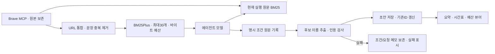

# 094 · 검색 결과를 추리고, 대화 뒤 계획서를 자동 정리한다

## 문제와 변경

검색 발췌·누적 주변 문서 목록이 크고, 모델이 계획 저장 도구를 쓰지 않으면 계획서가 비어 있었다. 검색 선별과 대화 후 자동 정리 단계를 구현했다. 기준 커밋 `1d15ad4`.

- 검색: 같은 URL 통합·출처 내 정확한 문장 중복 제거·한국어 단어/bigram BM25Plus 순위. 병렬 검색·주변 문서 합계 최대30개를 선택하고, 단일24KB·묶음30KB 예산 안에서 전달한다. 날짜·가격이 다른 문장은 남긴다. 의미 유사도 기반 병합은 도입하지 않았다.

- 문맥: 선별에서 빠진 현재 실행 원문도 매 추론 전에 메모리에 색인한다. 압축이 없더라도 다시 검색할 수 있다. 원본은 비공개 보존한다.

- 실패: 실패 상태를 유지하면서 설명 문구를 반환한다. 목록도 결과 상태를 보며, 작업 종료를 추천 성공으로 표시하지 않는다.

- 계획: 명시한 조건을 코드로 먼저 기록하고, Qwen이 장소·숙소 이름만 추출한다. 입력에 실제 있는 이름·인용인지 검사한다. 이미 있는 항목은ID로 갱신하고 자동 확정하지 않는다.

## 실패에서 바꾼 설계

첫 실제 시험은 Ollama가 꺼져 있어 연결 오류였다. 기존 앱을 실행해0.40.5 연결을 확인한 뒤 같은 질문으로 다시 시험했다. 복잡한 전체 계획 추출은 시간 초과와 잘못된 인용 때문에 실패했다. 모델이 과거25만원 문장을20만원으로 바꿔 원문처럼 인용한 것을 검증기가 거절했다.

이를 문구 수정만으로 해결하지 않고 단계를 줄였다. 명시적인 한국어 총예산·인원·기간·이동수단은 원문 패턴으로 먼저 저장하고, 모델은 후보 이름만 추출한다. 총예산은 지출 cost가 아닌 조건 note다. 지원하지 않는 문장 형식은 남는 한계다.

추출 실패 시 조건만 저장하거나 요청 메모를 보존하며, 후보 정리 실패를 화면에 표시한다. 요청 메모만 있는 상태를 일정 완성으로 취급하지 않는다. 메인330초·정리 최대30초로 전체360초를 공유한다. 별도 정리는 추가 모델 호출이며 토큰을 따로 기록한다.

## 같은 질문으로 실제 Qwen 확인

로컬 Qwen·웹검색 해제·빈 MCP로 합성 장소를 사용했다. 초기 복잡한 추출은 요청 메모만 남았고, 보완 후 아래 두 턴은 초안6개와 예산 정정을 저장했다. 메인 모델의 계획 도구 호출은 두 턴 모두0회다. 메인 답변 개선이나 실제 여행 품질 통과 실험은 아니다.

### 조건 입력

<callout icon="💬" color="blue_bg">
공개 합성 여행이야. 2026년 11월 14일부터 15일까지 성인 2명이 이천에서 자가용으로 갈 거야. 총예산은 25만원이고, 합성 정원 A 산책과 합성 숙소 B를 후보로 생각 중이야. 실제 장소를 검색하지 말고 지금 정한 조건만 간결하게 확인해줘.
</callout>

요청하신 조건에 따라 현재 계획 초안을 확인합니다.

**현재 여행 계획 (2026 년 11 월 14 일 ~ 15 일, 성인 2 명)**

*   **총 예산:** 25 만 원
*   **출발지:** 이천
*   **수단:** 자가용
*   **후보 1 (합성 정원 A):** 산책 여부 미확인
*   **후보 2 (합성 숙소 B):** 숙박 여부 미확인

현재 계획에는 구체적인 장소 이름이나 시설 조건이 포함되어 있지 않습니다. 사용자의 요청하신 '합성 정원 A'와 '합성 숙소 B'가 실제 존재하는 곳인지, 그리고 예산 내에서 가능한지 확인하기 위해서는 해당 장소의 정확한 위치와 요금 정보를 검색해야 합니다.

하지만 현재 웹 검색 기능이 비활성화되어 있어, 외부 정보 조회는 불가능합니다. 따라서 사용자의 요청하신 조건만으로는 구체적인 장소 선정이나 비용 산출이 어렵습니다.

추가로 필요한 정보는 다음과 같습니다:
1.  **'합성 정원 A'**와 **'합성 숙소 B'**가 실제로 존재하는 곳인지 확인 가능한지 (예: 정확한 주소나 운영 여부).
2.  해당 장소의 **정확한 위치**와 **요금**.
3.  **이천에서 자가용으로 이동할 경우 소요 시간과 예상 비용**.

현재 조건만으로는 구체적인 여행 계획을 세우기 어렵습니다. 추가 정보를 제공해 주시면 더 자세히 도와드릴 수 있습니다.

저장 결과: 총예산·인원·여행기간·이동수단과 장소/숙소 후보2개, 총6개 초안.

### 예산 정정

<callout icon="💬" color="blue_bg">
총예산만 20만원으로 바꿀게. 날짜와 인원, 이동수단은 그대로야. 조건만 간결하게 확인해줘.
</callout>

요청하신 예산 변경을 반영하여 현재 계획 초안을 확인합니다.

**변경된 여행 계획 (2026 년 11 월 14 일 ~ 15 일, 성인 2 명)**

*   **총 예산:** 20 만 원 (변경됨)
*   **출발지:** 이천
*   **수단:** 자가용
*   **후보 장소:** 합성 정원 A, 합성 숙소 B
*   **확인 상태:** 현재 계획에는 구체적인 장소의 요금 및 시설 정보가 포함되어 있지 않습니다.

**요약:**
예산이 25 만 원에서 20 만 원으로 변경되었습니다. '합성 정원 A'와 '합성 숙소 B'가 실제 존재하는 곳인지, 그리고 이 예산 내에서 가능한지 확인하기 위해서는 해당 장소의 정확한 위치와 요금 정보를 검색해야 합니다. 현재 웹 검색 기능이 비활성화되어 있어 외부 정보 조회는 불가능합니다.

추가로 필요한 정보는 다음과 같습니다:
1.  **'합성 정원 A'**와 **'합성 숙소 B'**가 실제로 존재하는 곳인지 확인 가능한지 (예: 정확한 주소나 운영 여부).
2.  해당 장소의 **정확한 위치**와 **요금**.
3.  **이천에서 자가용으로 이동할 경우 소요 시간과 예상 비용**.

현재 조건만으로는 구체적인 여행 계획을 세우기 어렵습니다. 추가 정보를 제공해 주시면 더 자세히 도와드릴 수 있습니다.

저장 결과: 총예산25만→20만원만 정정. 항목6개 유지·기존 인원/기간/교통 보존·중복 추가 없음.

메인 응답은 합성 장소라는 요청을 충분히 이해하지 못하고 불필요한 검색·추가 정보를 요구하는 문제가 남았다. 이번 성공은 자동 저장과 조건 정정의 기능 범위다. 상세 시간표·요금·실제 예약을 완성했다고 주장하지 않는다.

## 저장 검색 결과 재포장

과거 저장된 첫 검색3개를 같은 원문으로 다시 포장했다. 재정렬용 질의는 “춘천 박물관 케이블카 숙소 예산”이며 기존 개별 검색어도 결합했다. 원래 질문을 그대로 쓴 에이전트 품질 전후 평가가 아니다. 새 검색·새 여행 답변 생성은 없었다.

| 항목 | 관찰 |
|---|---|
| 기존 전달량 | 85,090바이트 |
| 최종 전달량 | 29,062바이트 |
| 순위 후보 | 검색·주변 문서39개 중30개 선택 |
| 실제 패킷 | 검색 결과21개, 주변 문서0개 |
| 문장 중복 제거 | 33회 |

바이트 상한으로 선택된30개가 전부 전달된 것은 아니다. 주변 문서는 이번 패킷에서 빠졌으며 생략 개수를 표시한다. 이는 토큰 수나 품질 개선 수치가 아니라 동일 저장 자료의 전달 바이트 비교다. BM25 점수는 의미 유사도·사실성 확률이 아니다. 어휘가 다르다는 이유만으로 주변 링크를 숨기면 유효한 영어 페이지도 사라져, 어휘 불일치만으로 강제 삭제하지 않기로 했다.

## 구조



## 검증과 한계

Python304개·UI JS6종·기존 연구 JS8개 통과. 정확한 중복/가격 차이 보존·30개 제한·동일URL 발췌 병합·후보 인용 거부·자동 조건 저장·정정·실패 상태·압축 없는 현재 원문 검색을 확인했다. 실모델 시험은 임시 RunManager에서 수행하고 비민감 결과만 비공개 작업 폴더에 보존한 뒤 임시 실행을 정리했다. 사용자 웹 대화는 생성·삭제·수정하지 않았다. 원래MCP와 고정50733으로 재시작했다.

모델의 조기 종료·추정 가격·근거 혼합을 일반적으로 해결했다고 주장하지 않는다. 기존079의 실제 여행 근거 품질0/2는 유지한다. 새로운 외부 검색·예약·키 발급·추가 모델 다운로드는 없다.

<details>
<summary>실제 코드 · 문장 중복과 순위</summary>

`src/travel_agent/search_selection.py`의 `select`. 문장을 통째로 비교하므로 금액·날짜가 다르면 다른 문장으로 남는다. 원래 검색 자료는 변경하지 않는다.

```python
def select(hits,query,limit=30):
    """BM25 lexical ranking, stable engine order when query has no overlap."""
    hits=deepcopy(hits);duplicates=0
    for hit in hits:
        texts,n=unique_texts([hit.get('snippet',''),*hit.get('extra_snippets',[])])
        duplicates+=n;hit['snippet']=texts[0] if texts else '';hit['extra_snippets']=texts[1:]
    corpus=[tokens(h.get('title','')+' '+h.get('snippet','')+' '+' '.join(h.get('extra_snippets',[]))) or ['__empty__'] for h in hits]
    q=tokens(query);overlap=bool(q and any(set(q)&set(t) for t in corpus))
    scores=BM25Plus(corpus).get_scores(q) if hits and overlap else [0]*len(hits)
    # Zero lexical overlap is not proof of irrelevance (e.g. linked English page).
    eligible=list(range(len(hits)))
    order=sorted(eligible,key=lambda i:(-float(scores[i]),i))
    selected=[hits[i] for i in order[:limit]]
    for hit,i in zip(selected,order):hit['relevance_score']=round(float(scores[i]),6)
    return selected,{'ranking':'bm25plus' if overlap else 'engine_order_no_lexical_overlap',
                     'exact_sentences_removed':duplicates,'result_limit':limit,
                     'rank_omitted':len(hits)-len(selected),
                     'zero_overlap_candidates':sum(not bool(set(q)&set(t)) for t in corpus)}

```

계획 연결은 `src/travel_agent/web_app.py`의 `sync_plan`, 조건/후보 처리는 `src/travel_agent/plan_sync.py`다. 웹은 메인 응답 뒤 이 단계를 호출하며, 모델이 plan_add를 요청했는지와 독립적으로 실행한다.
</details>

<details>
<summary>실제 모델 호출과 저장 로그</summary>

메인 에이전트 호출은 턴당1회·툴콜0회. 후처리 후보 추출은 턴당1회이며, 아래는 그 모델이 제안한 record_trip_draft 인자다. 이 함수는 메인 에이전트가 임의로 실행한 검색 도구가 아니라 후처리기의 검증된 저장 입력이다. 외부 도구 실행은0회다.


### 1턴

```json
{
  "proposed_calls": [
    {
      "function": {
        "arguments": {
          "items": [
            {
              "kind": "activity",
              "quote": "합성 정원 A",
              "source": "user",
              "title": "합성 정원 A"
            },
            {
              "kind": "lodging",
              "quote": "합성 숙소 B",
              "source": "user",
              "title": "합성 숙소 B"
            }
          ]
        },
        "index": 0,
        "name": "record_trip_draft"
      },
      "id": "call_i63kh1gb"
    }
  ],
  "host_result": {
    "status": "saved",
    "item_count": 2,
    "condition_count": 4,
    "model_calls": 1,
    "prompt_tokens": 1296,
    "output_tokens": 90
  }
}
```


### 2턴

```json
{
  "proposed_calls": [
    {
      "function": {
        "arguments": {
          "items": [
            {
              "kind": "activity",
              "quote": "합성 정원 A",
              "source": "user",
              "title": "합성 정원 A"
            },
            {
              "kind": "lodging",
              "quote": "합성 숙소 B",
              "source": "user",
              "title": "합성 숙소 B"
            }
          ]
        },
        "index": 0,
        "name": "record_trip_draft"
      },
      "id": "call_9r780zxh"
    }
  ],
  "host_result": {
    "status": "saved",
    "item_count": 2,
    "condition_count": 1,
    "model_calls": 1,
    "prompt_tokens": 1462,
    "output_tokens": 90
  }
}
```


새 검색이 없는 재포장 시험은 과거 검색 호출 ID·인자·원문을 비공개 보존하고 재포장 통계만 공개한다. 실행하지 않은 검색 로그를 추가하지 않는다.
</details>
