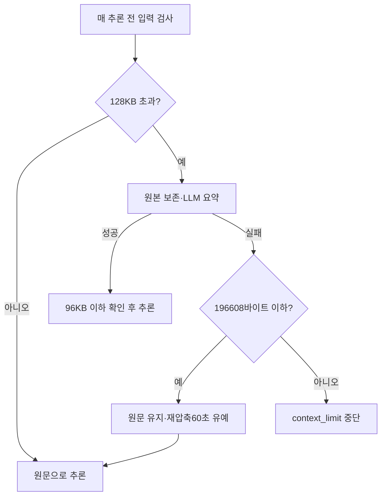

# 096 · 압축을 늦추고 요약 실패를 실행 실패와 분리한다

Notion: https://app.notion.com/p/403d058c022e8195aa6efd15ac4d5009

## 문제

실제 사용자 실행은 입력67344바이트에서 압축을 시도하다 TimeoutError로 중단했다. 당시 기준은64000바이트였으며 모델의65536토큰 창을 소진한 상황인지는 확인되지 않았다. 요약 실패를 곧바로 context_limit으로 처리하는 정책 때문에 충분히 읽을 수 있는 입력까지 중단될 수 있었다. 사용자 원문과 대화 전체는 공개하지 않고 비공개 체크포인트로 재현했다.

## 변경

| 항목 | 이전 | 현재 |
|---|---|---|
| 압축 시작 | 64000바이트 | 128000바이트 |
| 압축 후 목표 | 64000바이트 | 96000바이트 |
| 요약 호출 대기 | 최대60초 | 최대180초, 남은 실행 시간 이내 |
| 요약 출력 | 일반 응답4096 공유 | 요약만2048토큰, 일반 응답4096 유지 |
| 압축 실패 | 즉시 중단 | 하드 상한 이하면 원문으로 계속,60초 재압축 유예 |
| 하드 상한 초과 | 중단 | 압축 재시도, 실패하면 중단 |

모델 문맥65536토큰·입력 하드 상한196608바이트·전체 실행360초는 유지한다. 바이트 기준은 정확한 토큰 계산이 아니다. 압축을 덜 자주 하도록 시작점과 목표를 분리했으며 단순히 메모리·토큰 창을 무제한 늘리지 않았다. 사용자 원문·시스템 지침 보존과 원본 검색은 유지한다. 응답을 받지 못한 요약 호출의 토큰은0으로 확정하지 않고 수집 불완전으로 표시한다.

## 동일 실패 입력으로 검증

새 외부 검색이나 숙소 조회 없이, 실패 직전의 messages와 tools를 동일하게 재생했다. 기존 사용자 세션은 수정하지 않았다. 모델이 제안한 도구는 실행하지 않았다.

| 실제 로컬 실행 | 입력과 결과 | 범위 |
|---|---|---|
| 새 운영 기본값 |67344바이트 유지·요약0회·다음 입력20989토큰·출력277토큰·stop·도구제안1 | 불필요한 압축 없이 다음 추론 성공 |
| 강제 압축 진단 | 시작64000/목표48000을 명시해67344→38077바이트·요약1회·다음 입력10472토큰·출력209토큰·stop·도구제안1 | 실제 요약과 다음 추론 모두 성공 |

기본값 재생은13.209초, 강제 압축과 다음 호출은 합계26.946초였다. 강제 진단은 운영128KB 시작점을 시험한 것으로 쓰지 않는다. 실제 요약은 입력16832·출력1390토큰을 사용했다. 캐시·장치 상태가 다른 실행이므로 시간 차이를 설정 변경만의 효과로 단정하지 않는다.

기본값에서는 아직 같은 숙소 검색을 제안했고 강제 압축 후에는 다시 잘못된 지역명 Spring City를 제안했다. 원래 숙소10곳 비교는 완료되지 않았다. 문맥 처리 성공과 조사 품질 개선을 구분한다.

<details>
<summary>모델 호출 기록 · 실제 도구 실행은 없음</summary>

1. 운영 기본값: 압축 호출0, Ollama /api/chat 1회. 입력20989·출력277토큰, done_reason=stop, 제안 call_0andbmu0의 도구는 mcp_openbnb_airbnb_search. location=Chuncheon, South Korea. 사용자 여행 날짜는 비공개로 보존했다. 실제 MCP 실행0.
2. 강제 진단: 요약 /api/chat 1회(도구목록 없음·출력예산2048), 입력16832·출력1390토큰. 그 다음 추론1회, 입력10472·출력209토큰, done_reason=stop. 제안 call_3r7e48uh의 도구는 mcp_openbnb_airbnb_search, location=Spring City, South Korea. 실제 MCP 실행0.

전체 요청·응답은 비공개 실험 폴더에 보존했다. 이 기록은 모델의 도구 제안을 실제 도구 성공으로 바꾸지 않는다.
</details>

## 계약·회귀 검사

Python311개·UI JS6종·과거 연구 JS8종을 통과했다. 기본128KB 시작점, 실제 큰 단일 턴 압축, 요약 TimeoutError 후 다음 에이전트 추론,60초 재압축 유예, 하드 상한 초과 시 유예 무시·안전 중단, 원문 불변·고아 tool 메시지 방지, 요약 전용 출력 예산을 검사했다.

첫 전체 실행의310검사에서는 과거4000바이트 목표만 지정한 메모리 테스트가 실패했다. 새 정책은 시작점을 따로 가지므로 해당 요약 손실 테스트에 시작4000도 명시했고, 기능 의도와 기존 원문 검색 검증을 유지했다. 수정 후311개 전체를 다시 실행했다. 네트워크 모의 응답 객체를 두 번 재사용한 테스트 작성 오류도 새 응답 객체를 각각 주도록 수정했다.

## 실제 구현

기준1c77ea3, src/travel_agent/runtime_context.py의 prepare. 압축 실패 시 원본을 유지하고 하드 상한 안에서만 유예한다.

```python
if before<=max_bytes:
    info.update(compression_deferred=True,deferred_reason='summary_failed')
    save(state_file.name,{'retry_after':time.time()+60,'error_type':type(exc).__name__})
else:info['warning']='summary_failed'
```



scripts/replay_context_checkpoint.py는 비공개 체크포인트와 출력 폴더를 명시해 실행한다. --force-compaction은 이전 실패 입력의 요약 경로 진단용이다. 사용자 기록에 새 턴을 만들거나 모델이 제안한 도구를 실행하지 않는다.

## 적용과 한계

고정50733에서 서버를 재시작해 적용했다. 이번 작업의 외부 검색·새 모델 다운로드·사용자 대화 변경은0이다. 반복 검색·지역명·후보 비교와 계획서 완성은 별도 미해결이며 이전 추천 품질0/2를 바꾸지 않는다. 요약 시간 초과 가능성을 없앤 것이 아니라 더 늦게 요약하고 허용 범위에서 실패를 견디도록 바꿨다.
