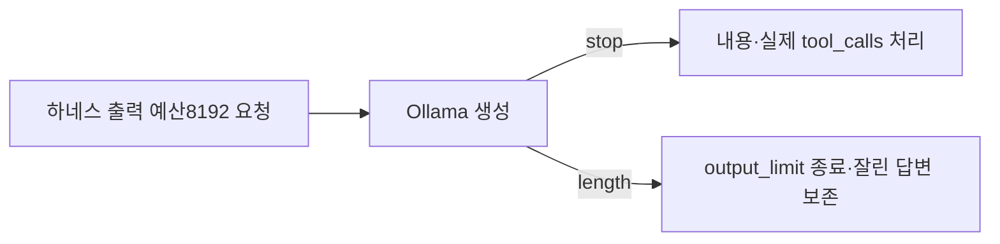

# 097 · 반복 출력 원인 확인과 일반 출력 한도 확대

Notion: https://app.notion.com/p/403d058c022e81a7b336fb327531ec37

## 문제와 실제 기록

최근 비공개 여행 실행은 두 번째 모델 응답에서 output_limit으로 끝났다. 첫 응답174토큰, 둘째4096토큰으로 전체 출력 합계는4270이었다. 둘째 응답은 '결론 → 실행' 설명을30번 항목까지 반복했으며 실제 tool_calls는0이었다. 도구 이름을 본문에 적는 것은 도구 호출이 아니다. 사용자 대화 전체와 원본 응답은 공개하지 않는다.

Ollama가 done_reason=length를 반환하자 agent.run_agent가 output_limit으로 종료했다. 모델이 스스로 완료를 선택한 stop이 아니다. 하네스가 반복 문장을 감지해서 끊은 것도 아니다. 하네스가 요청한 num_predict=4096 예산을 공급자가 적용하고, 하네스는 잘린 응답을 완성 답변으로 다루지 않았다. 앞선 압축은138307→33099바이트로 성공했으므로 이번 종료를 압축 실패로 설명하지 않는다.

## 변경

일반 모델 호출의 기본 출력 예산을4096→8192토큰으로 확대했다. 모델 문맥65536토큰, 압축 시작128KB·목표96KB, 요약 전용2048토큰은 유지한다. AGENT_MAX_OUTPUT_TOKENS를 명시하면 그 값이 우선한다. 출력 예산 확대만으로 모델의 반복이나 올바른 도구 선택을 해결했다고 주장하지 않는다. 긴 응답은 실행 시간과 이후 입력량도 더 사용할 수 있다.

## 코드

src/travel_agent/llm_config.py · generation_options. 명시 설정 검증은 기존128~8192 범위를 유지한다.

```python
"num_predict": _integer("AGENT_MAX_OUTPUT_TOKENS", 8192, 128, 8192)
```



## 검증 범위

첫 전체 검사에서 이전4096을 기대하던 공급자 테스트2개가 실패했다. 새8192 기본값을 기대하도록 수정한 뒤 전체 Python311·UI JS6종·과거 연구 JS8종을 다시 검사했다. HTTP 요청의 기본8192, 명시1536 설정 우선, 요약2048만 적용 후 다음 일반 호출8192로 복귀, 공급자 length 응답의 output_limit 처리를 포함한다. 로컬50733으로 재시작해 적용했다.

이번에는 새 실제 여행 모델 응답이나 외부 도구를 실행하지 않았다. 따라서8192에서 반복이 멈췄는지와 여행 과제 완료 여부는 미검증이다. 원래 실행의 출력 반복은 증상이며 모델 가중치·요약 내용·프롬프트 중 어느 요소가 주원인인지는 분리하지 못했다.

<details>
<summary>기존 호출 관측 · 새 도구 실행 없음</summary>

기존 첫 호출: 출력174토큰·도구제안1. 둘째 호출: 출력4096토큰·도구제안0·done_reason=length. 둘째 모델 본문에는 결론/실행의 반복이 있지만 실제 MCP 호출은 없었다. 검증의 모의 HTTP와 기존 기록 분석을 새 실제 모델 호출이나 검색으로 표시하지 않는다.
</details>
