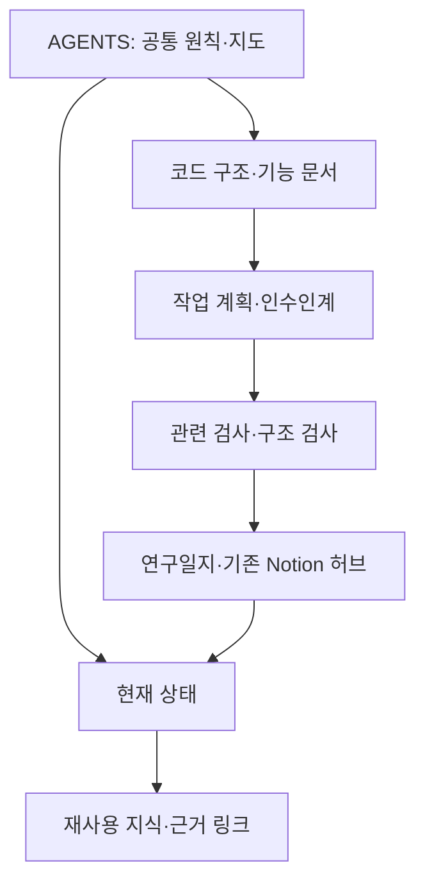

# 099 · 개발 지침을 짧은 지도와 근거 있는 지식노트로 바꾼다

Notion: https://app.notion.com/p/404d058c022e8136a710e968942e05eb

## 개발 요청과 완료 기준

사용자는 이 워크스페이스에 카파시의 4원칙, 최근 하네스 엔지니어링의 폴더 관리 규칙, 지식노트를 조사해 적용하도록 요청했다. 개발 환경·정책 변경으로 다뤘고 여행 모델에 가상의 질문·답변을 만들지 않았다.

성공 기준은 원출처 확인, 기존 지침 보존, 짧은 자동 탐색 진입점, 현재 소스와 연결된 구조 지도·상태·지식노트, 폴더·계획 규칙, 실행 가능한 구조 검사, 기존 검사 통과와 Notion 기록이다. 이번 변경으로 추천 품질·속도·비용이 좋아졌다는 주장은 하지 않는다.

## 문제와 조사

기존 루트 지침은 UTF-8 49,157바이트·160줄이었다. 현재 결정 앞뒤에 과거 검색 공급자·포트·출력 한도가 누적돼 있었다. 공식 AGENTS 문서의 기본 합산 한도는32KiB다. 실제 이 세션에서 어떤 부분이 누락됐다는 측정은 하지 않았지만, 기존 크기는 기본 한도보다 컸다.

“카파시 4원칙”으로 알려진 자료의 원본 저장소는 스스로 Karpathy-inspired라고 설명한다. 카파시 본인의 공식 AGENTS 문서로 소개하지 않고, 구현 전 확인·단순함·필요한 변경·검증까지 실행하는 원칙을 이 프로젝트에 맞게 정리했다. 매번 사용자에게 질문하거나 기존 RAG 학습 목표를 생략하도록 해석하지 않았다.

OpenAI의 하네스 글과 개발 워크플로 자료, Anthropic의 장기 작업 하네스 글을 확인했다. 단일 최신 폴더 표준을 찾았다고 주장하지 않는다. 짧은 진입점, 저장소 안의 근거, 세션 간 진행 보존, 작은 변경, 명시적 검증을 기존 Python 구조에 적용했다.

## 적용 결과

루트 지침은 4원칙·필수 경계·문서 지도·검증/Git 규칙을 담는다. 예전 지침 전체는 보존 자료로 분리했고 연구 기록 정책의 본문도 그대로 별도 문서로 옮겼다. 새 실행 이력을 루트에 붙이지 않고 현재 상태를 갱신하도록 했다.

지식노트는 현재 설정·실제 평가 한계·반복되는 근거 판단을 담는다. 원문·요약을 분리하는 제품 메모리와 개발용 노트를 구분했다. 현재 값은 제품 소스와 기존 연구 기록으로 연결한다. README의 일반 출력4096은097의8192로 바로잡았다.

폴더 규칙은 제품·검사·스크립트·기능 문서·노트·설계 결정·계획·연구·개인 실행 자료의 위치를 정한다. 기존 코드·사용자 작업 파일은 재배치하지 않았다. 여러 세션 작업은 진행·검사·다음 행동을 남기고 완료 계획은 별도 위치에 보존한다.



## 검증 결과와 한계

루트 지침은83줄·6,496바이트다. 기존 지침 전체와 연구 정책의 본문 보존을 비교해 확인했다. 구조 검사와 끊어진 링크·크기 초과·노트 메타데이터/인덱스 누락·Git에 추적된 비공개 경로의 실패 검사를 통과했다. 임시 합성 검사 저장소는 정리했다.

전체 로컬 검사는 Python311개·UI JavaScript6종·과거 연구용 JavaScript8개를 통과했다(Node24.22.1). 이는 개발 계약 검사이며 새 여행 추천·브라우저 시연·일반 품질 향상을 뜻하지 않는다. 기존 Notion 허브 아래에099를 만들고 요청 콜아웃·흐름도·실제 검사 코드·검사 결과·기본 접힌 상세/조회 로그2개를 재조회했다. Git 반영은 이번 작업 파일만 대상으로 수행한다.

적용 커밋 `c985eba`를 기존 `origin/main`에 푸시했다. 연구 인덱스는099 항목만 포함하고 기존 사용자 수정·미추적 논문·산출물·임시 파일은 보존했다.

제품 로직·여행 SYSTEM·모델 설정·기존 개인 대화·실행 서버는 변경하지 않았다. 이번 여행 모델 호출과 여행 도구 실행은0회다. 자료 조사를 위한 공개 웹 조회와 Notion 기록은 별개다. 일반 여행 근거0/2와 반복 응답 문제는 해결로 표시하지 않는다. 새 의존성·서비스·상주 자동화·모델 다운로드는 추가하지 않았다.

<details>
<summary>적용 문서와 검사 상세</summary>

- 기준 제품 커밋: `cc6c513`. 추가 검사 `scripts/verify_workspace.py`의 `check(root)`와 적용 문서의 기준 커밋: `c985eba`.
- 루트: `AGENTS.md`, `ARCHITECTURE.md`, `README.md`.
- 탐색·운영: `docs/README.md`, `docs/agent-workflow.md`, `docs/plans/README.md`.
- 지식: `docs/knowledge/README.md`, `current-state.md`, `evidence-and-evaluation.md`, `research-policy.md`.
- 이전 지침: `docs/knowledge/history/2026-10-25-agents-before-harness.md`.
- 검사: `scripts/verify_workspace.py`의 `check(root)`. 입력은 저장소 경로, 출력은 오류 목록이며 CLI는 오류가 있으면1로 종료한다. `scripts/verify_local.ps1`이 먼저 호출한다.
- 자동 검사 범위는 새 지도·노트·계획의 인라인 로컬 링크, 루트 크기, 노트 메타데이터/색인, Git 추적 경로다. 앵커·외부 링크 상태·기존 연구일지 전체·의미적 사실성은 검사하지 않는다. 로컬 실행에 연결했으며 CI는 추가하지 않았다.

실제 검사 소스 발췌:

```python
if len(raw) > 12000 or len(raw.splitlines()) > 120:
    errors.append("AGENTS.md: keep within 120 lines / 12000 bytes; move history to docs")
```

이 프로젝트 자체의 작은 진입점 예산을 검사한다. 공급자의32KiB 상한과는 별개다. 링크 검사는 탐색 경로가 끊기는 문제를 찾고, 개인정보 경로 검사는 Git 인덱스에 잘못 들어간 기본 경로를 찾는다. 모든 민감정보를 탐지하는 보안 스캐너는 아니다.

</details>

<details>
<summary>공개 자료 조회와 도구 사용 기록</summary>

원본 조사는 이 개발 세션의 웹 검색·페이지 열기와 로컬 파일 읽기로 수행했다. 공개 자료의 제목·발행일·내용과 실제 소스를 대조했다. 여행 모델에 다음 입력으로 전달한 도구 결과는 없다. 도구 호출 식별자가 외부에 제공되지 않은 항목은 임의 생성하지 않는다. 원문 조회의 재확인 기록은 검증 후 아래에 덧붙인다.

재확인 순서1 · 도구 `web.run` · 호출 ID: 인터페이스에서 미노출.
시작 2026-10-25T13:01:44.145Z · 종료 2026-10-25T13:01:46.578Z (UTC, 한국 시각22:01:44~22:01:46).
실제 인자는 다음과 같다. 별도 검색어 없이 여섯 원출처를 open으로 재조회했다.

```json
{
  "open": [
    {
      "ref_id": "https://raw.githubusercontent.com/multica-ai/andrej-karpathy-skills/main/CLAUDE.md"
    },
    {
      "ref_id": "https://learn.chatgpt.com/docs/agent-configuration/agents-md"
    },
    {
      "ref_id": "https://openai.com/index/harness-engineering/"
    },
    {
      "ref_id": "https://developers.openai.com/cookbook/examples/codex/iterating-development-workflows-with-codex"
    },
    {
      "ref_id": "https://www.anthropic.com/engineering/effective-harnesses-for-long-running-agents"
    },
    {
      "ref_id": "https://www.anthropic.com/research/harness-design-long-running-apps"
    }
  ],
  "response_length": "short"
}
```

결과: 4원칙59줄, AGENTS 문서1085줄, OpenAI 하네스417줄, 개발 워크플로2167줄, Anthropic 장기 작업198줄, 앱 하네스360줄의 페이지 추출을 반환했다. Anthropic 장기 작업은 /engineering/에서 /research/로 리디렉션됐다. 이 도구 출력에는 원사이트 HTTP 상태가 없으므로 HTTP200으로 표시하지 않는다. 다음 여행 모델에 전달한 결과는 없으며, 개발 에이전트가 문서 작성의 근거로 읽었다. 원응답은 비공개로 보존했다. 이 기록은 마지막 원출처 재확인의 실제 호출이며 초기 탐색 전체를 대체하는 재구성 로그가 아니다.


</details>

## 자료

- [Karpathy-inspired 원본과4원칙](https://github.com/multica-ai/andrej-karpathy-skills)
- [OpenAI AGENTS.md](https://learn.chatgpt.com/docs/agent-configuration/agents-md)
- [OpenAI Harness engineering](https://openai.com/index/harness-engineering/)
- [OpenAI 개발 워크플로](https://developers.openai.com/cookbook/examples/codex/iterating-development-workflows-with-codex)
- [Anthropic 장기 작업 하네스](https://www.anthropic.com/engineering/effective-harnesses-for-long-running-agents)
- [Anthropic 장기 앱 하네스 설계](https://www.anthropic.com/research/harness-design-long-running-apps)
