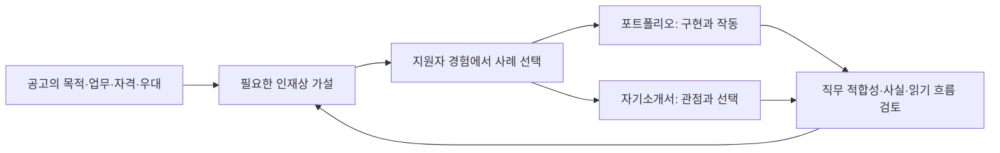

# 100 · 토스 두 공고를 서류의 요구사항으로 해체한다

Notion: https://app.notion.com/p/404d058c022e81a684f9fb93f1580554

## 개발 요청

두 AI Engineer 공고 각각에 맞는 포트폴리오와 자기소개서를 준비하기 위해, 먼저 공고를 분석하고 원하는 인재상을 지식으로 남기는 작업이다. 기록·숫자가 풍부한 자료와 서류심사에 유리한 글을 동일하게 보지 않는다는 편집 기준을 반영했다.

현재 범위는 공고 해체·인재상·사례 선택·후속 서류 작성 기준이다. 포트폴리오·자기소개서 완성본을 만들거나 기존 발표 본문을 수정한 작업은 아니다.

## 문제와 분석 방식

기존 포트폴리오는 구현한 기능과 기술·검증 범위를 설명한다. 이번에는 독자가 그 기능을 읽고 어떤 직무를 맡길 수 있다고 판단할지에서 출발한다. 수치는 필요한 주장을 뒷받침하는 자리에 두고, 실험 총량과 실패 기록을 서류의 주인공으로 만들지 않는다.

사용자가 제공한 두 공고 전문을 출처로 고정했다. 팀의 목적, 업무, 자격, 우대, 이력서 안내를 구분하고 각각 명시된 요구와 서류 전략에 대한 해석을 분리했다. 다른 공고·일반 취업 팁을 내부 심사 기준처럼 섞지 않았다. 채용 이벤트의 현재 유효성은 판단하지 않았다.

## 정리한 인재상과 활용 방향

| 구분 | 공고에서 읽은 중심 인재상 | 여행 프로젝트를 설명할 시작점 |
| --- | --- | --- |
| 토스 | 고객 문제를 문맥·행동·도구·평가 설계로 옮기고, 실제 문제 해결로 이어지는 에이전트를 개선하는 사람 | 여행 조건이 바뀌어도 맥락을 이어가며 조사와 계획서로 연결하는 사용자 흐름 |
| 토스증권 WM | 에이전트의 실행·데이터·메모리·품질을 관찰하고 관리하면서 신뢰할 수 있는 서비스로 운영하는 사람 | 요청부터 도구·문맥·저장·실패·사용자 확정까지 관리하는 제품 구조 |

차이는 강조점이며 서로 배타적인 직무 분류가 아니다. 공고1의 프로덕션·평가 요구와 공고2의 고객 경험·문제 해결 요구를 함께 보존했다. 음성 경험의 예외, 운영 경험의 자격요건 위치, 금융 경험의 우대 여부를 따로 설명했다.

포트폴리오는 실제 구현과 작동, 자기소개서는 문제를 보는 관점·선택·주도성을 설명하도록 역할을 나눴다. 같은 여행 프로젝트라도 사례 순서와 중심 주장이 달라야 한다. 로컬 운영을 대규모 서비스 경력으로, 병렬 도구 호출을 멀티 에이전트로, 사용자 확정을 금융 컴플라이언스로 바꾸지 않는다.

## 후속 작성 기준

공고의 문구에 답하는 경험을 고르고, 무엇을 직접 판단하고 설계했는지 드러낸다. 기술 이름은 그 선택의 이유를 설명하는 데 사용한다. 기존 여섯 파트·이미지/코드 개수는 이전 발표 본문의 형식이며 두 지원 서류의 고정 양식으로 삼지 않는다.

합격 답안·배점은 알려져 있지 않다. 분석한 인재상은 공고에 근거한 가설로 유지하고, 작성 에이전트의 자기 평가로 최종본을 확정하지 않는다. 다른 개인 경력·협업·금융 관심·실제 자기소개서 문항이 필요해지면 확인한다. 아직 모르는 개인 이력을 채우지 않았다.

## 검토 범위

요구사항과 원문 소제목의 연결, 두 공고의 공통점/차이, 명시/해석 구분, 실제 프로젝트와 미보유 경험의 경계, 수치 사용 기준을 문서로 확인했다. 로컬 링크·노트 인덱스·메타데이터 검사를 통과했다. 기존 Notion 허브 아래에 두 공고 분석과 공통 작성 기준을 기록하고 요청 콜아웃·요구사항 표·인재상·프로젝트 사례·미확정 사항을 재조회했다. 이 검사는 서류의 설득력이나 채용 결과를 판정하지 않는다.

새 제품 코드·모델·검색·추천 실험은 없다. 이번 분석은 제공된 공고와 기존 공개 프로젝트 문서를 읽어 작성했다. 실험용 모델/도구 호출 로그가 없어 별도 실험 로그를 만들지 않았다. 파일 읽기·편집과 Notion 기록은 문서 작업이다.

지식노트와 적용 문서

- 기준 프로젝트 문서: `e7361ac`의 공개 포트폴리오·구조 지도·현재 상태.
- `docs/knowledge/toss-hiring-brief.md`: 두 공고 비교, 서류 목적, 수치·기술·한계의 배치 원칙, 초안 검토 질문.
- `docs/knowledge/toss-ai-engineer.md`: 공고1의 요구 단위, 인재상, 여행 프로젝트 사례 선택, 두 서류의 역할.
- `docs/knowledge/toss-securities-ai-engineer.md`: 공고2의 요구 단위, 인재상, 구조·운영·신뢰 사례 선택, 경험의 간극.
- 지식노트 인덱스·문서 지도·현재 상태에서 위 노트를 찾도록 연결했다.

코드 변경이 없는 분석·편집 정책 작업이므로 의사 코드나 실행하지 않은 답변 예시를 구현 결과처럼 넣지 않았다. 개인 이력·지원서 원문은 공개 지식노트의 범위에 포함하지 않는다.

