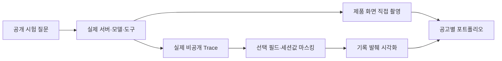

# 107 · 서버에서 직접 촬영한 검색·메모리·Context 추적

Notion: https://app.notion.com/p/404d058c022e8123ab94fe9ed8c15209

## 요청과 실제 실행

사용자가 직접 서버를 열어 두었으며 필요한 사진을 에이전트가 만들어보도록 요청했다. Computer Use로 고정50733의 실제 제품 화면을 열고 공개 시험 대화를 새로 만들었다. 기존 대화는 읽기·촬영 대상으로 사용하지 않았다.

<callout icon="💬">
	공개 캡처용 시험입니다. 웹 검색 도구를 한 번 사용해 국립춘천박물관 공식 홈페이지를 찾고, 공식 링크 한 개만 한 문장으로 알려줘. 본문 추가 조회나 여행 추천은 하지 마.
</callout>

국립춘천박물관 공식 홈페이지는 **https://chuncheon.museum.go.kr**입니다.

같은 대화에서 원문 검색을 확인했다.

<callout icon="💬">
	공개 캡처용 후속 시험입니다. memory_search 도구를 사용해 이전 사용자 요청에서 본문 추가 조회에 대해 무엇이라고 했는지 찾아줘. 검색된 사용자 원문 한 문장만 인용하고 웹 검색은 하지 마.
</callout>

과거 사용자 요청에서 본문을 추가 조회에 대해 언급한 문장은 다음과 같습니다.

**"본문 추가 조회나 여행 추천은 하지 마."**

## 촬영과 연결

실제 제품의 검색 인자·호출 ID·반환 결과, memory_search와 사용자 원문, 매 모델 호출 전 Context 검사를 촬영했다. UI가 모델 입력을 노출하지 않으므로 원본 Trace에서 다음 model_start의 실제 messages를 확인해 별도 시각 자료를 만들었다. 원문 검색 결과와 실제 모델 입력의 근거 ID·내용·tool_call_id가 같은지 대조했다.

보조 열람 HTML은 앱 내 브라우저의 로컬 파일 보안 정책에 차단됐다. 다른 브라우저나HTTP서버로 우회하지 않았다. HTML 실행이 필요 없는 실제 기록의 정적 시각화를 선택했다. 이는 제품 화면이나 새로 구현한 제품 관측 기능으로 표시하지 않는다.

각 포트폴리오의 호출·메모리·데이터 전달 자리를 실제 이미지로 교체했다. 함수 디버거 스택이나 압축 전후를 찍은 것처럼 표현하지 않는다. 이번 두 호출의 Context는 압축 기준 아래였으며 요약 호출은 없었다. 개발 협업의 과거 원본 화면·동일 질문 평가 검토·재시작 복원은 이번 캡처로 대체하지 않았다.

## 실제 범위와 정리

메인 모델은 각 턴2회, 도구는 검색1회와 메모리1회다. 계획 자동 정리의 추가 모델 호출은 각1회로 별도다. 첫 검색에는 자동 주변 문서 수집9건이 붙었고 메모리 턴의 새 외부 검색은 없었다. 완료·인용 표시와 여행 추천 품질 평가는 구분하며 기존 추천 근거 판정을 갱신하지 않았다.

촬영 후 만든 루트와 후속 턴의 원본을 비공개로 보존했다. 해당 루트에 다른 후속 대화가 없는지 확인하고 API로 만든2턴만 삭제했다. 각 실행API404와 기존 대화 기록의 내용 무변경을 확인했다. 웹 검색 체크와 새 대화 화면을 복원했고 서버·공급자·기존 대화는 유지했다.

<details>
<summary>실제 도구 요청·반환·다음 모델 입력 연결</summary>

- 검색: 실제 `mcp_brave_brave_web_search`, `call_ypvkvx2w`, 검색어 `국립춘천박물관 공식 홈페이지`, countryKR/search_langko/ui_langko-KR/count10. 요청8→반환10→다음 모델 입력15에 연결됐다.
- 메모리: 실제 `memory_search`, `call_e5wxfgey`, query `본문 추가 조회`, top_k3. 반환의 사용자 원문 근거 `m-36411ed5ae31991efdb5`가 같은 도구 ID의 다음 model_start tool 메시지에 포함됐다.
- 실제 시각·인자·결과 발췌·입력 역할은 [공개 발췌](107-capture-evidence.json)에 연결했다. 원문 전체는 비공개 보존한다. URL의 세션 식별자는 공개 발췌와 설명도에서 마스킹했다. 숨은 사고 과정은 공개하지 않는다.
- 모델 요청, 실제 도구 반환, 다음 입력의 선별된 자료는 서로 다른 단계로 기록한다. 검색 원시 첫 항목과 선별 첫 항목은 같은 URL이라고 단정하지 않으며 같은 호출의 자료로 표시한다.

</details>

<details>
<summary>구현·자료 생성과 검증</summary>

- 제품 기준 `a63f3cd`: `agent.run_agent`의 model_start와 tool_message_prepared, `visible_event`, `static/app.js`의 실행 과정 화면.
- 실제 화면은 CUA의 `travelTab.screenshot` 결과를 그대로 저장했다. 공개 입력의 화면만 촬영했고 기존 사용자 대화는 제외했다.
- `scripts/export_portfolio_capture_records.py`의 `load_run/build`: 명시한 공개 시험 실행에서 선택 필드만 발췌하고 URL 세션 식별자를 마스킹한다. 개인 대화로 보이는 입력은 내보내기를 거절한다.
- `scripts/render_portfolio_trace_records.py`의 `render`: 실제 필드·순서·ID·메시지를 읽어 정적 자료로 그린다. 이미지 편집으로 기존 화면을 바꾼 것이 아니다. 제품 화면과 로그 발췌 자료를 캡션으로 구분한다.
- 발췌·시각화 코드 기준 커밋은 `7a2f73a`다. `render`의 실제 연결 확인 부분은 다음과 같다. 도구 결과와 다음 입력을 다른 호출에서 가져오지 않도록 확인한다.

```python
tool_message = next(m for m in reversed(request['messages']) if m['role'] == 'tool')
assert tool_message['tool_call_id'] == mt['call_id']
hit = tool_message['hits'][0]
```

- 같은 tool_call_id·근거 ID·본문의 전달 대조, 개인 대화 내보내기 거부, URL 마스킹, 도형 영역의 텍스트 넘침 검사를 확인했다. 생성 이미지도 열어 육안으로 확인했다. 초기 venv의Pillow부재는 번들Python을 사용해 해결했다.



</details>
