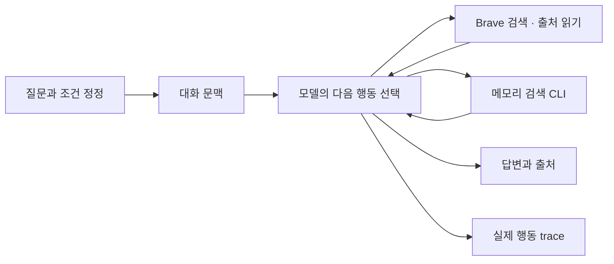

# 여행 에이전트 · 문제에서 검증까지

노션 허브를 발표 흐름으로 정리한 문서다. [노션에서 보기](https://app.notion.com/p/3fcd058c022e81dda6eff44a0bb29d4f).

> **여행을 대신 계획하는 AI보다, 근거를 확인하며 함께 결정하는 에이전트**

> 범용 에이전트로 여행을 준비하며 겪은 불편에서 시작했다. 로컬 모델·대화 메모리·웹검색을 구현하고, 실제 질문으로 무엇이 되는지와 무엇이 틀리는지 확인하고 있다.

2026-10-19 기준 · 발표용 본문 → 실제 사례 → 단계별 연구 기록

# 01 · 어떤 문제에서 시작했나

여자친구와 여행을 준비하며 Codex에 계획을 맡겼지만, 불필요하게 느껴지는 토큰 소비와 기대에 못 미치는 결과를 경험했다. 여행 조건을 이어서 조정하고, 추천 근거와 실제 검색 행동을 직접 확인할 수 있는 도구를 만들기 시작했다.
기존 Codex보다 저렴하거나 정확하다는 비교는 아직 입증하지 않았다. 이 경험은 출발점이고, 아래 실험 결과는 별도로 측정한 사실이다.

# 02 · 어디까지 만들었나

### 로컬 실행

Python · Ollama
qwen3.5:4b-q4_K_M
컨텍스트65536 · 출력 상한4096 (056)

### 근거를 찾는 도구

대화 원문 메모리 RAG
Brave 웹검색 · 선택적 본문 읽기
독립 검색 묶음 최대3개 병렬 실행

### 직접 실험하는 화면

Docker 로컬 웹 UI
이어지는 대화 · 하단 입력창
출처 · 도구 인자와 결과 · 실행 기록

**현재 기본 검색은 Brave다.** Google·DDGS·Bing 직접 요청은 아래 시행착오 기록에 해당한다. 독립 web research의 전체 수집·재정렬 파이프라인은 에이전트 web_search와 별도이며, 웹 대화의 자동 압축·메모리 RAG 연결은 아직 없다.

메모리 도구는 원문이 있는 사용자·세션 범위에서 제공한다. 현재 웹 실험 화면은 빈 메모리 DB와 부모 실행의 메시지·도구 결과를 이어 쓰며, 자동 메모리 검색을 붙인 상태는 아니다.

# 03 · 쿼리에서 좋은 답변으로 가려면

## 사례 A · 요약에 없는 이유를 다시 묻는다

합성 대화의 원문에는 강릉을 제외한 이유가 있었지만, 실험용 요약에는 제외 사실만 남겼다. 자동 압축기를 평가한 실험은 아니다.

> **실제로 보낸 동일 질문**

> 강릉을 후보에서 제외한 이유가 뭐였지?

**요약만 제공한 실제 답변**

> 제공된 과거 기록에는 강릉을 후보에서 제외한 구체적인 이유가 명시되어 있지 않습니다.

**원문 검색을 추가한 실제 답변**

> 강릉을 후보에서 제외한 이유는 기차로 이동 후 숙소까지 환승하는 시간이 길어 이동 부담이 컸기 때문입니다. \[m-afccc527afe2b91ebcaa\]

**배운 점:** 요약을 다시 읽는 것만으로는 빠진 이유를 복구할 수 없다. 원문을 보존하고 필요한 근거를 찾아 넣어야 한다. 이 한 사례가 일반 기억 성능·토큰 절감을 입증하지는 않는다.
실험 조건·코드·다른 질문은 [007 · 요약에서 사라진 이유는 원문에서 복원한다](https://app.notion.com/p/3fcd058c022e81cdaf18e02657f84d18).

## 사례 B · 조건을 다시 쓰지 않고 수정한다

웹 대화에서 웹검색을 끄고 두 질문을 연속으로 보냈다.

> 이번 여행은 두 명이고 총예산은25만원이야. 이 조건만 한 문장으로 확인해줘.

두 명이 이번 여행에 참여하며 총 예산은 25 만 원입니다.

> 예산만30만원으로 바꿀게. 앞에서 말한 인원과 수정한 총예산을 한 문장으로 말해줘.

두 명이 이번 여행에 참여하며 총 예산은 30 만 원입니다.
**배운 점:** 인원을 유지하면서 최신 정정을 반영했다. 이때는 부모 실행 메시지를 이어 썼으며 메모리 RAG 검색 실험과는 다르다.
구현·호출 기록은 [046 · 정정할 때 앞선 조건과 도구 근거를 이어서 전달한다](https://app.notion.com/p/3fdd058c022e8187addffd6af78f7e82).

# 04 · 가장 큰 시행착오: 검색이 된다는 것은 무엇인가

| 막힌 지점 | 조사와 선택 | 남긴 판단 |

| --- | --- | --- |

| HTTP200인데 결과가 없음 | 원본 코드·응답·파서를 직접 대조 | 요청 성공과 검색 성공은 다르다 |

| Google 직접 요청이 계속 실패 | 전송·JS 환경을 분리해 실험 후 연구 중단 | 확인 쿠키 생성이 정상 검색을 보장하지 않는다 |

| Bing 후보가 질문과 무관함 | 언어·지역·RSS·같은 질의 반복 비교 | 관련 없는 후보를 리랭킹해도 새 근거는 생기지 않는다 |

| 위키·메뉴만 최종 발췌에 남음 | 원본·본문 추출·토큰·발췌 단계 분리 | 관련 URL과 구체적인 여행 근거는 다르다 |

| 검색 후보 공급 단계가 개발을 막음 | 기존 인증으로 Brave 전환, 후처리 유지 | 후보 확보는 개선 관찰, 최종 답변 품질은 별도다 |
대표 흐름: [034 · 원래 없는 근거를 리랭킹으로 만들 수는 없다](https://app.notion.com/p/3fdd058c022e8144bc48ef3a28233b76) → [039 · 정보가 사라진 단계를 원본부터 확인한다](https://app.notion.com/p/3fdd058c022e8167a9e6f581e33832a8) → [042 · 검색 후보 공급자를 바꾸고 후처리는 유지한다](https://app.notion.com/p/3fdd058c022e819293a2d417952f5c7d) → [043 · 문장 경계를 지켜도 내용의 유용성까지 보장되지는 않는다](https://app.notion.com/p/3fdd058c022e81d6a15ef0babb15c59f).

# 05 · 실제 검증은 어떤 결과였나

> **완료 응답 ≠ 좋은 여행 답변**

> 044의 실제 에이전트13회 실험에서 보완본 여행3질의의 수동 근거 판정은 **0/3 통과**였다. 인사·기억 회상은 통과했지만, 검색 장애·웹 비활성화 뒤 추측을 덧붙이는 문제가 남았다.

| 확인한 것 | 관찰 | 그것만으로 말할 수 없는 것 |

| --- | --- | --- |

| 메모리 검색·도구 호출·출처 ID | 합성 기억·공식 URL 일부 확인 | 장기 기억·일반 여행 정확도 |

| 본문 읽기·토큰 표현 | 선택적 발췌와 일부 입력 토큰 감소 | 사실성·필수 근거 전체 보존 |

| 웹 대화·Docker 화면 | 연속 정정·복원·모바일 배치 확인 | 추천 품질 향상·다중 사용자 운영 |

| 기존 Python 테스트 | 048 시점166개 통과 | 실제 사용자 만족·모델 품질 통과 |
전체 실제 질문·초기/보완 답변·접힌 툴콜 로그는 [044 · 완료 응답과 실제 여행 품질은 다른 결과다](https://app.notion.com/p/3fdd058c022e810db461e02cd63f1e7d).

## 아직 열린 실패: 검색한다고 말하고 끝낸다

> 검색을 진행하겠습니다.

실제 trace는 **모델1회·툴콜0회·출력478토큰·done_reason=stop**이었다. 출력 한도가 아니라 구조화 호출을 내보내지 않은 모델과 텍스트를 최종 답변으로 받은 실행기의 문제였다. [052](https://app.notion.com/p/3fdd058c022e81eaa612d527e9273386)에서 일반 텍스트는 진행 설명으로 두고 명시적인 최종 태그를 받을 때만 정상 종료하도록 바꿨다. 완료 판단은 모델에 둔다. 새 방식의 실제 조회2질의는 한도 종료여서 태그 준수·조사 품질은 아직 남은 과제다.
[047 · 검색 예고 문장은 구조화한 도구 호출이 아니다](https://app.notion.com/p/3fdd058c022e813c86dcc98e24b562c3)

# 06 · 지금 보여줄 데모와 다음 검증

1. 새 대화에서 여행 조건을 입력한다.
2. 예산이나 이동수단을 이어서 바꾸고 이전 조건 유지 여부를 본다.
3. 답변 아래 실행 과정을 펼쳐 실제 검색어·도구 반환·오류를 확인한다.
4. 출처 ID가 존재하는 것과 해당 근거가 주장을 뒷받침하는지 따로 판단한다.
화면 구성은 [048 · 입력창을 남기고 대화 영역만 스크롤한다](https://app.notion.com/p/3fdd058c022e81d0a95cd3ac653dcffd). [GitHub 저장소](https://github.com/yuchanahn/travel-agent) · 로컬 실행은 저장소의 scripts/start_[web.ps](http://web.ps)1 안내를 따른다.
**다음 검증 우선순위**
- 명시적 종료 태그 준수율과 무진전 재요청을 평가·보완한다.
- 요금·경로·운영 조건을 근거 없이 만드는 실패를 줄이고 같은 질문으로 비교한다.
- 검색 도구·대화 문맥·모델의 근거 사용을 분리해 측정한다.
- 자동 압축·메모리 연결·소수 사용자 실사용은 후속 범위로 둔다.
---

# 단계별 연구 기록

발표 본문은 위에서 읽고, 실제 질문·답변·코드·실패·로그는 해당 기록에서 펼쳐본다. 아래 페이지는 각각의 실험·결정 이력이며 같은 연구를 중복 생성한 페이지는 확인되지 않았다.

1 · 출발과 개발 기반 · 8개

- [001 · 로컬 실행과 추천 품질을 구분한다](https://app.notion.com/p/3fcd058c022e81ddbae3eea51ef307dc)
- [설계 결정 · 초기 선택과 현재 적용](https://app.notion.com/p/3fcd058c022e81d9b7fbe5fb6f37652a)
- [연구 기록 · 작성 기준과 운영 규칙](https://app.notion.com/p/3fcd058c022e81aa82b7e5da4e6851ae)
- [002 · 모델을 실행 가능한 프로그램으로 만든다](https://app.notion.com/p/3fcd058c022e81aebe49f39397ffa23e)
- [003 · 개발 실행을 한 가지 절차로 정리한다](https://app.notion.com/p/3fcd058c022e81f9a78ef9fb20cb925e)
- [004 · 변경 이유와 원격 반영 상태를 함께 남긴다](https://app.notion.com/p/3fcd058c022e81a19451cca764cb8bed)
- [005 · 질문 대본 대신 실패 기준을 먼저 정한다](https://app.notion.com/p/3fcd058c022e811ca9cafd98586ef76a)
- [006 · BM25·벡터·리랭킹의 역할을 나눈다](https://app.notion.com/p/3fcd058c022e8196b896e69ed2353bfb)

2 · 대화 메모리와 Agentic RAG · 3개

- [007 · 요약에서 사라진 이유는 원문에서 복원한다](https://app.notion.com/p/3fcd058c022e81cdaf18e02657f84d18)
- [008 · 코드의 이름보다 실행 경로를 설명한다](https://app.notion.com/p/3fcd058c022e812db527e925dddeb9dd)
- [009 · 모델의 도구 선택과 답변 근거를 따로 검증한다](https://app.notion.com/p/3fcd058c022e81c9b671c1ed757cc8b1)

3 · 웹 도구와 공개 구현 검토 · 10개

- [010 · 과거 대화와 현재 공개 정보를 다른 도구로 조회한다](https://app.notion.com/p/3fcd058c022e81829b63f3d304cb9b16)
- [011 · 병렬 처리 성공은 검색 성공과 다르다](https://app.notion.com/p/3fcd058c022e8173aca9e5396ef098b1)
- [012 · 빈 결과와 접근 실패를 분리한다](https://app.notion.com/p/3fcd058c022e81d1a6efccb5f55af2a2)
- [013 · 라이브러리의 주장보다 실제 비교 기준을 세운다](https://app.notion.com/p/3fcd058c022e81d192ecefeaad3c20ab)
- [014 · 무료 소프트웨어와 웹 색인 운영은 다른 문제다](https://app.notion.com/p/3fcd058c022e8115b3afd982490dd92d)
- [015 · 검색 요청 재현과 세션 재사용을 구분한다](https://app.notion.com/p/3fcd058c022e8140870bcef43c5dc7df)
- [016 · 성공 메시지가 나와도 결과가 없으면 실패다](https://app.notion.com/p/3fcd058c022e8113b94ce7dc9dded318)
- [017 · 연결과 품질을 같은 성과로 쓰지 않는다](https://app.notion.com/p/3fcd058c022e814a9e54c34a67c2ab9e)
- [018 · 64K 설정 문구와 실제 요청 옵션을 일치시킨다](https://app.notion.com/p/3fcd058c022e81488ec9c03d46d6258b)
- [019 · 한 엔진의 실패를 라이브러리 전체 실패로 일반화하지 않는다](https://app.notion.com/p/3fcd058c022e81c3a984d9dfecf8b13b)

4 · Google 직접 요청 연구 — 중단한 경로 · 9개

- [020 · HTTP200 안의 검색 근거를 직접 확인한다](https://app.notion.com/p/3fcd058c022e81c1ba6ade99cbd02359)
- [021 · 의도를 잘못 이해한 구현은 현재 경로에서 제외한다](https://app.notion.com/p/3fcd058c022e81ff996beabdc2ff9aeb)
- [022 · 쿠키 생성과 정상 검색을 따로 확인한다](https://app.notion.com/p/3fcd058c022e818b8abfc10fe60ae3a1)
- [023 · JS 환경과 HTTP 식별 정보의 모순을 줄인다](https://app.notion.com/p/3fcd058c022e8138b17ceb2e311d2f74)
- [024 · 후기에서 소스 검토와 현재 환경 재현으로 이어간다](https://app.notion.com/p/3fcd058c022e81b78659ccd879796f40)
- [025 · 입력 하나의 영향은 고정된 응답에서 비교한다](https://app.notion.com/p/3fcd058c022e81e9a457de8d61a1bc23)
- [026 · 환경 보완 효과를 실제 HTTP 결과와 대조한다](https://app.notion.com/p/3fcd058c022e8132b362ef5ea924f8f7)
- [027 · 대조 경로의 성공을 일반 검색 성공으로 바꾸지 않는다](https://app.notion.com/p/3fdd058c022e81628e0fdf1509337dc2)
- [028 · 관찰 장치가 실험 결과를 바꾸지 않는지 먼저 확인한다](https://app.notion.com/p/3fdd058c022e8176bdcdd4be88047d90)

5 · DDGS·Bing 직접 검색의 변동과 후처리 · 8개

- [029 · 엔진별 상태를 숨기지 않고 결과를 통합한다](https://app.notion.com/p/3fdd058c022e81ec8d63e6889ee105a4)
- [030 · 유지보수·응답·파서 문제를 별도로 진단한다](https://app.notion.com/p/3fdd058c022e817c8d34f9024a2ab0ea)
- [031 · 직접 요청으로 바꿔도 원격 차단은 남는다](https://app.notion.com/p/3fdd058c022e81a9b66dcba0bfc96a08)
- [032 · 엔진 수를 줄여 실패 경로를 명확히 한다](https://app.notion.com/p/3fdd058c022e81288307e20940fc717a)
- [033 · 검색 수·토큰·답변 사실성을 따로 측정한다](https://app.notion.com/p/3fdd058c022e8103bda5fe1cc0f73788)
- [034 · 원래 없는 근거를 리랭킹으로 만들 수는 없다](https://app.notion.com/p/3fdd058c022e8144bc48ef3a28233b76)
- [035 · 새 HTTP 조회와 같은 본문 재구성을 섞지 않는다](https://app.notion.com/p/3fdd058c022e81c3a9f8c74dd7e3bc9f)
- [036 · 일부 locale 실패를 재현하고 한계를 남긴다](https://app.notion.com/p/3fdd058c022e81c3b082e31aa74d0443)

6 · 실제 본문·발췌·Brave 전환 · 7개

- [037 · 모델에 넘길 예정인 데이터를 실제 내용으로 보여준다](https://app.notion.com/p/3fdd058c022e81fd915cd4c5e85f01bc)
- [038 · 관련 문서를 찾는 것과 쓸모 있는 본문을 확보하는 것은 다르다](https://app.notion.com/p/3fdd058c022e813c9cecff234cc857db)
- [039 · 정보가 사라진 단계를 원본부터 확인한다](https://app.notion.com/p/3fdd058c022e8167a9e6f581e33832a8)
- [040 · 검색 실패와 블로그 본문 읽기 실패를 분리한다](https://app.notion.com/p/3fdd058c022e81e1964ecdddb7a3f54e)
- [041 · 기존 연결의 인증 가능성과 제품 통합은 다른 단계다](https://app.notion.com/p/3fdd058c022e81feb71ccbacc7d28171)
- [042 · 검색 후보 공급자를 바꾸고 후처리는 유지한다](https://app.notion.com/p/3fdd058c022e819293a2d417952f5c7d)
- [043 · 문장 경계를 지켜도 내용의 유용성까지 보장되지는 않는다](https://app.notion.com/p/3fdd058c022e81d6a15ef0babb15c59f)

7 · 실제 에이전트 평가와 웹 대화 · 8개

- [044 · 완료 응답과 실제 여행 품질은 다른 결과다](https://app.notion.com/p/3fdd058c022e810db461e02cd63f1e7d)
- [045 · 사용자가 직접 질문하며 실제 실행을 볼 수 있게 한다](https://app.notion.com/p/3fdd058c022e8134ae5dfa72566d7bc0)
- [046 · 정정할 때 앞선 조건과 도구 근거를 이어서 전달한다](https://app.notion.com/p/3fdd058c022e8187addffd6af78f7e82)
- [047 · 검색 예고 문장은 구조화한 도구 호출이 아니다](https://app.notion.com/p/3fdd058c022e813c86dcc98e24b562c3)
- [048 · 입력창을 남기고 대화 영역만 스크롤한다](https://app.notion.com/p/3fdd058c022e81d0a95cd3ac653dcffd)
- [050 · 눈부심을 줄이는 다크모드](https://app.notion.com/p/3fdd058c022e814fb7a1f7ee3452c614)
- [051 · 텍스트 응답과 작업 완료를 분리하는 종료 설계](https://app.notion.com/p/3fdd058c022e818e8d30dccfe7aec5ca)
- [052 · 모델이 최종을 결정하는 종료 프로토콜 실험](https://app.notion.com/p/3fdd058c022e81eaa612d527e9273386)

문서 정리 기록 · 2026-10-19

허브에 겹쳐 있던 연구 요약과 오래된 현재 상태를 제거했다. 최신 구성·대표 사례·실제 평가를 발표 흐름으로 모으고, 기존 연구일지001\~048은 핵심 한 장과 접힌 실험 상세로 정리했다. 실제 질문·답변·코드·도구 로그와50개 기존 하위 페이지는 보존한다. 이번 편집은 새로운 추론·검색 실험이나 기능 변경이 아니다.

**반영 확인:** 연구일지48개와 설계·작성 기준을 갱신하고 재조회했다. 기존 하위50개 페이지가 각각 하나씩 남아 있으며, 코드·출력473블록과 긴 본문의 누락을 대조했다. 새 모델·검색 호출은0회다. 문서 구조·내용 재조회 검증이며 브라우저 발표 리허설은 하지 않았다.

