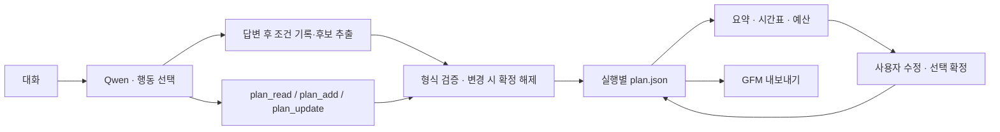

# 여행 계획서

대화 중 구조화한 초안을 저장하고 **여행 계획서** 버튼으로 바로 연다. 열람·보기 전환·Markdown 저장은 모델을 호출하지 않는다. 기본 뷰어 구현: `de4bd63`. 자동 정리·실패 처리: `1d15ad4`.

## 대화 뒤 자동 정리

메인 모델의 저장 도구 호출이 없어도 웹 실행 후 초안을 갱신한다. 명시적인 한국어 예산·인원·기간·이동 표현은 코드가 먼저 원문으로 기록하고, 로컬 모델은 장소·숙소 이름을 추출한다. 최신 정정을 우선하며 후보 이름과 인용이 입력에 실제 있는지 검사한다. 같은 종류·이름은 기존ID로 갱신한다.

추출 실패 시 조건 또는 요청 메모를 보존하고 실패 상태를 표시한다. 요청 메모만 있는 상태는 완성된 일정이 아니다. 숫자·날짜를 추정하거나 사용자 확인 없이 확정하지 않는다. 이 단계는 추가 모델 호출1회이며 최대30초, 메인 실행330초와 합쳐360초 안에서 처리한다. 직접 편집 중 revision이 달라지면 자동 수정을 중단한다.

조건 파서는 흔한 명시적 표현을 지원하는 보조 기능이며 모든 문장 형식을 이해하지 못한다. 상세 시간표·예약가격을 자동 완성한다고 보장하지 않는다.

## 양식과 표시 규칙

| 항목 | 기록 내용 |
|---|---|
| 일정 | 날짜, 시작·종료, 장소, 주소, 메모, 출처 |
| 숙소 | 후보 이름, 날짜, 위치, 적용 인원·기간, 금액, 출처 |
| 교통 | 이동수단, 출발·도착 메모, 날짜·시간, 비용 |
| 비용 | 원화 합계, 적용 기준, 예상/조회/미확인 |
| 메모 | 여행 조건과 확인할 내용 |

미정은 그대로 둔다. 모델이 추가한 항목은 초안이며 사용자가 선택 확정한다. 선택 확정은 예약·결제·사실 검증이 아니다. 확정 항목의 내용이 바뀌면 다시 초안으로 돌아간다.

숙소·교통에도 비용을 기록할 수 있다. 동일 금액을 별도 비용 항목에 다시 더하지 않도록 지침을 제공하지만, 의미상 중복을 자동 판정하지는 않는다. 예산 보기는 입력된 금액만 합산하며 예상·조회 합계와 미확인 항목 수를 분리한다. 전체 여행비를 보장하지 않는다.

## 화면

- **요약:** 일정·숙소·비용·교통·메모 카드.
- **시간표:** 날짜와 시작 시간순. 모르는 날짜·시간은 미정으로 표시.
- **예산:** 예상/조회 금액과 미확인 비용을 구분.
- **선택 확정만:** 사용자가 선택한 항목만 조회·내보내기.
- **직접 추가·수정:** 모델을 부르지 않고 편집.
- **Markdown 저장:** 제목·GFM 표를 사용하는 고정 템플릿. 인쇄 버튼과 인쇄용 CSS도 제공한다. 095에서 실제 브라우저의 예산 보기를 PDF 1쪽으로 생성하고 한글·금액·잘림을 확인했다. OS 인쇄창과 모든 보기 조합은 미검증이다.

## 구조

`RunManager.submit`은 부모 계획을 새 턴에 복사한다. 수정은 현재 턴에 저장하므로 과거 턴·다른 분기를 덮어쓰지 않는다. 대화 삭제 시 계획도 함께 삭제된다. 사용자 편집은 revision 충돌을409로 반환하고 모델 변경도 같은 잠금·검증 경로를 사용한다.

현재 웹 실행에만 계획 도구를 제공한다. CLI 자동 저장, 실제 예약, 지도·이동시간 계산, 일정 충돌 판단, 모델의 빠짐없는 기록은 구현·보장하지 않는다. 기존 대화를 열기만 해서는 변경하지 않는다. 이어서 실행할 때 원문에 있는 누락 조건을 보완하고 최신 정정을 적용한다.

095에서는 후보 이름·인용문이 실제 답변에 존재할 때만 잘못 표시된 출처를 assistant로 교정한다. 자동 후보는 미검증으로 남기고 주소·시간·금액은 제거한다. 잘못된 항목 하나가 다른 유효 후보까지 폐기하지 않도록 항목별로 검증한다. 저장 모델 응답 재생에서 숙소 3개·수목원 1개를 복원했으며 이는 새 추천 품질 평가가 아니다.
