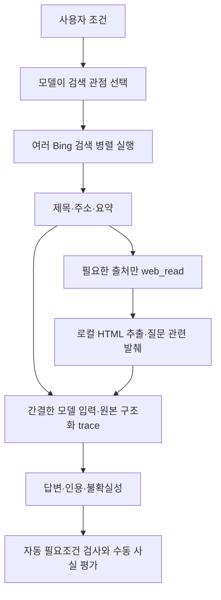

# 여행 검색·본문 읽기·답변 평가

## 기준

평가 입력은 [여행 개발 사례3개](../examples/travel-search-cases.json)다. 정답률을 대표하는 벤치마크가 아니라 검색·읽기·생성 중 어디에서 실패하는지 찾는 작은 실험이다.

| 단계 | 확인할 것 | 통과로 간주하지 않는 것 |
| --- | --- | --- |
| 검색 | 대상과 관련된 후보·공식 안내·교통 등 필요한 관점의 근거 | HTTP200, URL 수·호스트 수 증가만으로 품질 통과 |
| 병렬 | 독립 검색들의 실제 실행 구간 겹침·실패·호출별 출처 | 순차와 다른 시점의 응답을 비교한 속도 우위 주장 |
| 표현 | 같은 근거의 JSON·간결한 JSON·Markdown 실제 입력 토큰 | UTF-8 바이트를 토큰으로 간주, Markdown의 무조건적 절약 |
| 읽기 | 필요한 사실·조건 보존, 발췌와 잘림 표시 | 공식 도메인이라는 이유로 무관한 페이지 선택, 짧다는 이유로 좋은 발췌 |
| 답변 | 제약 준수·금액 근거·인용·불확실성·오류 회복 | 루프 completed 또는 인용 ID 유효성만으로 정답 판정 |

## 현재 동작

모델이 여러 web_search를 한 응답에 요청하면 기본3개 worker로 병렬 실행한다. 검색어 수나 사이트를 고정하는 런타임 대본은 없다. top_k 기본3·최대5는 각 검색의 후보 수이고, 검색 관점의 수와 다르다. 결과 JSON의 바이트 예산 때문에 요청한 후보를 모두 전달하지 못하면 omitted_results가 남는다.

Bing은 기본 curl_cffi의 edge101 HTTP 프로필로 요청한다. 브라우저 프로세스를 실행하지 않는다. WEB_HTTP_TRANSPORT=urllib로 이전 경로를 재현할 수 있다. 같은 긴 질의의 비교에서 결과 관련성이 달랐고 curl로 세 사례를 다시 확인했지만, 다른 질의에서는 curl도 무관한 결과가 나왔다. 이 변경을 Bing 품질 문제의 일반적 해결로 보지 않는다.

검색 프로그램은 Bing HTML을 받지만 LLM은 검색 HTML이나 링크된 원문 전체를 읽지 않는다. web_search는 제목·URL·요약이다. WEB_TOOL_FORMAT=compact_md가 기본이며, 구조화한 상태 정보와 간결한 Markdown 출처 목록을 tool 메시지의 content 문자열로 보낸다. API 요청 전체의 바깥 형식은 JSON이다. full_json·compact_json도 비교용으로 지원한다. 원래 구조화한 도구 결과는 비공개 trace에 남는다.

web_read는 앞선 검색에서 받은 source_id와 확인할 query를 받는다. 같은 요청에 등록된 출처만 허용하며 임의 URL을 모델 인자로 받지 않는다. 공개 DNS 주소를 검증한 뒤 연결 IP를 고정하고 TLS 호스트 검증을 유지한다. 리다이렉트·비HTML·비공개 주소는 거부한다. 전체 다운로드·추출 과정에는 네트워크·CPU 비용이 남고, 실패·TLS 호환성·동적 페이지 한계가 있다.

HTML을 로컬 Trafilatura로 추출하고 질문 단어에 맞는 최대4개 문단 조각을 고른다. 결과 전체 기본3500바이트 한도, page_fetched·truncated·verified_current=false·fetched_at을 표시한다. 전체 문서를 읽었다거나 최신 사실 검증이 끝났다는 뜻이 아니다. 문단 선택은 단순한 문자열 매칭이며 의미 검색·금액 검증·긴 표의 정확한 문맥 보존을 보장하지 않는다. [추출기 API](https://trafilatura.readthedocs.io/en/latest/corefunctions.html)를 참고한다.



## 재현

```powershell
python -m pip install -e .
python scripts/evaluate_travel_search.py --case chuncheon --tokens --agent
# 같은 저장 응답을 사용한 근거량·표현 비교: 새 웹 요청이나 자율적 도구 선택은 없음
python scripts/compare_frozen_travel_answers.py <위 실험의 비공개 JSON>
python -m unittest discover -s tests -q
```

top3와 top5는 동일한 top5 응답의 앞3개/5개를 사용하는 통제 비교다. multi3x3은 첫 응답의3개와 관점이 다른 두 검색의3개씩을 사용한다. 원본 실험은 후보 바이트 잘림을 피하려고 검색 출력 한도를10000바이트로 늘렸다. 에이전트 도구 기본값3500바이트와 구분한다.

토큰 측정은 같은 Qwen 모델·raw 프롬프트·같은 짧은 접두어·생성1토큰으로 수행하며 Ollama prompt_eval_count를 기록한다. 대화 템플릿·전체 도구 스키마·누적 대화 비용과 같지 않다. HTML이 실험 입력 한도120000바이트를 넘으면 HTML 토큰 측정은 생략하고 실제 바이트만 기록한다. 추정 토큰을 실제 값으로 쓰지 않는다.

자율 에이전트 실험의 자동 필요조건은 루프 완료·유효 인용·필요 본문 읽기다. --agent에서 이 검사가 실패하면 실험 스크립트는 종료 코드1을 반환한다. 조건을 모두 만족해도 수동 사실 검토가 필요하다. citation_gate_passed는 인용 ID 검사이며 사실성 보증이 아니다.

## 현재 판정

044에서 Brave 전환 후 실제 에이전트 평가를 재개했다. 기존 공개3질의를 초기·중간·보완본으로 실행하고 인사·기억 회상·검색 장애·웹 비활성화4개를 별도 확인했다. 보완본의 기계적 필요조건은1/3, 수동 여행 근거 검토는0/3 통과다. 인사·기억 회상은 통과했고 장애·비활성화에서는 미확인을 알린 뒤에도 근거 없는 시간을 덧붙였다. [044 질문·실제 답변·판정·로그](research/2026-10-18-044-live-brave-agent-validation.md)를 현재 판정으로 따른다. scripts/evaluate_brave_agent.py는 실제 모델이 검색어·출처·읽기를 선택하게 하며, scripts/evaluate_agent_controls.py의429만 명시적 모의 장애다. 이전 evaluate_travel_search.py의 수집 비교는 Bing을 명시하므로 Brave 검증과 섞지 않는다.

[033 연구일지](research/2026-10-18-033-travel-search-evaluation.md)의 표현·병렬 처리·선택적 읽기 기능 검사는 통과했다. 여행 답변은 근거 없는 금액·제한의 일반화·인용 누락·출력/루프 한도로 불합격이다. 유효한 ID를 붙이고도 관람료를 잘못 생성한 사례가 있어 인용 검사만으로 다음 단계 통과를 선언하지 않는다. 현재 실제 사용자 추천 품질을 검증한 상태가 아니다.
