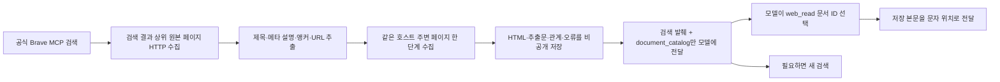

# 검색 결과와 주변 페이지 문서화

공식 Brave MCP의 검색 결과를 받은 뒤, 일부 원본과 연결 페이지를 HTTP로 수집한다. HTML과 추출문은 비공개 실행 폴더에 저장하고 모델에는 문서 목록을 전달한다. 모델이 `web_read`로 문서 ID를 선택하면 저장 본문을 읽는다. 별도 LLM 요약이나 브라우저 실행은 없다.

## 실행 경로



`web_documents.DocumentCollection`은 에이전트와 분리해 실행할 수 있다. `agent.execute_tool`이 성공한 Brave 응답을 래핑하고, `brave_mcp.pack_result`가 검색 발췌와 문서 목록을 함께 포장한다. 원래 MCP의 도구 스키마·검색 응답 원본은 유지한다.

## 범위와 제한

| 항목 | 기본값 |
|---|---|
| 검색 응답당 자동 수집 원본 | 상위3개 |
| 원본당 주변 링크 자동 수집 | 최대3개 |
| 링크 추출 검사 | 페이지당 최대128개, 도달 시 제한 가능성 표시 |
| 탐색 깊이 | 원본에서 한 단계 |
| 대상 | 같은 hostname의 HTTP(S) HTML |
| 실행 전체 문서 ID 수 | 최대16개, 실패도 포함 |
| 원본 HTML·추출문 저장 예산 | 합계32MiB |
| HTTP 병렬 처리 | 최대3개 |
| 페이지 최대 크기 | 기존 fetch_public_page의2MiB |
| 저장 문서 열람 응답 | 최대12000 UTF-8바이트 |

같은 호스트 링크는 검색어와 앵커·경로의 단어/bigram 겹침이 높은 것을 먼저 수집한다. 이는 제한된 수집 예산의 순서 결정이며 의미적 관련성이나 추천 순위가 아니다. 외부 호스트·수집 개수·실행 예산 때문에 수집하지 못한 수를 표시한다. 모든 주변 링크를 모았다고 말하지 않는다.

기존 공개 주소 검사·DNS 연결 고정·80/443포트 제한을 재사용한다. 리다이렉트는 따라가지 않으며 비HTML·차단·빈 추출문을 실패 또는 empty로 보존한다. HTML `<base>`는 사용하지 않고 실제 요청 URL 기준으로 상대 링크를 해석한다. JavaScript가 필요한 내용까지 확보한다고 보장하지 않는다. HTTP 제한 시간은 전체 작업의 엄격한 실시간 상한이 아니며, 남은 예산에서 새 작업을 시작하지 않는 방식이다.

검색 결과의 원본 수집이 실패해도 해당 실패를 목록에 남기고 다른 원본을 계속 처리한다. 수집기 자체가 실패하면 검색 결과는 유지하고 별도 수집 오류를 표시한다. 추가 모델 도구 호출 없이 여러 HTTP 요청이 발생하므로 MCP 호출 수와 HTTP 수집 수를 구분한다.

## 저장과 모델 전달 계약

실행마다 `traces/documents/<request_id>/`를 만든다. URL에서 얻은 안정적 `web:` ID를 사용한다.

- `manifest.json`: URL·부모 ID·앵커·제목·메타 설명·수집 상태·본문 파일 대응.
- `<URL 식별자>.html`: 실제 받은 HTML.
- `<URL 식별자>.md`: 전체 추출문. 내용이 완전히 같은 문서는 텍스트 파일만 공유하고 URL별 관측은 유지한다.

문서 목록의 필드는 `id`, `url`, `title`, `description`, `parents`, `anchors`, `status`, `error`, `page_fetched`, `fetched_at`, `verified_current`, `total_chars` 등이다. 상태는 ready/failed/empty/not_fetched로 구분한다. 제목과 설명은 실제 HTML의 title·meta이며 생성 모델이 작성한 설명이 아니다. 설명이 없으면 빈 값이다. `ready`와 `page_fetched=true`는 수집 상태이고 모델이 본문을 읽었다는 뜻이 아니다. `verified_current`는 계속 false다.

검색 응답은 기존96000바이트 안에서 전체 검색 항목과 완결된 문서 목록 항목을 담는다. 목록 생략은 `document_catalog_omitted`로 표시한다. 저장된 본문을 목록에 넣지 않는다. 모델에 전달된 목록의 ID만 에이전트의 허용 출처에 추가한다.

`web_read`의 query는 기존 도구 호환을 위해 받지만, 사전 수집 문서에서는 질문별 발췌 대신 저장 원문의 첫 구간을 전달한다. `document_token`과 `next_start_index`로 이어 읽으며, 완료는 원문의 문자 위치로 판정한다. 공백을 다시 정리하지 않으므로 문자열 정리 차이를 내용 누락으로 오인하지 않는다. 미수집 검색 출처는 기존 HTTP 본문 읽기를 유지하며 그 경로의077 상태 판정 문제를 이번에 전부 고친 것은 아니다.

저장소는 실행별로 격리된다. 새 실행은 새 관측을 만든다. 같은 실행 내 실패 URL을 자동 재시도하거나 오래된 자료를 최신으로 바꾸지 않는다. 모델은 다른 출처를 검색할 수 있다. 웹 대화 삭제 시 실행 폴더와 함께 제거되며, 개인 본문·HTML·원본 기록은 Git/노션에 자동 게시하지 않는다.

## 독립 실행

```powershell
.\.venv\Scripts\python.exe -m travel_agent.web_documents 'site:collineps.com 수영장 바베큐' --output data/private/my-documents
.\.venv\Scripts\python.exe -m travel_agent.web_documents --output data/private/my-documents --read 'web:목록에서받은ID'
```

독립 명령도 설정된 공식 Brave MCP를 사용한다. `--read`는 기존 저장소만 읽고 네트워크·모델을 호출하지 않는다. 출력 폴더는 프로젝트의 data/private 안으로 제한한다. 에이전트에서는 기본 활성화하며 `WEB_DOCUMENT_COLLECTION=0` 또는 `run_agent(document_collection=False)`로 기존 경로를 비교할 수 있다. 본문 읽기나 웹이 비활성일 때 수집도 하지 않는다.

## 검증 설계와 실제 범위

| 검증 | 판정 기준 |
|---|---|
| 링크 해석 | 상대 URL·fragment 중복·지원하지 않는 스킴·정적 파일·외부 호스트 구분 |
| 수집 깊이·예산 | 자식의 자식을 자동 방문하지 않음, 문서/저장/시간 예산 표시 |
| 문서 정체 | 실제 title/meta와 부모·앵커·URL이 연결됨 |
| 캐시 열람 | 재개방 후 HTTP 없이 같은 본문 열람 |
| 이어 읽기 | UTF-8·공백·따옴표·역슬래시를 포함한 텍스트 정확히 재조립 |
| 실패 | 403·빈 추출·미수집을 ready로 표시하지 않음 |
| MCP→모델 왕복 | 검색 외 주변 ID가 목록에 노출되고, 선택 뒤 본문만 전달됨 |
| 출력 예산 | 긴 목록 항목은 통째로 생략하고 수를 표시 |
| 실제 실행 | 수집 기능 성공과 답변 근거 품질을 별도 판정 |

078은 독립 수집·합성 실제 MCP 왕복·실제 Ollama 기능 질문 순서로 검증했다. 실제 답변에 타 시설 정보 혼합이 남아 추천 품질 향상은 입증하지 못했다. 상세 결과는 연구일지078을 따른다.
